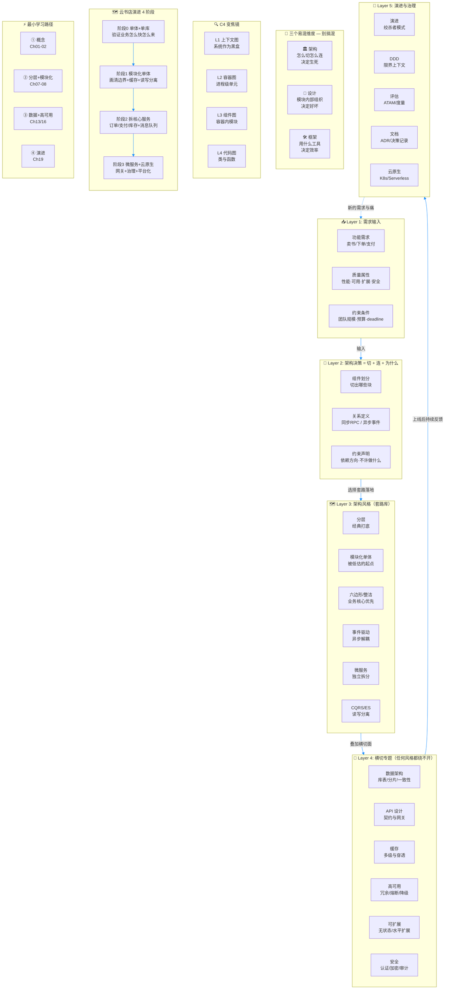

# 软件架构完全教程

> 从写代码到做决策，掌握软件系统的顶层设计思维

---

## 目录

### Part 1: 从零认识软件架构（基础概念篇）

- [第1章：软件架构是什么](./ch01.md)
- [第2章：架构的目标——质量属性与权衡](./ch02.md)
- [第3章：架构视图——用 C4 模型给系统"变焦"](./ch03.md)
- [第4章：架构设计的基本原则](./ch04.md)
- [第5章：架构风格总览——一张地图看懂所有流派](./ch05.md)
- [第6章：架构师的工具箱——ADR、文档与评审](./ch06.md)

### Part 2: 核心架构风格（模式篇）

- [第7章：分层架构——最经典的组织方式](./ch07.md)
- [第8章：模块化单体——被低估的起点](./ch08.md)
- [第9章：六边形架构与整洁架构](./ch09.md)
- [第10章：事件驱动架构——用消息解耦系统](./ch10.md)
- [第11章：微服务架构—— freedom 与代价](./ch11.md)
- [第12章：CQRS 与事件溯源——读写分离的艺术](./ch12.md)

### Part 3: 系统设计实战（横向专题篇）

- [第13章：数据架构设计](./ch13.md)
- [第14章：API 设计——系统之间的契约](./ch14.md)
- [第15章：缓存架构——用空间换时间](./ch15.md)
- [第16章：高可用设计——让系统活着](./ch16.md)
- [第17章：可扩展性设计——为增长留出空间](./ch17.md)
- [第18章：安全架构——构建信任的边界](./ch18.md)

### Part 4: 架构演进与治理（进阶实战篇）

- [第19章：从单体到微服务的演进](./ch19.md)
- [第20章：DDD 领域驱动设计](./ch20.md)
- [第21章：架构评估与度量](./ch21.md)
- [第22章：架构文档与 ADR 实战](./ch22.md)
- [第23章：云原生架构](./ch23.md)
- [第24章：架构师成长之路与速查表](./ch24.md)

---

## 心智模型

### 一、核心模型：架构 = 组件 + 关系 + 决策

剥开各种流派和术语，软件架构的本质可以浓缩成一个公式：

> **架构 = 组件划分（怎么切） + 组件关系（怎么连） + 关键决策（为什么这么切、这么连）**

一个架构决策由三部分组成，缺一不可：

```text
            ┌─────────────────────────────┐
            │          业务需求            │
            │  功能：卖书、下单、支付……      │
            │  质量：快、稳、好改、安全……    │
            └──────────────┬──────────────┘
                           ▼
            ┌─────────────────────────────┐
            │         架构决策层            │
            │  ① 组件划分：切出哪些块       │
            │  ② 关系定义：块之间怎么通信    │
            │  ③ 约束声明：什么不许做        │
            └──────────────┬──────────────┘
                           ▼
            ┌─────────────────────────────┐
            │          代码实现            │
            │  类、函数、模块、服务……        │
            └─────────────────────────────┘
```

- **组件划分**回答"系统由几块组成"：订单是一块，库存是一块，支付是一块。
- **关系定义**回答"块与块怎么打交道"：同步调用、消息事件、共享数据库还是 API？
- **关键决策**回答"为什么"：为什么拆服务而不是拆模块？为什么用消息而不是 RPC？没有"为什么"的架构图只是一张画。

这个模型对应到本教程的学习动作：**看到任何系统，先问三件事——切成了几块？怎么连的？为什么这么切？**

### 二、决策的输入：质量属性

功能需求决定系统"做什么"，质量属性决定系统"做得多好"。架构师 80% 的时间是在跟质量属性打交道：

| 质量属性 | 关心的问题 | 典型手段 |
|----|----|----|
| 性能 | 一个请求多久能返回？ | 缓存、异步、索引 |
| 可用性 | 一年挂多久？ | 冗余、熔断、多活 |
| 可扩展性 | 用户涨 10 倍怎么办？ | 无状态、水平扩展、分片 |
| 可维护性 | 新人多久能改一个功能？ | 模块化、清晰的边界 |
| 安全性 | 数据会不会泄露？ | 认证授权、加密、审计 |
| 可演进性 | 三年后还能改吗？ | 防腐层、契约、渐进式重构 |

关键认知：**质量属性之间互相牵制**。性能和安全有张力（加密有开销），灵活和简单有张力（过度抽象让新人看不懂）。架构设计的本质是**权衡（trade-off）**，不存在"最好的架构"，只存在"最适合当前约束的架构"。

### 三、三个容易混淆的概念：架构 vs 设计 vs 框架

很多人把"用了 Spring Cloud 就是微服务架构"挂在嘴边，这里必须把三个维度拆开：

| 维度 | 回答的问题 | 变更成本 | 例子 |
|----|----|----|----|
| 架构 | 系统怎么**切**、怎么**连** | 极高，后期几乎改不动 | 单体还是微服务、同步还是事件驱动 |
| 设计 | 模块内部怎么**组织** | 中等，可以渐进重构 | 订单模块用策略模式还是 if-else |
| 框架/技术 | 用什么**工具**实现 | 较低，可以替换 | Spring 还是 Go、MySQL 还是 PostgreSQL |

> [!TIP] 技巧
> 选型（用什么数据库、什么框架）是最容易被讨论的，却往往是最不重要的架构决策。先定"切与连"，再谈"用什么"。

记忆锚点：**架构决定生死，设计决定好坏，框架决定效率。**

### 四、C4 模型：给架构"变焦"

架构图画不清晰，通常是因为把不同缩放级别的东西画在了一张图上。C4 模型用四个缩放级别解决这个问题，就像地图的国家图、省图、市图、街道图：

```text
Level 1  系统上下文图 (Context)
         你的系统作为一个黑盒，和外部的人、系统打交道
              │ 放大
              ▼
Level 2  容器图 (Container)
         系统内部的进程级单元：Web 应用、API 服务、数据库、消息队列
              │ 放大
              ▼
Level 3  组件图 (Component)
         单个容器内部的模块划分：控制器、服务、仓储……
              │ 放大
              ▼
Level 4  代码图 (Code)
         类图、时序图——这个级别通常交给 IDE 和文档工具
```

本教程第 3 章会详细展开。先记住：**画架构图之前，先说清楚你在哪个缩放级别。**

### 五、架构风格分类地图

架构风格是前人总结的"切与连"的套路。按**组件之间怎么通信、状态放哪里**两个维度，可以把主流风格放进一张地图：

| 架构风格 | 核心思想 | 适合场景 | 主要代价 |
|----|----|----|----|
| 分层架构 | 按职责纵向切层，单向依赖 | 绝大多数业务系统的起点 | 层层转发，性能与表达力损耗 |
| 模块化单体 | 单进程部署 + 强制模块边界 | 中小团队、业务边界未稳定 | 纪律松了就退化成大泥球 |
| 六边形/整洁架构 | 业务核心在外，依赖指向内部 | 领域逻辑复杂、需要隔离框架 | 样板代码多，简单 CRUD 不划算 |
| 事件驱动 | 组件通过消息异步协作 | 削峰、解耦、最终一致 | 调试难、一致性变复杂 |
| 微服务 | 按业务域拆成独立部署单元 | 大团队、独立伸缩与发布 | 分布式复杂度、运维成本 |
| CQRS/事件溯源 | 读写模型分离，状态由事件推导 | 审计要求高、读写差异大 | 心智负担重，学习曲线陡 |

> [!NOTE] 提醒
> 这些风格不是互斥的单选题。一个真实系统往往是"分层打底 + 模块化单体起步 + 核心域事件驱动 + 个别服务独立拆分"的混合体。

### 六、演进模型：架构是长出来的

没有架构是一步到位的。本教程贯穿一个虚构的示例项目——**云书店**（一个卖书的电商平台），它的架构随业务一起生长：

```text
阶段 0  单体应用 + 单库                    （验证业务，怎么快怎么来）
   │  用户涨到 10 万，代码 50 万行，改一处崩三处
   ▼
阶段 1  模块化单体 + 读写分离 + 缓存        （把边界画清楚，不动部署）
   │  大促流量打不进来，团队涨到 50 人互相踩脚
   ▼
阶段 2  拆出核心服务（订单/支付/库存）+ 消息队列 （先拆最痛的地方）
   │  服务多了，配置、监控、调用链一片混乱
   ▼
阶段 3  微服务化 + 网关 + 服务治理 + 云原生    （平台化，让拆分可持续）
```

每个阶段都是被**真实的痛**推着走的，而不是被技术潮流推着走的。第 19 章会用云书店完整走一遍这条演进路径。

### 七、建议学习路径：用这个模型去学

1. **先建立概念框架**（Part 1）：知道架构在解决什么问题、用什么语言描述。
2. **掌握主流风格**（Part 2）：每种风格都回答"怎么切、怎么连"，理解它们的适用条件和代价。
3. **横向补齐专题**（Part 3）：数据、API、缓存、高可用、扩展性、安全——任何风格都绕不开的横切面。
4. **学会治理与演进**（Part 4）：架构不是画完图就结束，评估、文档、演进、团队才是长期战场。

如果时间有限，最小路径是：**第 1、2 章（概念）→ 第 7、8 章（分层与模块化单体）→ 第 13、16 章（数据与高可用）→ 第 19 章（演进）**，这十章足够支撑绝大多数日常架构讨论。

全教程的心智模型可以概括为：

1. 一个公式：架构 = 组件划分 + 组件关系 + 关键决策
2. 一组输入：质量属性，以及它们之间的权衡
3. 一台变焦镜：C4 四级视图
4. 一张地图：六大主流架构风格
5. 一条路径：单体 → 模块化单体 → 服务化 → 云原生

下面这张交互图把整本教程的结构浓缩在一起，学完后回头看，每个节点都应该能唤起对应章节的内容。


