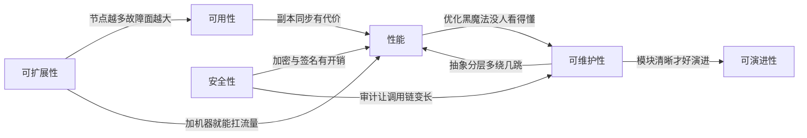

# 第2章：架构的目标——质量属性与权衡

> [!TIP] Part 1: 从零认识软件架构（基础概念篇）
> 在画第一张架构图之前，先把"内功"练好。这六章帮你建立软件架构的完整概念框架：它是什么、目标是什么、怎么描述、按什么原则做决策。本章回答"架构为了什么"——一切架构决策的输入：质量属性。

上一章说，架构 = 怎么切 + 怎么连 + 为什么。那个"为什么"，输入几乎全部来自一个地方：质量属性（Quality Attributes）。功能需求决定系统"做什么"，质量属性决定系统"做得多好"，而约束决定"能在什么条件下做"。

这一章我们逐个认识六大质量属性，学会用"场景描述法"把它们说清楚，并直面一个残酷的事实：质量属性之间天生互相牵制，架构设计的本质是权衡（Trade-off），而不是集齐所有优点。

## 2.1 功能之外：架构师真正的主战场

没人会走进会议室说"我要求 99.95% 的可用性"，但系统停机一小时，所有人都会冲进来问为什么。质量属性几乎从来不出现在需求文档里，它们是隐性的期待，而把它们变成明确目标，就是架构师的核心工作。

先把需求分三类，看看谁在负责什么：

| 类型 | 典型表述 | 例子（云书店） | 谁主导 |
| ---- | -------- | -------------- | ------ |
| 功能需求 | "系统要能……" | 用户能下单、能退款、能写书评 | 全员 |
| 质量属性 | "系统要有多快、多稳、多安全" | 下单 P99 不超过 500 毫秒 | 架构师主导 |
| 约束 | "只能在……条件下" | 预算每年 50 万、团队 20 人、必须用公司指定云 | 现实给定 |

功能需求决定系统有没有资格上线，质量属性决定系统上线后能活多久。一个功能全对但大促必挂的系统，和一个响应慢 3 秒就流失一半用户的系统，问题都出在第二行。

## 2.2 六大质量属性逐个看

先上一张总览表，然后逐个展开：

| 质量属性 | 关心的问题 | 怎么度量 | 典型手段 |
| -------- | ---------- | -------- | -------- |
| 性能 | 一个请求多久能返回？ | P95/P99 响应时间、QPS | 缓存、异步、索引、CDN |
| 可用性 | 一年能挂多久？ | 可用性百分比、MTTR | 冗余、熔断、降级、多机房 |
| 可扩展性 | 用户涨 10 倍怎么办？ | 加倍资源能扛几倍流量 | 无状态、水平扩展、分片 |
| 可维护性 | 新人多久能改一个功能？ | 变更前置时间、修复时长 | 模块化、清晰边界、自动化测试 |
| 安全性 | 数据会不会泄露？ | 漏洞数与修复时长、审计覆盖率 | 认证授权、加密、最小权限 |
| 可演进性 | 三年后还能改吗？ | 需求平均触碰的模块数 | 防腐层、契约测试、渐进重构 |

读表的方法：每个属性都要能回答三个问题——它被破坏时的症状是什么？用什么指标度量？有哪些成熟的应对手段？三个问题答不上来任何一个，就说明你的理解还停留在名词层面。下面逐个展开，每个属性都按"定义、度量、手段、云书店实例"四步走。

### 2.2.1 性能（Performance）

**定义**：系统处理请求的速度和承载能力，通常拆成两个指标看：响应时间（Latency）和吞吐量（Throughput，常用 QPS，Queries Per Second，每秒查询数）。

**度量方式**：别看平均值，看分位数——P95、P99 表示"99% 的请求快于这个值"。平均值最容易骗人：接口平均 80 毫秒，可能藏着 2 秒的 1% 长尾，而长尾恰恰砸在大客户头上。

**常用手段**：缓存、异步化、批量处理、数据库索引、读写分离、CDN。

云书店的例子：成长期大促时商品详情峰值 5,000 QPS，目标是 P99 不超过 200 毫秒。没做缓存之前，数据库 CPU 冲到 90%；上了 Redis 之后，95% 的请求在 0.8 毫秒内命中缓存返回。

### 2.2.2 可用性（Availability）

**定义**：系统在需要时能正常提供服务的比例。可用性用"几个 9"来描述，每个 9 的代价换算成停机时间非常直观：

| 可用性 | 全年允许停机 | 直观感受 |
| ------ | ------------ | -------- |
| 99%（两个 9） | 87.6 小时 | 每月停 7 小时，用户会骂街 |
| 99.9%（三个 9） | 8.8 小时 | 一般业务系统的下限 |
| 99.95% | 4.4 小时 | 核心交易链路的常见目标 |
| 99.99%（四个 9） | 52.6 分钟 | 每多一个 9，成本翻着涨 |

**度量方式**：可用性百分比、平均故障间隔（MTBF）、平均恢复时间（MTTR）。注意恢复速度和不出故障同等重要——把 MTTR 从 60 分钟压到 5 分钟，等价于可用性上一个台阶。

**常用手段**：冗余部署、故障转移（Failover）、熔断降级、健康检查、多可用区部署。

云书店的例子：核心交易链路目标 99.95%，换算下来全年只允许停 4.4 小时。而那次大促瘫痪 47 分钟，一次就花掉了全年可用性预算的 18%——这就是为什么事故之后必须做熔断和降级。

### 2.2.3 可扩展性（Scalability）

**定义**：当负载增长时，通过增加资源就能线性提升承载能力，而不需要重写代码。

**度量方式**：资源翻倍，吞吐量能翻几倍？理想是线性，现实中受限于串行部分（阿姆达尔定律：串行占比决定加速上限）。

**常用手段**：应用无状态化（状态外移到 Redis）、水平扩展（Scale Out，加机器）而不是垂直扩展（Scale Up，换大机器）、数据分库分表、消息队列削峰。

云书店的例子：起步期单体只部署在一台 8 核 16G 的云主机上；模块化单体之后应用无状态化了，大促前从 4 台扩到 20 台，半小时完成——这就是可扩展性换来的从容。

### 2.2.4 可维护性（Maintainability）

**定义**：定位、理解、修改系统的难易程度。这是六者中最"不性感"却最决定长期成本的一个：系统的生命周期成本里，维护占了七成以上。

**度量方式**：变更前置时间（从提出到上线多久）、缺陷平均修复时长、新人独立交付第一个需求的时间。DevOps 业界流行的四大指标中，有三个和它相关。

**常用手段**：模块化与清晰边界、统一编码规范、自动化测试、持续集成、文档与 ADR。

云书店的例子：回归测试从 4 小时降到 40 分钟，改促销不再崩运费——这就是可维护性最直接的样子，它省下的每一天都在给团队发工资。

### 2.2.5 安全性（Security）

**定义**：抵御未授权访问、防数据泄露、保证数据完整的能力。经典的三要素是机密性（Confidentiality）、完整性（Integrity）、可用性（Availability）。

**度量方式**：高危漏洞数量与修复时长、渗透测试结果、审计日志覆盖率。

**常用手段**：认证授权（JWT、OAuth2）、传输与存储加密、最小权限原则、参数校验防注入、审计日志。

云书店的例子：用户手机号全链路脱敏展示，支付数据加密存储，接口全部走 HTTPS。安全是典型的"不出事没人在意，出事就是大事"——一次数据泄露对公司品牌的伤害，可能超过十次宕机。

### 2.2.6 可演进性（Evolvability）

**定义**：需求变化时，系统以可控成本适应变化的能力。前五个属性看的是"现在"，这个属性看的是"三年后"。

**度量方式**：一个典型需求平均要触碰几个模块？接口向后兼容率多高？跨模块调用的方向是否始终单向？

**常用手段**：防腐层（Anti-Corruption Layer，隔离外部变化）、API 版本化、契约测试、事件驱动的松耦合、渐进式重构。

云书店的例子：接入第三家支付渠道时，只改了支付模块里的一个适配器类，其他模块零改动——这就是可演进性好的实感。反过来，如果加一个渠道要动五个模块，说明边界已经烂了。

## 2.3 质量属性场景描述法：把"要快"翻译成能验收的话

"系统要快""要稳定""要安全"——这些话没法评审，没法验收，因为它们不可度量。卡内基梅隆大学 SEI 研究所给了一个经典的工具：质量属性场景（Quality Attribute Scenario），用六个要素把模糊期待变成可验证的一句话：

| 要素 | 含义 | 云书店示例 |
| ---- | ---- | ---------- |
| 来源（Source） | 谁发起了刺激 | 顾客 |
| 刺激（Stimulus） | 发生了什么事 | 0 点抢购点击下单 |
| 环境（Environment） | 刺激发生时的条件 | 大促高峰，流量是平时 10 倍 |
| 工件（Artifact） | 刺激作用在哪里 | 下单接口 |
| 响应（Response） | 系统应该怎么反应 | 校验并受理订单，转入异步处理 |
| 响应度量（Response Measure） | 怎么才算达标 | P99 不超过 500 毫秒，错误率不超过 0.1% |

```text
        ①来源         ②刺激                ③环境
       ┌──────┐    ┌────────────┐     ┌──────────────┐
       │ 顾客 │───▶│ 0点抢购下单 │────▶│ 大促流量10倍  │
       └──────┘    └────────────┘     └──────┬───────┘
                                             │ 作用在
                                             ▼
       ┌──────────────┐   ┌────────────┐  ┌────────────┐
       │ ⑥响应度量     │◀──│ ⑤响应       │◀─│ ④工件       │
       │ P99≤500ms    │   │ 受理并异步  │  │ 下单接口    │
       │ 错误率≤0.1%  │   │ 处理        │  │            │
       └──────────────┘   └────────────┘  └────────────┘
```

同一个刺激在不同环境下，要求可以完全不同：平时下单 P99 500 毫秒就够了，大促 0 点可以放宽到 800 毫秒但错误率必须严控。场景描述法的价值就在这里——**它逼你把"环境"和"度量"说出口**，评审时才有得讨论。

> [!WARNING] 一个铁律
> 没有度量，就没有优化。任何不给出"响应度量"的质量目标，在评审会上都应该被退回重写。

对照着看一个反例和一个正例：

- 反例（不可验收）："系统要快，用户体验要好。"——多快？对谁？在什么负载下？谁来验收？
- 正例（可验收）："大促高峰期（环境），顾客（来源）点击下单（刺激），下单接口（工件）应在 P99 500 毫秒内返回受理结果（响应），错误率不超过 0.1%（度量）。"

评审会上每一条质量目标都应该能通过这个对照检验。通过不了的，要么补上数字，要么承认它只是个愿望。

## 2.4 张力与权衡：六属性的相爱相杀

如果质量属性能全部拉满，架构师就可以失业了。现实是它们互相牵制，先看一张张力地图：



几个最经典的冲突，以及云书店的取舍：

| 冲突对 | 表现 | 云书店的取舍 |
| ------ | ---- | ------------ |
| 性能 vs 安全 | 加密、签名、风控都消耗毫秒 | 全链路 TLS 开销约 2 毫秒，可接受；支付卡号必须加密，此项不妥协 |
| 灵活 vs 简单 | 抽象越多，新人越看不懂 | 促销规则每月改动超过 4 次才引入策略表，之前老实写 if-else |
| 性能 vs 一致性 | 缓存让数据变旧 | 书籍详情缓存 5 分钟（几乎不变）；库存永不缓存，实时查询 |
| 可扩展性 vs 可用性 | 机器越多，故障面越大 | 无状态设计加副本冗余，用季度故障演练对冲风险 |

看一个具体的代码级权衡——商品详情加缓存：

```typescript
// 不加缓存：每次查询打穿到数据库
// 大促详情峰值 5,000 QPS 时，MySQL CPU 冲到 90%，P99 飙到 1.2 秒
async function getBookDetail(bookId: string): Promise<BookDetail> {
  return db.query(
    "SELECT ... FROM book JOIN author WHERE book.id = ?", [bookId]
  );
}

// 加缓存：命中 Redis 只要 0.8 毫秒，但数据最长陈旧 5 分钟
async function getBookDetailCached(bookId: string): Promise<BookDetail> {
  const cached = await redis.get(`book:${bookId}`);
  if (cached) return JSON.parse(cached);
  const detail = await db.query(
    "SELECT ... FROM book JOIN author WHERE book.id = ?", [bookId]
  );
  await redis.set(`book:${bookId}`, JSON.stringify(detail), "EX", 300);
  return detail;
}
```

这段代码用"5 分钟的数据陈旧"换来了三个数量级的性能提升。对书籍简介这种几乎不变的数据，这笔交易稳赚；但同样的套路套在库存数量上就是灾难——用户看到"有货"而下单，扣减时才发现没货。**同一个手段，用在不同属性的数据上，结论完全相反**，这就是为什么权衡必须一个个做，没有万能配置。

最后别忘了：**每一个权衡决定都要留痕**。云书店"书籍详情缓存 5 分钟、库存永不缓存"这个决定，后来被写进了 ADR-004——半年后新人想给库存也加上缓存时，这条记录替团队挡下了一次几乎必然的超卖事故。权衡不记录，就会被人反复重新发明，而且每次都踩同一个坑。

## 2.5 没有银弹

1986 年，Fred Brooks 写下了软件工程史上最著名的文章《没有银弹》（No Silver Bullet）。他的论断至今成立：**没有任何单一技术或方法，能让软件生产率提升一个数量级**。

他把软件复杂度分成两类：

- **本质复杂度（Essential Complexity）**：问题本身固有的，比如电商就是会有库存、订单、退款的纠缠。这部分砍不掉。
- **偶然复杂度（Accidental Complexity）**：工具和实现方式带来的，比如糟糕的模块划分、重复的胶水代码。这部分可以压低。

新框架、新语言、新架构风格，本质上都在消灭偶然复杂度，但没人能消灭本质复杂度。所以面对"上了微服务是不是就不用关心一致性问题了"这类问题，答案永远是否——微服务只是把一致性问题换了形态，从"本地事务"变成"分布式事务"，本质复杂度一分没少。

架构师的日常，就是在没有银弹的世界里做取舍：把偶然复杂度压到最低，让团队的火力集中在真正的本质复杂度上。

落到操作层面，"没有银弹"提醒我们警惕两类话术：一类是"用了 X 就不用管 Y 了"——通常只是把 Y 藏进了更深的抽象层；另一类是"别人家都用 X"——别人家的痛你还没轮到。技术选型永远回到本章的方法：列出它改善哪个质量属性、恶化哪个，数字在哪里。

## 2.6 练习：给云书店定出量化的质量目标

学完这一章，来做一道实操题。假设你是云书店成长期（日订单 5 万、团队 50 人）的架构师，请给系统定一组量化的质量目标。要求：每条目标都有数字、有度量方式、有验证手段，能写成质量属性场景。

下面是参考答案（数字可以讨论，但"有数字、可验证"不可妥协）：

| 质量属性 | 量化目标 | 度量方式 | 验证手段 |
| -------- | -------- | -------- | -------- |
| 性能 | 商品详情 P99 ≤ 200 毫秒；下单 P99 ≤ 500 毫秒 | APM 全链路监控 | 每次大促前压测：详情 5,000 QPS、下单 500 QPS |
| 可用性 | 核心交易链路 99.95%（全年 ≤ 4.4 小时） | 拨测与监控告警 | 每季度一次故障演练 |
| 可扩展性 | 日订单从 5 万涨到 50 万，只加机器不改代码 | 扩容后吞吐提升比 | 每半年扩容演练 |
| 可维护性 | 新人 2 周内独立交付第一个需求；P0 事故 30 分钟内恢复 | 交付与事故统计 | 迭代复盘 |
| 安全性 | 高危漏洞 24 小时内修复；支付数据全程加密 | 安全扫描平台 | 每半年渗透测试 |
| 可演进性 | 单个需求平均触碰不超过 2 个模块 | 模块依赖分析工具 | 月度架构评审 |

做这道题时你会发现：最难的不是定数字，而是说服相关方接受数字背后的代价。P99 从 500 毫秒压到 200 毫秒要加机器、加缓存，钱从哪来？这正是第 6 章"架构师的三种对话"要解决的问题。

> [!NOTE] 建议
> 把这张表打印出来贴在团队 wiki 首页。以后任何架构方案，先用它过一遍：这个方案让哪个指标变好？让哪个指标变差？值不值？

## 本章小结

- 功能需求决定系统"做什么"，质量属性决定系统"做得多好"，架构师 80% 的时间在与后者打交道
- 六大质量属性：性能看响应与吞吐、可用性看几个 9、可扩展性看加机器能扛几倍、可维护性看改起来多快、安全性看攻不攻得破、可演进性看三年后还能不能改
- 别用平均值骗自己，响应时间看 P95/P99；可用性每多一个 9，成本翻着涨
- 质量属性场景六要素：来源、刺激、环境、工件、响应、响应度量——没有度量就没有优化
- 质量属性之间互相牵制，架构设计的本质是权衡：性能与安全、灵活与简单、性能与一致性，都要一个个具体取舍
- 没有银弹：架构能做的是压低偶然复杂度，让团队火力集中在本质复杂度上
- 质量目标必须量化、可验证：有数字、有度量方式、有验证手段

**下一章预告**：目标定好了，怎么把系统的样子讲清楚？下一章介绍 C4 模型——像地图变焦一样，用四个缩放级别把云书店画明白，终结"一张架构图谁都看不懂"的历史。

---
