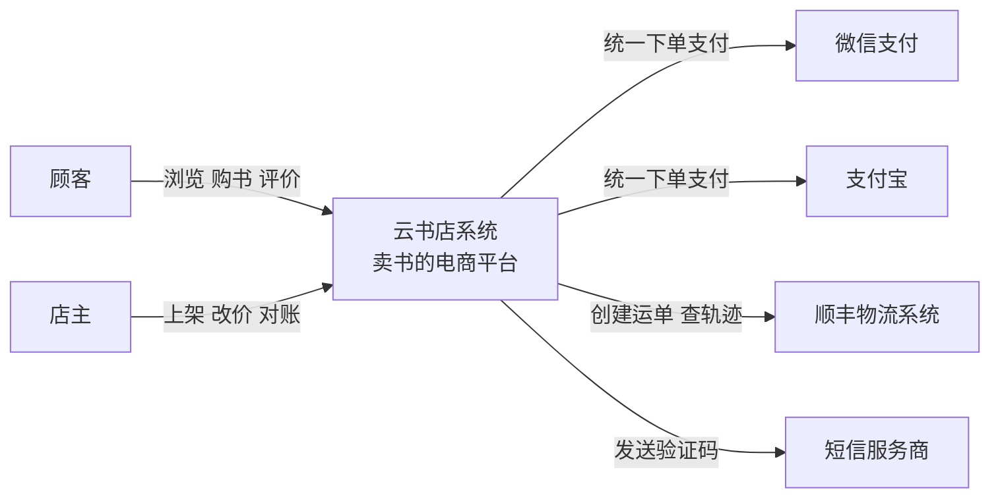
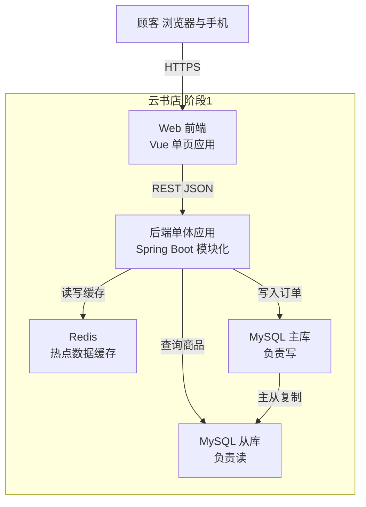

# 第3章：架构视图——用 C4 模型给系统"变焦"

> [!TIP] Part 1: 从零认识软件架构（基础概念篇）
> 在画第一张架构图之前，先把"内功"练好。这六章帮你建立软件架构的完整概念框架。本章解决一个高频痛点：架构图怎么画，才能让人一眼看懂。

先做个小测试：回忆一下你最近见过的架构图。是不是这个画风——最左边一个人形图标，然后是小程序、网关、十几个服务框、两个数据库、一个 Redis、一个消息队列，箭头纵横交错，最后角落里还躺着一个"第三方支付"？

这种图谁画谁知道，谁看谁糊涂。这一章介绍 C4 模型（C4 Model），用"地图变焦"的思路终结这个乱局：一张图只讲一个缩放级别的故事。

## 3.1 为什么你的架构图没人看得懂

架构图画不清楚，九成的原因只有一个：**把不同缩放级别的东西塞进了同一张图**。看一张典型的"灾难现场"：

```text
一张谁也看不懂的架构图：三个缩放级别挤在一起

  顾客 ──▶ 小程序 ──▶ Gateway ──▶ OrderController ──▶ OrderService ──▶ OrderMapper
                                        │                 │
                                        ▼                 ▼
                              RabbitMQ("OrderCreated")    MySQL order 表
                                        │
                                        ▼
                              InventoryService 微服务 ──▶ Redis
```

数一数，这张图里混进了三个世界：

- "顾客"是一个**人**——属于系统上下文级别（跟谁打交道）
- "小程序、Gateway、MySQL、Redis"是**独立运行的单元**——属于容器级别（部署了什么东西）
- "OrderController、OrderService、OrderMapper"是**代码里的类**——属于代码级别（代码怎么写的）

看图的人想问的问题也各不相同：老板想知道"我们系统和哪些外部系统合作"；运维想知道"生产环境跑着哪些东西"；新人想知道"这个类为什么调用那个类"。一张图回答所有问题，结果就是谁的问题都答不好。

下次画图前先问自己两个问题：这张图给谁看？他要解决什么问题？答案会直接告诉你该用哪个缩放级别。

C4 模型的药方极其简单：**一张图，一个缩放级别，只回答一类人的一个问题**。这句话请背下来——它是本章唯一需要背的东西。

## 3.2 C4 模型：四个缩放级别总览

C4 由 Simon Brown 提出，四个 C 分别是 Context（上下文）、Container（容器）、Component（组件）、Code（代码）。它的思路和地图一模一样：国家图、省图、市图、街道图，各有各的用途，谁也不会把全国高速和小区门口的便利店画在一张图上。

```text
Level 1  上下文图     你的系统是一个黑盒，只看它和谁打交道
   │  放大
   ▼
Level 2  容器图       黑盒打开，看内部有哪些独立运行的单元
   │  放大
   ▼
Level 3  组件图       挑一个单元放大，看内部模块怎么分工
   │  放大
   ▼
Level 4  代码图       再放大到类与函数，这个级别交给 IDE
```

四个级别的分工，一张表说清楚：

| 级别 | 名称 | 画什么 | 明确不画什么 | 主要给谁看 |
| ---- | ---- | ------ | ------------ | ---------- |
| L1 | 系统上下文图 | 你的系统作为整体，与用户和外部系统的关系 | 内部任何技术细节 | 所有人：老板、产品、新员工 |
| L2 | 容器图 | 内部独立运行的单元（应用、数据库、缓存）及通信方式 | 类、函数、模块内部结构 | 开发、运维、SRE |
| L3 | 组件图 | 单个容器内部的模块划分与依赖方向 | 具体的类实现 | 开发 |
| L4 | 代码图 | 类图、时序图 | 通常不手画 | 开发（交给 IDE 生成） |

一个经验法则：**级别越高，受众越广**。L1 应该能让老板看懂，L2 是开发与运维的共同语言，L3、L4 是开发者之间的事。如果你发现老板在研究一张时序图，或者新人抱着一本百页类图文档发呆，说明级别用错了。

不需要一上来画满四级。实践中的最小配置是两张图：

- **L1 上下文图一张**：全公司通用，老板看、产品看、新人看，一年更新一次都够
- **L2 容器图一张**：开发运维的主战场，随部署架构演进更新

L3 组件图按需画——只在模块边界有争议、或者某个容器内部复杂到需要专门讨论时才画。L4 基本不手画。云书店两年里积累的常驻架构图就是 L1 一张、L2 三张（三个阶段各一张），其余都是评审时临时画、用完即弃的"白板图"。白板图不算债务，常驻图才是——前者用完即弃，后者必须有版本号和负责人。

## 3.3 L1 系统上下文图：云书店的世界里有什么

L1 回答的问题：**云书店是一个什么系统？它和哪些人、哪些外部系统打交道？**

画什么：你的系统（整体作为一个黑盒）、系统的用户（人）、与之交互的外部系统、关键的交互方式。明确不画：数据库、技术栈、内部模块——一个都不画。

云书店起步期的 L1 长这样：



这张图虽然只有 7 个框，信息量却不小：

- **系统边界画清楚了**：支付和物流是外部系统，不是我们写的代码。微信支付宕机不属于我们的故障，但属于我们的风险——要做降级和切换（呼应第 2 章的质量属性场景）。
- **两种用户角色浮出水面**：顾客和店主的诉求完全不同，后续权限设计从这里出发。
- **新人十分钟上手**：入职第一天看懂这张图，就知道系统的全貌和它在外部世界中的位置。

画 L1 时最常见的三个追问，提前给出答案：

- "顾客算不算外部系统？"——不算。L1 上人是人、系统是系统，分两类形状画。
- "要把所有外部依赖都画上吗？"——画你**主动依赖**的（支付、物流、短信），被动的（比如爬虫）不画。
- "一张图几年有效？"——L1 的有效期最长，除非商业模式变了，否则一年刷新一次足够。

## 3.4 L2 容器图：打开黑盒

L1 说"云书店是一个黑盒"，L2 就是把这个黑盒打开。注意这里的"容器（Container）"不是 Docker 的容器，而是**独立运行的单元**：有自己的进程、可以独立部署、独立故障。

云书店成长期（阶段 1，模块化单体）的 L2 容器图：



对照这张图，把 L2 的画法要点过一遍：

- **每个框都是一个可独立部署的运行单元**：Web 前端、后端应用、Redis、主库、从库，各占一个进程，各有自己的故障域。
- **连线上标注协议与关键事实**：HTTPS、REST JSON、主从复制。运维关心的部署拓扑，一半就在这些线上。
- **主库和从库分开画**：因为读写分离是阶段 1 的关键决策（读多写少，读写比约 20 比 1），图上不体现，决策就会被遗忘。
- **大促时 95% 的详情请求由 Redis 扛下**——缓存单独立框，它的容量规划和故障预案才有处安放。

L2 给谁看：开发和运维。它是容量规划、故障排查、部署方案讨论的主战场。第 19 章讲单体拆微服务时，你会发现微服务化的过程本质上就是"把 L2 图上拆出的每个框，变成一个可以独立发布的单元"。

还有一条给 L2 的提示：**容器图要跟着阶段走，别一张图画到底**。云书店的 L1 图两年没怎么变，L2 图却有三个版本——阶段 0 的"应用加单库"，阶段 1 的"应用加主从加缓存"，阶段 2 的"应用加三个服务加消息队列"。给容器图标上阶段和日期，看图的人才能理解系统是"长成这样的"，而不是"天生这样的"。这份演进感，恰恰是第 19 章拆分决策的重要输入。

## 3.5 L3 组件图与 L4 代码图：再放大两级

L2 里的"后端单体应用"是一个框，但里面有 30 万行代码。L3 就是把这个框放大，看内部的**组件（Component）**——一组职责聚合、可独立替换的模块。云书店阶段 1 的后端应用内部：

```text
L2 容器图放大：后端单体应用内部的组件（阶段 1 模块化单体）

┌──────────────────── 后端应用（Spring Boot 模块化单体）────────────────────┐
│                                                                          │
│   [用户]    [商品]    [购物车]    [评价]                                  │
│       \         \         /         /      ← 这些模块之间不横跳           │
│        ▼         ▼        ▼         ▼                                    │
│    ┌──────────────────────────────┐        ┌────────────┐               │
│    │          订单模块            │ ─────▶ │  库存模块  │               │
│    │  只依赖别人的对外接口        │        └────────────┘               │
│    └──────────────┬───────────────┘                                     │
│                   ▼                                                      │
│             ┌────────────┐                                               │
│             │  支付模块  │ ──▶ 外部：微信支付 / 支付宝                     │
│             └────────────┘                                               │
└──────────────────────────────────────────────────────────────────────────┘
```

L3 图回答两个问题：**依赖规则是什么**（箭头方向就是"准许的依赖方向"，反向即违规）、**改这里会波及谁**（顺着箭头找下游）。第 4 章的"高内聚低耦合"，落地就是这张图上的箭头画法。

组件的边界如何落到代码？答案是"先定接口，后定实现"。库存组件对外只暴露这样的契约：

```typescript
// L3 组件图上的"库存组件"，对外只暴露这个接口
// 订单模块不关心库存今天是 MySQL 表，明天会不会拆成独立服务
export interface InventoryGateway {
  /** 查询可售数量，售罄时 available 为 0 */
  getAvailable(skuId: string): Promise<number>;

  /** 预占库存，15 分钟未支付自动释放 */
  reserve(skuId: string, quantity: number): Promise<ReservationResult>;
}
```

接口定义在调用方一侧（订单模块需要什么，库存组件就提供什么），实现可以随意替换——这个技巧就是第 4 章依赖倒置原则的预告。到了阶段 2 拆微服务时，库存模块改个实现类就能搬出去，订单模块一行不用改。

组件切多大合适？经验尺度是：**一个组件大约对应 1 到 3 人可维护的代码量，对外接口数量不超过一个屏幕**。组件太多太碎，L3 图会碎成一锅粥，接口互相纠缠；太少太粗，等于没切。云书店后端单体切了八个模块，配八份对外接口文档，新人一周能背出依赖方向——这个粒度刚好。

L4 代码图（类图、时序图）怎么办？建议：**类图交给 IDE 自动生成**，手画全量类图是极低性价比的劳动；但**关键流程的时序图值得手绘**，比如"下单扣库存"这条链路跨越了五个组件，一张时序图胜过千言万语。

什么时候必须手绘时序图？三个信号：一次调用横跨三个以上组件；链路上有超时、重试、补偿这类"不看图必懵"的机制；新人反复在同一个环节问同一个问题。云书店"下单扣库存"的时序图贴在工位旁三年，换来的解释时间远超画它的半小时。

## 3.6 与 UML 的关系：不是替代，是分工

经常有人问：有了 C4，还要学 UML 吗？答案是：C4 告诉你**在哪个缩放级别画什么**，UML 提供其中部分级别的**记法**。两者是分工关系：

| 你要表达什么 | 更合适的工具 |
| ------------ | ------------ |
| 系统与外部世界的关系 | C4 L1 上下文图 |
| 部署与运行单元拓扑 | C4 L2 容器图 |
| 模块划分与依赖方向 | C4 L3 组件图 |
| 类的继承与组合关系 | UML 类图（L4，建议 IDE 生成） |
| 一次跨模块调用的先后顺序 | UML 时序图（L4，手绘关键流程） |
| 订单状态的流转 | UML 状态图 |

一句话总结：**C4 管变焦，UML 管细节，谁也别越界**。

这张表还有个隐藏用法：评审时有人坚持"所有设计都要 UML 类图"，你就把这张表推过去——表达"系统怎么切怎么连"，C4 前三级已经覆盖；UML 记法只在 L4 有主场优势，而 L4 恰恰是手画最不划算的地方。

## 3.7 画图工具与约定

工具没有高下之分，按团队习惯选就好：

- **Mermaid**：文本化，能进代码库、能 diff、能跟随代码演进，本教程用它举例
- **draw.io / Excalidraw**：自由拖拽，适合白板式探索和评审现场的即时修改
- **PlantUML / Structurizr DSL**：代码化建模，Structurizr 是 C4 官方工具，一份模型可生成多个级别的视图

比工具更重要的是**画图约定**。团队没有约定，每个人画出来的图就是方言，图例各不相同，看图全靠猜：

| 约定 | 说明 |
| ---- | ---- |
| 图例必配 | 每张图角落放图例，说明形状与颜色的含义 |
| 统一形状语言 | 人用圆角框，内部单元用实线框，外部系统用虚线框 |
| 一图一级别 | 一张图只讲一个缩放级别，想放大就另画一张 |
| 标注关键信息 | 连线上标协议与量级（HTTPS、5,000 QPS），框里标技术栈 |
| 关系编号 | 复杂图给关系编上 1、2、3，正文按编号展开叙述 |
| 带版本与日期 | 图上写版本号和更新时间，过期图比没有图更害人 |

最后送一份"画图自查清单"，画完对着过一遍：

- 图里有没有混进两个缩放级别的东西？（最常见，回到 3.1 的反面教材）
- 每条线都有方向吗？双向箭头往往说明关系没想清楚
- 外部系统和内部单元的形状区分了吗？
- 关键连线上标了协议、量级或者理由吗？
- 一年后的同事看这张图，能提出至少三个有价值的追问吗？——能，说明图里有信息；不能，说明图里只有形状

> [!WARNING] 最常见的坑
> 架构图最大的敌人不是画得丑，而是**过期**。系统都拆完微服务了，wiki 首页还挂着三年前的单体图——新人按图索骥，越找越糊涂。约定每季度架构评审时刷新一遍图，或者干脆用 Mermaid 放在代码库里跟着代码走。

## 本章小结

- 架构图画不清的九成原因：把人、运行单元、代码类三个缩放级别塞进了一张图
- C4 四级：上下文图看系统与外部的关系，容器图看独立运行单元，组件图看容器内模块，代码图看类与函数
- 一张图只回答一类人的一个问题；级别越高，受众越广
- L1 画边界（哪些是外部系统），L2 画部署（协议与量级标在连线上），L3 画依赖规则（箭头即准许方向）
- 组件边界先定接口后定实现，为未来的拆分留好门
- C4 管变焦，UML 管细节：类图交给 IDE，关键时序图值得手绘
- 画图约定比工具重要：统一形状语言、图例必配、一图一级别、警惕过期图

**下一章预告**：知道了目标（质量属性），学会了表达（C4 视图），下一章补上价值判断——架构设计的基本原则。高内聚低耦合、依赖倒置、康威定律，每一条都会用云书店的真实反例和正例来讲。

---
