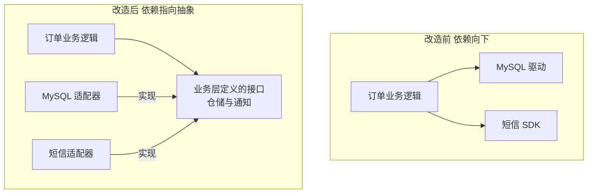

# 第4章：架构设计的基本原则

> [!TIP] Part 1: 从零认识软件架构（基础概念篇）
> 在画第一张架构图之前，先把"内功"练好。这六章帮你建立软件架构的完整概念框架。本章讲八条基本原则——它们是所有架构风格背后的价值判断。

风格会过时，原则不会。这一章的八条原则，从上世纪 70 年代到今天，横跨四十多年依然有效。每一条我们都会看：它到底在说什么、云书店踩过什么坑、正确的做法长什么样。

先立一个总纲：**原则不是教条，而是权衡的坐标系**。当两个原则打架时（它们经常打架），坐标系能帮你快速判断这次该偏向谁。

## 4.1 高内聚低耦合：一切原则的祖宗

高内聚（High Cohesion）低耦合（Low Coupling）听起来像废话，但它是所有其他原则的地基：

- **内聚**：一个模块内部的元素，为同一个目标协同的程度。高内聚 = 订单模块里的所有代码都只服务订单。
- **耦合**：模块之间互相依赖的程度。低耦合 = 改订单模块不需要知道库存模块的任何内部细节。

目标状态只有一个象限：高内聚 + 低耦合。判断耦合的深浅，可以分级看：

| 耦合级别 | 例子（云书店） | 危害评估 |
| -------- | -------------- | -------- |
| 无耦合 | 订单模块不知道评价模块的存在 | 理想状态 |
| 数据耦合 | 订单通过接口传 SKU 和数量给库存 | 可控，边界清晰 |
| 时间耦合 | 下单必须等短信发完才返回 | 排队阻塞，用异步化解除 |
| 共享库耦合 | 订单模块直接 UPDATE 库存表 | 表结构一改，两边同时崩 |
| 内容耦合 | 订单模块知道库存表字段含义并手拼 SQL | 最糟，等于没有模块 |

云书店的真实教训：起步期的购物车模块为了省一次接口调用，直接操作了库存表——这就是共享库耦合。半年后库存模块重构表结构，购物车悄悄写坏了一列数据，排查了两天才发现。改造后的正例：购物车只能调用 `InventoryGateway.reserve()` 接口，库存表成为库存模块的私产。

顺便把内聚也分级，因为内聚同样有高低之分：巧合内聚（模块里是一堆不相干的工具函数）、逻辑内聚（一组只是"长得像"的功能）、功能内聚（所有代码为同一个业务目标服务）。云书店的"Common"包就是典型的巧合内聚——它不是不能有，而是要控制规模，一旦超过 20 个类，就是边界开始腐烂的信号。

## 4.2 关注点分离：一件事只在一处处理

关注点分离（Separation of Concerns, SoC）的思想来自 Dijkstra：把复杂问题拆成互不重叠的关注点，一次只解决一个。落到架构上：**一个业务关切（下单、扣库存、发通知），应该只在一个明确的地方被处理**。

云书店的反例，下单接口什么都管：

```typescript
// 反例：下单函数的"关注点"失控
async function createOrder(cart: Cart) {
  await saveOrder(cart);                       // 下单：该管
  await deductStock(cart);                     // 扣库存：为什么在这？
  await sms.send(user.phone, "下单成功");      // 发短信：为什么在这？
  await coupon.checkAndBind(user.id);          // 绑优惠券：为什么在这？
  await recommend.logBehavior(user.id, cart);  // 埋点：为什么在这？
}
```

这个函数的下一次修改，要集齐库存、短信、营销、增长四个模块的开发者一起评审。正例：下单只做下单，其他事通过事件交给该管的人：

```typescript
// 正例：下单模块只关心下单，发布事件后各回各家
async function createOrder(cart: Cart) {
  const order = await saveOrder(cart);
  await eventBus.publish(new OrderCreatedEvent(order));
  // 库存模块订阅事件扣减库存
  // 通知模块订阅事件发送短信
  // 营销模块订阅事件绑定优惠券
}
```

SoC 的好处立竿见影：加一个"下单后送积分"的需求，只需新增一个订阅者，下单模块一行代码不改。代价也要清楚：事件引入了异步和最终一致（第 10 章细讲），所以核心链路里"必须立刻知道结果"的步骤（如支付）不适合事件化。

判断 SoC 是否做好的土办法：念一遍函数的实现。如果 createOrder 里能读出"扣库存""发短信"这些动词，职责就漏了；如果它只读出"创建订单并把后续交给事件"，边界就是干净的。

## 4.3 单一职责与开闭原则：换上架构的眼镜

这两个原则在类设计（SOLID）里讲过，但**在架构层面它们的含义完全不同**，值得重新讲一遍。

**单一职责（Single Responsibility）在架构层**：一个模块应该只因一个业务理由而变化。云书店的 OrderService 有五个变更理由（促销规则、运费模板、库存流程、短信文案、报表口径），所以它注定每周被改、每次被改都心惊胆战。模块化改造后，促销归营销模块，运费归物流模块，OrderService 只剩一个变更理由：订单本身。

**开闭原则（Open-Closed Principle）在架构层**：对扩展开放，对修改关闭——加一个新东西，应该是"增加"，而不是"修改"云书店里已有的东西。反例：每接入一个支付渠道，就要在 `switch` 里加一个 case，同时改计费、对账、退款五处。正例：支付渠道用策略注册表，新渠道只是多注册一个实现：

```typescript
// 支付渠道注册表：加新渠道只增不改
const channels = new Map<string, PaymentChannel>();

function registerChannel(name: string, impl: PaymentChannel) {
  channels.set(name, impl);   // 接入"云闪付"？写一个 CloudPayChannel 再注册即可
}

// 下单时的支付调用对所有渠道一视同仁
async function pay(order: Order, name: string) {
  const channel = channels.get(name);
  return channel.charge(order);
}
```

判断标准很简单：接入新支付渠道那天，如果团队只需要写一个新类加一行注册代码，开闭原则就落地了；如果要在老代码里翻找五处修改点，边界就没画对。

## 4.4 依赖倒置：架构中最重要的原则

如果把八条原则只留一条给架构师，留它。**依赖倒置原则（Dependency Inversion Principle, DIP）**：高层业务逻辑不应该依赖低层技术细节，两者都应该依赖抽象（接口），并且抽象属于高层。

倒过来念一遍更有感觉：默认情况下依赖是"向下"的——业务代码 import 数据库驱动、import 短信 SDK，技术细节改一次，业务代码跟着改一次。DIP 做的事是把依赖方向**倒过来**：



落到代码上，就是第 3 章那个 `InventoryGateway` 接口的完整版故事：

```typescript
// 接口定义在业务层（高层），而不是技术层（低层）
interface OrderRepository {
  save(order: Order): Promise<void>;
  findById(orderId: string): Promise<Order | null>;
}

// 适配器实现接口：换存储只改适配器，业务逻辑零改动
class MySqlOrderRepository implements OrderRepository { /* ... */ }
class MongoOrderRepository implements OrderRepository { /* ... */ }

// 业务服务只认识接口，不认识 MySQL
class PlaceOrderService {
  constructor(private readonly orders: OrderRepository) {}
  async place(order: Order) {
    await this.orders.save(order);   // 它不知道也不关心存到了哪
  }
}
```

为什么说它是架构中最重要的原则？因为它决定了**业务是否被技术绑架**：

- 云书店阶段 1 用 MySQL，阶段 2 把库存搬成独立服务——只要业务只依赖接口，搬家就是换适配器。
- 换短信服务商、换消息队列、换缓存实现，全部是适配器级别的工作。
- 单元测试时塞一个内存版 Repository，业务逻辑可以脱离数据库测试。

整个六边形架构与整洁架构（第 9 章）本质上就是 DIP 的完整展开。用一张同心圆图记住依赖方向：

```text
依赖方向：从外向内，内层永远不知道外层的存在

   ┌─────────────────────────────────────────────┐
   │  最外层：框架与工具                            │
   │  Spring Boot · MySQL · RocketMQ · 短信 SDK    │
   │   ┌─────────────────────────────────────┐    │
   │   │  适配层：实现业务定义的接口            │    │
   │   │  MySqlOrderRepo · SmsNotifier        │    │
   │   │   ┌─────────────────────────────┐    │    │
   │   │   │  业务核心：订单、库存、促销   │    │    │
   │   │   │  只依赖自己定义的接口         │    │    │
   │   │   └─────────────────────────────┘    │    │
   │   └─────────────────────────────────────┘    │
   └─────────────────────────────────────────────┘

   箭头永远指向内层：外层实现内层的接口，而不是反过来
```

> [!NOTE] 一个自查动作
> 打开业务模块的 import 列表，如果看到 `mysql2`、`rocketmq-client` 这类技术包，依赖倒置就被击穿了。业务代码里出现具体技术的名字，是架构腐化最早的信号。

三个常见误区，顺手排掉：

- **"DIP 就是为每个类建接口"**——接口泛滥比没有接口更糟。只为"会变的技术细节"和"跨模块依赖"建接口，模块内部的私有协作直接调用就好。
- **"接口放在公共包里谁都能依赖"**——抽象属于使用方（高层），不属于实现方。放错位置，依赖方向表面上倒了，实际上还是实现方在定义契约。
- **"业务核心里用点框架注解没关系吧"**——业务类上爬满框架注解的那一刻，它就不再能脱离框架测试了。业务核心保持纯净，是同心圆图的全部意义。

## 4.5 KISS 与 YAGNI：少做也是做

KISS（Keep It Simple, Stupid）：能简单就别复杂。YAGNI（You Aren't Gonna Need It）：你不会需要它——没有出现的场景，不为它写代码。

这两条是克制之学，专治"架构师的炫技冲动"。云书店起步期的假想敌就是曾经流传的一个方案：3 人团队，上来就拆 8 个微服务、分 16 张库表、上 Kubernetes——三个月后，一半人力在维护基础设施，业务功能反而难产。什么时候才该升级？用一张判断表代替拍脑袋：

| 诱惑 | 先问自己 | 云书店的答案 |
| ---- | -------- | ------------ |
| 分库分表 | 单表超过 5,000 万行了吗？ | 没有，索引建好单表几千万行没问题 |
| 上 Kubernetes | 有专职运维了吗？ | 没有，3 台云主机加部署脚本先顶住 |
| 多币种抽象 | 未来一年确定出海吗？ | 没确定，不抽象（YAGNI） |
| 引入规则引擎 | 促销规则每月改超过 4 次吗？ | 没有，if-else 加策略表足够 |

注意 KISS/YAGNI 和第 2 章的可演进性并不矛盾：简单不等于短视。正确的姿势是**把"最可能变化的轴"想清楚，但不为想象中的变化写代码**——为变化留门（接口、边界），不为变化铺路（预实现的分支逻辑）。

还要防一种反向滥用：**有人拿 YAGNI 当挡箭牌，拒绝一切前瞻性设计**。区分的办法看成本结构——"为变化留门"（定接口、画边界）是低成本高杠杆的，永远该做；"为变化写实现"（预写的分支逻辑、预建的抽象类）是高成本低确定性的，默认不做。云书店起步期没有为多币种写一行逻辑代码，但订单表从一开始就有 currency 字段——前者是 YAGNI 的克制，后者是留门的远见，两件事不冲突。

## 4.6 康威定律：组织结构决定系统结构

康威定律（Conway's Law）由 Melvin Conway 于 1968 年提出：**任何组织设计的系统，其结构必然复制该组织的沟通结构**。四个开发小组写的编译器，一定有四个步骤的流水线；一个前端组加一个后端组加一个 DBA 组，一定长出前后端分离加"谁都不敢动的数据库"。

云书店的阶段 2 就撞上了它：50 人按技术分工（前端组、后端组、DBA 组），结果每个需求要跨三个团队排期，订单需求的沟通成本是代码成本的五倍。解法不是消灭沟通，而是**逆康威演习（Inverse Conway Maneuver）**：先设计目标架构，再按这个架构去组建团队，让组织结构主动匹配系统结构。

| 组织形态 | 长出来的系统形态 |
| -------- | ---------------- |
| 前端组 + 后端组 + DBA 组 | 前后端分离，数据库成为"圣域" |
| 按技术层分团队 | 系统按技术分层，一个需求跨三个团队 |
| 按业务域分的全功能团队 | 微服务按业务域切分，一个需求一个团队闭环 |

云书店的解法：把 50 人重组为 6 个全功能小队（用户、商品交易、库存履约、支付资金、内容评价、平台支撑），每个小队对自己的业务域端到端负责。半年后，系统里"订单、支付、库存"的服务边界，和团队边界严丝合缝——这不是巧合，这是康威定律在帮你。

值得记住的是小队的切法：六个小队对应六个业务域，每队 7 到 9 人，包含前端、后端、测试，共享一个产品经理。小队可以独立发布自己域的服务，发布频率从全公司每周一次，变成每队每天都可以发。这个数字很有代表性——**当你发现一个团队无法在两周内独立交付自己域的需求时，要么团队切错了，要么系统边界切错了**。

> [!WARNING] 别把定律当宿命
> 康威定律描述的是惯性，不是宿命。它的正确用法有二：一是诊断——系统结构混乱时先看组织沟通结构；二是武器——用逆康威演习主动重塑组织，让定律为你打工。

顺带一提，远程办公会放大康威定律：沟通带宽下降之后，系统边界会进一步向团队边界坍缩，跨团队调用的接口设计要格外谨慎。

## 4.7 最小知识原则：只和直接朋友说话

最小知识原则（Least Knowledge Principle），也叫迪米特法则（Law of Demeter, LoD）：一个对象应该对其他对象保持最少的了解，只和"直接朋友"通信。

类级别的经典反例是链式掏内脏：`order.getCustomer().getAddress().getCity()`——订单知道顾客、顾客知道地址、地址知道城市，四层全串起来了。架构级别的对应版本更致命：**跨模块掏别人的内脏**，比如订单模块直接读用户模块的数据库表，或者引用用户模块的内部类来拼数据。

架构级的正例：模块只暴露"门面"，其他模块只能问门面要答案。订单需要"收货城市"，就问订单自己的收货信息聚合，或调用户模块的门面接口 `getDeliveryCity(orderId)`——用户模块内部怎么存、怎么改，门面之后的世界对订单不可见。这一条和 4.1 的低耦合是同一件事的两种说法：**耦合度深浅，就看你知道了别人多少内脏**。

## 4.8 原则速查表

八条原则收进一张表，评审架构方案时对着过一遍：

| 原则 | 一句话 | 云书店的落地 |
| ---- | ------ | ------------ |
| 高内聚低耦合 | 相关的放一起，依赖走接口 | 模块化单体的模块划分 |
| 关注点分离 | 一件事只在一处处理 | 下单后发事件，通知归通知模块 |
| 单一职责 | 模块只因一个业务理由变化 | 促销、运费从订单类里拆出去 |
| 开闭原则 | 加新东西不改老代码 | 支付渠道用策略注册表 |
| 依赖倒置 | 业务与细节都依赖抽象，抽象归业务 | 仓储接口定义在业务层 |
| KISS / YAGNI | 能简单先简单，没需要不预研 | 起步期不上分库分表 |
| 康威定律 | 组织结构决定系统结构 | 按业务域组建全功能小队 |
| 最小知识原则 | 只和直接朋友说话 | 模块只暴露门面，不掏内脏 |

最后再强调一次总纲：这些原则是坐标系，不是法律。KISS 和 DIP 会打架（接口层数太多就不 KISS 了），高内聚和康威定律会打架（理想边界可能切割现有团队）。架构师的功力，体现在每次冲突时知道**这一次**该偏向谁、愿意付出什么代价。

## 本章小结

- 高内聚低耦合是一切原则的地基：内聚看模块是否为同一目标协同，耦合看改一处要懂多少别处
- 关注点分离：一个业务关切只在一处处理，事件订阅是解耦的常用手法
- 单一职责在架构层的含义：一个模块只因一个业务理由而变化；开闭原则：加新东西靠"增加"，不靠"修改"
- 依赖倒置是架构中最重要的原则：接口定义在业务层，技术细节实现它——业务从此不被框架和中间件绑架
- KISS 与 YAGNI 专治炫技冲动：为变化留门，不为想象中的变化铺路
- 康威定律：组织结构决定系统结构；逆康威演习让定律为你打工而不是和你作对
- 最小知识原则：只和直接朋友说话，不跨模块掏内脏
- 原则是权衡的坐标系而非教条，冲突时知道这次偏向谁，才是架构功力

**下一章预告**：原则有了，但具体怎么"切与连"？下一章给出一张架构风格总地图——从分层、模块化单体到微服务、事件驱动，六大流派一张表看懂，外加一棵帮你选型的决策树。

---
