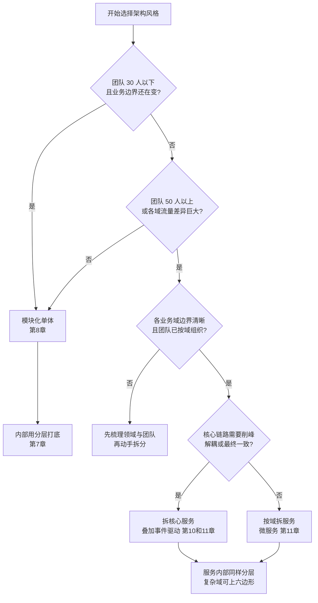

# 第5章：架构风格总览——一张地图看懂所有流派

> [!TIP] Part 1: 从零认识软件架构（基础概念篇）
> 在画第一张架构图之前，先把"内功"练好。这六章帮你建立软件架构的完整概念框架。本章把六大主流架构风格放进一张地图，让你面对任何系统都能快速定位它的"流派"。

分层、模块化单体、六边形、事件驱动、微服务、CQRS——这些名词你一定都听说过，但它们之间是什么关系？互相排斥吗？选哪个才对？这一章不深入任何一种风格（Part 2 每种会用一章细讲），而是先给你一张**总地图**：六大流派各自的核心思想、适用场景和代价，以及一棵帮你在它们之间选型的决策树。

## 5.1 什么是架构风格：切与连的套路

第 1 章说过，架构 = 组件划分（怎么切）+ 组件关系（怎么连）+ 决策（为什么）。而架构风格（Architectural Style），就是前人反复验证过的"切与连"的固定套路。

这个概念的学术定义来自 Mary Shaw 和 David Garlan：一种架构风格规定了一组组件类型、一组连接器类型，以及它们之间的组合约束。翻译成人话：**风格回答"系统大概切成几类块、块之间用什么方式连、有什么红线不能碰"**。

风格的价值有三层：

- **踩坑经验的开箱即用**：一种风格能流传下来，说明它的坑前人都替你踩过并总结了对策。
- **沟通词汇**：说"我们是事件驱动"，懂行的人立刻知道大概的切法、连法和代价，省下半小时解释。
- **选择坐标系**：知道有哪些选项，才谈得上权衡——只见过微服务的人，看什么都是微服务问题。

用两种风格的"套路描述"感受一下什么叫切与连的固定玩法：

- 分层架构的套路是：**按技术职责纵切**（表现层、业务层、数据访问层），**层间只能单向向下调用**，红线是"下层不许知道上层"。
- 事件驱动架构的套路是：**按业务事件横切**（下单事件、支付事件、发货事件），**组件间只通过消息中介通信**，红线是"不许点对点直接调用"。

同一个云书店，套上不同风格，切法、连法、红线全都不一样——这就是风格的含义：它是一整套打包好的约定，选风格等于选一整套规则和一揽子代价。所以第 11 章讲微服务时会先讲成本，第 12 章讲 CQRS 时会先讲"什么时候千万别用"——先看见账单，再做选择。

## 5.2 分类的两个维度：怎么通信，状态放哪里

六大风格看着眼花，其实可以用两个问题全部装进一张 2 乘 2 的地图：

**维度一：组件之间怎么通信？** 同步（RPC、HTTP 调用，我等你的回话）还是异步（消息、事件，发完我就走）？

**维度二：状态放在哪里？** 共享（多个组件读写同一份数据库）还是私有（每个组件只碰自己的数据）？

先说维度一：**同步还是异步，本质是"我要不要等结果"**。同步调用简单直接，出错当场知道，但调用方被响应时间捆绑，故障会沿着调用链向上传播；异步消息解除了捆绑，吞吐和韧性都更好，代价是要与"最终一致"和"消息会重复"这些现实共处。没有绝对优劣，只有场景匹配——核心交易要即时反馈，偏同步；通知、积分、推荐，偏异步。

一个换算帮助记忆：同步的极端是"打电话"，异步的极端是"发广播"，真实系统的每条链路都在两端之间按需取用——只是取用前，要知道自己选的是什么。

先用伪代码感受一下维度一的差别——同一个"下单"场景，同步和异步是两种世界：

```text
// 同步串行：用户要等所有步骤做完才能看到"下单成功"
createOrder() {
  saveOrder();        // 80 毫秒
  deductStock();      // 120 毫秒
  createPayment();    // 200 毫秒
  notifyLogistics();  // 150 毫秒
  return "下单成功";   // 用户等了 550 毫秒，任何一步挂了整单失败
}

// 异步事件：核心动作做完立刻返回，其余步骤异步跟上
createOrder() {
  saveOrder();                              // 80 毫秒
  eventBus.publish("OrderCreated", order);  // 2 毫秒
  return "下单成功";                         // 用户等 82 毫秒
}
// 库存、物流、通知各自订阅 OrderCreated 事件独立处理
// 代价：库存扣减从"实时强一致"变成"毫秒级最终一致"
```

两个世界没有优劣：同步版 550 毫秒里每一步都能拿到确定结果，异步版 82 毫秒却要接受"结果稍后才知道"。第 10 章会展开异步的完整账单，这里只需记住：**通信方式的选择，直接决定了一致性模型和用户体验的形态**。

把六大风格放进两个维度，地图就出来了：

|  | 状态共享 | 状态私有 |
| ---- | ---- | ---- |
| **同步通信** | 分层架构、模块化单体（共享库表） | 六边形架构、微服务（API 互相调用） |
| **异步通信** | 早期企业服务总线（ESB） | 事件驱动、CQRS / 事件溯源（事件 + 私有库） |

```text
                组件之间怎么通信
         同步 RPC/HTTP         异步 消息/事件
        ┌──────────────────────┬──────────────────────┐
  状    │  分层架构             │  事件驱动架构          │
  态    │  模块化单体           │  （共享数据场景）       │
  共    ├──────────────────────┼──────────────────────┤
  享    │  六边形架构           │  事件驱动 + 私有库     │
  /     │  微服务              │  CQRS / 事件溯源       │
  私    │                      │                       │
  有    └──────────────────────┴──────────────────────┘
```

看懂这张图，很多争论自动消解：微服务和事件驱动不是对立的，它们一个偏"状态私有"，一个偏"通信异步"，完全可以在同一个系统里组合——事实上第 19 章你会看到，云书店拆出的订单服务正是"私有库 + 对内事件驱动 + 对外 API"的混合体。

再补一句维度二的重要性：**状态放哪里，决定了系统一半的复杂度**。

状态共享意味着组件之间有隐式通信渠道（数据库表就是它们的后门），任何一次表结构调整都会横跨组件边界——云书店起步期"购物车直改库存表"的事故，本质就是共享状态缺乏所有权。状态私有意味着每个组件封有自己的数据，只能通过接口或事件交换信息——代价是"跨组件查询变贵了"，一致性从数据库事务降级为补偿与对账。

这也是为什么第 11 章讲微服务时，"每个服务私有数据库"被列为铁律：状态所有权是边界是否真实的试金石。画 L2 容器图时，如果两个框之间只有数据库而没有接口相连，你多半看到的是两个假服务。

读这张地图的方法：先定位你现在的系统落在哪个格子，再问两个问题——这个格子是"选出来的"还是"长歪了掉进去的"？如果业务要求你移动到另一个格子，代价清单想清楚了没有？风格迁移的成本，就是这两个问题之间的距离。

最后给两个维度各留一个例外说明：存在"同步但状态共享"的杂交（多个服务共读一个报表库），也存在"异步但强一致"的特例（基于共识算法的复制状态机）。地图是导航工具，不是物理定律，遇到例外先问"为什么"，再决定要不要学。

## 5.3 六大主流风格速览

一张总表先建立全局，然后每种风格三句话点到为止。读表的方法先说一个：别急着背表格，真正有价值的是"适合场景"和"主要代价"两列——前者告诉你什么时候值得用它，后者告诉你用它的账单长什么样。任何只讲收益不讲代价的架构布道，都值得警惕。

| 架构风格 | 核心思想 | 适合场景 | 主要代价 | 详见 |
| -------- | -------- | -------- | -------- | ---- |
| 分层架构 | 按职责纵向切层，单向依赖 | 几乎所有业务系统的起点 | 层层转发，性能与表达力损耗 | 第 7 章 |
| 模块化单体 | 单进程部署 + 强制模块边界 | 中小团队、业务边界未稳定 | 纪律松了就退化成大泥球 | 第 8 章 |
| 六边形/整洁架构 | 业务核心在外，依赖指向内部 | 领域逻辑复杂、要隔离框架 | 样板代码多，简单 CRUD 不划算 | 第 9 章 |
| 事件驱动 | 组件通过消息异步协作 | 削峰、解耦、最终一致 | 调试难、一致性变复杂 | 第 10 章 |
| 微服务 | 按业务域拆成独立部署单元 | 大团队、独立伸缩与发布 | 分布式复杂度、运维成本 | 第 11 章 |
| CQRS/事件溯源 | 读写分离，状态由事件推导 | 审计要求高、读写差异大 | 心智负担重，学习曲线陡 | 第 12 章 |

先把六大风格的味道各记一句话，细节留给 Part 2：

```text
六大风格速记（先记味道，Part 2 再记细节）：

  分层架构      把"请求的一生"竖切成几段，逐层向下、逐层向上
  模块化单体    一个进程跑全部业务，但模块间"只走大门、不翻墙"
  六边形架构    业务核心住城堡，数据库和框架都是城外的护城河
  事件驱动      组件之间不打电话，只在广播频道里喊事件
  微服务        按业务域划地盘，每个地盘自己部署、自己伸缩
  CQRS/事件溯源 写和读各修一条路，系统状态是一部可回放的事件史
```

**分层架构（Layered Architecture）**：把系统切成表现层、业务层、数据层，请求逐层向下，返回逐层向上。它的伟大在于简单和普适——几乎所有业务系统的默认起点；它的局限在于"为了改一行代码穿越三层"的表达力损耗。

**模块化单体（Modular Monolith）**：部署上是一个进程，代码上是边界森严的模块。它和"大泥球单体"的区别只有一条：模块边界是否被强制执行。云书店阶段 1 的选择，也是本书最推荐大部分团队的起点。

**六边形/整洁架构（Hexagonal / Clean Architecture）**：业务逻辑放正中间，数据库和框架都在边上，依赖一律指向业务核心。它是第 4 章依赖倒置原则的完整落地，适合领域逻辑复杂的系统。

**事件驱动架构（Event-Driven Architecture, EDA）**：组件不直接调用，而是发布和订阅事件。天生适合削峰填谷（大促下单）和解耦（下游加个积分模块不用动上游），代价是调试像追一个看不见的幽灵。

**微服务（Microservices）**：按业务域把系统拆成一堆独立部署、独立扩展、数据私有的小服务。它的收益一半来自技术（独立伸缩），一半来自组织（小团队闭环），它的成本也由这两部分双倍奉还。顺带一提：微服务的"微"不是行数少，而是边界小到"一个团队养得起"——按行数拆服务是新手最常见的误读。

**CQRS/事件溯源（CQRS / Event Sourcing）**：命令与查询职责分离（CQRS），系统的状态不是存"当前值"而是存"发生过的事件流"（事件溯源）。读写模型可以各自优化到极致，审计天然完整，但心智负担也是六者之最。

把这六种风格放到云书店的时间线上，你还能看出风格的**时机属性**：分层从第 1 天就在用；模块化单体在第 30 个月成为主角；事件驱动在第 3 年随消息队列进场；三个核心服务在第 3 年末独立拆分；六边形思想只被用在订单和促销这两个领域逻辑复杂的模块；CQRS 至今没被采用——审计需求用每日对账就满足了。风格没有过时不过时，只有合不合时宜。

> [!NOTE] 重要认知
> 这六种风格不是互斥的单选题。真实系统往往是"分层打底 + 模块化单体起步 + 核心链路事件驱动 + 个别服务独立拆分"的混合体。第 19 章的云书店就是这个混合配方。

```text
云书店成熟期（阶段 3）的真实形态——一张混合风格的配方图：

                    ┌──────────────┐
  顾客 ────────▶    │   API 网关    │
                    └──────┬───────┘
             ┌─────────────┼─────────────────┐
             ▼             ▼                 ▼
       ┌──────────┐  ┌──────────┐   ┌──────────┐
       │ 单体残留  │  │ 订单服务 │   │ 支付服务 │
       │ 用户商品  │  │ 私有库   │   │ 私有库   │
       │ 评价物流  │  └────┬─────┘   └────┬─────┘
       └──────────┘       │ OrderPaid 事件│
             ▲            ▼               │
             │      ┌──────────┐          │
             └──────│ 消息队列 │◀─────────┘
                    └────┬─────┘
                         │ 异步消费
                         ▼
                 库存 / 积分 / 通知 / 推荐

 配方：分层打底（每个服务内部） + 单体残留（边界未稳的域）
     + 三个独立服务（最痛的核心域） + 事件驱动（削峰与解耦）
```

## 5.4 风格选择决策树

选型不靠气质，靠问对问题。下面这棵决策树覆盖了 80% 的常见局面：



用这棵树走一遍云书店：起步期 3 人、边界未稳，落点"模块化单体"；成长期 50 人按域重组、大促需要削峰，落点"拆核心服务 + 事件驱动"。两次选择都没有碰"CQRS"——因为云书店没有强审计需求和极端读写差异，不为用而用。

注意决策树的用法：它是**思考的起点，不是合同**。走完树的输出常常是混合方案（主干一个风格，局部另一个风格），这完全正常。两个使用提示：第一，回答每个问题前，先用第 2 章的质量属性目标校准——你的量化目标本身就暗示了答案（要 99.99% 可用性，大概率走向服务化与冗余）；第二，树的每个出口都标了对应章节，Part 2 会逐个展开，现在记不住细节没关系，记住出口编号即可。读树的方法：从根出发，每个菱形是一道判断题，题目里全是硬指标——人数、流量差异、边界清晰度，都是可观察的事实，不是感觉。如果走完树还是拿不定主意，选更简单的那个出口——回归 KISS：复杂度永远可以事后增加，很难事后删除。

顺手排掉争论中常见的三种错误姿势：

- 拿头部大厂的架构论证自己 20 人团队的选型——规模差三个数量级，结论不可迁移
- 拿"我们未来会成为独角兽"论证现在的微服务——为想象中的流量提前买单
- 拿"某公司微服务失败"的个案否定一切拆分——个案的反面不是教条，是具体条件

## 5.5 "单体 vs 微服务"之争：一个被问错的问题

技术社区吵了十年"单体好还是微服务好"，这个问题本身问错了——就像问"皮卡好还是自行车好"却不说拉什么货、走什么路。先把两者的账摊开：

| 维度 | 模块化单体 | 微服务 |
| ---- | ---------- | ------ |
| 开发体验 | 一个仓库，全局重构容易 | 多仓库，跨服务改动要协调两个团队 |
| 部署 | 一个包，10 分钟发布完 | 几十个服务，需要 CI/CD 平台支撑 |
| 扩展 | 只能整体扩展 | 热点服务独立扩容，省机器 |
| 故障隔离 | 一个内存泄漏拖垮全部 | 单服务故障可隔离（但有级联风险） |
| 数据一致性 | 本地事务，简单可靠 | 分布式事务，Saga 与最终一致 |
| 调试 | 一个进程打日志 | 分布式追踪，排障成本翻几倍 |
| 组织成本 | 小团队高效 | 需要平台团队支撑几十个服务 |
| 适用规模 | 团队 30 人以下 | 团队 50 人以上、流量差异大 |

冷静看这张表，可以得出三条理性结论：

**第一，问题不是"单不单体"，而是"什么时候、拆哪一块"。** 云书店的答案：起步期单体（日订单 1 千，拆什么拆），成长期模块化单体（日订单 5 万，边界画清但不动部署），爆发期只拆订单、支付、库存三个核心服务（日订单 50 万时），其余八个域至今仍留在单体里活得好好的。

**第二，微服务的收益一半来自团队规模。** 30 人以下的团队用微服务，独立发布、独立伸缩的好处基本兑现不了，而分布式复杂度一分不少地全款支付。判断标准不是技术潮流，是人数和流量差异。

**第三，拆分是重构，不是重写。** 从模块化单体拆出订单服务，是把已经边界清晰的模块"搬出去"；从大泥球直接拆微服务，等于把一坨乱麻剪成八坨乱麻，还要在乱麻之间加网络调用。

这张表还可以再压缩成一句话：**单体把复杂度留在代码里，微服务把复杂度搬到基础设施里**。你并没有消灭复杂度，只是选择把它放在团队最擅长处理的位置。补充一组可感知的数字：云书店拆服务后，运维侧多出来的东西包括注册中心、链路追踪、消息队列，以及每个服务独立的流水线与告警——平台上投入了 4 个专职工程师。这笔账在 150 人规模时是划算的，在 20 人规模时是自杀的。**拆分的决策本质上是一笔投资回报计算，不是技术信仰表态。**

> [!WARNING] 微服务不是免费午餐
> 微服务把代码复杂度换成了运维复杂度：服务发现、链路追踪、分布式事务、容器编排，每一样都是全职工作。没有平台能力就上微服务，相当于没有驾照先上高速——不是不能活，是活得很贵。

收尾给出两张清单，代替空泛的态度表态。

什么时候必须考虑拆？

- 不同业务的流量差异悬殊：大促时只有订单和库存被打爆，其他功能毫无压力
- 团队规模让一个仓库的合并成为瓶颈：50 人排队发布，每周合并冲突超过 10 起
- 故障域必须隔离：一次推荐算法的内存泄漏拖垮了支付，业务上无法接受
- 某个域的合规要求独立：支付数据需要单独的审计与隔离环境

什么时候千万别拆？

- 团队不到 30 人，分布式运维的人手挤不出来
- 业务边界还在每周变动：拆一次边界变一次，等于反复施工
- 系统还没有模块化：大泥球拆微服务是灾难复利
- 你只是因为在技术大会上听了三场微服务分享

## 本章小结

- 架构风格是前人验证过的"切与连"的套路：组件类型 + 连接方式 + 组合约束
- 分类看两个维度：组件怎么通信（同步/异步），状态放哪里（共享/私有），六大风格都能放进这张 2 乘 2 地图
- 六大风格一句话：分层打底、模块化单体起步、六边形护核心、事件驱动解耦、微服务分而治之、CQRS 玩转读写
- 风格不是单选题，真实系统是混合体：分层打底 + 模块化单体 + 核心链路事件驱动 + 个别服务拆分
- 选型用决策树问对问题，输出混合方案是常态；先看团队人数和业务边界，再看技术潮流
- "单体 vs 微服务"是问错的问题，对的问题是"什么时候、拆哪一块"
- 拆分是一笔投资回报计算：收益兑现要靠团队规模，成本要靠平台能力兜底
- 拆分是重构不是重写：从边界清晰的单体搬模块，而不是把乱麻剪成八坨乱麻

**下一章预告**：Part 1 最后一章讲"怎么把以上一切落地"——架构师的工具箱：一页纸的 ADR 怎么写、文档多薄才有人读、架构评审怎么开不变成批斗会，以及走线骨架怎么替你提前排雷。

---
