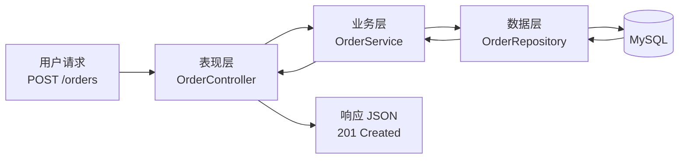

# 第7章：分层架构——最经典的组织方式

> [!TIP] Part 2: 核心架构风格（模式篇）
> 从这一章起，我们进入 Part 2。接下来六章将逐一拆解六种最主流的架构风格，每一种都在回答同样三个问题：系统怎么切、组件怎么连、要付出什么代价。学完你将拥有一张完整的"风格地图"，知道什么场景该掏出哪把刀。

我们先从最古老、最没有争议的一种讲起——分层架构（Layered Architecture）。你写的第一个 Web 项目大概率就是它：Controller 接请求，Service 处理业务，DAO 访问数据库。它经典到很多开发者以为"架构就是分层"，也老派到常被新兴风格调侃成"老古董"。

但事实是：**今天互联网上绝大多数业务系统，骨架依然是分层架构**。学架构不从分层开始，就像学做菜不先学切菜——后面刀法再花哨，都建立在这套基本功上。这一章我们把分层讲透：它为什么有效、规则是什么、最常见的两种死法是什么，以及它到底适合谁。

## 7.1 什么是分层——从餐厅后厨说起

想象一家生意不错的餐厅，里面有三种角色：

- **服务员**负责接待客人、记录菜品、上菜、结账，但他不会炒菜；
- **厨师**负责把订单变成菜品，掌握火候与配料，但他不知道白菜是哪个批发市场送的；
- **采购员**负责进货、管仓库，他不关心今天客人点了什么。

三种角色分工清晰、单向协作：客人的需求从服务员流向厨师，再流向采购员；食材与菜品反向流回。谁也不越权，谁也不需要全知——这就是分层。

正式定义：**分层架构把系统按职责切成若干个水平层次，每层只做一类事情，请求自上而下穿过各层，结果自下而上返回**。

这个思想比互联网还老：1968 年 Dijkstra 在 THE 操作系统里就用层次结构组织系统；90 年代 J2EE 把"三层"带进全世界的企业项目；今天 Spring Boot、Django、Rails 的默认项目结构，全是它的变体。一个能活五十多年的模式，值得你花一章认真对待。

## 7.2 经典三层：表现、业务、数据

绝大多数 Web 系统用的是"经典三层"（Classic 3-Tier）。先看每层的职责，以云书店为例：

| 层 | 英文名 | 职责 | 云书店里的典型产物 |
| ---- | ---- | ---- | ---- |
| 表现层 | Presentation Layer | 接收请求、参数校验、组装响应，**不写业务规则** | OrderController、各种 DTO/VO |
| 业务层 | Business Logic Layer | 业务规则、流程编排、事务边界 | OrderService、PaymentService |
| 数据层 | Data Access Layer | 读写数据库，封装 SQL 与 ORM 细节 | OrderRepository、OrderDO |

画成图就是：

```text
┌─────────────────────────────────────────────┐
│  表现层  Presentation                        │
│  Controller：接请求、校验参数、返回 JSON       │
└──────────────────────┬──────────────────────┘
                       ▼  只能调用相邻的下一层
┌─────────────────────────────────────────────┐
│  业务层  Business Logic                      │
│  Service：业务规则、流程编排、事务边界          │
└──────────────────────┬──────────────────────┘
                       ▼
┌─────────────────────────────────────────────┐
│  数据层  Data Access                         │
│  Repository / DAO：读写数据库、SQL 细节        │
└──────────────────────┬──────────────────────┘
                       ▼
                 ┌──────────┐
                 │  MySQL   │  ← 存储本身，一般不算应用层
                 └──────────┘
```

三个容易误解的点，值得单独说清楚：

1. **"层"是逻辑概念，不是部署概念**。三层可以跑在一个进程里（绝大多数情况如此），也可以拆成三台机器（那是另一个话题）。别把"分层"和"分布式三层（C/S/B 三端）"混为一谈。
2. **每层的回答对象不同**。表现层回答"HTTP 怎么进出"，业务层回答"生意规则是什么"，数据层回答"数据放在哪、怎么取"。看一个类该放哪层，就问它回答的是哪个问题。
3. **层不是文件夹**。建三个叫 controller/service/dao 的文件夹不等于分层，层是依赖关系与职责的约束，文件夹只是它的一种体现。

## 7.3 依赖规则：只许向下，不许向上

分层的全部价值，浓缩成一句话就是：**依赖必须单向，只能上层调用下层，绝不允许反向**。展开成四条具体规则：

1. **每层只认识直接相邻的下一层**（必要时同层协作），不允许跳层、不允许反向。
2. **下层不知道上层的存在**。OrderService 里不能出现 HttpServletRequest，数据层不能 import 表现层的任何类。
3. **跨层传递数据用中立的 DTO**，而不是把某层的对象直接塞给另一层，否则层与层会被对象结构焊死。
4. **变更影响自上而下收敛**：改一个页面样式只动表现层；换数据库理论上只动数据层——这是分层的承诺。

为什么必须单向？打个比方：**上层像楼，下层像地基**。楼怎么装修都不影响地基，但地基一沉，所有楼跟着晃。越往下层，代码越稳定、越通用；越往上，变化越频繁。让"常变的"依赖"稳定的"，系统才稳得住。如果反过来——业务规则里掺满了 HTTP 细节和 SQL 字符串——那么换一个前端、换一个数据库，都得把业务逻辑重写一遍。

规则之外，还要认清**各层之间流转的数据对象**。这是新人最容易糊涂、也是泄露检查的第一现场：

| 对象 | 全称 | 活在哪一层 | 特点 |
| ---- | ---- | ---- | ---- |
| DO | Data Object | 数据层 | 与表结构一一对应，含全部字段，绝不向上外传 |
| DTO | Data Transfer Object | 层与层之间 | 中立的数据载体，防止层与层被对象结构焊死 |
| VO | View Object | 表现层 | 面向前端裁剪：只给该看的字段，隐藏手机号等敏感信息 |

记住一条铁律：**OrderDO 绝不该出现在 Controller 的返回值里**。一旦 DO 混进表现层，数据库的每一次加字段、改列名，都会直接打穿到前端接口契约——层的隔离就白做了。

用一张 mermaid 图看一次请求的完整旅程：



## 7.4 MVC、MVVM——它们和三层是什么关系

很多团队把"MVC 架构"挂在嘴边，这里必须把概念理清，否则后面对话永远对不上频道。关键认知：**MVC 和 MVVM 是表现层内部的组织模式，而三层是整个系统的划分，它们不在同一个层面上**。

| 名词 | 全称 | 解决什么问题 | 作用范围 | 典型代表 |
| ---- | ---- | ---- | ---- | ---- |
| 三层架构 | 3-Tier / Layered | 整个系统按职责怎么切 | 系统级 | Spring Boot 典型项目 |
| MVC | Model-View-Controller | 界面与数据如何解耦交互 | 表现层内部 | Spring MVC、早期 Ruby on Rails |
| MVVM | Model-View-ViewModel | 视图与状态如何双向绑定 | 表现层内部（多见于前端） | Vue、WPF |

几个对应关系帮你建立坐标：

- Spring 项目里，`Controller + View（JSON 序列化）+ Model（DTO）` 合起来构成了 MVC，而这套东西在三层架构里只占**表现层**那一格。
- 前端 Vue 应用是标准的 MVVM：ViewModel 响应式地连接视图与数据。但它本身就是一个系统的表现层——它背后还要调用后端的三层。
- 所以"我们项目是 MVC 架构"这句话，严格说只描述了表现层的实现方式，不能回答"订单和库存怎么划边界"这种真正的架构问题。

> [!NOTE] 术语提醒
> 后端面试常说"MVC 三层架构"，其实是把两个层面的概念捏在一起说：系统整体是三层，表现层内部用了 MVC。听懂这句话，你就比大多数候选人概念清晰。

## 7.5 反模式一：层间泄露

分层最常见的死法不是"没用分层"，而是**层间泄露（Leaky Abstraction）**：下层的实现细节穿透到上层，上层代码开始"认识"下层的内部。三种典型症状：

1. **Controller 里出现 SQL**。表现层直接拼查询语句，甚至直接拿数据库连接。
2. **数据库结构直接暴露给前端**。把 DO（Data Object，与表一一对应的对象）原样序列化返回，前端和表结构焊死，表一改前端跟着崩。
3. **HTTP 对象一路下传**。把 HttpServletRequest 塞进 Service 参数，业务层从此离了 Web 容器跑不起来。

看一个坏例子（TypeScript 伪代码）：

```typescript
// 反面教材：名为分层，实为"SQL 传递带"
app.post("/orders", async (req, res) => {
  // 症状 1：表现层直接写 SQL
  const rows = await db.query(
    `SELECT o.*, u.phone FROM orders o JOIN users u ON o.user_id = u.id
     WHERE o.user_id = ${req.body.userId}`   // 顺带一个 SQL 注入漏洞
  );
  // 症状 2：数据库原始行直接扔给前端
  res.json(rows);
  // 症状 3（此处未展示）：Service 签名里出现 HttpServletRequest
});
```

这段代码短期看"少写了一个 Service 类，真高效"，长期看每一层都失效了：换数据库要改前端？不，是要改**所有 Controller**；想给接口加缓存？对不起，业务逻辑根本不在一个能找到的地方；想写单元测试？先起一个 MySQL。

层间泄露的本质是**抽象失败**：层与层之间的接口没有把下层细节挡住，等于楼板到处是洞，楼上楼下互相看得一清二楚，最后谁也离不开谁。

怎么系统性地发现泄露？每季度对代码库做一次"三问自检"：

1. **业务层的 import 列表里，有没有协议和存储的名字？** 出现 `HttpServletRequest`、`mysql2`、ORM 注解，即为泄露。
2. **前端拿到的 JSON 字段名，和数据库列名是不是一模一样？** 一模一样说明 DO 混进了表现层，前端已被表结构绑架。
3. **换掉 ORM（比如 MyBatis 换 JPA）要改几个文件？** 正确答案是"业务层与表现层零个"；超过零个，细节已经穿透上来了。

> [!WARNING] 危险信号
> 当你的 Controller 超过两百行、出现 SQL 字符串、或者 try-catch 的是数据库异常——分层的"形"还在，"神"已经没了。趁早把这些逻辑压回它该在的层。

## 7.6 反模式二：跨层调用

第二种死法是**跨层调用**：上层跳过中间层，直接调用更下层。最常见的是 Controller 绕过 Service 直连 Repository。

为什么危险？因为**业务规则会失去住所**。看云书店的真实教训：起步期有个"新用户首单立减 10 元"的规则，图省事写在了 Controller 里。三个月后产品上线了 App 端和小程序端，这条规则被复制了三份；再后来运营改成"立减 15 元，特价书除外"，改动点了五处，漏了两处，直接资损。规则写在业务层，一处定义、处处生效；规则散落在调用方，每多一个入口就多一颗雷。

第二条危害是**事务与一致性失去控制点**。Service 层是天然的事务边界（Transaction Boundary），Controller 直接操作数据层，事务边界就碎落在各个入口里，"下单扣库存"这种需要原子性的操作再也没法包进同一个事务。

跨层调用有多隐蔽地漏掉规则？看一段最常见的"顺手代码"：

```typescript
// 反面教材：Controller 直连 Repository，看似省事，实为漏账
app.post("/orders", async (req) => {
  const order = Order.create(req.userId, req.items);
  await orderRepository.save(order);   // 限购校验呢？价格快照呢？事务呢？
  return ok({ id: order.id });
});
```

这五行的"轻量实现"，把上一节 7.7 走读里业务层的四项职责全部弄丢——而且丢得悄无声息，code review 时没人会觉得它有问题。跨层调用的代价从来不是"多写几行代码"，而是"少写了必要的东西"。

要不要一刀切禁止？务实的答案写在规范里，而不是写在情绪里：

- **强一致的业务操作**（下单、退款、扣库存）：必须走 Service，没有商量余地。
- **极简单的只读查询**（如"列出商品分类"）：部分团队允许 Controller 直连 Repository 换取开发效率——可以，但必须白纸黑字写进规范（用第 6 章讲的 ADR 记录下来），并且严格限定"只读、无规则、无缓存逻辑"。默认允许、事实泛滥，是最糟的状态。

## 7.7 实战走读：云书店的下单流程

空谈不如走一遍代码。云书店起步期日订单一千单，峰值并发每秒不过几个请求，标准三层完全够用。下面是"提交订单"接口的逐层走读（TypeScript 伪代码）：

```typescript
// ── 表现层：只做协议相关的事 ──────────────────────
class OrderController {
  async placeOrder(req: Request): Promise<Response> {
    const cmd = validatePlaceOrder(req);        // 参数校验：书 ID、数量、收货地址
    const order = await orderService.placeOrder(cmd);  // 转发，不含任何规则
    return ok(toOrderVO(order));                // 组装视图对象返回
  }
}

// ── 业务层：业务规则与事务边界 ────────────────────
class OrderService {
  async placeOrder(cmd: PlaceOrderCmd): Promise<Order> {
    return await db.transaction(async () => {   // 事务边界在这里
      const user = await userService.getUser(cmd.userId);
      checkPurchaseLimit(user, cmd);            // 规则：每人每种书限购 5 本
      const items = await productService.snapshot(cmd.items); // 价格快照
      const order = Order.create(user.id, items, cmd.addressId);
      await orderRepository.save(order);
      await inventoryApi.deduct(cmd.items);     // 调库存模块的接口扣减
      return order;
    });
  }
}

// ── 数据层：只关心怎么存取 ────────────────────────
class OrderRepository {
  async save(order: Order): Promise<void>  { /* INSERT INTO orders ... */ }
  async findById(id: OrderId): Promise<Order | null> { /* SELECT ... */ }
}
```

逐层点评几个关键设计：

- **参数校验在表现层，业务校验在业务层**。"数量必须是正整数"是协议问题，放 Controller；"限购 5 本"是生意问题，放 Service。混在一起，换协议时业务规则会被连锅端走。
- **事务边界画在 Service**。订单落库和扣库存要么都成功、要么都回滚，这个原子性要求是业务语义，所以由业务层来声明事务。
- **价格用快照（Snapshot）而不是引用**。订单里存的是下单那一刻的价格，商品后来改价不影响历史订单——这就是为什么下单要"复制"商品信息而不是只存商品 ID。这个习惯在第 11 章讲跨服务查询时还会再见。
- **数据层薄而稳定**。Repository 只有存取，没有"如果 VIP 用户就……"这种逻辑，因此换 ORM、换数据库时它的影响面最小。

## 7.8 优缺点与适用场景

最后给分层画一张客观的资产负债表：

| 优点 | 代价 |
| ---- | ---- |
| 职责清晰，新人半天就能找到改代码的位置 | 一次功能改动要纵向穿过多层，简单需求也可能动五六个文件 |
| 关注点分离，各层可独立测试（Service 不依赖 Web 也能测） | 容易退化成"SQL 传递带"，业务逻辑被层层转发稀释 |
| 下层技术可替换（换 ORM、换序列化方式影响面可控） | 每层多一次转发调用，单请求多消耗 0.1~1ms（对绝大多数系统可忽略） |
| 生态最成熟：所有主流框架默认按它组织，招人零成本 | 对复杂领域表达力不足，规则多了 Service 会膨胀成千行大类 |

什么时候用、什么时候别指望它：

- **默认起点**。业务系统第一版就该是它——云书店起步期日订单一千单，三层架构轻松支撑，团队三个人的心智负担也最小。
- **领域逻辑复杂的模块**，分层的 Service 会越来越胖，这时再演进到第 9 章的六边形架构，让业务规则拥有独立的家园。
- **性能极端敏感的底层组件**（每微秒都要计较的基础设施），层层转发的开销与间接性反而是负担，它们通常直接面向数据结构设计。
- **只有一个"层"的需求**（脚本、工具类程序），别硬套三层，两段式（处理 + 输出）就够。

记住一句话：**分层是业务系统的"及格线"——它不保证优秀，但保证不出大事。先把层画对、依赖守住，再谈更花的架构。**

## 本章小结

- 分层架构按职责纵向切层，经典三层是表现层、业务层、数据层，请求自上而下单向流动
- 核心规则只有一条：依赖必须单向向下，下层不得感知上层，跨层数据用中立的 DTO 传递
- MVC/MVVM 是表现层内部的组织模式，与系统级的三层不在同一个概念层面
- 反模式一"层间泄露"：SQL 进 Controller、DO 直接返给前端，抽象失效后各层互相焊死
- 反模式二"跨层调用"：绕过 Service 会让业务规则失去住所、事务边界碎落一地
- 事务边界应画在业务层；订单存价格快照而不是商品引用，是贯穿全书的好习惯
- 分层是绝大多数业务系统的默认起点，简单、成熟、够用；复杂领域请继续读第 9 章

**下一章预告**：分层回答了"纵向怎么切"，但没回答"横向怎么切"——用户、订单、库存这些模块挤在同一个进程里，如何相处而不搅成一锅粥？第 8 章讲被严重低估的架构风格：模块化单体。

---
