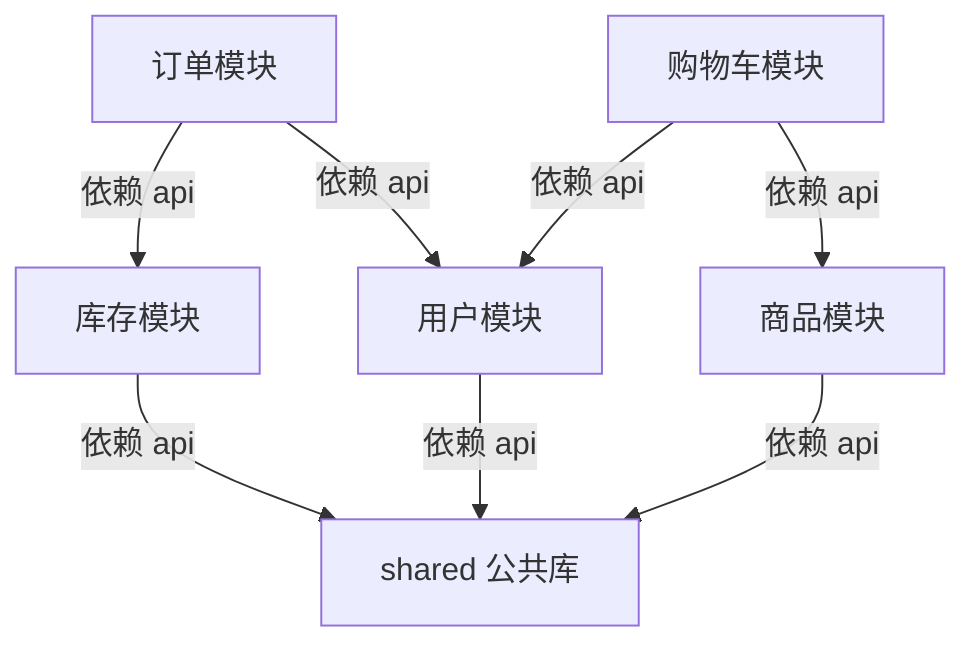

# 第8章：模块化单体——被低估的起点

> [!TIP] Part 2: 核心架构风格（模式篇）
> 从这一章起，我们进入 Part 2。接下来六章将逐一拆解六种最主流的架构风格，每一种都在回答同样三个问题：系统怎么切、组件怎么连、要付出什么代价。学完你将拥有一张完整的"风格地图"，知道什么场景该掏出哪把刀。

上一章的分层解决了"纵向怎么切"，这一章解决"横向怎么切"。先说一个反直觉的结论：**对绝大多数团队来说，正确答案不是微服务，而是模块化单体（Modular Monolith）**——一个进程部署、内部却有清晰边界的单体。

微服务的光环太亮，以至于很多人跳过了这个中间站。但看看业内复盘：亚马逊 2001 年也是单体，淘宝 2008 年之前也是单体，GitHub 到今天核心仍是模块化单体。单体不是落后，**没有边界的单体才是落后**。这一章讲的就是：怎么在不动部署的前提下，把边界的价值全部拿到手。

## 8.1 为什么多数项目该从它开始

先用数字算一笔账，看看过早微服务的真实代价：

- **调用开销**：单进程内的方法调用耗时不到 0.1ms，一次跨服务 RPC（Remote Procedure Call）要 1~5ms，还要算上序列化、网络重试。云书店起步期日订单一千单，这些开销纯属白花。
- **事务开销**：单体里一个本地事务搞定"订单落库 + 扣库存"；微服务里同样的事要引入分布式事务或最终一致，复杂度直接翻一个数量级。
- **协作开销**：3 个工程师维护 8 个服务，意味着每个人都要懂部署、监控、链路追踪，写业务的实际时间可能不到一半。
- **重构开销**：单体里挪一个类是一分钟的重构；跨服务挪代码是一次跨团队谈判。

再看组织层面。康威定律（Conway's Law）说：系统结构会长成团队沟通结构的形状。团队只有十几个人、每天坐在一间办公室里，硬拆出七八个服务，等于人为制造沟通墙——**微服务解决的是大组织的协作问题，小团队用它是在没有病的地方吃药**。

所以这条路径应该倒过来记：**先在单体内把模块边界练好，等组织长大了，边界自然能变成服务**。这正是 ch00 里云书店的路线：阶段 0 的单体撑到用户 10 万、日订单上千，痛了才进入阶段 1 的模块化单体。

## 8.2 什么是模块化单体

模块化单体 = **单进程部署 + 强制模块边界**。它和两位邻居的关系如下：

| 维度 | 大泥球单体 | 模块化单体 | 微服务 |
| ---- | ---- | ---- | ---- |
| 边界 | 没有，代码互相缠绕 | 有，模块间只走公开接口 | 有，且部署隔离 |
| 部署 | 一个包 | 仍是一个包 | 每服务一个包 |
| 事务 | 一个大事务，容易失控 | 本地事务，边界清晰 | 分布式事务/最终一致 |
| 模块间调用 | 方法乱调 | 接口 + 进程内事件 | RPC + 消息队列 |
| 换掉一个模块 | 不可能 | 可整体重写替换 | 可独立替换与伸缩 |
| 团队门槛 | 最低 | 中 | 最高 |

看清中间那一列：除了"部署"一格，模块化单体几乎拿到了微服务的全部架构收益，却几乎不付分布式的成本。这就是它被低估的原因——它把"逻辑边界"和"物理边界"解耦了，先收逻辑边界的红利，把物理拆分留到真正需要的那天。

还有一个常被忽略的好处：**调试与排障的心智模型依然是单机的**。一次请求的全部日志在同一个进程里，一个断点能走完"下单 → 扣库存 → 记流水"全程，堆栈一目了然。这些在微服务里要靠链路追踪、日志聚合才能勉强还原的东西，在模块化单体里是免费的。

## 8.3 模块化的判定标准：两个"独立"

怎么判断你的单体是不是"模块化"的？别看目录树，看两个硬标准：

**标准一：能否独立理解（Independent Comprehension）**。新人接手"物流模块"的需求，是否只需读物流模块内部的代码和接口定义，而不必通读全库？如果改一个物流规则要翻订单、库存、用户三个模块的实现细节才能确定影响面，那这堆代码是编了目录的大泥球。

**标准二：能否独立替换（Independent Replaceability）**。问你一个残酷的问题：能不能把"评价模块"整个删掉，一周内重写一个功能等价的新模块，其他代码一行不改地接上？能，说明它有真边界；不能——比如删掉它之后订单模块编译不过了——说明边界是画在 PPT 上的。

这两个标准可以进一步落成可度量的检查项：

| 检查项 | 达标表现 | 不达标表现 |
| ---- | ---- | ---- |
| 依赖方向 | 模块间只依赖对方的公开接口 | 直接 import 对方 internal 类 |
| 数据所有权 | 每模块只读写自己的表 | 订单模块的 SQL 里 JOIN 着商品表 |
| 测试独立性 | 模块测试不依赖其他模块的实现 | 测库存要先起订单的上下文 |
| 认知负担 | 新人两周内能独立交付模块内需求 | 每个需求都要问遍全组 |

> [!NOTE] 自测一句
> 判定模块边界的终极问题是：**这个模块的业务语言是否自成一体**？"库存"有自己的一套词汇（预占、扣减、回补），"评价"也是，但"工具类"不是——后者注定只能是公共库，不配当模块。

## 8.4 强制边界的工程手段：让边界不靠自觉

边界最大的敌人是时间。项目赶工期时，总有人写下一句"就这一次"的违规 import。所以**好边界必须靠工具强制，而不是靠自觉维持**。手段有三档，力度递增。

### 8.4.1 包结构约定：先画地图

最低成本的手段是包（Package）结构约定。云书店单体的目录长这样：

```text
cloud-bookstore/
├── modules/
│   ├── user/            # 用户模块
│   │   ├── api/         # 对外接口：只有这里允许被其他模块 import
│   │   └── internal/    # 内部实现：外界禁止引用
│   ├── product/         # 商品模块
│   ├── cart/            # 购物车模块
│   ├── order/           # 订单模块
│   ├── inventory/       # 库存模块
│   └── logistics/       # 物流模块
├── shared/              # 公共工具：只放真正通用的东西，警惕它变成新泥球
└── bootstrap/           # 启动装配：把各模块接起来的地方
```

约定只有两条：**模块间只能 import 对方的 api 包**；**internal 包只许本模块引用**。文档化的约定是第一道防线，但它拦不住赶工期的人，所以需要后面两道。

把这两条约定画成依赖图，就是全部模块的"交通规则"——箭头只允许指向 api，且不允许成环：



图里没有画出的箭头都是非法的：库存不许反过来依赖订单，用户不许依赖购物车。依赖一旦成环，模块就无法独立理解和替换——8.3 节的两个判定标准双双失守。

### 8.4.2 编译器强制：让违规直接编不过

第二档是把约定交给编译器。TypeScript 项目可以把每个模块做成独立的 package，只通过 `package.json` 的 `exports` 字段暴露公开入口：

```json
// modules/order/package.json —— 编译器层面只暴露 api，internal 引用直接报错
{
  "name": "@bookstore/order",
  "exports": {
    ".": "./src/api/index.ts",        // 公开入口：类型 + 用例
    "./*": "./src/api/*.ts"
  }
}
```

```json
// 根 tsconfig.json：用 project references 声明模块依赖图
{
  "files": [],
  "references": [
    { "path": "./modules/shared" },
    { "path": "./modules/user" },
    { "path": "./modules/inventory" },
    { "path": "./modules/order" }
  ]
}
```

谁想在订单模块里 import `@bookstore/inventory/internal/stock-dao`，TypeScript 立刻报错——**违规在写代码的当时就被拦住，而不是三个月后的 code review**。Java 世界同理，JPMS（Java 平台模块系统）用 `module-info.java` 达到同样效果：

```java
// order 模块的 module-info.java：只导出 api 包
module com.cloudbookstore.order {
    exports com.cloudbookstore.order.api;   // 对外只暴露这一个包
    requires com.cloudbookstore.shared;     // 允许使用公共库
}
```

### 8.4.3 架构测试：让违规挂掉 CI

第三档是架构测试（Architecture Test）：把架构规则写成单元测试，塞进持续集成。Java 的 ArchUnit 是代表：

```java
@Test
void orderModuleMustNotReachIntoOtherModules() {
    noClasses().that().resideInAPackage("..order..")
        .should().dependOnClassesThat().resideInAnyPackage(
            "..user.internal..",
            "..inventory.internal..",
            "..payment..")
        .because("模块间只能走 api 包，防止边界被悄悄打穿")
        .check(new ClassFileImporter().importPath("src/main/java"));
}
```

这段测试的意思是：订单模块的任何类，依赖了用户或库存模块的 internal 包，CI 就直接红灯。**架构从一张图变成了一条会失败的测试用例**——这是第 21 章讲架构度量时还会回来看的思想。TS 生态对应工具是 dependency-cruiser，效果相同。

三档手段叠加，边界就从"口头约定"升级为"物理定律"。

## 8.5 模块间通信：接口调用 vs 领域事件

边界画好之后，模块之间只剩两种合法的说话方式：

**方式一：接口调用（进程内同步调用）**。调用方持有被调方的接口，像普通方法一样发起调用。比如下单时，订单模块调用库存模块：

```typescript
// order 模块依赖的是 inventory/api 暴露的接口，不知道其实现
export interface InventoryApi {
  deduct(items: OrderItem[]): Promise<void>;  // 扣减库存
}

// 下单用例里的用法
await inventoryApi.deduct(cmd.items);   // 扣不到就抛异常，订单回滚
```

**方式二：领域事件（Domain Event，进程内发布订阅）**。订单模块在完成业务动作后，发布一个"发生过什么"的事实，感兴趣的模块自己订阅：

```typescript
// 订单模块：只管广播事实，不关心谁来听、听不听得懂
await eventBus.publish(new OrderPlaced(order.id, order.userId, order.amount));

// 物流模块（订阅者）：自己决定收到事件后干什么
eventBus.subscribe(OrderPlaced, (e) => logistics.createShipment(e.orderId));
```

无论哪种方式，事件的设计都有三条值得一开始就守住的约定：

- **事件名用过去式**：`OrderPlaced`、`OrderPaid`，表达"已经发生的事实"，而不是"请去做什么"——指令是接口的事，事实才走事件。
- **载荷自包含**：事件里放订单号、用户、金额等完整业务字段，别只放一个 ID 逼着消费方反查生产者——这条约定在第 8.7 节拆服务时，会成为省掉一半改造量的伏笔。
- **事件带版本号**：字段要变时新旧版本并存、消费者灰度切换，而不是原地改结构让所有订阅者同时崩溃。

两种方式的取舍对比：

| 维度 | 接口调用 | 领域事件 |
| ---- | ---- | ---- |
| 耦合方向 | 调用方知道被调方 | 双方互不知道，只认识事件 |
| 一致性 | 同事务内，强一致 | 异步，最终一致 |
| 失败语义 | 抛异常可回滚 | 失败不影响主流程，需重试 |
| 可读性 | 调用链清晰好调试 | 时序发散，排查靠事件流 |
| 典型场景 | 下单扣库存（必须知道结果） | 下单后发短信、加积分、发物流单 |

选择标准一句话：**结果影响主流程成败的用接口，旁路动作用的领域事件**。下单必须知道库存够不够，所以扣库存用接口；至于发短信——短信发失败了订单还照付，这种事就该用事件。这个判断在第 10 章升级成跨服务的消息队列时，依然是同一个判断。

## 8.6 防退化：别让单体烂回去

模块化单体最大的风险是**退化成大泥球**，而退化从来不是一夜之间发生的，是几百次"就这一次"堆出来的。四条实践压住它：

1. **架构测试进 CI**（上一节），任何违规 import 当天就失败，不过夜。
2. **数据库表也要有边界**。每个模块只许读写自己的表，跨模块取数只能走接口——否则"代码边界"会被一条 JOIN SQL 无声地穿透，这是最常见的暗漏。
3. **警惕 shared 目录变成第二个泥球**。公共库只放真正人畜无害的东西（日期工具、通用校验）；业务对象一旦进了 shared，它就成了所有模块的公共依赖，改一处动全身。
4. **定期做模块体检**。每季度跑一次依赖分析，画出模块间依赖图：依赖方向有没有变歪、有没有模块悄悄变大、公共接口有没有膨胀。发现苗头，趁早治理。

体检不必凭感觉，三项硬指标足矣：

| 体检项 | 频率 | 红线 |
| ---- | ---- | ---- |
| 依赖方向分析 | 每季度 | 出现反向依赖或循环依赖 |
| 模块体积占比 | 每季度 | 单模块超过全库代码量的 25% |
| api 包导出面 | 每次接口评审 | 导出符号数量连续两个季度上涨 |

> [!WARNING] 警惕温水煮青蛙
> 大泥球单体的可怕之处在于：每次违规都很小，每次都有理由，直到某天没人敢动任何代码。边界的维护成本必须每天付一点，欠到一起就是还不上的债。

## 8.7 为未来拆服务"留缝"

模块化单体还有一层战略价值：**它是微服务前的最佳演练场**。但"未来可拆"不会自动发生，需要在今天就预判拆分点、主动留缝（Seam，接缝）。

先预判哪些模块最可能先拆。三个信号，命中越多越该留缝：

| 信号 | 含义 | 云书店的例子 |
| ---- | ---- | ---- |
| 变化频率高 | 改动最频繁的模块最拖累整体发布节奏 | 订单与促销规则天天变 |
| 资源画像特殊 | 它需要的机器与其他模块差别大 | 大促时库存读多写多，要单独扩容 |
| 团队要独立 | 业务长大了，必须有专人长期负责 | 支付涉及资金安全，要独立团队 |

对照 ch00 的演进路线，云书店后来在阶段 2 拆出的正是订单、支付、库存三个服务——按这套信号看，一点也不意外。

"留缝"的具体做法有四条，全是低成本动作：

- **模块间只走接口**，不直接 new 实现类。将来把接口实现换成 HTTP/gRPC 客户端，调用方一行不改。
- **不共享数据库表**（8.6 节的规则）。这是最关键的一条：代码可以搬，数据耦合拆不动。表一共享，拆服务就变成拆数据库，难度指数级上升。
- **主键用全局唯一 ID**（如雪花 ID），别用数据库自增。拆库后 ID 冲突是现实问题，提前用全局 ID 就没有后患。
- **事件带上完整业务字段**。OrderPlaced 事件里放订单号、用户、金额，而不是只放一个 ID——将来事件跨进程传输时，消费方不必反查订单服务。

检验缝留得好不好，有一个低成本动作：**每半年做一次"拆分纸面演练"**。挑一个候选模块，假设明天就要把它拆成独立服务，列出所有要修改的代码与配置。要改的地方越少，说明缝留得越好；如果演练结果里出现"共享表要迁移""三处调用方要改 import"，那就是下一次体检的整改清单。

分寸也要拿捏：留缝不是提前拆——不建第二个代码库、不上 RPC 框架、不引入消息中间件。留缝只是**别把缝焊死**：保持模块可替换、数据可分离，把"拆"的成本从一次手术降为一次搬家。

## 本章小结

- 多数项目该从模块化单体开始：它几乎拿到微服务的全部逻辑边界收益，却不付分布式成本
- 判定标准是两个"独立"：模块能否被独立理解、能否被整体替换，做不到就是编了目录的大泥球
- 边界必须工具强制：包结构约定打底，编译器（TS exports / Java JPMS）拦截，架构测试（ArchUnit）在 CI 兜底
- 模块间通信只有两种合法方式：影响主流程的用接口调用，旁路动作用的领域事件
- 防退化靠纪律：架构测试进 CI、表不跨模块共享、警惕 shared 膨胀、定期模块体检
- 为未来留缝：预判高变化、特殊资源、独立团队的模块，用接口隔离、数据私有、全局 ID、事件自包含四招降低未来拆分成本
- 模块化单体不是微服务的妥协品，而是微服务的前提课：边界都画不好的团队，拆服务只会得到分布式大泥球

**下一章预告**：边界横向画好了，但分层单体还有最后一个心结——业务逻辑总围着数据库和框架打转，测试要连库、换框架伤筋动骨。第 9 章讲六边形架构与整洁架构，看依赖倒置如何让业务核心真正"独立自主"。

---
