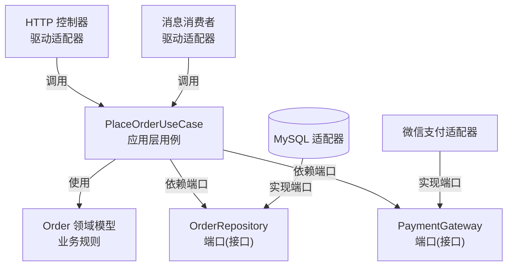

# 第9章：六边形架构与整洁架构

> [!TIP] Part 2: 核心架构风格（模式篇）
> 从这一章起，我们进入 Part 2。接下来六章将逐一拆解六种最主流的架构风格，每一种都在回答同样三个问题：系统怎么切、组件怎么连、要付出什么代价。学完你将拥有一张完整的"风格地图"，知道什么场景该掏出哪把刀。

分层架构有一个心照不宣的默认设定：**数据库是宇宙的中心**。业务逻辑围绕"怎么存"来组织，测试要连数据库，换个框架伤筋动骨。这一章介绍的三种"同门"风格——六边形架构、洋葱架构、整洁架构——就是来推翻这个设定的：**让业务逻辑站在宇宙中心，数据库和框架退到边缘当配角**。

先说结论管理预期：这三种风格是同一个思想的三种表述，学会一个等于学会三个。它们不是分层的替代品，而是分层的"精装修"——业务复杂度不高的模块用了是浪费，业务规则密集的模块用了是真香。

## 9.1 痛点：业务逻辑为什么围着数据库转

回头看第 7 章的标准三层，依赖箭头长这样：表现层 → 业务层 → 数据层。问题出在最后一格：**OrderService 直接 import 了 OrderRepository 的具体实现，而那个实现 import 了 MySQL 驱动**。

把这条依赖链拉直，你会看到一条荒谬的逻辑：业务流程（下单）依赖存储细节（MySQL），而存储细节又依赖某个框架（MyBatis、Hibernate）。也就是说，**公司的核心生意——卖书——竟然建立在某个 ORM 库的 API 之上**。由此带来三个现实痛点：

1. **测试贵**。想测"限购 5 本"的规则，必须先连上数据库、准备测试数据。单元测试跑成集成测试，一轮要几秒到几十秒，没人愿意写测试了。
2. **技术绑架业务**。想从 MySQL 迁到 PostgreSQL、想把 Web 框架从 Express 换成 Fastify，都会波及业务代码。第 2 章说过可演进性是核心质量属性，这里它正在流失。
3. **规则稀释**。Service 既要懂业务规则又要懂存储细节、事务细节，慢慢膨胀成千行大类，业务语言淹没在技术噪音里。

病根一句话：**依赖方向指错了**。技术细节应该依赖业务，而不是业务依赖技术细节。

## 9.2 六边形架构：端口与适配器

2005 年 Alistair Cockburn 提出六边形架构（Hexagonal Architecture），别名**端口与适配器（Ports and Adapters）**。它把系统分成两部分：

- **内部：领域（Domain）与应用（Application）**。业务规则与用例编排，不依赖任何框架、数据库、UI。
- **外部：适配器（Adapter）**。一切技术细节——Web 控制器、数据库客户端、消息队列、第三方支付——都是插在外面的适配器。

内部与外部通过**端口（Port）**连接。端口就是内部定义的一组接口，分两类：

| 端口类型 | 方向 | 含义 | 云书店订单模块的例子 |
| ---- | ---- | ---- | ---- |
| 驱动端口（Driving Port） | 外 → 内 | 外部世界如何"使用"内部 | PlaceOrderUseCase 接口，HTTP 控制器调用它 |
| 被驱动端口（Driven Port） | 内 → 外 | 内部需要外部提供什么能力 | OrderRepository、PaymentGateway 接口 |

画成结构图：

```text
                    外部世界（技术细节）
   ┌────────────┐   ┌────────────┐   ┌────────────┐
   │ HTTP 控制器 │   │ gRPC 服务端 │   │ 消息消费者  │
   └──────┬─────┘   └──────┬─────┘   └──────┬─────┘
          │  驱动端口        │               │
          ▼                ▼               ▼
   ┌─────────────────────────────────────────────┐
   │              内部：领域 + 应用                │
   │   Order 领域模型 · 下单/取消/退款 用例          │
   └──────┬──────────────────────┬───────────────┘
          │  被驱动端口            │  被驱动端口
          ▼                      ▼
   ┌────────────┐        ┌────────────┐
   │  MySQL 适配器│        │ 微信支付适配器│
   └────────────┘        └────────────┘
```

为什么画成六边形？没有深意，作者只是想强调**有多个对称的入口和出口**——HTTP、gRPC、定时任务都是平等的"插座"，没有谁是"第一公民"。类比家里的墙上的插座：电器（适配器）可以随便换，墙里的电路（领域逻辑）不用动。

## 9.3 依赖倒置如何落地

六边形架构的发动机，是第 4 章讲过的**依赖倒置原则（Dependency Inversion Principle, DIP）**。这里看它如何真正落地——关键只有一步：**把接口的定义权从技术侧挪到业务侧**。

传统分层里，Repository 接口往往长在数据层（或干脆没有接口），于是依赖从业务指向数据实现。倒置之后：

1. **领域定义接口**：OrderRepository 这个接口写在 domain 包里，用业务语言描述（"我要保存订单""我要按 ID 找订单"）。
2. **适配器实现接口**：MySQL 版实现在最外层，import 领域接口，implements 它。
3. **依赖箭头全部指向内部**：适配器依赖端口，端口属于领域；数据库因此变成了"可插拔的外设"。

> [!NOTE] 一句话记住 DIP
> 接口归业务所有，实现归技术所有——依赖箭头从"实现"指向"接口"，从外圈指向内圈。谁持有接口的定义，谁就是被依赖的中心。

落到工程上的验证标准很朴素：**domain 包的 import 列表里，不应出现任何框架名**。不出现 Spring、不出现 Express、不出现 mysql2、不出现 ORM 注解。做到这一条，领域逻辑就可以用纯内存的方式秒级测试，迁移框架时一行业务代码都不用改。

## 9.4 整洁架构：同心圆与依赖规则

2012 年 Robert C. Martin（Uncle Bob）提出整洁架构（Clean Architecture），把同样的思想画成了著名的同心圆：

```text
┌───────────────────────────────────────────────────┐
│  框架与驱动（Frameworks & Drivers）                 │
│  Web 框架 · 数据库 · UI · 外部接口                   │
│  ┌─────────────────────────────────────────────┐  │
│  │  接口适配器（Interface Adapters）             │  │
│  │  控制器 · 网关 · 展示器                       │  │
│  │  ┌───────────────────────────────────────┐  │  │
│  │  │  用例（Use Cases）                     │  │  │
│  │  │  应用层编排：下单、取消、退款            │  │  │
│  │  │  ┌─────────────────────────────────┐  │  │  │
│  │  │  │  实体（Entities）                │  │  │  │
│  │  │  │  领域模型与业务规则：Order         │  │  │  │
│  │  │  └─────────────────────────────────┘  │  │  │
│  │  └───────────────────────────────────────┘  │  │
│  └─────────────────────────────────────────────┘  │
└───────────────────────────────────────────────────┘

唯一规则：源码依赖只能从外圈指向内圈，内圈对外圈一无所知
```

四圈职责速览：最内圈是实体（业务规则与不变量）；第二圈是用例（把实体串成一个个用户故事）；第三圈是适配器（在协议格式与领域对象之间翻译）；最外圈是框架与驱动（一切具体技术）。圆圈可以按项目增减圈数，但**箭头永远向内**这一条不许变。

介于两者之间还有 2008 年 Jeffrey Palermo 的洋葱架构（Onion Architecture），同样是"领域居中、外层服务内层"的同心圆。三者的关系下一节直接上对比表。

## 9.5 三种表述，同一个思想

把三个"门派"放在一起，你会发现它们连术语都能一一对上：

| 维度 | 六边形架构 | 洋葱架构 | 整洁架构 |
| ---- | ---- | ---- | ---- |
| 提出者与年份 | Cockburn，2005 | Palermo，2008 | Martin，2012 |
| 核心图示 | 六边形 + 端口 | 同心圆 | 同心圆 |
| 最内圈叫什么 | 领域（Domain） | 领域模型 | 实体（Entities） |
| 中间圈叫什么 | 应用层 | 领域服务 | 用例（Use Cases） |
| 外圈叫什么 | 适配器（Adapters） | 基础设施 | 接口适配器 + 框架驱动 |
| 独特强调 | 端口的对称性：多个平等入口 | 领域模型优先 | 明确点名"框架是外圈" |
| 落地要点 | 定义好两类端口 | 分清领域与基础设施 | 依赖规则：箭头只向内 |

结论：**它们是同一个思想的三个商标**——业务核心不依赖技术细节，依赖全部指向内部。选哪个词不重要，重要的是你能向团队讲清楚两件事：端口怎么定义、依赖箭头朝哪指。本教程后续统一使用六边形的术语，因为它最直白。

用一张 mermaid 图看清依赖方向——所有箭头都朝内，没有任何一条从内部指向外部：



## 9.6 实战：把云书店订单模块按六边形重构

回到云书店。订单模块业务规则密集（限购、状态机、价格快照、退款校验），是最值得六边形化的模块。目录结构如下：

```text
modules/order/
├── domain/                          # 领域层：纯业务，零框架依赖
│   ├── order.ts                     # Order 聚合：状态机与业务规则
│   ├── order-repository.ts          # 被驱动端口：持久化抽象
│   ├── payment-gateway.ts           # 被驱动端口：支付抽象
│   └── events.ts                    # OrderPlaced 等领域事件
├── application/                     # 应用层：用例编排，不写业务规则
│   └── place-order-usecase.ts       # 下单用例
└── adapters/                        # 适配层：一切技术细节
    ├── in/
    │   ├── http-order-controller.ts # 驱动适配器：HTTP 入口
    │   └── mq-refund-consumer.ts    # 驱动适配器：消息入口
    └── out/
        ├── mysql-order-repository.ts
        └── wechat-pay-gateway.ts
```

核心代码，先看领域层——注意它的 import 列表是空的：

```typescript
// domain/order.ts —— 不知道 MySQL、Spring、HTTP 的存在
export class Order {
  private status: OrderStatus = "PENDING_PAYMENT";

  constructor(
    public readonly id: OrderId,
    private readonly userId: UserId,
    private readonly items: OrderItem[],
    private readonly amount: Amount,
  ) {}

  // 业务规则住在领域对象里，任何用例想绕都绕不开
  cancel(): void {
    if (this.status !== "PENDING_PAYMENT") {
      throw new DomainError("只有待支付订单才能取消");
    }
    this.status = "CANCELLED";
  }
}

// 端口：领域用业务语言定义的"插座"
export interface OrderRepository {
  save(order: Order): Promise<void>;
  findById(id: OrderId): Promise<Order | null>;
}

export interface PaymentGateway {
  charge(order: Order): Promise<PaymentResult>;
}
```

再看应用层用例——只做编排，规则都委托给领域对象：

```typescript
// application/place-order-usecase.ts
export class PlaceOrderUseCase {
  constructor(
    private readonly orderRepo: OrderRepository,   // 依赖端口，不依赖实现
    private readonly payment: PaymentGateway,
    private readonly eventBus: EventBus,
  ) {}

  async execute(cmd: PlaceOrderCmd): Promise<OrderId> {
    const order = Order.create(cmd.userId, cmd.items);  // 规则在领域内
    await this.orderRepo.save(order);
    const result = await this.payment.charge(order);
    await this.eventBus.publish(new OrderPlaced(order.id, order.userId));
    return order.id;
  }
}
```

最后是两个方向的适配器——它们认识内部，内部却不认识它们：

```typescript
// adapters/out/mysql-order-repository.ts —— 实现被驱动端口
export class MySqlOrderRepository implements OrderRepository {
  async save(order: Order): Promise<void> { /* INSERT ... */ }
  async findById(id: OrderId): Promise<Order | null> { /* SELECT ... */ }
}

// adapters/in/http-order-controller.ts —— 驱动适配器，把 HTTP 接到用例
export class HttpOrderController {
  constructor(private readonly placeOrder: PlaceOrderUseCase) {}

  async handle(req: HttpRequest): Promise<HttpResponse> {
    const id = await this.placeOrder.execute(toCmd(req)); // 只翻译协议
    return json(201, { orderId: id });
  }
}
```

重构后的收益立竿见影：

- **测试**："限购 5 本""只有待支付可取消"这些规则，用内存假实现（In-memory Fake）直测领域对象，毫秒级完成，不再依赖数据库。
- **替换**：给订单模块加一个 gRPC 入口，只新增一个驱动适配器；把 MySQL 换成 PostgreSQL，只重写一个被驱动适配器。内部零改动。
- **认知**：新人读 domain 目录就能掌握全部生意规则，不被技术噪音打扰——这正是第 8 章"独立理解"标准的落地。

## 9.7 何时不要用：简单 CRUD 请绕行

六边形架构的真实成本是**样板代码**：每个用例一个接口、每个外部依赖一个端口、每个端口至少两个实现（真实现 + 测试假实现）。这些成本对复杂领域是投资，对简单 CRUD 是纯粹的税。

| 项目特征 | 建议 |
| ---- | ---- |
| 业务规则以字段校验为主，几乎没有状态机 | 用普通分层，别上六边形 |
| 预计整个生命周期只用一种数据库、一个框架 | 端口层没有兑现日，纯属提前还贷 |
| 团队多数成员没接触过该风格 | 培训成本可能吞掉架构收益，先在单个模块试点 |
| 核心模块规则密集、频繁变更、要求高测试覆盖 | 值得上，如云书店的订单、支付 |

> [!WARNING] 防止过度设计
> 判断口诀：**业务规则的密度决定投入的档次**。云书店的"评价"模块就是增删改查加个星级，老实用三层；"订单"模块规则密集、资损敏感，才配得上六边形。全站六边形化的团队，多半是在用架构焦虑代替架构设计。

## 本章小结

- 传统分层的病根是业务依赖技术细节，导致测试贵、技术绑架业务、规则被稀释
- 六边形架构用端口与适配器组织系统：驱动端口承接外部调用，被驱动端口反向声明内部需要的能力
- 依赖倒置的落地关键：接口定义权归业务侧，实现归技术侧，domain 包的 import 里不允许出现框架
- 整洁架构用同心圆表达同一思想，唯一规则是源码依赖只能由外向内
- 六边形、洋葱、整洁是同一思想的三种表述，术语可一一对应，学会一个等于学会三个
- 云书店订单模块按 domain/application/adapters 三段重构后，规则测试毫秒级、框架可替换、新人可独立理解
- 简单 CRUD 不值得六边形化，样板代码是真实的税；业务规则密度决定投入档次

**下一章预告**：模块间的"说话方式"还剩最后一块拼图——当旁路动作从进程内事件升级为跨进程消息，系统就从"各管各的"变成"彼此守望"。第 10 章讲事件驱动架构，看消息队列如何解耦、削峰，以及埋在哪里的一堆坑。

---
