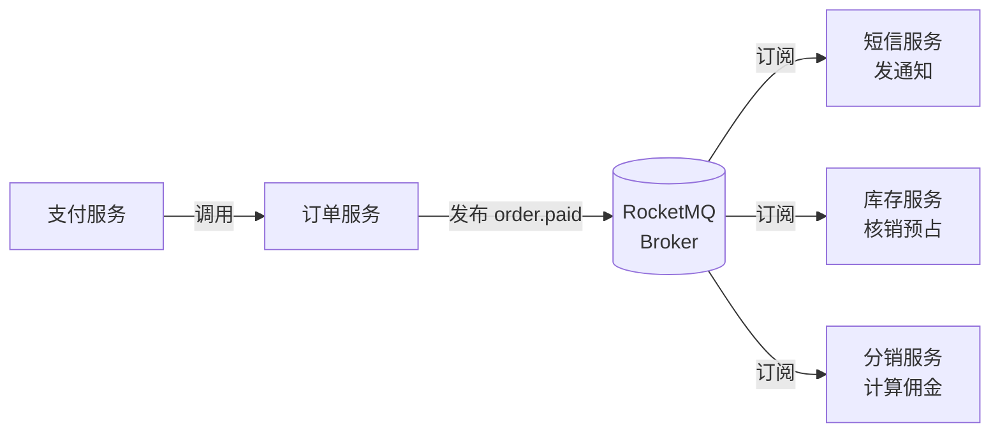

# 第10章：事件驱动架构——用消息解耦系统

> [!TIP] Part 2: 核心架构风格（模式篇）
> 从这一章起，我们进入 Part 2。接下来六章将逐一拆解六种最主流的架构风格，每一种都在回答同样三个问题：系统怎么切、组件怎么连、要付出什么代价。学完你将拥有一张完整的"风格地图"，知道什么场景该掏出哪把刀。

前面的架构风格里，组件之间都是"打电话"：我调你，等你干完我再继续。事件驱动架构（Event-Driven Architecture, EDA）换了一种沟通方式——"广播电台"：我只管把发生了什么播出去，谁关心谁收听，播完我就走。这一换，系统的耦合方式、吞吐能力、一致语义全都变了。

这是六种风格里"坑最多"的一章，也是最值得认真学的一章：从微服务到大模型应用的后端管线，今天几乎所有高吞吐系统都长着一张事件驱动的骨架。我们用云书店"下单成功之后"那条链路，把原理和坑一次讲透。

## 10.1 同步调用 vs 异步事件：电话与广播

先看两种通信方式的本质区别。同步调用像打电话：拨号、等接、听答复、挂断，全程你被占用。异步事件像电台广播：电台把新闻播出去就完事，听众什么时候听、听完干什么，电台一概不管。

| 维度 | 同步调用（RPC/REST） | 异步事件（消息） |
| ---- | ---- | ---- |
| 耦合 | 调用方必须知道被调方的地址和接口 | 生产者只认识"主题"，不认识消费者 |
| 时效 | 立刻拿到结果 | 毫秒到秒级延迟，最终送达 |
| 故障传播 | 下游挂，上游跟着挂（故障传染） | 下游挂，消息留在队列里等它恢复 |
| 吞吐 | 受调用链最慢一环限制，上游被拖住 | 生产者发完即走，削峰填谷 |
| 一致性 | 强一致，天然好推理 | 最终一致，需额外设计 |
| 心智负担 | 低，代码顺序执行 | 高：重复、乱序、积压都要想 |

什么时候该同步？**结果决定主流程成败时**。下单必须知道库存扣没扣成，这是同步；下单后要不要发短信，不影响订单成立，这是异步。把"要结果"和"走流程"区分开，是事件驱动的第一课。

异步还有一张王牌：**削峰填谷（Peak Shaving）**。云书店成熟期日均 50 万单，大促零点的下单瞬时峰值能冲到日常 100 倍。如果"下单 → 发短信"是同步的，短信服务商一抖，下单接口跟着超时；换成事件，订单服务把事件发进队列就返回，短信服务按自己的节奏消费，洪峰被队列这个"蓄水池"接住了。

反过来，三类场景别硬上异步，否则解耦的甜头会变成排查的苦果：

1. **用户正在等结果的操作**（支付回调、验证码校验）：用户要的是毫秒级答复，异步的延迟窗口直接变成体验问题。
2. **强一致要求的资金操作**（扣款与记账必须同生共死）：老老实实留在同步事务里，别用事件赌运气。
3. **又短又低频的内部调用**：为了一个每天调用十次的查询引入一整套消息中间件，运维成本远超收益。

## 10.2 两种消息模型：Queue 与 Pub/Sub

消息中间件（常称 Broker）最基础的两种模型，务必分清：

**模型一：消息队列（Queue，点对点）**。一条消息只被一个消费者处理。多个消费者挂在同一个队列上时，它们是**竞争消费**关系——消息被分给其中任何一个。用途是把一件事分给一队工人干，天然支持水平扩展。

**模型二：发布订阅（Publish/Subscribe, Pub/Sub）**。一条消息广播给**所有**订阅了该主题（Topic）的订阅者，人人有份。用途是"一件事发生，多方各自响应"。

```text
模型一 Queue（竞争消费）            模型二 Pub/Sub（广播分发）

生产者 ──┐                        生产者 ──▶ Topic: order.paid
         ▼                              │
   ┌───────────┐                  ┌────┼─────────┐
   │  Queue:    │                 ▼    ▼         ▼
   │ export.pdf │             订阅A    订阅B     订阅C
   └─────┬─────┘             短信服务  库存服务  分销服务
      ┌──┴──┐               各得一份消息副本，互不影响
      ▼     ▼
  工人1   工人2      ← 一条消息只属于其中一个
```

云书店里两种模型各司其职：

- **Queue 场景**：用户上传头像后生成缩略图。任务进队列，后台一个消费者集群竞争认领，加机器就能线性扩容。
- **Pub/Sub 场景**：订单支付成功（`order.paid`）。短信服务要发通知、库存服务要核销预占、分销服务要算佣金——三个都要，广播给他们，互不干扰。

> [!NOTE] 别混淆两种"并发"
> Pub/Sub 里同一主题的每个订阅组都拿到全量消息；而同一订阅组内部如果起多个实例，它们之间又是竞争消费。Kafka 的"消费组（Consumer Group）"就是把这两个维度焊在了一起：组间广播、组内竞争。

## 10.3 Broker 选型：Kafka、RabbitMQ、RocketMQ

三大主流消息中间件怎么选？先上对比表，数字是量级参考（实际以压测为准）：

| 维度 | Kafka | RabbitMQ | RocketMQ |
| ---- | ---- | ---- | ---- |
| 单机吞吐 | 百万级消息/秒 | 万到十万级/秒 | 十万级/秒 |
| 延迟 | 毫秒级（批量攒批） | 亚毫秒到毫秒级 | 毫秒级 |
| 顺序保证 | 分区（Partition）内严格有序 | 单队列有序 | 队列内有序 |
| 事务消息 | 不支持（靠幂等生产） | 不支持 | 原生支持（半消息） |
| 延迟消息 | 不支持原生 | 插件支持 | 原生支持（任意精度） |
| 消息回溯 | 支持（按位点重放） | 消费即删，不支持 | 支持（按时间重放） |
| 运维复杂度 | 高（分区、副本、再均衡） | 中 | 中 |
| 典型场景 | 日志流、行为埋点、大数据管道 | 业务消息、复杂路由、低延迟 | 电商交易、订单、营销 |

三句话选型建议：

- **吞吐优先、走大数据管道**：Kafka。日志、埋点、实时计算场景的事实标准，配合流处理生态（Flink 等）无敌。
- **路由灵活、延迟敏感**：RabbitMQ。交换机路由规则丰富（直连、主题、通配），适合企业内部五花八门的小型业务消息。
- **交易系统、要事务消息和延迟消息**：RocketMQ。为电商而生，"下单 30 分钟未支付自动取消"这类需求原生支持。

最后提醒一句：选型前先把**消息拓扑**画出来——有哪些主题、谁发谁收、哪些要保序、哪些要延迟。拓扑不清楚就选型，等于户型没画就买家具。云书店在阶段 2 选了 RocketMQ：订单链路既要事务消息（10.7 节），又要支付超时取消的延迟消息，两个关键特性正好都命中。

## 10.4 投递语义与幂等消费

消息系统绕不开的第一个理论问题是：**一条消息，保证送达几次？**三种投递语义（Delivery Semantics）：

| 语义 | 含义 | 实现方式 | 代价 | 业务取舍 |
| ---- | ---- | ---- | ---- | ---- |
| at-most-once | 至多一次，可能丢 | 收到就确认，处理失败不重投 | 可能丢消息 | 日志类，丢了无所谓 |
| at-least-once | 至少一次，可能重 | 处理完才确认，超时未确认就重投 | 可能重复消息 | 绝大多数业务的选择 |
| exactly-once | 恰好一次 | 上游幂等生产 + 事务 + 消费幂等 | 性能损耗大，中间件强绑定 | 极少数场景真做得到 |

残酷的现实：网络永远可能在你最不想的时候抖一下——消费者处理完了，回 ACK（确认）的路上断线，Broker 没收到确认，只能再投一次。所以**重复投递不是异常，而是常态**，工程上的正确姿势是：

> **默认选择 at-least-once，然后用"幂等消费（Idempotent Consumption）"把重复消化掉。**

所谓幂等，就是同一件事执行一次和执行一百次，结果一样。实现套路是"业务唯一键 + 去重记录"：

```typescript
// 幂等消费：用业务唯一键去重，而不是消息 ID（重试时消息 ID 会变）
async function consumeOrderPaid(msg: OrderPaidEvent) {
  // INSERT IGNORE：同一个订单的"已处理"记录只能插进去一次
  const result = await db.query(
    `INSERT IGNORE INTO consumed_events (biz_key, processed_at)
     VALUES (?, NOW())`,
    [`order.paid:${msg.orderId}`],   // 业务唯一键：事件类型 + 订单号
  );
  if (result.affectedRows === 0) {
    return;                          // 已处理过 → 重复消息，直接丢弃
  }
  await addLoyaltyPoints(msg.userId, msg.orderId, msg.amount); // 真正的业务
}
```

另一种思路更彻底：**把"加积分"本身设计成幂等操作**——积分流水表以 `orderId` 建唯一索引，重复消费时插入失败、静默成功。去重记录可能过期丢失，业务本身幂等才是终极答案。

## 10.5 最终一致性：把"不一致"的时间窗口管起来

异步化有一个绕不开的哲学代价：**放弃强一致，拥抱最终一致性（Eventual Consistency）**——系统在短暂时间内允许不一致，但保证在没有新变更的前提下，最终收敛到一致。

类比银行转账：跨行转账不是瞬间到账的，你的钱扣了、对方还没到的那几分钟，两个账户就是不一致的，但银行敢这么干，因为它保证"最终一定到"。事件驱动系统同理：`order.paid` 事件发出后几百毫秒内，积分还没加上、短信还没发出，这个窗口是设计出来的，不是 bug。

工程上要做的是**管理这个窗口**，而不是假装它不存在：

1. **对用户诚实**：下单成功页写"积分将在 1 分钟内到账"，把窗口说清楚，客诉少一半。
2. **监控收敛速度**：事件从产生到消费完的延迟做成指标，窗口从 100ms 恶化到 10 分钟要能报警。
3. **准备兜底对账**：定时任务比对"应加积分"和"实加积分"，对不上的补偿处理——窗口收敛的最后一道保险（第 13 章数据架构还会细讲对账）。

经验值可以参考：云书店把事件消费延迟的告警线定在 5 秒——P99 常态在 300ms 以内，一旦 5 秒说明消费端出问题了，而不是流量正常波动。给窗口设一条"多长算不正常"的红线，比纠结"多快才算快"更有工程意义。

## 10.6 实战：云书店"下单成功后"的事件链

把前面所有概念拼成云书店的真实场景。支付成功那一刻，一条 `order.paid` 事件触发的完整链路（ASCII 时序图）：

```text
 用户端        订单服务          RocketMQ            下游消费者（三个订阅组）
   │             │                 │                       │
   │ 1.支付成功   │                 │                       │
   │────────────▶│                 │                       │
   │             │ 2.本地事务：订单置为"已支付"，同时写本地消息表
   │             │ 3.发送事件 order.paid（payload: orderId, userId, amount）
   │             │────────────────▶│                       │
   │             │ 4.立即返回"支付成功"，不等任何下游     │
   │◀────────────│                 │                       │
   │             │                 │ 5.广播投递（重复投递是常态）
   │             │                 │───────┬───────┬───────┤
   │             │                 │       ▼       ▼       ▼
   │             │                 │    短信服务   库存服务   分销服务
   │             │                 │    发通知短信  核销预占   计算佣金
   │             │                 │    (失败重试)  (幂等消费) (幂等消费)
   │             │                 │       │       │       │
   │             │                 │  6.各自处理成功后 ACK，窗口内全部收敛
```

对照要点逐条读图：

- **第 2 步是灵魂**：订单状态变更和事件记录在**同一个本地事务**里落库，这是 10.7 节"事务消息"要解决的问题的铺垫。
- **第 4 步是解耦的意义**：订单服务的接口耗时里不含短信、佣金任何一环。哪怕分销服务整体宕机，用户照样看到"支付成功"。
- **第 5 步是语义的战场**：三个订阅组各自拿到一份消息（Pub/Sub），每个组内部多实例竞争消费（Queue 语义），每组各自做幂等。
- **第 6 步是一致的终点**：通常几百毫秒内全部收敛；任何一组持续失败，靠重试 + 死信告警兜底。

再补充一个容易忽视的细节：事件载荷里除了业务字段，还应带上 `eventId`（全局唯一）、`occurredAt`（发生时间）和 `version`（同一订单的第几个事件）——后两者是消费端做幂等与乱序检测的原料，缺了它们，四大坑的对策都无从落地。

用 mermaid 再看一次拓扑关系（谁发、谁收、走什么主题）：



## 10.7 四大坑：每一个都能上生产事故榜

事件驱动的坑，教材里排在附录，事故榜上排在头版。四个必须提前设计、不能事后补救的坑：

**坑一：消息幂等**（10.4 节已详述）。只强调一句：**把重复当成设计前提**。凡是"发短信发两条""佣金算两次"的事故，根因都是开发时假设了"消息只来一次"。

**坑二：顺序性**。事件不保证全局有序——重试会让后面的先到。云书店真实案例：分销服务先收到 `order.refunded`（已退款）再收到 `order.paid`（已支付），按到达顺序处理就给已退款订单算了佣金。对策：**只对"同一业务实体内"保序**——按 `orderId` 做分区键（Partition Key），同一订单的事件进同一分区，分区内天然有序；不同订单之间不关心顺序。生产端只需要一行配置：

```typescript
// 生产者：按 orderId 做分区键，同一订单的事件永远进同一分区
await producer.send({
  topic: "order-events",
  partitionKey: event.orderId,  // 相同 key → 相同分区 → 分区内严格有序
  body: event,
});
```

**坑三：积压（Backlog）**。生产速度持续大于消费速度，未消费消息堆积。数字感受一下：平时每秒 200 条事件，大促零点冲到每秒 2.5 万条（50 万单 × 平均每单 3~5 个事件），消费能力跟不上一小时，积压就是几千万条——短信迟发是小事，库存核销迟了会引发超卖。对策组合拳：监控积压量（lag）并告警、消费者无状态可水平扩容、削峰限流让上游别把队列灌爆、必要时降级非关键消费者。

**坑四：事务消息**——"先落库还是先发消息"的两难：

- 先落库、后发消息：落库后进程崩溃，消息没发出去，下游永远不知道这单付了款。
- 先发消息、后落库：消息发出去了，落库失败，下游处理了一个不存在的订单。

两条路都是断桥。工程上有两种标准搭法：

```sql
-- 搭法一：本地消息表（Local Message Table），任何数据库都能用
CREATE TABLE outbox_message (
  id          BIGINT PRIMARY KEY,
  topic       VARCHAR(64)  NOT NULL,
  payload     JSON         NOT NULL,
  status      TINYINT      NOT NULL DEFAULT 0,  -- 0 待发送 1 已发送
  created_at  DATETIME(3)  NOT NULL
);

BEGIN;
  UPDATE orders SET status = 'PAID' WHERE id = 1001;      -- 业务变更
  INSERT INTO outbox_message(topic, payload)              -- 事件记录进同一事务
  VALUES ('order.paid', '{"orderId":1001,"amount":15800}');
COMMIT;
-- 后台任务轮询 outbox，把待发送消息投给 Broker，成功后标记 status = 1
```

搭法二是 RocketMQ 的**半消息（Half Message）**：先把消息以"半消息"状态发给 Broker（此时消费者不可见），再执行本地事务，成功了提交半消息、失败回滚半消息；Broker 还会定时回查"你那个事务到底成了没"，兜住进程崩溃的间隙。两种搭法思想相同——**把"发消息"这个动作本身纳入事务保障**，业界也称事务性发件箱（Transactional Outbox）模式。

四大坑之外，还有一个贯穿所有坑的兜底机制值得单独交代：**重试与死信队列（Dead Letter Queue, DLQ）**。消费失败后不是无限重试，而是按指数退避重试 3~5 次（如 10 秒、30 秒、2 分钟），仍失败就投进死信队列，触发告警转人工处理。没有 DLQ 的系统，一条"毒消息"（每处理必失败的消息）就能卡死整个消费组——它永远排不下队，后面的消息全被堵住。所以 DLQ 必须配监控：死信数不为零就报警，人工修复后重新投递。

把四大坑的对策浓缩成一张速查表，上线前逐项打勾：

| 坑 | 一句话对策 | 盯住哪个指标 |
| ---- | ---- | ---- |
| 消息幂等 | 业务唯一键去重，或把业务操作本身设计成幂等 | 重复消息引发的副作用数（应为零） |
| 顺序性 | 按聚合根 ID（订单号）做分区键，只保实体内有序 | 乱序到达告警 |
| 积压 | 消费者无状态可扩容 + 上游限流 + 非关键消费降级 | 消费滞后量（lag） |
| 事务消息 | 本地消息表或 RocketMQ 半消息，把发消息纳入事务 | outbox 待发送堆积量 |

> [!WARNING] 上线前的自查清单
> 每条消息链路问自己四个问题：重复投递消费端扛得住吗？同一订单的事件乱序到达会出错吗？消费速度跟不上时积压会怎样？"落库"和"发消息"谁先谁后？四个都有答案，才敢上线。

## 本章小结

- 同步调用像打电话（要结果、强耦合），异步事件像广播（走流程、松耦合），"要结果"和"走流程"的区分是第一课
- 异步的两大红利：故障隔离（下游挂了消息等着）与削峰填谷（大促 100 倍洪峰被队列接住）
- Queue 是竞争消费（一消息一工人，可水平扩容），Pub/Sub 是广播分发（一消息多订阅组）；Kafka 的消费组把两者焊在一起
- Broker 选型：大吞吐管道选 Kafka，灵活路由低延迟选 RabbitMQ，交易系统要事务/延迟消息选 RocketMQ
- 投递语义默认选 at-least-once，用幂等消费（业务唯一键去重或业务操作天然幂等）消化重复
- 最终一致性要管理时间窗口：对用户说清楚、监控收敛延迟、对账兜底
- 四大坑上线前必答：幂等、按订单号分区保序、积压监控与扩容、本地消息表/半消息解决事务原子性

**下一章预告**：事件解决了"怎么连"，下一个问题是"怎么拆"——把单体拆成服务的那条线，到底应该画在哪里？第 11 章讲微服务架构：拆分原则、私有数据、三大基础设施，以及什么团队不该碰它。

---
