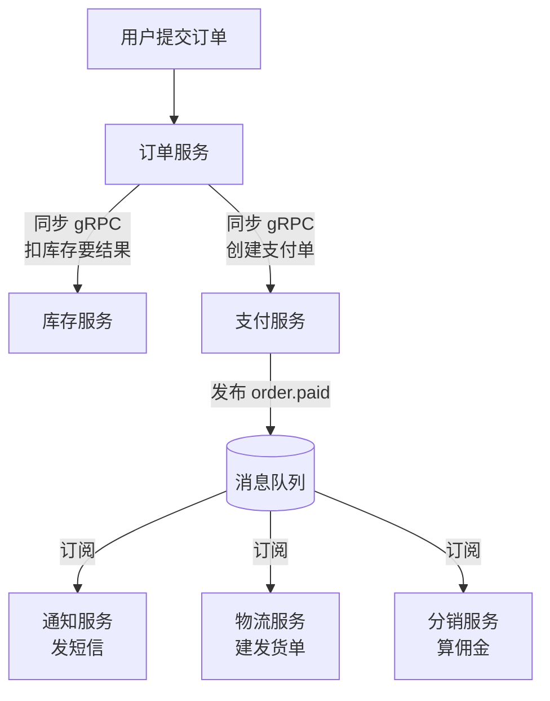

# 第11章：微服务架构—— freedom 与代价

> [!TIP] Part 2: 核心架构风格（模式篇）
> 从这一章起，我们进入 Part 2。接下来六章将逐一拆解六种最主流的架构风格，每一种都在回答同样三个问题：系统怎么切、组件怎么连、要付出什么代价。学完你将拥有一张完整的"风格地图"，知道什么场景该掏出哪把刀。

终于到了流量最大的关键词——微服务（Microservices）。搜索指数最高、面试题最多、翻车事故也最多的一种风格。这一章不吹它的自由，也不黑它的复杂，而是回答三个实际问题：**服务怎么拆才对？拆完之后系统怎么连？以及最重要的——你的团队真的需要它吗？**

云书店走到这一步了：日订单从成长期的 5 万涨到成熟期 50 万，团队膨胀到 50 人，单个单体已经编译十分钟、发布一次全组戒严。是时候拆了——但怎么拆，决定了你得到的是微服务，还是分布式大泥球。

先给本章定个基调：**微服务不是目标，是手段；不是起点，是阶段**。带着这个框架往下读，每一个设计决策都会清晰很多。

## 11.1 定义与核心特征

微服务没有权威定义，业内引用最多的是 Martin Fowler 与 James Lewis 2014 年的总结。剥掉修辞，核心特征就三条：

| 特征 | 含义 | 反面教材 |
| ---- | ---- | ---- |
| 独立部署（Independent Deployment） | 每个服务单独构建、发布、回滚，互不等待 | "微服务"发版要十个服务一起上，叫分布式单体 |
| 数据私有（Private Data） | 每个服务独占自己的存储，他人只能走 API | 七个服务连同一个库，一条 SQL 穿透所有边界 |
| 按业务域拆分（Business-Domain Split） | 服务边界对应业务边界，而非技术层次 | 拆出"数据访问服务""工具服务"这类技术服务 |

注意第一条的措辞：独立**部署**，不是独立**运行**。很多团队把单体进程复制成十份就自称微服务，但只要它们必须一起发版、共享一个库，就没有拿到任何一条特征红利。

微服务真正解决的问题其实是**组织问题**：50 个人的团队在一个代码库上互相踩脚（第 8 章讲过康威定律），拆服务是为了让每个小团队在自己的领地里独立前进。技术上的独立伸缩、故障隔离是副产品。**把微服务当技术优化手段的团队，大多拆完发现性能没变好、复杂度翻了倍。**

学习微服务之前，还得把它和前身 SOA（Service-Oriented Architecture，面向服务的架构）划清界限，这两个词在老项目里经常被混用：

| 维度 | SOA | 微服务 |
| ---- | ---- | ---- |
| 核心思想 | 复用：沉淀共享服务 | 独立：每个服务自主自治 |
| 通信中枢 | 重的企业服务总线（ESB），集中编排 | 轻量协议直连或消息，去中心化 |
| 数据 | 服务间常共享数据库 | 每服务私有数据库 |
| 拆分粒度 | 粗，服务即系统 | 细，一个服务干好一件事 |
| 组织含义 | 集中治理 | 赋能小团队 |

一句话区分：SOA 想让能力被**复用**，微服务想让团队**独立**。理解了这一点，你就明白为什么微服务天然和"小团队、自治权、你建你运维（You build it, you run it）"绑在一起。

## 11.2 拆分原则：线画在哪里

拆分的核心难题只有一个：边界画在哪。三条原则按优先级排列。

**原则一：按业务能力（Business Capability）拆**。业务能力是"公司靠什么创造价值"：云书店的能力清单是用户、商品、购物车、订单、支付、库存、评价、物流。每个能力对应一个候选服务，且能力与组织对齐——负责支付风控的团队就拥有支付服务。

**原则二：按限界上下文（Bounded Context）校准**。业务能力是粗线条，真正的刀刃在上下文边界：同一个词在不同上下文里含义不同。"商品"在商品上下文里是完整的详情、图文、分类；在订单上下文里只是"书名 + 价格快照 + SKU ID"。**上下文不同，模型就该不同，服务边界就该分开**。这个词来自 DDD（领域驱动设计），第 20 章会系统展开，这里先记住判断方法：当两个团队对同一个词的理解开始打架，边界就该画在那里。

**原则三：先粗后细，避免分布式单体（Distributed Monolith）**。拆分是单向门，拆细了合不回来，所以第一刀宁粗勿细。云书店阶段 2 只拆了三个服务（订单、支付、库存），而不是一步到位拆八个。分布式单体的典型症状自查表：

| 症状 | 检查方法 |
| ---- | ---- |
| 多个服务必须同时发布才能上线 | 看发版流程：是否存在"发布编排" |
| 一个请求同步穿过 4 个以上服务 | 看调用链追踪的深度 |
| 服务间共享数据库表 | 看 JDBC 连接串和数据库名 |
| 修改一个业务字段要改 5 个服务 | 看契约变更的波及面 |
| 各服务代码强耦合，只是物理分开了 | 抽 3 个服务合回去试试，若无痛即中招 |

中了任何一条，说明你只是把单体的痛点搬到了网络上，还额外付了分布式的税。

原则之外，把拆分落成动作可以走"五步法"，云书店就是这么拆的：

1. **盘点业务能力清单**：用户、商品、购物车、订单、支付、库存、评价、物流，八个候选。
2. **用限界上下文校准**：购物车与订单同属"交易上下文"且都很薄，暂不拆；评价上下文独立清晰，候选。
3. **按信号挑第一批**：变化频率（订单、支付最高）、资源画像（库存大促时需要独立扩容）、团队归属（支付要资金安全专人），选出订单、支付、库存三个。
4. **先拆旁路，后拆核心**：先迁评价、物流这类读多写少、出错不影响主链路的服务练手，订单支付这种强一致核心最后动。
5. **拆一个稳一个**：每拆一个服务，配齐独立数据库迁移、监控告警、CI/CD 流水线，再拆下一个。

## 11.3 服务间通信：同步 RPC 与异步事件

服务拆开后必须通信。第 10 章讲的同步/异步之辨在这里同样成立，只是选项更丰富：

| 方式 | 协议与代表 | 性能特征 | 适用场景 |
| ---- | ---- | ---- | ---- |
| 同步 REST | HTTP + JSON | 简单通用，解析开销中等 | 对外 API、低频管理端调用 |
| 同步 gRPC | HTTP/2 + Protobuf | 序列化紧凑，单次调用 0.5~2ms | 内部高频调用、多语言团队 |
| 异步事件 | 消息队列（第 10 章） | 生产即返回，最终一致 | 状态变更广播、削峰、解耦 |

选择依然是那个判断：**结果影响主流程成败用同步，旁路动作用异步**。落到云书店下单链路：

- **同步**：下单服务调用库存服务的 `deduct`（gRPC，1ms 级）——库存不够订单就不能成立，必须等结果。
- **异步**：支付成功后广播 `order.paid`——短信、佣金这些旁路动作，走 RocketMQ（第 10 章的完整链路直接复用）。

一个常见误区要拆掉：**"微服务 = 全部异步"是错的**。全异步的系统调试噩梦缠身，该同步的查询类调用大方地同步，配合超时、重试、熔断（第 16 章高可用细讲）即可。

内部高频的同步调用，业界首选 gRPC，关键是**先定契约再写代码**——接口定义文件（IDL）就是服务之间的合同：

```protobuf
// inventory-api.proto：库存服务的对外契约，工具可生成多语言客户端
service InventoryService {
  rpc Deduct (DeductRequest) returns (DeductReply);   // 扣减库存
}

message DeductRequest {
  string order_id = 1;         // 幂等键：重试时服务端据此去重
  repeated OrderItem items = 2;
}

message OrderItem {
  string sku_id = 1;           // 商品最小库存单位 ID
  int32  quantity = 2;
}
```

契约先行有三个好处：客户端代码自动生成（Java、Go、TS 全覆盖）、字段类型编译期校验、契约变更在评审阶段就被双方看见——而不是上线后靠一个 500 报错通知你。

同步调用还有一个必须成套使用的"三件套"：**超时、重试、幂等**。不设超时，一次网络抖动就能拖死调用方；重试能救瞬时故障，但重试的前提是被调方幂等——否则一次扣库存被重试成两次，超卖就来了。这三件事在服务拆分的同一天就要做，不能"以后再补"。

## 11.4 私有数据原则与跨服务查询

**每个服务私有自己的数据**是微服务最硬的一条纪律。订单服务的库只有订单服务能连，库存服务想读？走 API 或订阅事件。为什么这么狠？因为数据是状态的根，库一共享，任何服务的 schema 变更都会惊动别的服务，边界就名存实亡了（第 8 章在模块层面说过同一件事，服务层面是同一纪律的物理版）。

数据私有了，麻烦也随之而来：**跨服务的数据怎么一起展示**？订单详情页需要订单本体（订单服务）、物流轨迹（物流服务）、评价摘要（评价服务）——三个库，一次查询。标准解法是 **API 组合（API Composition）**：

```typescript
// BFF 层的订单详情聚合：并行调用三个服务，总耗时 ≈ 最慢的那个
async function getOrderDetail(orderId: OrderId): Promise<OrderDetailVO> {
  const [order, logistics, reviews] = await Promise.all([
    orderClient.getOrder(orderId),      // ≈25ms：订单本体
    logisticsClient.track(orderId),     // ≈40ms：物流轨迹
    reviewClient.listByOrder(orderId),  // ≈30ms：评价摘要
  ]);
  return assemble(order, logistics, reviews);  // 总耗时 ≈40ms，而非串行的 95ms
}
```

三个工程要点：

1. **并行调用**：串行 95ms，并行约 40ms，差异就是用户体验。
2. **冗余快照代替实时关联**：订单详情里显示的书名和价格，是下单时的快照（第 7 章埋的伏笔在这里兑现），不必实时去问商品服务——商品改价不影响历史订单，还省了一次跨服务调用。
3. **聚合层放 BFF（Backend for Frontend）或网关**，别让某个业务服务去"拼装"别的服务，否则它成了新的耦合中心。

用 mermaid 看云书店下单链路的混合通信全貌——同步要结果、异步走通知，两条线泾渭分明：



除了"查询时实时组合"，跨服务取数还有第二条路——**把数据复制过来**：

- **同步拉取**：查询时实时调对方 API（上面的 API 组合）。数据最新，但每次查询都引入跨服务延迟与依赖。
- **异步复制**：订阅对方的变更事件（如 `product.updated`），在本地存一份只读副本。查询零跨服务调用，代价是分钟级延迟与存储冗余。

云书店订单列表页显示的书名和封面图，就是异步复制的商品副本——商品团队改图片，订单页几秒后跟上，业务完全可接受。**能容忍延迟的展示数据，复制优于实时拉取**。

> [!WARNING] 一条不能破的禁令
> 微服务化后，任何"直连他人库""跨库 JOIN"的 SQL 都应当被监控和告警。它总是从"就查一次"开始，三个月后长成牵一发动全身的暗管——数据边界的失守，永远比代码边界的失守更难修复。

API 组合解决不了所有问题：当组合的服务数变多、过滤聚合逻辑变复杂、或需要跨服务的多条件搜索（"查上海仓最近三天退款订单的物流时效"）时，实时组合的性能与复杂度都会失控。这时该 **CQRS**（命令查询职责分离）出场：用事件把数据异步复制到一张为查询定制的宽表里。它是第 12 章的主角，这里先留个钩子。

把数据私有原则浓缩成三句话，贴在团队墙上即可：**库是服务的老婆，别人不许碰；要数据，走 API；要历史，订事件；展示用的旧数据，复制一份不丢人**。

## 11.5 三大基础设施：服务发现、API 网关、配置中心

单体是一个进程，配置写在文件里、方法调用不需要寻址；服务一多，三件事立刻从"不是问题"变成"每天的问题"：

**基础设施一：服务发现（Service Discovery）**。订单服务要调库存服务，库存服务有几个实例、IP 是多少？云原生环境里实例随时生灭——大促前 K8s 一分钟把库存服务从 5 个实例扩到 50 个。服务启动时向注册中心（Nacos、Consul、etcd）注册自己的地址，调用方从注册中心拉取健康实例列表做客户端负载均衡。下面网关配置示例里的 `lb://order-service`，`lb` 就是"去注册中心做负载均衡"的意思。服务发现的常见实现分三类：

| 实现方式 | 代表 | 特点 |
| ---- | ---- | ---- |
| 客户端发现 | Eureka + Ribbon | 客户端拉实例列表自己负载均衡，少一跳，逻辑下沉到每个调用方 |
| 服务端发现 | K8s Service | 平台层统一代理转发，客户端无感知，多一次代理跳转 |
| DNS 发现 | Consul | 简单通用、跨语言，健康检查粒度较粗 |

**基础设施二：API 网关（API Gateway）**。系统对外的唯一大门，把所有服务都挡在后面：

- **路由**：`/api/orders/**` 转给订单服务，外部世界只认识一个域名。
- **认证**：JWT 校验、鉴权统一做一次，三十个服务不用各写一遍登录逻辑。
- **限流**：按用户、按接口限流，把恶意流量和洪峰挡在门外。
- **聚合与协议转换**：给前端一个精简接口，屏蔽后端服务拆分细节。

```yaml
# 网关路由配置示例：lb 前缀表示"去注册中心做负载均衡"，呼应上一段的服务发现
routes:
  - id: order-route
    uri: lb://order-service          # 不写死 IP，实例增减网关自动感知
    predicates: [ "Path=/api/orders/**" ]
    filters:
      - name: JwtAuth                # 统一认证，业务服务不再重复实现
      - name: RateLimit              # 限流：单用户 10 QPS
```

网关也不是万能的：它承载全部出口流量，本身就是单点风险，要做多实例部署；业务逻辑更不该写进网关，否则它变成无人敢动的"上帝服务"。

**基础设施三：配置中心（Config Center）**。50 人团队、30 个服务、平均 5 个实例，就是 150 份配置。改一个超时参数难道要发 30 个版？配置中心（Nacos、Apollo）让配置集中管理、动态推送——改完秒级生效，不用重启：

```yaml
# 配置中心里的订单服务配置：改超时阈值不发版，秒级推送到全部实例
order-service:
  rpc:
    inventory-timeout-ms: 200        # 调库存的超时，大促前临时调大
  flash-sale:
    max-orders-per-user: 5           # 限购规则，运营可实时调整
```

三者与服务的空间关系：

```text
                        外部世界
                            │
                   ┌────────▼────────┐
                   │    API 网关      │  ← 统一入口：路由/认证/限流
                   └───┬────┬────┬───┘
                       │    │    │
              ┌────────▼┐ ┌─▼──────▼─┐
              │ 订单服务  │ │ 库存服务  │  ……（各服务独立部署、独立数据库）
              └───┬─────┘ └────┬─────┘
                  │            │
     ┌────────────┴────────────┴────────────┐
     │  注册中心（服务发现）    配置中心        │  ← 平台级基础设施
     └──────────────────────────────────────┘
```

> [!NOTE] 基础设施的定位
> 这三件套不是微服务的"奢侈品"，而是"日用品"——它们解决的是服务化之后每天都会发生的寻址、入口、配置问题。云原生平台（K8s + 服务网格）本质上是把它们下沉到了平台层：K8s 的 Service/DNS 就是服务发现，Ingress 就是网关，ConfigMap 是配置管理的雏形，服务网格（Istio 等）则把流量治理进一步做进了基础设施，第 23 章再展开。

## 11.6 什么时候不要微服务：一份劝退清单

最后回答本章最重要的问题。微服务是把双刃剑，拿之前先过一遍清单：

| 检查项 | 微服务的隐形要求 | 不达标的后果 |
| ---- | ---- | ---- |
| 团队规模 | 每个服务背后有一个稳定小队（两张披萨团队） | 5 个人维护 12 个服务，人人都在救火 |
| 自动化程度 | CI/CD、容器编排、链路追踪、集中监控全部就绪 | 运维 30 个进程靠 SSH 手工，故障定位靠猜 |
| 业务稳定性 | 领域边界基本清晰，需求不再推倒重来 | 0→1 阶段业务天天变，服务边界月月重画 |
| 一致性容忍 | 业务能接受最终一致性 | 账务强一致场景，分布式事务把你拖垮 |
| 组织协同 | 服务所有权清晰，跨团队协作有契约 | 没人敢改别人的服务，需求全靠排期扯皮 |

五条里超过两条不达标，答案就是**留在模块化单体**。给三个具体参考线：工程团队 10 人以下，几乎永远不需要微服务；10~50 人，拆一两个最痛的服务即可（云书店阶段 2 就是这个姿势）；50 人以上且基础设施成熟，才谈得上全面微服务化。还有一个组织侧的旁证：如果各业务负责人已经在为"发布互相卡"吵架、为"谁改坏了共享代码"扯皮，说明协作痛已经到位；反之大家相安无事，就不必人为制造边界。

如果现状是"存量单体 + 确实需要逐步服务化"，正规姿势叫**绞杀者模式（Strangler Fig）**：像藤蔓缠树一样，新功能一律做进新服务，老功能按痛点逐步搬迁，网关按路由把流量一点点从单体切到新服务，直到单体被"绞杀"干净。切忌推倒重写——第 19 章会带云书店完整走一遍这场演进。

再送一句清醒剂：微服务迁移没有回头路。拆出去的服务、拆碎的数据、建立的平台，合回来的成本是拆的十倍。**先用模块化单体证明你的团队管得好边界，再谈拆服务**。

## 本章小结

- 微服务三特征：独立部署、数据私有、按业务域拆分；三者缺一就是分布式单体
- 微服务本质是组织问题的解法（康威定律），技术收益（独立伸缩、故障隔离）是副产品
- 拆分三原则：按业务能力起刀、按限界上下文校准（详见 ch20）、先粗后细避免分布式单体
- 通信选择延续 ch10 的判断：要结果的同步（内部高频用 gRPC），旁路动作异步走消息
- 数据私有了才有"跨服务查询"问题：API 组合并行聚合 + 快照冗余，复杂查询升级到 CQRS（ch12）
- 服务发现、API 网关、配置中心是服务化的三大日用品：寻址、统一入口、动态配置
- 上手前过劝退清单：团队规模、自动化、业务稳定性、一致性容忍、组织协同，两条不达标就留在模块化单体

**下一章预告**：API 组合应付不了复杂查询时，我们提到过一条出路——把同一份数据按读写分成两个世界。第 12 章讲 CQRS 与事件溯源：为什么读写值得分开、状态如何由事件折叠而成，以及什么项目千万别碰它。

---
