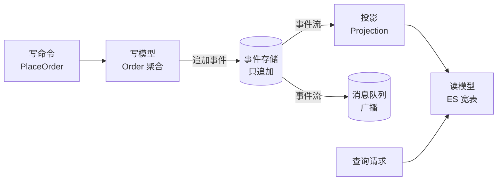

# 第12章：CQRS 与事件溯源——读写分离的艺术

> [!TIP] Part 2: 核心架构风格（模式篇）
> 从这一章起，我们进入 Part 2。接下来六章将逐一拆解六种最主流的架构风格，每一种都在回答同样三个问题：系统怎么切、组件怎么连、要付出什么代价。学完你将拥有一张完整的"风格地图"，知道什么场景该掏出哪把刀。

Part 2 的最后一章，讲两个常被绑在一起、却经常被误解的概念：CQRS（命令查询职责分离）与事件溯源（Event Sourcing）。它们是六种风格里学习曲线最陡的，也是被滥用得最惨的——多少人看完一篇博客就把公司账务系统改成了事件溯源，三个月后含泪回滚。

这一章我们冷静地拆解它们：读写为什么值得分开、事件溯源的数学本质是什么、三者关系到底是什么，最后给你一份不吹不黑的"强项与劝退"清单。

## 12.1 为什么读和写值得分开

一个反常识的事实：**绝大多数系统里，读和写根本不是同一种工作**。云书店的数据可以印证——日均 50 万笔订单写入，但商品详情页、搜索、榜单的读取请求每天超过 2000 万次，读写比接近 1:40。两者在三个维度上互相打架：

**维度一：模型不同**。写模型关心不变量："库存不能为负""订单金额必须等于明细之和"，它要的是严谨的领域对象与事务。读模型关心展示："榜单页要把商品、销量、标签聚合进一个卡片"，它要的是扁平、现成、最好一次取完的数据结构。让一个对象同时服务两个主人，结果就是又厚又拧巴的"万能实体"。

**维度二：性能画像不同**。写要行锁、要事务、要持久化，吞吐天然受限；读可以缓存、可以冗余、可以并行。混在一起，一次慢查询占着连接池，写入被拖垮——互相拖累。

**维度三：最优存储不同**。写最适合强一致的 OLTP 行存（MySQL）；读最适合反范式的宽表或倒排索引（Elasticsearch）、或内存结构（Redis）。一种存储伺候两个主人，必然两头妥协。

CQRS（Command Query Responsibility Segregation，命令查询职责分离，Greg Young 2010 年推广）的答案直截了当：**把系统劈成两半——命令（Command）侧负责改状态、不返回数据；查询（Query）侧负责返回数据、不改状态**。命令与查询分开建模、分开优化、甚至分开存储。

两个名词先钉死，后面所有讨论都建立在这组定义上：

- **命令（Command）**：表达"改变世界的意图"，如"提交订单""取消订单""核销优惠券"。它只返回"接受或拒绝"，不返回业务数据——想看结果？再发一条查询。
- **查询（Query）**：表达"想知道些什么"，如"订单详情""销量榜单"。它绝不产生副作用，因此可以随意缓存、并行、重试。

这对概念源自 Bertrand Meyer 的 CQS 原则（Command-Query Separation，1988），CQRS 把它从"方法级别"提升到了"系统架构级别"——分离的不再是两个方法，而是两套模型、两条链路、两种存储。落到代码上，就是把一个"万能 OrderService"拆成两个各司其职的接口：

```typescript
// 命令侧：只改状态，返回"接受/拒绝"，不返回业务数据
interface OrderCommands {
  placeOrder(cmd: PlaceOrderCmd): Promise<{ accepted: boolean; orderId?: OrderId }>;
  cancelOrder(orderId: OrderId, reason: string): Promise<{ accepted: boolean }>;
}

// 查询侧：只读数据，返回为展示定制好的视图对象，可随意缓存与并行
interface OrderQueries {
  getOrderDetail(orderId: OrderId): Promise<OrderDetailVO>;
  listOrdersByUser(userId: UserId, page: number): Promise<OrderSummary[]>;
}
```

## 12.2 CQRS 的三个形态：从轻到重

CQRS 不是一次豪赌，它有三个形态，成本递增。大多数团队只需要前两个：

| 形态 | 结构 | 同步机制 | 成本 | 适用 |
| ---- | ---- | ---- | ---- | ---- |
| 形态一：同库不同模型 | 一个数据库，读写走不同的对象模型（写用领域对象，读用 SQL 直查视图/宽表） | 无需同步，同一份数据 | 最低 | 第一步分离，几乎适合所有系统 |
| 形态二：异库读写分离 | 写主库，读从库 | 数据库主从复制，秒级延迟 | 低 | 读多写少、能容忍主从延迟 |
| 形态三：异存储引擎 | 写 MySQL，读 Elasticsearch / Redis | 应用层或 CDC（Change Data Capture）同步 | 高 | 搜索、多维聚合等关系库做不好的读 |

三个形态是渐进关系，云书店商品读链路的演进就是活教材：

- 起步期（日订单 1 千）：形态一。管理后台用 ORM 的领域对象写，C 端列表页直接 SQL 联表查，一库两模型，毫无压力。
- 成长期（日订单 5 万）：形态二。写进主库，详情页读走两个从库，主从延迟控制在 300ms 内，用户无感。
- 成熟期（日订单 50 万）：搜索和筛选的 QPS 冲到 2 万，多条件联表查询在 MySQL 上平均 800ms，用户开始流失。于是升级形态三：MySQL 只管写，商品数据经消息队列同步进 Elasticsearch，搜索平均响应降到 30ms——**26 倍的读性能差距，就是异存储引擎存在的理由**。

> [!NOTE] 形态三的隐藏代价
> 主从延迟 300ms 用户无感，但"异引擎"的同步链路是自家代码，一旦同步延迟 5 分钟，用户改了价格搜索页还是旧价，就是客诉。选形态三，等于同时接下了"数据管道运维"这份新工作。

形态怎么选？三个问题按顺序问自己：

1. **读侧真的痛吗？** 列表页 50ms 响应稳定，用户没有抱怨——停在形态一，读写模型分离本身已经带来代码清晰度的收益。
2. **主从延迟业务能忍吗？** 能忍上形态二，不能忍但查询逻辑不复杂，也还是停在形态一。
3. **关系型存储真的表达不了这些查询吗？** 只有全文检索、多维聚合这类 MySQL 天生做不好的需求，才值得付形态三的成本。

## 12.3 事件溯源：状态是事件的折叠

CQRS 解决"读"的问题，事件溯源（Event Sourcing）则是对"写"的重新想象。核心命题一句话：

> **不存"当前状态"，只存"导致状态变化的事件序列"；当前状态 = 事件流按序折叠（Fold/Reduce）的结果。**

最好的类比是银行流水：账户"余额 3500 元"这个状态从来不直接存——存的是每一笔进出账，余额是全部流水折叠出来的。这样做的好处是**历史永远在场**：不仅能回答"余额是多少"，还能回答"这 3500 是怎么来的"。

看云书店订单聚合（Aggregate，DDD 术语，第 20 章详述）的事件流。事件存储（Event Store）里的记录，只追加、永不修改：

```text
事件流（event store 中订单 O-20260501-0001 的记录）

 seq 1   OrderCreated    { items:[...],   amount: 15800 分 }
 seq 2   OrderPaid       { txId:"wx_88..", paidAt: 10:01:23 }
 seq 3   OrderShipped    { trackingNo:"SF138…" }
 seq 4   OrderCompleted  { completedAt: 05-03 18:00 }
 ──────────────────────────────────────────────────────────────
 当前状态 = replay(事件 1..4)  →  { status:"已完成", amount:15800, … }
```

折叠的代码出乎意料地简单——就是一次 reduce：

```typescript
// 状态 = 事件依次应用的结果（TypeScript）
function replayOrder(events: OrderEvent[]): OrderState {
  return events.reduce(applyEvent, { status: "EMPTY", amount: 0, items: [] });
}

function applyEvent(state: OrderState, e: OrderEvent): OrderState {
  switch (e.type) {
    case "OrderCreated":   return { ...state, status: "待支付", amount: e.amount, items: e.items };
    case "OrderPaid":      return { ...state, status: "已支付", paidAt: e.paidAt };
    case "OrderShipped":   return { ...state, status: "已发货", trackingNo: e.trackingNo };
    case "OrderCompleted": return { ...state, status: "已完成" };
  }
}

// replay([OrderCreated, OrderPaid, OrderShipped, OrderCompleted])
// → { status: "已完成", amount: 15800, ... }
```

三个必须建立的关键认知：

1. **事件是事实（Fact），不是指令**。`OrderPaid` 表示"已经支付了"，不是"请去支付"。所以事件命名用过去式，且写入后永不修改——历史不容篡改。
2. **写入路径变了**：修改订单不再是 `UPDATE orders SET ...`，而是"校验 → 追加一条新事件"。校验需要当前状态时，先重放。
3. **事件溯源天然就是 CQRS 的完美写侧**：事件流既保住了严谨的写模型，又源源不断地为读侧提供素材——这正是两者经常成对出现的原因。

还有一个并发细节不能漏：**两个人同时修改同一个聚合怎么办？**传统数据库用行锁，事件存储用"期望版本号"做乐观并发控制（Optimistic Concurrency Control）：提交事件时声明"我是基于第 3 条事件做的决策"，存储一看当前已经是第 4 条，直接拒绝这次追加——就像 Git 推送冲突一样，让业务方重新基于最新状态决策后再提交。

## 12.4 快照：给重放装上加速器

事件溯源有一个必须直面的性能账：**每次要当前状态都重放整条事件流？**一个运营三年的高频账户，事件几万条，逐条重放要秒级——不可接受。

解法是**快照（Snapshot）**：每隔 N 条事件（常取 100 或 1000），把折叠后的状态存一份。重放从最近的快照起步，只重放其后的事件：

```text
事件流：  e1  e2  e3  e4 │ e5  e6  e7  e8 │ e9  e10  e11  e12
                        ▲                ▲
                 快照 S1(含 e1-e4)   快照 S2(含 e5-e8)

求 e12 时刻的状态 = 快照 S2 + 依次应用 e9 e10 e11 e12
                  ← 只重放 4 条，而不是 12 条
```

落到存储上，事件表与快照表通常是这么两张：

```sql
CREATE TABLE event_store (
  aggregate_id  VARCHAR(64) NOT NULL,  -- 聚合 ID，如订单号
  seq           INT         NOT NULL,  -- 事件在流内的序号
  event_type    VARCHAR(64) NOT NULL,
  payload       JSON        NOT NULL,
  occurred_at   DATETIME(3) NOT NULL,
  PRIMARY KEY (aggregate_id, seq)      -- 只追加，永不 UPDATE / DELETE
);

CREATE TABLE snapshot (
  aggregate_id  VARCHAR(64) PRIMARY KEY,
  last_seq      INT         NOT NULL,  -- 快照覆盖到第几条事件
  state         JSON        NOT NULL,  -- 折叠后的状态
  created_at    DATETIME(3) NOT NULL
);
```

注意分寸：快照只是**性能缓存**，不是数据的另一个真相源。快照丢了、错了都无所谓，删掉重放全量事件流即可重建——真相永远在事件里。

打快照的时机有三个常见选择：按事件数（每 100 条打一个，最常用）、按时间（每小时给活跃聚合打一个）、以及搭读侧便车（投影器扫描到某聚合时顺手存一份）。云书店的订单聚合交互短平快（创建 → 支付 → 发货 → 完成，通常不到 10 条事件），基本不需要快照；而支付账户这种高频交互的聚合（充值、消费、退款可能上千条），快照就是刚需。

## 12.5 三者关系辨析：CQRS、事件驱动、事件溯源

这三个"事件/命令"开头的词是概念重灾区。一张表先分清：

| 概念 | 回答什么问题 | 作用层面 | 谁依赖谁 |
| ---- | ---- | ---- | ---- |
| 事件驱动（ch10） | 组件之间怎么通信 | 服务间的协作方式 | 与其余两者正交，可独立使用 |
| CQRS | 读写两侧怎么各自建模优化 | 单个系统内部的读写架构 | 可无事件溯源，独立使用 |
| 事件溯源 | 写侧状态如何表达与持久化 | 写模型的实现方式 | 通常作为 CQRS 的写侧引擎 |

关键结论：**三者互相独立、可以自由组合**。可以用事件驱动而不用 CQRS（云书店的 order.paid 链路就是）；可以用形态一的 CQRS 而不用事件溯源（绝大多数系统）；三者全上就是传说中的 CQRS+ES 全家桶——威力最大，心智负担也最大。

用一张 mermaid 图看"全家桶"里数据怎么流动（这是它们最经典的组合形态）：



读法：命令侧只和事件存储打交道；事件流广播出来，投影器（Projection）把它们折叠成各种读模型——榜单一份宽表、搜索一个索引、报表一个物化视图，各取所需。**一份事件流，养活任意多个读世界**，这就是三者组合后的杠杆。

投影器本身并不神秘，就是把 12.3 的折叠逻辑换了个触发时机——不再"查询时重放"，而是"事件到达时增量更新读模型"：

```typescript
// 投影器：订阅 order.paid 事件，增量维护商品销量榜（伪代码）
class SalesRankingProjection {
  async handle(e: OrderPaidEvent) {
    for (const item of e.items) {
      await db.exec(
        `INSERT INTO sales_ranking (book_id, paid_copies, updated_at)
         VALUES (?, 1, NOW())
         ON DUPLICATE KEY UPDATE paid_copies = paid_copies + 1, updated_at = NOW()`,
        [item.bookId],
      );   // 榜单查询变成单表 ORDER BY，毫秒级返回
    }
  }
}
```

注意投影必须**幂等**（第 10 章的功课在这里兑现）：事件可能重复投递，所以计数逻辑要能容忍同一事件被应用两次，否则榜单就虚高了。

## 12.6 强项与劝退：一张冷静的清单

最后回答"我的项目该不该上"。先看它真正的强项在哪：

| 场景 | 事件溯源/CQRS 提供了什么 |
| ---- | ---- |
| 审计与合规（金融、账务、医疗） | 天然的完整审计日志，每笔变更可追溯到具体事件，监管要求直接满足 |
| 争议处理与回放 | 把历史事件换个规则重放，可复算"当时如果这样会怎样"，对账与定责利器 |
| 复杂多变的多读模型 | 一份事件流养多个投影，新增一个报表维度不用回填历史数据 |
| 时间旅行调试 | 系统在任意历史时刻的状态可精确还原，bug 复现不再靠猜 |

这些强项有一个共同前提：**业务真的被"追溯与回放"逼到过墙角**。没有这个前提，强项就只是简历上的关键词。

再看劝退清单，命中两条以上就该放弃：

| 劝退信号 | 代价 |
| ---- | ---- |
| 普通增删改查为主，无审计要求 | 样板与工具成本全打水漂 |
| 团队没人有 ES 实战经验 | 学习曲线以月计，早期全是隐蔽 bug |
| 查询模式简单固定 | CQRS 的读模型优化空间用不上 |
| 事件结构会频繁演进 | 旧事件的结构升级（Upcaster）是长期税 |
| 需要与其他强一致系统实时联动 | 最终一致的窗口是业务硬伤 |

云书店的取舍是个好范例：**支付对账模块**上了事件溯源（每一分钱的进出都要可追溯，监管与资损双重要求），而**评价模块**老实用 MySQL 单表加形态一——没有审计诉求，上 ES（这里指事件溯源）纯属行为艺术。

收尾前澄清三个最常见的误解，帮你避开前人踩过的坑：

- **误解一：CQRS 就是两个数据库**。错——形态一在同一个库里走两套模型，就已经是 CQRS；数据库数量从来不是判据，读写职责的分离才是。
- **误解二：事件溯源就是存一份 JSON 日志**。事件是有 schema、有版本策略、有并发控制的正式契约，把它当"打印日志随手存"，三个月后没人能重放出正确状态。
- **误解三：上了 CQRS+ES 全家桶就不用对账了**。恰恰相反——读模型靠异步管道追赶，管道延迟和丢事件都靠对账兜底（第 13 章细讲），对账从"可选项"变成了"必选项"。

> [!TIP] 渐进路线
> 想尝试的正确姿势：先用消息队列和读写分离（形态一、二）把读写模型分开，跑半年；确实被审计、回放、多读模型逼到墙角了，再让核心模块（如支付）上事件溯源。反过来"一步到位"的团队，大多数停在回滚的路上。

## 本章小结

- 读写天然是两种工作：模型不同（不变量 vs 展示）、性能画像不同、最优存储不同，混养必互相拖累
- CQRS 把系统劈成命令侧（改状态不返回数据）与查询侧（返回数据不改状态），三个形态成本递增：同库不同模型、异库主从、异存储引擎
- 异存储引擎收益巨大（云书店搜索 800ms → 30ms），代价是自建数据同步管道的运维责任
- 事件溯源的本质：不存状态存事件，当前状态 = 事件流的折叠（reduce），事件是过去式的、只追加的事实
- 并发写入靠"期望版本号"做乐观控制，冲突即拒绝，业务方重放后再提交
- 快照是重放的加速器：每 N 条事件存一份折叠结果，真相永远在事件里，快照只是可丢弃的缓存
- 三者关系：事件驱动是服务间通信方式，CQRS 是读写架构，事件溯源是写侧实现，互相独立、自由组合
- 强项是审计、回放、多读模型、时间旅行；劝退信号命中两条以上就留在传统存储，渐进引入才是正道

**下一章预告**：Part 2 的六种风格到此全部登场，但所有风格都绕不开同一个地基——数据。第 13 章进入 Part 3，讲数据架构设计：库表怎么切、分片怎么分、跨库一致性怎么保，把"事务性发件箱"和"对账"这些老朋友一次讲透。

---
