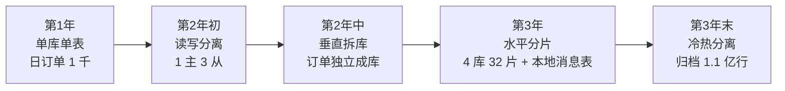

# 第13章：数据架构设计

> [!TIP] Part 3: 系统设计实战（横向专题篇）
> 从本章起进入 Part 3。前两部分回答的是"怎么切服务、怎么连服务"，这一部分回答"任何架构风格都绕不开的横切面怎么办"——数据、API、缓存、高可用、扩展性、安全。先从系统的地基说起：数据。

服务崩了可以重启，代码错了可以回滚，但数据错了、丢了、对不上了，往往没有后悔药。在所有架构决策里，数据架构的"后悔成本"是最高的：一张核心表的分片键选错，意味着一场持续一年的数据迁徙工程。

这一章我们跟着云书店的订单库走一遍：从一张单表开始，看它如何被真实的业务流量一步步"逼"出读写分离、分库分表、跨库一致性和冷热分离。看完你会发现，这些手段都不是提前设计出来的，而是被真实的痛逼出来的。

## 13.1 存储选型：先问访问模式，再谈流行度

"我们用什么数据库？"是架构评审会上出现频率最高的问题，也是最容易答错的问题。正确的打开方式不是"哪个数据库最火"，而是先回答三个问题：

1. **数据长什么样**：结构固定吗？字段差异大吗？有没有多层嵌套？
2. **数据怎么被访问**：读写比多少？要事务还是聚合？是点查还是全文检索？
3. **数据有多大量**：十万行和十亿行是完全不同的战场。

带着这三个问题看下面这张选型矩阵，每一类存储都在云书店里有明确的位置：

| 存储类型 | 代表产品 | 强项 | 云书店的使用场景 |
| ------- | ------- | ---- | -------------- |
| 关系型（RDBMS） | MySQL、PostgreSQL | 事务、强一致、复杂关联查询 | 订单、支付、库存——钱和库存的事务一分都不能错 |
| 文档型（Document） | MongoDB | Schema 灵活、天然支持嵌套文档 | 商品详情：图书有作者/版次/ISBN，文创有材质/尺寸，字段结构完全不同 |
| KV 存储 | Redis | 微秒级延迟、TTL、丰富数据结构 | 购物车、登录会话、验证码、热点缓存（第 15 章的主角） |
| 宽表（Wide-column） | Cassandra、HBase | 海量写入吞吐、按行键扫描 | 用户浏览足迹、行为埋点日志 |
| 时序（Time-series） | InfluxDB、Prometheus | 按时间追加、区间聚合、自动降采样 | 监控指标、每小时销量曲线 |
| 搜索引擎（Search Engine） | Elasticsearch | 全文检索、分词、多维聚合 | 图书搜索"三体 全集"、按价格区间筛商品 |

这个思路有个专门的名字：**混合持久化（Polyglot Persistence）**——不同类型的数据交给最擅长处理它的存储，而不是让一个 MySQL 承包一切。

反过来看，选型最常见的三个反模式：

- **一库走天下**：所有数据塞进 MySQL，商品详情用 JSON 列存，查询慢、索引废。
- **为技术而技术**：日订单 1 千就引入 Cassandra，运维成本远超业务收益。
- **忽视迁移成本**：只看写入性能，没想过数据一旦写进去，换存储要付出多大代价。

选型不是终身制，但存储迁移的成本是真实存在的——所以前两个问题（数据长什么样、怎么被访问）值得花掉一半的选型时间。

> [!NOTE] 提醒
> 存储种类越多，运维和一致性的成本就越高。云书店起步期只用一个 MySQL——日订单 1 千的阶段引入 6 种数据库，不叫架构先进，叫给自己找事。

## 13.2 主从复制与读写分离

云书店日订单涨到 1 万时（成长期初），第一个撞上的墙不是写入，而是读取。商品详情页、订单列表、库存查询全是读，读写比大约 20:1。MySQL 单实例扛 5000 左右的简单读查询 QPS 就开始报警，而大促的读流量很快就会冲过 1 万。

解法就是读写分离（Read/Write Splitting）：写走主库，读走从库。数据靠主从复制（Replication）从主库流向从库：

```text
                      写请求
                        │
                        ▼
                 ┌─────────────┐
                 │  主库 Master │
                 └──────┬──────┘
                        │ binlog 异步复制（延迟通常 1~100ms）
         ┌──────────────┼──────────────┐
         ▼              ▼              ▼
  ┌────────────┐ ┌────────────┐ ┌────────────┐
  │ 从库 Slave1 │ │ 从库 Slave2 │ │ 从库 Slave3 │
  └────────────┘ └────────────┘ └────────────┘
         ▲              ▲              ▲
         └──────────────┼──────────────┘
                        │ 读请求（读写比约 20:1）
```

一主多从之后，读能力从 5000 QPS 变成 2 万以上，而且挂掉一台从库还有两台顶上——顺便解决了"读"的可用性问题。

复制模式也有讲究，三种取舍：

| 复制模式 | 机制 | 一致性 | 性能 | 适用 |
| ---- | ---- | ---- | ---- | ---- |
| 异步复制 | 主库提交即返回，binlog 后台慢慢同步 | 可能丢少量最新数据 | 最好 | 读多写少的一般业务 |
| 半同步复制 | 至少 1 个从库确认收到 binlog 才返回 | 不丢已确认的事务 | 略降 | 订单、资金类表 |
| 组复制（Group Replication） | 多数派表决后才提交 | 强 | 最差 | 金融级强一致场景 |

云书店的订单库用半同步，埋点日志库用异步——同一套架构里按业务重要性分级，比"全部上最强"务实得多。

但复制是有延迟的。用户刚支付完订单，跳到"我的订单"页却查不到这笔单——因为他被路由到了一个还没同步完的从库。这就是**主从延迟（Replication Lag）**带来的"写后读"（Read-your-writes）问题。常见对策有三种：

| 对策 | 做法 | 代价 |
| ---- | ---- | ---- |
| 关键路径读主库 | 支付后的订单查询强制走主库 | 主库压力回升，要严格控制范围 |
| 会话粘性 | 同一用户写后 N 秒内固定路由到主库 | 网关要多维护一层路由规则 |
| 等待位点 | 读之前等 binlog 位点追平再返回 | 响应时间变长 |

云书店的取舍：下单、支付后的 3 秒内，订单相关查询走主库，其余全部走从库。简单，够用。

## 13.3 分库分表：垂直拆分与水平拆分

### 13.3.1 垂直拆分：按业务切开

第 2 年，订单表膨胀到 8000 万行，而且订单、商品、用户挤在同一个库里，互相抢锁、互相影响备份。第一步是垂直拆分（Vertical Splitting）：按业务边界把库切开，订单归订单，商品归商品。这一刀怎么切，和第 8 章模块化单体的模块边界是同一件事——模块边界画对了，库的边界就顺理成章。

垂直拆分解决的是"不同业务互相干扰"，但订单表自己 8000 万行还在涨（成长期末日订单 5 万，一年就是 1800 多万行）。单表超过 5000 万行后，B+ 树层数变深、加一列索引变成几小时的手术，这时就要水平拆分了。

### 13.3.2 水平拆分与分片键的取舍

水平拆分（Horizontal Splitting）是把同一张表的行，按某个键的规则散到多个库表里。这个键就是分片键（Sharding Key），它是分库分表里权重最高的一个决策。

用订单表来推演：分片键选 order_id 还是 seller_id？

| 维度 | 按 order_id（订单维度） | 按 seller_id（商家维度） |
| ---- | --------------------- | ---------------------- |
| 买家查"我的订单" | 一次路由到目标分片 | 不知道在哪个分片，要扫全部 32 片 |
| 商家查"我卖出的订单" | 要扫全部分片，聚合后再排序 | 一次路由到位 |
| 写入均匀度 | 好，订单号散列均匀 | 差：头部 5% 的商家贡献 30% 的订单，产生数据倾斜（Skew） |
| 大促热点 | 均匀分散 | 爆款店铺所在分片被写爆 |

云书店是 C 端为主的平台，买家查询远多于商家查询，于是定下规则：**订单表按 order_id 分片**。商家侧的高频查询（发货、对账）怎么办？答案是异构索引：用 binlog 把订单数据异步同步一份到按 seller_id 组织的索引库（或 Elasticsearch），供商家后台查询。一份写入，两种读法，两边都路由到位。

> [!WARNING] 决策警告
> 分片键一旦定下，几乎不可更改——改分片键等于把几亿行数据重新洗一遍。建表之前，把未来三年所有"这张表会按什么维度查"的问题先想清楚。

### 13.3.3 路由算法：数据到底落在哪

| 算法 | 做法 | 优点 | 缺点 |
| ---- | ---- | ---- | ---- |
| 范围（Range） | 按时间或 ID 区间切：2026Q1 的数据在分片 1 | 范围查询友好，扩容只需加新分片 | 热点永远落在最后一个分片 |
| 哈希（Hash） | hash(order_id) 对分片数取模 | 数据均匀 | 扩容要大规模迁移数据，跨片范围查询要扫全片 |
| 查找表（Lookup） | 独立的路由表或路由服务记录 key 到分片的映射 | 灵活，可以任意迁移单个 key | 多一次查询，路由表自己必须高可用 |

云书店选择哈希 + 分片基因（Sharding Gene）：生成订单号时，把 user_id 哈希后的 5 位拼进 order_id 末尾。这样订单号本身就携带了路由信息——买家查订单、支付回调，都不需要查路由表，直接从单号算出分片：

```text
order_id = [时间戳 8 位] + [自增序列 7 位] + [分片基因 5 位]
                                     ↑
                       user_id 的哈希值后 5 位，决定落在哪个分片
```

```typescript
// 分片路由伪代码
const SHARD_COUNT = 32;

function getShard(orderId: string): number {
  const gene = orderId.slice(-5);           // 取分片基因
  return parseInt(gene, 16) % SHARD_COUNT;  // 直接算出 0~31 的分片编号
}

// 商家侧不走这段逻辑，走异构索引库（按 seller_id 组织）
```

扩容预案：32 个逻辑分片先落在 4 个物理库上（每库 8 片）。将来涨到 8 个库时，只需把每个库的一半分片整体搬到新库——因为分片是逻辑概念，搬的是"片"而不是"行"。

### 13.3.4 分片之后，问题清单要重新过一遍

分片不是免费的午餐，拆完之后这些问题都要重新回答：

| 新问题 | 说明 | 云书店的解法 |
| ---- | ---- | ---- |
| 跨片查询 | 不带分片键的查询要扫全部 32 片 | 交易链路强制带分片键；运营后台走异构索引库 |
| 跨片事务 | 一笔订单跨两个分片，没有共同的本地事务 | 本地消息表 + 最终一致（见 13.4） |
| 全局唯一 ID | 各库自增主键会冲突 | 时间戳 + 序列 + 分片基因的雪花式 ID |
| 二次扩容 | 32 片将来不够用了 | 逻辑分片预留 4 倍余量，扩物理库搬"片"不搬行 |
| 运维复杂度 | 一个 DDL 要在 32 片上执行 32 次 | 变更工具按分片编排，先灰度一片验证再全量 |

## 13.4 跨库一致性：本地消息表与事务消息

订单拆到独立数据库之后，一个老问题变成了分布式问题："支付成功后，订单状态要更新，库存要扣减"——这两步在不同库里，没有共同的本地事务了。

强一致方案两阶段提交（2PC，Two-Phase Commit）性能差、协议重，电商场景几乎不用。主流答案是把"强一致"降级为最终一致（Eventual Consistency），代表作是本地消息表（Transactional Outbox）。

核心思想一句话：**业务数据和"要发的消息"在同一个库、同一个事务里落盘，消息的投递交给后台任务异步完成。**

```sql
CREATE TABLE local_message (
  id           BIGINT PRIMARY KEY,
  biz_type     VARCHAR(32) NOT NULL,  -- ORDER_PAID / STOCK_DEDUCTED
  biz_key      VARCHAR(64) NOT NULL,  -- 订单号，消费方据此幂等
  payload      TEXT        NOT NULL,  -- 消息体 JSON
  status       TINYINT     NOT NULL DEFAULT 0,  -- 0待发送 1已发送 2死信
  retry_count  INT         NOT NULL DEFAULT 0,
  next_retry   DATETIME    NOT NULL,
  created_at   DATETIME    NOT NULL,
  KEY idx_status_retry (status, next_retry)
);
```

完整流程分四步：

1. 业务事务里同时写入业务表和 local_message——同库同事务，天然原子。
2. 后台任务按 `status=0 AND next_retry <= now` 扫表，把消息投递到 MQ。
3. 投递成功更新 status=1；失败则 retry_count 加一，next_retry 按指数退避推后。
4. 重试超过 10 次标记为死信（status=2），触发告警转人工。

消费端拿到消息后按 biz_key 做幂等判断——消息至少会被投递一次，重复投递是常态而非异常。

```typescript
// 业务与消息表同事务写入
async function onPaySuccess(order: Order) {
  await db.transaction(async (tx) => {
    await tx.update('orders').set({ status: 'PAID' }).where({ id: order.id });
    await tx.insert('local_message').values({
      biz_type: 'ORDER_PAID',
      biz_key: order.id,
      payload: JSON.stringify({ orderId: order.id }),
      next_retry: new Date(),
    });
  }); // 订单状态和消息要么同时成功，要么同时失败
}

// 后台任务：扫表投递到消息队列，失败按指数退避重试，超过 10 次进死信人工介入
```

对比一下 RocketMQ 的事务消息（Transactional Message）：它把"本地消息表"内置到了消息队列里（半消息 + 回查机制），省掉了建表和扫表的代码，代价是绑定特定的 MQ。两者选一个即可，思想完全一样：**先落盘、再投递、靠重试、靠幂等兜底**（幂等在第 14 章展开）。

## 13.5 冷热数据分离与归档

第 3 年末，订单表约 2 亿行。但统计发现 95% 的查询只碰最近 6 个月的数据——两年前那笔订单一年也查不了几次，却和其他订单一起摊薄着每一层索引的性能。

冷热分离（Hot/Cold Data Separation）的思路：热库只保留 6 个月，更早的数据搬到归档库。

| 层 | 存储 | 数据范围 | 特点 |
| ---- | ---- | ---- | ---- |
| 热库 | 4 库 32 片 | 最近 6 个月，约 9000 万行 | 高配 SSD，服务 95% 的查询 |
| 归档库 | 2 个低配实例 | 6 个月以上，约 1.1 亿行 | 只支持按订单号点查，成本约为热库的 1/5 |
| 冷备份 | 对象存储 | 3 年以上 | Parquet 列存文件，供数据分析，几乎不计成本 |

归档作业的三条纪律：

1. **按批搬**：每批 2000 行，搬完校验行数一致后再删源数据，绝不一把梭。
2. **可回查**：订单详情页发现数据不在热库时，自动降级查归档库，用户无感知。
3. **先备份再删除**：删除条件必须带上时间戳和状态，防止误删刚补支付的旧订单。

归档不是"扔进冷宫"，配套要跟上：归档库的表结构刻意精简——去掉大部分索引，只留订单号和用户 ID 两个点查索引；归档数据每周抽样比对行数与校验和；数据分析团队直接读对象存储上的 Parquet 文件，不再碰生产库。

## 13.6 云书店订单库：三年演进复盘

把这一章的手段按时间串起来：



| 阶段 | 触发的痛 | 动作 | 效果 |
| ---- | ---- | ---- | ---- |
| 单库单表 | 读流量打满单实例（读 QPS 过 1 万） | 读写分离，1 主 3 从 | 读能力约 4 倍，成本 +3 台从库 |
| 垂直拆库 | 业务互相干扰，DDL 互相阻塞 | 订单、商品、用户各自独立库 | 故障隔离，备份互不影响 |
| 水平分片 | 订单单表 8000 万行，写入逼近极限 | 按 order_id 分 32 片，商家侧走异构索引 | 写入能力随分片数扩展，单表回到 500 万行量级 |
| 冷热分离 | 2 亿行，95% 查询集中在 6 个月内 | 热库留 6 个月，其余归档 | 热库体积减半，查询 P99 从 80ms 降到 35ms |

复盘这三年，有三条经验值得带走：

1. **每一刀都有触发信号**：读 QPS 破万才读写分离，单表 8000 万行才分片——信号来自监控，不来自焦虑。
2. **拆分方向跟着查询走**：先想清楚"这张表按什么维度查"，再决定分片键，顺序不能反。
3. **每次拆分都留退路**：逻辑分片预留余量、归档可回查、消息可重放——好的架构决策不仅能往前走，还能往回看。

每一次动作都是被真实的痛逼出来的，而不是"听说大厂都分库分表"。这也呼应了第 4 章的原则：先测量，再动手。

## 本章小结

- 存储选型先看访问模式：事务用关系型、灵活结构用文档、检索用搜索引擎，混合持久化各取所长
- 读写分离解决读压力，但要面对主从延迟，关键路径可以临时读主库
- 分库分表先垂直后水平：垂直按业务边界切，水平按分片键切
- 分片键是最重的决策：C 端场景选订单维度，商家侧用异构索引补位
- 路由算法三种：范围友好但热点集中，哈希均匀但扩容难，查找表灵活但多一跳
- 跨库一致性的主流解是本地消息表（Outbox）：同事务落盘、异步投递、消费幂等
- 冷热分离让热库保持精瘦，95% 的查询服务在 5% 的数据上
- 数据架构是演进出来的，每一刀都是被真实的痛逼出来的

**下一章预告**：数据是系统对内的模样，而 API 是系统对外的模样。下一章我们聊 API 设计——如何让接口成为可以放心依赖的契约，而不是随时会变的惊喜。

---
