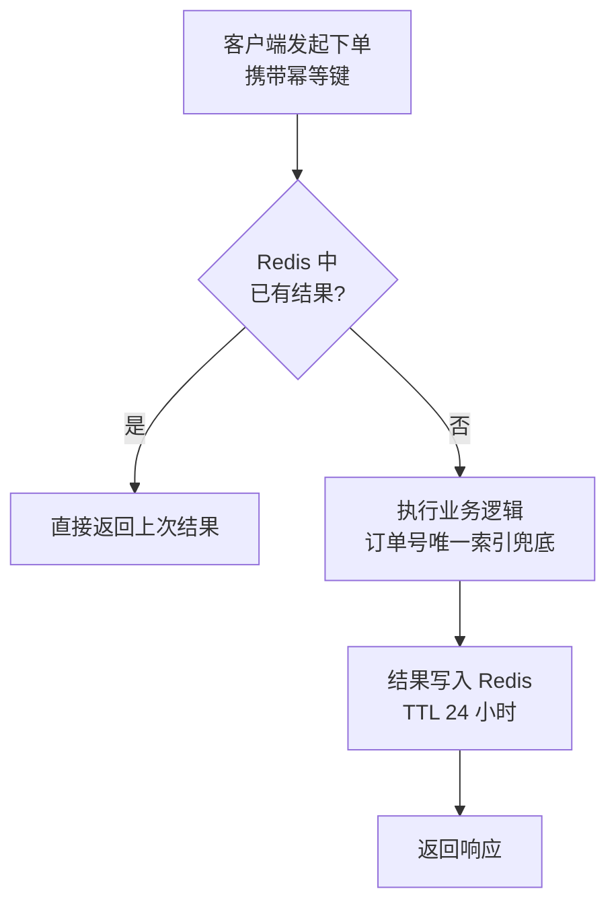

# 第14章：API 设计——系统之间的契约

> [!TIP] Part 3: 系统设计实战（横向专题篇）
> 数据定地基，API 定边界。本章讲系统之间如何立一份"白纸黑字、变更受控"的契约——从资源建模、版本管理到幂等与网关。

代码会过时，框架会更换，但接口一旦被别人依赖，就成了必须小心维护的公共设施。前端等后端、商家等开放平台、订单服务等库存服务——大家真正等的从来不是代码，而是一份双方都认可的契约。

这一章讲清楚：怎么把 API 设计成一份好契约——资源怎么建模、版本怎么管、幂等怎么做、错误怎么报，以及为什么"契约优先"能省掉一半的联调时间。

## 14.1 API 是架构的契约

第 4 章讲过：架构 = 组件 + 关系 + 决策。组件之间的关系，在运行时几乎都通过 API（Application Programming Interface，应用程序编程接口）体现。API 不只是"接口文档"，它同时是三样东西：

- **边界声明**：契约之外的事，一概不承诺。
- **稳定性承诺**：今天返回的字段，明天不能悄悄消失。
- **沟通语言**：双方基于契约并行开发，不必等对方写完。

打个比方：API 之于系统，就像插座之于电器。电压、频率、插口形状就是契约——只要契约不变，你换第十代电器，墙上的插座也不用心慌。

衡量一份契约好坏有三条标准：**明确**（写得下来）、**稳定**（变更受控）、**可验证**（机器能自动校验）。本章的所有手段都围绕这三条展开。

反例很常见：接口文档里写着 status 是"订单状态"，却没写取值范围；前端拿到 500 就弹一句"系统繁忙"，用户和客服都摸不着头脑。契约没立好，每一个误解都会在联调、报障、事故复盘时被加倍偿还。

## 14.2 REST 资源建模与命名规范

REST（Representational State Transfer，表述性状态转移）是目前最通用的 API 风格，核心思想一句话：**把一切抽象成资源（Resource），用名词定位资源，用 HTTP 方法表达操作。**

先建模资源。云书店的领域里有用户、商品、购物车、订单，接口从名词开始：

| 操作 | 请求 | 语义说明 |
| ---- | ---- | ---- |
| 创建订单 | POST /v1/orders | POST 创建，不幂等 |
| 查询单个订单 | GET /v1/orders/10086 | GET 安全且幂等 |
| 查询用户的订单列表 | GET /v1/users/9527/orders | 资源可以有层级 |
| 修改收货地址 | PATCH /v1/orders/10086 | PATCH 部分更新 |
| 取消订单 | PATCH /v1/orders/10086（status=CANCELLED） | 状态用字段表达，而不是造动词接口 |
| 删除购物车项 | DELETE /v1/cart/items/8829 | DELETE 幂等 |

REST 还有几条容易被忽略的约束，值得对照自查：无状态（请求之间不依赖服务端会话，呼应第 17 章）、统一接口（同一资源用同一套方法语义）、可缓存（响应声明自己能否被缓存，GET 天然可缓存）。这三条做满，网关缓存和水平扩展才有发挥空间。

命名规范全家桶：

| 规范 | 正确示例 | 错误示例 |
| ---- | ---- | ---- |
| 资源用名词复数 | /orders | /getOrder |
| 全小写，单词用中划线 | /order-items | /OrderItems、/order_items |
| 路径层级不超过两层 | /users/9527/orders | /users/9527/orders/10086/items/3 |
| 动作不进 URI | PATCH 状态字段或子资源 | /orders/10086/cancel |
| 过滤条件用查询参数 | /orders?status=PAID | /orders/paid |

> [!TIP] 动作类接口怎么办
> "取消订单""申请退款"这类动作硬套 CRUD 很别扭。两种主流做法：状态字段（PATCH status）或把动作名词化（POST /v1/orders/10086/cancellation）。选一种，全站统一，别混用。

## 14.3 版本管理三种策略

API 一旦有人用，就不能随意改。三种常见的版本管理策略：

| 策略 | 示例 | 优点 | 缺点 |
| ---- | ---- | ---- | ---- |
| URI 路径版本 | /v1/orders | 直观，路由和缓存友好 | 版本侵入 URL |
| 请求头版本 | X-Api-Version: 2026-06-01 | URL 干净，支持细粒度日期 | 调试不直观，CDN 缓存键要额外配置 |
| 媒体类型版本 | Accept: application/vnd.cloudbook.v2+json | 最符合 REST 原生理念 | 使用和理解门槛最高 |

云书店选 URI 路径版本：简单直白，网关按 /v1、/v2 转发即可。配套两条纪律：

1. **版本内只加不减**：新增可选字段不算破坏；删字段、改字段语义、把可选变必填，都是破坏性变更（Breaking Change），必须升版本。
2. **旧版本有明确的下线时间**：提前 3 个月公告，响应头带 Sunset 日期，旧版本调用量归零后再下线。

## 14.4 幂等性设计：让重复请求不闯祸

幂等（Idempotency）：同一个操作执行一次和执行 N 次，最终效果相同。

为什么必须有它：网络会超时，客户端会重试，消息会重复投递（第 10 章讲过"至少一次"语义）。下单接口如果不幂等，用户手抖点两下"提交"，就会生成两个订单。

HTTP 方法的天生幂等性：

| 方法 | 幂等 | 说明 |
| ---- | ---- | ---- |
| GET | 是 | 只读，天然幂等 |
| PUT | 是 | 整体替换，替换两次结果一样 |
| DELETE | 是 | 删两次还是删 |
| POST | 否 | 创建两次就是两个资源 |

POST 的解法是幂等键（Idempotency Key）：客户端为每个业务动作生成唯一键，服务端见到重复键就直接返回上次的结果：

```typescript
// 云书店下单接口的幂等实现
async function createOrder(req: Request): Promise<Order> {
  const key = req.header('Idempotency-Key');      // 客户端生成的 UUID
  const hit = await redis.get(`idem:order:${key}`);
  if (hit) return JSON.parse(hit);                // 重复请求，返回上次结果

  const order = await orderService.create(req.body); // 订单表唯一索引兜底
  await redis.set(`idem:order:${key}`, JSON.stringify(order), 'EX', 86400);
  return order;
}
```

双保险缺一不可：Redis 幂等键挡住绝大多数重复请求，数据库唯一索引兜底极端并发——只靠 Redis，它宕机的瞬间就可能重复下单。



## 14.5 分页、过滤、排序与统一错误结构

列表类接口的三件套要一开始就定死格式，否则每个接口一种风格，客户端会疯掉：

- **分页**：`GET /v1/orders?cursor=eyJpZCI6MTAwODZ9&limit=20`。为什么不用 `?page=100`？offset 深翻页时，数据库要扫过前面所有行再丢弃，订单表分片后更是灾难。游标（Cursor）分页只按索引"接着上次的位置继续"，代价是不能跳页——列表场景完全可以接受。三个工程细节：cursor 编码成不透明字符串，不暴露内部 ID 规律；cursor 里带上排序字段，翻页期间有新数据写入也不乱序；cursor 设 5 分钟有效期，过期重新查第一页——列表页没有人真的翻到第 100 页。
- **过滤**：`?status=PAID&createdAtFrom=2026-01-01`，支持的字段白名单化，防止有人拼出全表扫描。
- **排序**：`?sort=-createdAt`，同样白名单化，负号表示倒序。

错误结构也要统一。云书店的错误响应固定四个字段：

| 字段 | 类型 | 说明 | 示例 |
| ---- | ---- | ---- | ---- |
| code | string | 业务错误码，稳定不变 | ORD_STOCK_NOT_ENOUGH |
| message | string | 面向用户的提示语 | 商品库存不足 |
| traceId | string | 链路追踪 ID，报障必带 | a3f8c2e1 |
| doc | string | 错误码文档链接 | api.cloudbook.dev/errors/ORD_STOCK_NOT_ENOUGH |

错误码分段原则：HTTP 状态码表达大类（4xx 是客户端的错，5xx 是服务端的错），业务码表达细节。一句话总结：**状态码管传输语义，业务码管业务语义，message 管人话，traceId 管排查。**

## 14.6 REST vs gRPC vs GraphQL

REST 不是唯一选项。三种主流风格放在一起比：

| 维度 | REST | gRPC | GraphQL |
| ---- | ---- | ---- | ---- |
| 协议与格式 | HTTP/1.1 + JSON | HTTP/2 + Protobuf 二进制 | HTTP + JSON |
| 性能 | 一般 | 高：序列化小、多路复用 | 一般，按需取字段省流量 |
| 契约 | OpenAPI（可选） | .proto 强约束（必需） | Schema 强约束（必需） |
| 浏览器友好度 | 好 | 差，通常要网关转换 | 好 |
| 学习成本 | 低 | 中 | 中高 |
| 适合场景 | 对外开放 API、通用 Web | 内部服务间高频低延迟调用 | 多端字段需求差异大的聚合查询 |

云书店的组合拳：对外开放平台用 REST（生态好、调试容易）；订单调用库存、支付这类内部高频链路用 gRPC（内网带宽省 60%，延迟低一个量级）；App 首页用 GraphQL 搭 BFF（Backend for Frontend，面向前端的聚合层）——App 要什么字段自己挑，一次请求拿全商品、评价、推荐。选型的判断顺序建议固定：先问调用方是谁（外部开发者用 REST；内部服务 gRPC 可以后置；自家多端 App 才考虑 GraphQL 的 BFF），再问团队维护能力——一个没人玩得转 GraphQL 的团队，BFF 会从加速器变成维护黑洞。

> [!NOTE] 提醒
> 三者没有高下，只有场景。内部服务从 REST 起步完全没有问题，等调用延迟真成为瓶颈时再换 gRPC，迁移成本远小于一开始就过度设计。

## 14.7 API 网关的五大职责

服务一多，客户端不该知道每个服务在哪台机器上。API 网关（API Gateway）是所有请求的统一入口：

```text
   客户端（App / Web / 小程序 / 商家后台）
              │
              ▼
   ┌─────────────────────────────────┐
   │           API 网关                │
   │                                 │
   │  ① 路由转发   /orders → 订单服务   │
   │  ② 认证鉴权   校验 JWT、检查权限   │
   │  ③ 流量控制   令牌桶限流（见16章）  │
   │  ④ 响应聚合   首页一次聚合三服务   │
   │  ⑤ 统一观测   日志/指标/链路追踪   │
   └────────┬────────┬────────┬──────┘
            ▼        ▼        ▼
        订单服务   商品服务   评价服务
```

| 职责 | 说明 | 云书店实例 |
| ---- | ---- | ---- |
| 路由转发 | 按路径把请求送到对应服务 | /orders 前缀转发到订单服务 |
| 认证鉴权 | 统一校验令牌，服务不必重复实现 | JWT 验签在网关做一次 |
| 流量控制 | 按用户、接口、全局多维度限流 | 单用户 50 QPS，详情接口总量 12 万 QPS |
| 响应聚合 | 多个服务的结果合成一个响应 | 首页一次取商品 + 评价 + 推荐 |
| 统一观测 | 全站日志、指标、traceId 注入 | 报障凭 traceId 全链路查询 |

一个提醒：网关只做"横切"的事，业务逻辑一行都不要放进去，否则它会变成人人都要改、出了事全站陪葬的单点。网关自身也要高可用：至少两个实例加前置负载均衡，配置变更走版本化和灰度——第 16 章讲的"无单点"和"发布策略"，对网关自己同样适用。网关挂了全站都挂，它是最高优先级的保护对象。

## 14.8 契约优先与破坏性变更管理

两种开发节奏对比：代码先行（Code-First）是后端写完代码再导出文档，文档永远落后于实现；契约优先（Contract-First）是先写契约、评审通过、双方按契约各自开发（前端用 mock 数据），最后联调。后者把"联调才发现理解不一致"提前到了"评审阶段"，返工成本最低。

OpenAPI（前身 Swagger）是 REST 契约的事实标准：

```yaml
openapi: 3.1.0
info:
  title: CloudBook Order API
  version: 1.2.0
paths:
  /v1/orders/{orderId}:
    get:
      summary: 查询订单详情
      parameters:
        - name: orderId
          in: path
          required: true
          schema:
            type: string
      responses:
        "200":
          description: 订单详情
          content:
            application/json:
              schema:
                $ref: "#/components/schemas/Order"
        "404":
          description: 订单不存在
          content:
            application/json:
              schema:
                $ref: "#/components/schemas/Error"
components:
  schemas:
    Error:
      type: object
      required: [code, message, traceId]
      properties:
        code:
          type: string
          example: ORD_NOT_FOUND
        message:
          type: string
          example: 订单不存在
        traceId:
          type: string
          example: a3f8c2e1
```

契约写出来之后，CI 流水线自动校验实现是否符合契约（契约测试，Contract Testing），文档、SDK、mock 服务都可以从它生成——一份契约，多处复用。

破坏性变更的管理流程：

| 变更类型 | 示例 | 处理方式 |
| ---- | ---- | ---- |
| 非破坏性 | 新增可选响应字段 | 版本内直接发布 |
| 破坏性 | 删字段、改语义、可选变必填 | 开新版本，或新旧双写过渡 |
| 行为性 | 响应变慢、排序默认值变化 | 提前公告并观察监控指标 |

标准流程：弃用公告（提前 3 个月）→ 响应头带 Sunset 日期 → 监控旧版本调用量持续下降 → 归零后下线。整个过程像飞机换引擎：先装新的，再拆旧的，中间永远有一条活路。

## 本章小结

- API 是组件关系在运行时的体现：明确、稳定、可验证，才算好契约
- REST 建模从名词开始，动作交给 HTTP 方法或状态字段，命名全站统一
- 版本管理选一种策略并用纪律护航：版本内只加不减，破坏性变更升版本
- POST 靠幂等键实现幂等，幂等键加数据库唯一索引构成双保险
- 列表接口用游标分页，过滤排序字段白名单化，错误响应结构全站统一
- REST 对外、gRPC 对内、GraphQL 做聚合，按场景组合而非站队
- 网关五大职责：路由、鉴权、限流、聚合、观测，别往里塞业务逻辑
- 契约优先把不一致消灭在评审阶段，破坏性变更有公告到下线的完整流程

**下一章预告**：接口稳定了，用户还是嫌慢怎么办？下一章讲缓存架构——用空间换时间，以及用空间换来的三大新问题。

---
