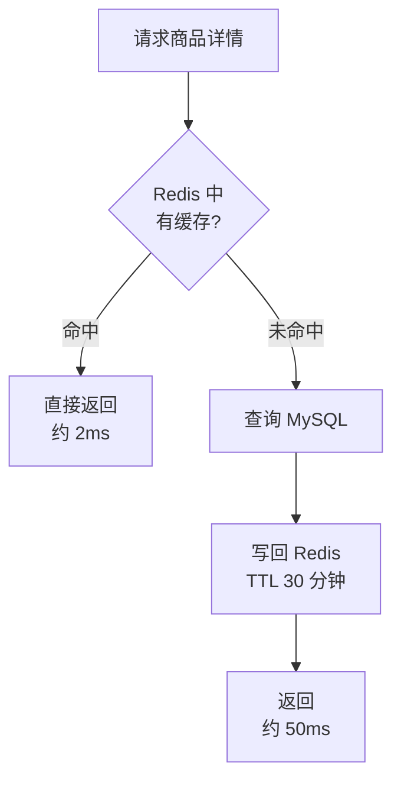

# 第15章：缓存架构——用空间换时间

> [!TIP] Part 3: 系统设计实战（横向专题篇）
> 缓存是性能优化的第一杠杆，也是线上事故榜的常客。本章讲多级缓存怎么摆、三大经典问题怎么防、与数据库的一致性怎么保。

几乎所有"系统变慢"的故事，最后的解法都是缓存。原因很简单：内存比磁盘快百倍，本机比跨网快百倍——用空间换时间，是架构里最划算的一笔买卖。

但缓存不是免费的午餐。它引入了"数据同时存在两份"这个新麻烦，还带来了穿透、击穿、雪崩三个经典事故现场。这一章把这几点一次讲透，最后用云书店商品详情页的真实数字做一次完整推演。

## 15.1 缓存放哪里：一条请求的四道缓冲

先建立空间感。缓存可以放在请求链路的每一层，越靠前越快越省，离数据源越远、一致性越难管：

```text
            用户请求（大促峰值 10 万 QPS）
                     │
                     ▼
┌────────────────────────────────────────────┐
│ ① CDN 节点        图片/静态资源，命中 ~85%   │
└──────────────────────┬─────────────────────┘
                       ▼ 未命中的 API 请求
┌────────────────────────────────────────────┐
│ ② 网关缓存         接口级短 TTL，扛突发      │
└──────────────────────┬─────────────────────┘
                       ▼
┌────────────────────────────────────────────┐
│ ③ 进程内缓存       Top 1000 热书，微秒级     │
└──────────────────────┬─────────────────────┘
                       ▼
┌────────────────────────────────────────────┐
│ ④ Redis 集群      全量商品详情，毫秒级       │
└──────────────────────┬─────────────────────┘
                       ▼  仅约 0.5% 回源（500 QPS）
                ┌──────────────┐
                │ MySQL 主从集群 │
                └──────────────┘
```

| 层级 | 位置 | 延迟量级 | 容量 | 一致性难度 |
| ---- | ---- | ---- | ---- | ---- |
| CDN（Content Delivery Network，内容分发网络） | 用户附近的边缘节点 | 约 10ms | 大（静态资源） | 低，内容基本不变 |
| 网关缓存 | 接入层 | 约 1ms | 小 | 中 |
| 进程内缓存 | 应用实例内存 | 约 10μs | 小，受堆内存限制 | 高，多实例各持一份 |
| 分布式缓存 | Redis 集群 | 约 1ms | 大，可水平扩展 | 中，全站共享一份 |
| 数据库 | 磁盘 | 10ms 以上 | 最大 | —— |

原则一句话：**静态资源往最外层推，热点数据往进程内放，全量数据放分布式缓存，数据库只做回源。**

但缓存不是处处适用。上缓存之前先过三问：读多写少吗？（写多读少的数据命中率极低，白费内存）能容忍不一致吗？（资金字段不行）值得引入复杂度吗？（低频接口缓存了也没人访问）。三个问题里有一个"否"，就先别缓存——缓存是负债，只是通常利息很低。

缓存收益有个简单的算术：**平均响应时间 = 命中率 × 缓存耗时 + (1 - 命中率) × 回源耗时**。命中率 99%、缓存 2ms、回源 50ms 时，平均约 2.5ms——命中率每掉 1 个点，平均耗时涨约 0.5ms。这就是为什么监控里命中率是最重要的指标：它直接换算成用户体验。

## 15.2 三大缓存模式

缓存和数据库怎么配合，有三种经典模式：

| 模式 | 读路径 | 写路径 | 优点 | 代价 | 云书店场景 |
| ---- | ---- | ---- | ---- | ---- | ---- |
| Cache-Aside（旁路缓存） | 应用先查缓存，未命中回源并回填 | 先更新数据库，再删除缓存 | 简单可控，最常用 | 应用代码自己管缓存 | 商品详情、订单列表 |
| Read/Write-Through（穿透读/直写） | 应用只访问缓存层，由缓存层读写数据库 | 写到缓存层，由它同步写库 | 对应用透明，逻辑集中 | 需要专门的缓存中间件 | 库存数量查询 |
| Write-Behind（异步写回） | 同上 | 先写缓存，异步批量刷回数据库 | 写性能最高 | 缓存宕机可能丢数据 | 浏览足迹、点赞计数 |

三种模式怎么选？一句话决策：默认 Cache-Aside；只有当"缓存层"本身是独立组件（如多级缓存框架）时才考虑 Through 系列；Write-Behind 只给"丢了无所谓"的数据用。宁可模式简单，也不要为了名词时髦三种混着上。

Cache-Aside 是默认姿势，读流程如下：



Write-Behind 的丢数据风险决定了它只能用于"丢了也不心疼"的数据——购物足迹丢了没人在乎，订单金额用 Write-Behind 就是事故。

Cache-Aside 能成为默认姿势，靠的是两件事：一是它不依赖特殊中间件，应用代码几十行就能实现；二是写路径"删缓存"而不是"改缓存"，天然回避了并发写的顺序问题（15.4 展开）。它的刷新策略默认是 TTL 过期，对"半天不更新也不出错"的数据（商品介绍、分类树）完全够用；更新频繁的数据要么缩短 TTL，要么在更新时主动删一次。

命中率还和 key 的粒度有关：粒度太粗（整页缓存）命中率高但复用性差，粒度太细（每个字段一个 key）复用好但请求次数多。云书店详情页拆成"基础信息 + 价格 + 库存"三个 key——前两个缓存 30 分钟，库存只缓存 1 秒。粒度和 TTL 按字段特性分别设计，而不是一刀切。

选模式的本质是在选"谁来负责一致性"：Cache-Aside 由应用负责，简单但要写对；Through 系列由缓存层负责，省心但要引组件；Write-Behind 由时间负责——它赌的是"刷回之前不出事"。三个负责人看明白了，选型就不会纠结。

## 15.3 缓存三大问题与对策

| 问题 | 场景 | 后果 | 对策 |
| ---- | ---- | ---- | ---- |
| 穿透（Cache Penetration） | 查一个根本不存在的商品 ID，缓存里永远不会有 | 恶意请求全部打到数据库 | 布隆过滤器拦一道；空值短 TTL 缓存 |
| 击穿（Cache Breakdown） | 某个热点 key 到期的一瞬间，上万请求同时回源 | 数据库瞬间被打爆 | 互斥锁只放一个请求回源；逻辑过期异步刷新 |
| 雪崩（Cache Avalanche） | 大批 key 同时到期，或 Redis 整体宕机 | 数据库被洪峰冲垮 | 过期时间加随机抖动；多级缓存兜底；限流降级 |

### 15.3.1 穿透：查根本不存在的数据

攻击者拿一堆不存在的商品 ID 反复请求（自增 ID 挨个试负数和超大值），缓存里永远没有，每次都穿透到数据库。对策两层：布隆过滤器（Bloom Filter）在入口拦截——它用极小的内存回答"这个 key 一定不存在吗"，回答不存在就一定不存在（回答存在有小概率误判，可接受）；再配一层空值缓存，偶尔漏网的不存在 ID 也只回源一次。

布隆过滤器的三个工程细节：

- 容量按"预期 key 数 × 1.2"规划，误判率压在 1% 以内
- 只支持添加、不支持删除——商品下架频繁时，需要定期全量重建
- 放在进程内而不是 Redis：拦截层越靠前，省下的回源越多

### 15.3.2 击穿：热点 key 失效的瞬间

某本爆款新书详情缓存到期，同一瞬间上万请求同时发现缓存没了，全部涌向数据库——这就是击穿。对策是互斥锁：抢到锁的那一个请求回源，其余请求等 50ms 后重读缓存（此时新值已经回填）。对"宁可旧不可无"的数据，还可以用逻辑过期：缓存物理上永不过期，值里带一个逻辑过期时间，发现逻辑过期就异步刷新、先用旧值顶着。

两种对策的取舍：互斥锁实现简单，但抢不到锁的请求要等 50ms；逻辑过期零等待，但要接受短暂旧值，还要常驻一个异步刷新任务。云书店的爆款详情用逻辑过期（宁旧勿挂），一般商品用互斥锁（等 50ms 无感）。

### 15.3.3 雪崩：大面积失效

雪崩有两种成因：大批 key 设了相同的 TTL 同时到期（对策：过期时间加随机抖动）；Redis 整体宕机（对策：进程内缓存兜底、网关限流、快速故障转移）。雪崩的杀伤力最大，因为它打击的是"缓存这一整层"。

防雪崩的完整清单：TTL 加随机抖动（打散到期时间）、Redis 集群化加主从自动切换（别让整层一起挂）、进程内缓存兜底（最热的一批顶住）、网关限流（最后防线，宁可慢速服务也不打死数据库）。

记一个口诀：**查不存在的数据是穿透，一个热点失效是击穿，一片 key 失效是雪崩。**

三者可以写进同一段读逻辑里：

```typescript
// ── 穿透：布隆过滤器（Bloom Filter）拦一道 ──
// 布隆过滤器说"没有"就一定没有，说"有"可能误判——用极小内存挡住绝大多数恶意 ID
function getProduct(id: string) {
  if (!bloom.mightContain(id)) return null;   // 一定不存在，直接返回

  const cached = redis.get(`product:${id}`);
  if (cached === 'NULL') return null;         // 空值缓存，TTL 60s，兜底防穿透
  if (cached) return JSON.parse(cached);

  return loadFromDb(id);
}

// ── 击穿：互斥锁（Mutex），只放一个请求回源 ──
async function loadFromDb(id: string) {
  const lockKey = `lock:product:${id}`;
  if (redis.set(lockKey, '1', 'NX', 'EX', 3)) {   // 只有一个请求抢到锁
    const data = await db.query('SELECT * FROM products WHERE id = ?', id);
    redis.setex(`product:${id}`, ttlWithJitter(), JSON.stringify(data));
    redis.del(lockKey);
    return data;
  }
  await sleep(50);                                // 没抢到锁：稍等后重读缓存
  return redis.get(`product:${id}`);
}

// ── 雪崩：过期时间打散 + 兜底 ──
function ttlWithJitter(): number {
  return 1800 + Math.floor(Math.random() * 600);  // 基础 30min ± 10min 随机抖动
}
// 极端情况 Redis 整体不可用：进程内缓存 + 网关限流（第 16 章）保命
```

> [!TIP] 面试高频
> 三大问题几乎每场后端面试都会出现。答题时先说清三者区别（一个 key、不存在的 key、一片 key），再给对策，最后补一句"生产上还要配监控和兜底限流"——层次立刻拉开。

## 15.4 缓存与数据库的一致性

先说结论：**用了缓存就不要追求强一致，追求"最终一致 + 不一致窗口尽量短"。**

把常见的四种写法放在一张表里对比：

| 写法 | 一致性窗口 | 主要风险 | 结论 |
| ---- | ---- | ---- | ---- |
| 先删缓存，再更库 | 长 | 删完到提交前的读会把旧值回灌缓存 | 不采用 |
| 先更库，再更新缓存 | 中 | 并发写乱序，旧值覆盖新值 | 不采用 |
| 先更库，再删缓存 | 短 | 概率极低的读并发回填旧值 | 默认采用 |
| 订阅 binlog 删缓存 | 短且稳定 | 引入 Canal 等额外组件 | 强一致诉求采用 |

为什么是"先更新库，再删缓存"，而不是"先删缓存"？如果先删缓存，删完到数据库提交之间的这几毫秒里，读请求会把旧值又灌回缓存，脏数据会一直留到过期。先更库再删缓存，最坏也只是短暂读到旧值，且窗口极小。

为什么是"删缓存"而不是"更新缓存"？两个并发写同时"更新缓存"时可能乱序，旧值覆盖新值；删除则没有顺序问题——下次读自然回填最新值。

即便如此，还有一种小概率脏数据：读请求在数据库提交前回源读到旧值，又恰好在删缓存之后把旧值写回。对策是延迟双删（Delayed Double Delete）：

```typescript
async function updateProduct(data: Product) {
  await db.update('products').set(data).where({ id: data.id });
  await redis.del(`product:${data.id}`);

  // 延迟双删：500ms 后再删一次，兜底清掉并发读回填的旧值
  // 500ms ≈ 主从复制延迟 + 一次读请求的耗时
  schedule(500, () => redis.del(`product:${data.id}`));
}
```

如果删缓存失败，把 key 丢进重试队列，由后台任务保证最终删掉；对一致性要求更高的场景，可以订阅数据库 binlog（如 Canal）来删缓存，把"业务代码里删"换成"数据变更了必然删"。

订阅 binlog 方案的实现要点：Canal 伪装成 MySQL 从库接收 binlog，解析出数据变更后投递删缓存消息。好处是删缓存这件事和数据变更强绑定，业务代码里不再出现任何缓存操作——代价是多维护一套订阅组件，且要接受毫秒级延迟。

> [!WARNING] 一致性等级要和业务对齐
> 商品详情缓存晚 1 秒更新，没人发现；但支付金额绝不允许读缓存。设计缓存之前先回答一个问题：这个字段错了 1 秒，业务损失有多大？答案是"大到赔钱"，就别缓存它。

## 15.5 云书店商品详情页：从 1 万到 10 万 QPS 的推演

把前面的手段拼成一个真实场景。先算流量：

- 成熟期日活 300 万，大促当天人均浏览 20 个商品页，共 6000 万次详情页访问。
- 80% 的流量集中在大促开始后的 2 小时：6000 万 × 0.8 ÷ 7200 秒 ≈ 6700 QPS 的平均压力。
- 0 点开抢的秒级毛刺再放大 15 倍左右，峰值冲到 **10 万 QPS**（成长期大促只有 1 万 QPS，4 年涨了一个数量级）。

如果不做缓存，10 万 QPS 直连 MySQL：单实例简单查询的读上限约 5000 QPS，需要 20 个以上只读实例，而且每次加索引都是全群手术——显然不现实。于是按 15.1 的四层结构逐层卸载流量：

| 层 | 承接流量 | 手段 |
| ---- | ---- | ---- |
| CDN | 约 85%（封面图、JS、CSS） | 图片长缓存 + 文件名带内容哈希，改版即换名 |
| 网关缓存 | 突发毛刺 | 详情接口 1 秒短 TTL，把毛刺削平 |
| 进程内缓存 | 约 4% | Top 1000 热书常驻本地，TTL 10 秒，容忍短暂不一致 |
| Redis 集群 | 约 10.5% | 详情 JSON，TTL 30±10 分钟，命中率 99% 以上 |
| MySQL | 约 0.5%，即 500 QPS | 1 主 2 从，只做回源，轻松扛住 |

算账：10 万 QPS 中 Redis 承接约 1 万（其余被 CDN、网关、进程内缓存提前消化），按命中率 99.5% 算，回源数据库约 500 QPS——和"20 个 MySQL 实例"的方案相比，省下的不只是服务器，还有随规模指数上涨的运维复杂度。容量预留：单实例 Redis 基准约 10 万 QPS，用 3 主 3 从的集群，单点打满还有冗余，挂一台主库从库秒级顶上。

内存账一起算：云书店在售 SKU 约 100 万，详情 JSON 平均 3KB，全量约 3GB——一台 8GB 的 Redis 就装得下，3 主 3 从共 48GB 内存，一半是冗余、一半是碎片余量。缓存预算里内存远比 CPU 便宜，往大了配不心疼。

**大促前的预热动作**：0 点的大促流量如果全靠运行时回填缓存，前 5 分钟就是一场小型雪崩。云书店在大促前 30 分钟运行预热任务，把 Top 1 万商品提前灌进 Redis、把热门图片推到 CDN——缓存的热身和系统的热身一样重要。

方案上线前用压测验证：模拟 12 万 QPS 打详情接口，确认各层命中率与推演一致——CDN 命中率 84%、Redis 命中率 99.6%、回源 480 QPS，和纸面推演偏差都在 5% 以内。压测还暴露了一个推演时没想到的问题：单品页把全部章节目录塞进了一个 2MB 的缓存 value，单 key 过大导致 Redis 网络带宽先于 QPS 打满；拆成"详情 + 目录"两个 key 后解决。**大 key（Big Key）是缓存容量推演里最容易漏的一项。**

这套设计的容量规划总原则值得记下来：**每一层的容量，按下一层失效时自己要扛的量来设计。** Redis 挂了，进程内缓存要扛得住降级流量；进程内缓存冷启动，Redis 要扛得住全量回源。每一层都给邻居留了退路，单层故障才不会变成全链路故障——这正是第 16 章要展开的主题。

回源路径本身也要保护：同一 key 的并发回源合并成一个请求、回源失败的重试带抖动、数据库连接池对回源流量单独设上限。缓存设计的完整性，一半在命中路径，一半在未命中路径。

一个特例要交代：详情页里的**库存数字不走这套缓存**。它只允许 1 秒的短缓存用于展示，真正下单扣减必须回到数据库做原子操作，否则就是超卖。展示可以缓存，扣减不能缓存——同一个页面，两种纪律。

## 15.6 缓存的监控与日常治理

缓存不是配好就完事，它是活的。四个必须盯的指标：

| 指标 | 健康线 | 恶化的信号 |
| ---- | ---- | ---- |
| 缓存命中率 | 详情页大于 99% | 突然下降：可能是有人批量刷库改了 TTL |
| 回源 QPS | 小于数据库容量的 30% | 缓慢上涨：缓存容量不够，频繁淘汰 |
| 大 key 数量 | 0 个超过 100KB | 某类 value 越写越大 |
| 热 key 流量 | 单 key 小于实例容量的 10% | 某本爆款书把单个 Redis 分片打满 |

热 key（Hot Key）的解法是把"一份"变"多份"：key 加随机后缀拆成 10 份，或干脆上进程内缓存——15.1 节的多级结构天然就是热 key 的答案。再配一个每季度的缓存审计：哪些 key 没人读了、哪些 TTL 该调了、哪些当初该上缓存没上。缓存治理的节奏和代码重构一样，是长期工程。

大 key 的治理清单：value 控制在 100KB 以内，超过就拆字段；用 `redis-cli --bigkeys` 每周巡检；删除大 key 用异步删除（UNLINK），避免阻塞主线程——同步删一个 2MB 的 value 会让 Redis 卡顿几十毫秒，高峰期就是一次可见的抖动。

## 本章小结

- 缓存多级摆放：静态推 CDN，热点进进程内，全量进 Redis，数据库只做回源
- Cache-Aside 是默认模式；Write-Behind 只用于可容忍丢数据的场景
- 穿透查不存在的数据，用布隆过滤器加空值缓存；击穿是单个热点失效，用互斥锁或逻辑过期；雪崩是大面积失效，用 TTL 抖动加多级兜底
- 一致性策略：先更新库再删缓存，配合延迟双删和重试队列，接受最终一致
- 缓存的收益要用数字算：命中率决定回源量，回源量决定数据库规模
- 上缓存之前先问：这个字段晚 1 秒更新，业务损失有多大
- 展示可以缓存，资金和扣减不能缓存——同一个页面也要分区对待

**下一章预告**：缓存让系统快起来，但快不等于稳。下一章讲高可用设计——冗余、限流、熔断、降级、容灾，让系统在最坏的日子里也活着。

---
