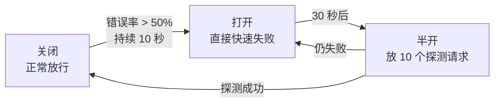

# 第16章：高可用设计——让系统活着

> [!TIP] Part 3: 系统设计实战（横向专题篇）
> 性能决定用户体验，可用性决定用户去留。本章讲冗余、限流、熔断、降级、容灾与发布策略——让系统在最坏的日子里也活着。

平时没有人记得可用性，出事的时候全公司都记得。云书店成长期的一次大促，支付网关抖动 40 分钟，订单跌零，客服电话被打爆——那 40 分钟损失的不只是订单，还有用户对平台的信任。

可用性（Availability）不是一个开关，而是一整套组合拳：先把单点消灭掉，再把流量挡在门外，把故障圈在局部，把损失降到最小。本章就按这个顺序展开。

## 16.1 可用性等级：几个 9 到底值多少钱

行业里用"几个 9"衡量可用性。每个 9 背后是真金白银的成本差异：

| 等级 | 年停机时间 | 月停机时间 | 云书店对应阶段 |
| ---- | ---- | ---- | ---- |
| 99%（两个 9） | 3.65 天 | 7.3 小时 | 起步期：出问题白天修，没人半夜爬起来 |
| 99.9%（三个 9） | 8.76 小时 | 43.8 分钟 | 成长期：故障要发公告，开始承诺赔付 |
| 99.99%（四个 9） | 52.6 分钟 | 4.4 分钟 | 成熟期核心交易链路的目标 |
| 99.999%（五个 9） | 5.26 分钟 | 26 秒 | 全链路异地多活，成本陡增 |

关键认知：**可用性每多一个 9，成本不止翻一倍**——因为要做冗余、多机房、自动化故障转移和全套演练。目标由业务定，不由技术情怀定。背后有一个公式：**可用性 = 减少故障频率 × 缩短恢复时长**。减少频率靠冗余，缩短时长靠故障转移和降级——后者便宜且见效快，所以预算先花在"缩短时长"上。

再进一步，把可用性预算花在刀刃上。云书店成熟期的分配：

| 链路 | 目标可用性 | 理由 |
| ---- | ---- | ---- |
| 浏览、搜索 | 99.9% | 挂了用户会重试，损失有限 |
| 下单、支付 | 99.99% | 挂一分钟就是真金白银 |
| 评价、积分 | 99% | 降级预案齐备，可以容忍 |

为所有东西都上五个 9，是预算的灾难；分级设防才是工程。

把停机换算到每天更直观：99.9% 意味着每天可以坏 1.4 分钟，99.99% 意味着每天只能坏 8.6 秒——一次 5 分钟的失败发布，就把四个 9 的整月预算烧光。所以四个 9 的系统必然配灰度发布和秒级回滚（16.7 节），这不是可选项。

## 16.2 冗余与故障转移：无单点原则

高可用的第一原则是无单点（No Single Point of Failure）：任何一个组件挂掉，系统都能继续服务。靠的是冗余（Redundancy）加故障转移（Failover）——坏了就换，而且要自动换：

```text
                    用户
                     │ DNS / GSLB
                     ▼
        ┌─────────────────────────┐
        │   负载均衡（主 + 备两台）   │
        └──┬────────┬────────┬───┘
           ▼        ▼        ▼
        ┌─────┐  ┌─────┐  ┌─────┐
        │App 1│  │App 2│  │App 3│   ← 同一服务至少两个实例
        └─────┘  └─────┘  └─────┘
           │        │        │
           └────────┼────────┘
                    ▼
     ┌──────────────────────────────┐
     │ 数据层冗余                     │
     │  Redis：1 主 2 从 + 3 哨兵      │
     │  MySQL：1 主 2 从，故障自动切换  │
     └──────────────────────────────┘
```

冗余要一层一层检查到底，任何一层漏了都是假冗余：

| 层 | 冗余方案 | 常见翻车点 |
| ---- | ---- | ---- |
| 应用实例 | 同一服务至少 2 个实例 | 定时任务只在 1 个实例上跑，实例挂了任务就停 |
| 负载均衡 | 主备两台 + VIP 漂移 | 备机从没演练过切换，真切换时配置过期 |
| 缓存 | 主从 + 哨兵或集群 | 只有一台 Redis，挂了缓存全丢，数据库被回源打垮 |
| 数据库 | 1 主 2 从 + 自动切换 | 从库延迟过大，切换后丢数据 |
| 机房 | 同城双机房 | 网线从同一个管道走，挖土机一铲子全断 |

故障转移有两种模式：主备模式（Active-Standby）——一台干活，备用机待命，切换需要 30 秒到几分钟，数据库多用这种；对等模式（Active-Active）——所有节点同时干活，坏一个就少一份份内事，流量自动分给其余节点，应用服务多用这种。选哪种看成本和切换速度的要求，但无论哪种，**切换必须演练过**——没切换过的备份等于没有备份。

检查冗余时还要警惕几种"伪冗余"：两台应用实例共用同一个数据库连接池配置，连接数超限时一起挂；主备负载均衡的心跳线走同一台交换机；号称"双活"的两个机房里只有一个在真正写数据，另一个是冷备。冗余要冗余到故障域——两个组件必须不会因为同一个原因一起死。

云书店成熟期的冗余家底：应用层 60 多个实例跨两个可用区，网关 4 实例跨区，Redis 3 主 3 从跨区部署，MySQL 半同步从库跨机房，核心服务全部做到"单可用区可缩容运行"——并且每个季度演练一次"整个可用区下线"。

## 16.3 限流：先把洪水挡在门外

系统容量是有限的。限流（Rate Limiting）就是给大门装上闸机：超过容量的请求宁可拒绝（返回 429），也不能让全部请求挤爆系统后一起死。三种经典算法：

| 算法 | 原理 | 优点 | 缺点 | 适合 |
| ---- | ---- | ---- | ---- | ---- |
| 固定窗口计数器 | 每分钟计数，到点清零 | 实现最简单 | 窗口边界突刺：临界处可能放进 2 倍流量 | 粗粒度配额统计 |
| 漏桶（Leaky Bucket） | 请求先进桶排队，以恒定速率放行 | 出口速率绝对平滑 | 无法应对合理的突发，排队增加延迟 | 调用第三方、计费接口 |
| 令牌桶（Token Bucket） | 匀速发放令牌，请求取到令牌才放行 | 允许小突发，平均速率可控 | 实现稍复杂 | 大多数接口，网关标配 |

固定窗口的突刺值得用数字看一眼：限流 100 次/分钟，前 59 秒放进 100 个请求，最后 1 秒窗口清零又放进 100 个——两秒内系统承受了 200 个请求，是限流值的两倍。这就是"窗口边界突刺"，也是网关普遍选令牌桶的原因：令牌按时间匀速补充，天然没有边界。

还有一层要交代：单机限流还是集群限流。网关有 10 个实例时，"每用户 50 QPS"如果各自为政，全局就是 500 QPS。解法是把计数器放 Redis（用 Lua 脚本保证原子性），或者按用户哈希固定到某实例。云书店用前者——多一次 Redis 往返（约 1ms），换来全站限流口径一致。

云书店的选择：网关统一用令牌桶——单用户 50 QPS 防脚本，详情接口总闸 12 万 QPS 防雪崩。实现并不复杂：

```typescript
class TokenBucket {
  private tokens: number;
  private last = Date.now();

  constructor(private capacity: number, private refillRate: number) {
    this.tokens = capacity;   // capacity：桶容量（允许的突发量）
  }                           // refillRate：每秒补充的令牌数（平均速率）

  tryTake(): boolean {
    const now = Date.now();
    this.tokens = Math.min(
      this.capacity,
      this.tokens + ((now - this.last) / 1000) * this.refillRate
    );
    this.last = now;
    if (this.tokens >= 1) {
      this.tokens -= 1;
      return true;            // 拿到令牌，放行
    }
    return false;             // 拒绝，返回 429 Too Many Requests
  }
}
```

> [!NOTE] 限流阈值从哪来
> 别拍脑袋。做一次压测，知道系统真实容量是"每秒 8000 单"，再把限流设在容量的 80%——留下余量给重试和毛刺。阈值是测出来的，不是猜出来的。

三个实现细节：被拒绝的请求返回 429 并带 Retry-After 头，让客户端知道何时再来；限流要分三级——全局总闸、接口级、用户级，任何一级触发都记日志，事后才能回答"谁把流量打爆的"；网关限流之后，服务内部和数据库连接池还有各自的排队上限，层层设闸，而不是把所有希望寄托在网关一层。

## 16.4 熔断与降级

限流挡的是外部洪水，熔断（Circuit Breaker）防的是内部蔓延：当下游服务已经病了，继续调用只会拖死自己。熔断器像电路里的保险丝，有三个状态：



- **关闭（Closed）**：正常状态，请求照常通过。
- **打开（Open）**：错误率超阈值后熔断，请求不再发给下游，直接走降级逻辑——失败得越快越好。
- **半开（Half-Open）**：冷却期后放少量探测请求，成功则恢复，失败则继续熔断。

一套能直接用的熔断参数：

| 参数 | 示例值 | 说明 |
| ---- | ---- | ---- |
| 统计窗口 | 10 秒 | 在这个窗口里统计错误率 |
| 错误率阈值 | 50% | 要配最小请求数 20，防止低流量时一两个错误就误熔断 |
| 熔断时长 | 30 秒 | 打开状态持续 30 秒后进入半开 |
| 半开探测数 | 10 个 | 全部成功才恢复关闭 |

还有一个隐蔽指标：慢调用率。下游响应从 50ms 恶化到 2 秒，错误率还是 0，但系统已经被拖死——现代熔断器（Sentinel、Resilience4j）都支持"慢调用比例"触发熔断，别只盯错误率。

熔断器的核心逻辑自己写也就几十行：

```typescript
// 熔断器核心逻辑伪代码
class CircuitBreaker {
  private failures = 0;
  private state: 'CLOSED' | 'OPEN' | 'HALF_OPEN' = 'CLOSED';
  private openedAt = 0;

  async call<T>(fn: () => Promise<T>, fallback: () => T): Promise<T> {
    if (this.state === 'OPEN') {
      if (Date.now() - this.openedAt < 30_000) return fallback(); // 熔断中：快速失败
      this.state = 'HALF_OPEN';                                   // 冷却结束：放探测请求
    }
    try {
      const result = await fn();
      if (this.state === 'HALF_OPEN') this.state = 'CLOSED';      // 探测成功：恢复
      return result;
    } catch {
      this.failures++;
      if (this.state === 'HALF_OPEN' || this.failures > 10) {     // 错误超阈值
        this.state = 'OPEN';
        this.openedAt = Date.now();
      }
      return fallback();                                          // 走降级逻辑
    }
  }
}
```

光熔断还不够，熔断之后用户看到什么？答案是降级（Degradation）预案——提前准备好的"缩水版"服务：

| 依赖 | 降级动作 | 用户感知 |
| ---- | ---- | ---- |
| 推荐算法服务 | 返回默认畅销榜 | 推荐变通用，能接受 |
| 评价服务 | 隐藏评价区 | 少看几条评价 |
| 库存查询服务 | 显示"有货"，下单时再精确校验 | 偶尔下单失败 |
| 支付渠道 A | 切换到备用渠道 B | 几乎无感 |

降级的核心思想：**牺牲非核心，保住核心链路。** 大促期间云书店把评价、推荐、积分全部降级，只保留"浏览、下单、支付"三个核心，数据库压力直接砍半。

降级还分两种触发方式：自动降级由熔断器触发，反应快但阈值难调；手动降级由值班同学拨开关，用于大促前主动"卸载"非核心功能——云书店每次大促都提前 10 分钟手动关闭推荐和评价，把资源让给下单链路。自动是保险丝，手动是总闸，两个都要有。

降级开关的工程实现：配置中心统一下发（推送到所有实例秒级生效），每个开关标注负责人和预期恢复时间，拨动动作全部进审计日志（第 18 章）。最怕的是"祖传开关"——三年前拨下去没人记得关，系统一直降级运行还没人发现。

## 16.5 超时、重试与幂等的三角关系

超时（Timeout）、重试（Retry）、幂等（Idempotency，见第 14 章）三者是绑定的三角：超时了才重试，重试要求幂等兜底。用错了就是**重试风暴（Retry Storm）**：下游抖动 2 秒，上游超时 200ms 自动重试 3 次，流量瞬间放大 4 倍；上游的上游再各放大一轮，层层叠加 16 倍流量砸向一个已经生病的服务——直接送走。

| 规则 | 说明 |
| ---- | ---- |
| 重试必须配幂等 | 非幂等操作（支付提交）不自动重试，或必须带幂等键 |
| 指数退避加抖动 | 重试间隔 100ms、200ms、400ms，再加随机抖动（Jitter），避免同时重试 |
| 限制重试次数 | 最多 2~3 次，超过就放弃并上报 |
| 重试预算 | 单条调用链的额外重试量不超过总量的 1%，防止层层放大 |
| 超时要小于上游剩余时间 | 否则上游已经先超时，你的重试毫无意义 |

用数字走一遍重试风暴的形成：正常时上游 1000 QPS；下游抖动 2 秒，这 2 秒里每个请求超时后重试 3 次，瞬时流量变成 4000 QPS；下游刚喘过气，迎接的就是 4 倍流量，于是继续超时、继续重试——2 秒的抖动滚成 30 秒的雪崩。重试预算的作用就在这里：全局规定"重试产生的额外请求不超过 1%"，4 倍流量根本放不出来。

超时怎么定？从下游往上游推：数据库慢查询预算 100ms，服务间调用 200ms，网关到客户端 500ms——每一层的超时必须小于上游给它的剩余预算。云书店把超时配置写进契约（第 14 章的 OpenAPI），调用方按契约设超时，而不是各自猜一个数。

一句话记住三角关系：**没有超时的重试是雪崩加速器，没有幂等的重试是数据粉碎机。**

## 16.6 容灾：同城双活与异地多活

机房级的故障（断电、火灾、光缆被挖断）要靠容灾（Disaster Recovery）体系。两个关键指标：

- **RTO（Recovery Time Objective）**：灾难发生后多久恢复服务。
- **RPO（Recovery Point Objective）**：最多能接受丢多长时间的数据。

| 方案 | 架构 | RTO / RPO | 成本 |
| ---- | ---- | ---- | ---- |
| 单机房 | 全部系统在一处 | 机房级故障等于全站下线 | 低 |
| 同城双活 | 同城两个机房同时服务，专线互联（延迟小于 2ms） | 分钟级 / 接近 0 | 中 |
| 异地多活（Multi-Active） | 多个地域同时服务，数据按用户单元化分片 | 秒级 / 秒级数据同步 | 高 |

表格里藏着一条规律：容灾级别每升一级，数据一致性方案就复杂一档。同城双活靠专线同步还算简单，异地多活就必须面对"跨地域延迟几十毫秒"的现实——这正是单元化存在的理由：数据只在本地写，跨地域同步做成异步，一致性从"实时"让位给"最终"。

云书店成熟期的选择：交易链路同城双活——双机房各承担 50% 流量，任一机房故障，DNS 5 分钟内把流量切到另一个机房。用户数据按地域单元化：每个用户的数据固定归属某个单元，跨单元不同步写，从根上避开分布式数据一致性的坑。异地多活投入巨大，等业务规模真需要时再上。落到指标上：交易库 RPO 定为 5 秒（半同步复制保证），RTO 定为 5 分钟（自动切换）——两个数字写在值班手册第一页，演练就是验证这两个数字。

切换流程也要提前写死：监控发现机房 A 异常 → 确认（人工或自动，30 秒）→ DNS 把流量切到机房 B → 数据层提升 B 机房从库为主库 → 5 分钟内恢复 80% 服务。这套流程每季度演练一次，演练中每次卡壳的环节，就是下次改造的对象。

还有一个容易忽视的点：数据库连接。应用实例要能同时连两个机房的数据库，"切流量不切连接"，切换才是真的快——云书店用数据库代理层屏蔽机房差异，应用配置里永远只有一个虚拟地址。

## 16.7 发布策略：灰度、蓝绿、滚动

很多"故障"不是天灾，是自己发版发出来的。三种发布策略：

| 策略 | 做法 | 优点 | 缺点 |
| ---- | ---- | ---- | ---- |
| 滚动发布（Rolling） | 分批替换实例，一批 25% | 资源消耗小 | 新旧版本共存，出问题回滚慢 |
| 蓝绿发布（Blue-Green） | 两套完整环境，流量一键切换 | 秒级回滚 | 要付双倍资源钱 |
| 灰度发布（Canary，金丝雀） | 先放 1% 流量到新版本，观察后逐步放大 | 风险最小，能按用户特征圈量 | 需要流量染色和精细监控 |

云书店的标准动作：每次发布先灰度 1%（按用户 ID 尾号），观察 30 分钟的错误率、延迟、转化率三个指标；无异常再放到 10%、50%、100%。任何一步指标异常，立即切回旧版本——发布的影响面要可控、可量化、可回退。

无论哪种策略，发布前后的检查单是共通的：发版前确认新版本通过了契约测试（第 14 章）和回归测试；灰度期间盯错误率、P99 延迟、业务指标（下单转化率）三样；配置好一键回滚——回滚速度必须快过故障扩散速度，否则"能回滚"只是纸面能力。

三种策略怎么选？日常迭代用滚动（成本最低）；重要版本用灰度（风险最小）；基础设施升级用蓝绿（回滚最快）。云书店把它写进了发布制度：核心链路的发布必须灰度，跳过灰度直接全量的发布申请，评审一律不通过。

## 16.8 故障演练与混沌工程

预案写了不等于有效。混沌工程（Chaos Engineering）的思路是：**主动注入故障，在生产环境验证系统能自愈。** 就像消防演习——在真着火之前，先自己点一把可控的火。

入门三板斧：

1. **随机杀实例**：脚本随机终止一个服务实例，验证流量自动切走、服务自愈。
2. **注入网络延迟**：给依赖服务加 2 秒延迟，验证超时配置和熔断是否按预期触发。
3. **拔掉依赖**：直接掐断评价服务，验证降级预案真的生效，用户无感知。

云书店每季度办一次游戏日（GameDay）：拉全团队，模拟"支付网关宕机 30 分钟"，照着预案书走一遍。每次演练都会暴露两三个"纸上谈兵"的预案——写预案的时候系统是好的，等出事才发现预案里的依赖早变了。故障演练就是给预案做体检。

混沌工程有两条纪律要遵守：**最小爆炸半径**——注入的故障圈定在单个实例、单条链路，配上"一键停止"开关，演砸了立刻恢复；**稳态假设**——先定义"什么是正常"（错误率、延迟的基线），再看注入故障后系统能否回到基线。没有稳态假设的故障注入不叫混沌工程，叫制造事故。

演练的产出要沉淀成指标：故障发现耗时（MTTD）、恢复耗时（MTTR）、预案命中率。云书店每次游戏日后更新一次"故障剧本库"，把暴露的问题变成下个季度的改进项——演练的价值就这样滚动积累起来。

## 本章小结

- 可用性用几个 9 衡量，每多一个 9 成本不止翻倍，目标由业务定
- 无单点是第一原则：应用、负载均衡、缓存、数据库、机房逐层检查冗余
- 限流用令牌桶做标配，阈值来自压测而不是猜测
- 熔断三态：关闭、打开、半开；熔断之后靠降级预案保住核心链路
- 超时、重试、幂等是三角关系：没有超时的重试是雪崩加速器，没有幂等的重试是数据粉碎机
- 容灾分同城双活与异地多活，用 RTO 和 RPO 量化恢复能力
- 发布先灰度后放量，指标异常立即回退，影响面必须可控
- 预案要靠故障演练验证，混沌工程是给系统做消防演习

**下一章预告**：系统能扛住今天的流量，那明年的呢？下一章讲可扩展性设计——让"用户涨 10 倍"从危机变成例行公事。

---
