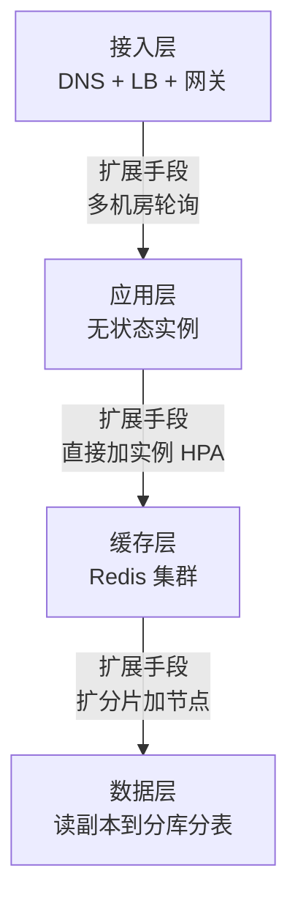

# 第17章：可扩展性设计——为增长留出空间

> [!TIP] Part 3: 系统设计实战（横向专题篇）
> 业务会涨，流量会涨，数据会涨。本章讲可扩展性：怎么让"用户涨 10 倍"从一场危机，变成一次例行公事的扩容。

可扩展性（Scalability）回答一个朴素的问题：**给系统加资源，性能能跟着涨吗？** 加一倍机器吞吐就翻倍，叫可扩展；加十倍机器吞吐纹丝不动，叫单机玩具。

云书店的成长期每天都面临这个问题：日订单从 1 千涨到 5 万只用了 14 个月，流量每个季度翻一番。好消息是，扩展性不是天赋，是一份可以逐层落实的改造清单。本章从部署、接入、数据、架构四个层面讲起，最后留一张自检清单。

## 17.1 垂直扩展 vs 水平扩展

扩展只有两条路：买更大的机器，或者买更多的机器。

| 维度 | 垂直扩展（Scale Up） | 水平扩展（Scale Out） |
| ---- | ---- | ---- |
| 做法 | 换更强的机器：8 核升 64 核 | 加更多的机器：3 台变 30 台 |
| 上限 | 硬件天花板，越往上单价越贵 | 理论上无上限 |
| 改造成本 | 零，搬个机房就行 | 应用必须无状态，数据必须可分片 |
| 风险 | 单机故障影响全局，扩容要停机 | 复杂度转移到架构设计上 |
| 收益曲线 | 接近线性后急速衰减 | 长期线性 |

两条路不互斥。云书店的策略：**先用垂直扩展买时间，再为水平扩展做改造。** 起步期把 4 核 8G 升到 16 核 64G，一台机器搞定，一行代码不用改；日订单破万后立刻开始无状态化改造——因为垂直扩展这条路，越往上走得越贵，而且总有走到头的一天。

收益曲线值得展开说：垂直扩展在 4 核到 16 核区间接近线性，16 核到 64 核收益打折（内存带宽、锁竞争开始拖后腿），64 核往上常常是钱花了效果没有——单机的并行度有物理上限。水平扩展的前期投入是改造（无状态化、分片），但一旦改完，收益就按机器数线性增长。云书店算过一笔账：16 核机器 8 台的吞吐，大约是 64 核单机的 6 倍，而价格只贵 2 倍。一句话总结：垂直扩展是租更大的房子，水平扩展是盖小区——租的房子再大也有上限，小区的规模取决于地基（无状态与分片）打得好不好。

还要看清扩展性和其他质量属性的关系：水平扩展的每一分收益，都要先付无状态化的成本；数据分片的每一分写入能力，都要先付跨库一致性的成本（第 13 章）。扩展性不是免费午餐，它是用架构复杂度换来的——这正是它该在架构阶段决定、而不是流量来了再补救的原因。

> [!NOTE] 扩展的时机
> 不要等瓶颈出现才改造，也不要在业务验证期就过度设计。判断标准：当季度增长率 × 2 会在 6 个月内触碰当前架构的容量上限，就该动手了。

## 17.2 无状态化改造清单

水平扩展的前提是无状态（Stateless）：**任意实例随时增减，任何请求发给任何实例，结果都相同。** 状态既然不能留在实例里，就要搬到共享的地方去。

先把"状态"这个词说清楚。实例上可能存在四类状态：

| 状态类型 | 例子 | 危害 | 归宿 |
| ---- | ---- | ---- | ---- |
| 会话状态 | Session、登录态 | 用户被路由到别的实例就掉线 | Redis |
| 文件状态 | 用户上传的图片 | 只有这台实例能访问 | 对象存储 |
| 任务状态 | 定时任务执行进度 | 多实例重复执行 | 分布式调度平台 |
| 业务快照 | 实例启动时加载的配置 | 配置变更不同步 | 配置中心，推送刷新 |

云书店改造前的真实一幕：把一个实例从负载均衡摘掉发版，当天有 37 个用户被登出——他们的 Session 就在这台实例的内存里。这就是状态分布的代价，也是最直观的改造动机。逐项检查：

| 检查项 | 反模式 | 改造方案 |
| ---- | ---- | ---- |
| 用户会话 | Session 存在实例内存里 | 外置到 Redis（如 Spring Session），呼应第 18 章的认证方案 |
| 上传文件 | 存实例本地磁盘 | 上对象存储（OSS/S3），本地只做临时中转 |
| 定时任务 | 每个实例都跑一遍，重复执行 | 分布式调度平台，或分布式锁 + 任务分片 |
| 本地缓存 | 大量数据缓存在实例内存 | 热点数据可留在本地（容忍不一致），全量进 Redis |
| 长连接 | WebSocket 绑定在单个实例上 | 网关层会话保持，或经消息总线广播到所有实例 |

定时任务是最容易漏的一项。分片执行的做法：

```typescript
// 定时任务分片：10 个实例平分 100 万条待同步的物流单
const total = await jobCenter.register('sync-logistics', 10); // 集群总实例数
const shard = jobCenter.myIndex();                            // 本实例序号 0~9

const rows = await db.query(
  'SELECT * FROM shipments WHERE status = 1 AND MOD(id, ?) = ? LIMIT 5000',
  [total, shard]  // 每个实例只处理自己那一份额：id 对实例数取模
);
```

改造完成的标志：**随机重启任何一个实例，没有任何用户掉线，没有任何任务丢失。** 做到这一点，扩容就从"工程"变成了"改一个数字"。

改造怎么验证？两个测试：混沌测试——随机杀实例，看有没有用户报障；容量测试——同一份压测流量分别打到 2 个实例和 20 个实例，吞吐必须接近 10 倍。第二个测试能揪出隐藏的共享瓶颈：文件锁、本地缓存命中依赖，甚至同步写日志盘。

长连接的改造再展开说：网关层会话保持（同一用户固定路由到同一实例）实现快，但破坏了"任意请求任意实例"的原则，实例一缩容连接就断；更彻底的是消息总线——连接状态只存路由表，业务消息经 Redis Pub/Sub 广播到所有实例，谁持有该用户的连接谁处理。云书店的订单状态推送用的就是后者。

每项改造的原则都一样：**把状态从"实例的所有物"变成"集群的共享资源"**。改造前先做一次状态盘点：grep 代码里的本地文件写入、排查 ThreadLocal 里的缓存、翻一遍定时任务注册表——最危险的不是技术难度，是"这个状态存在哪没人知道"。

还有个小陷阱要提醒：请求内的临时状态（如 `request.setAttribute`）生命周期只有一个请求，本身无害；但如果代码把它当跨请求缓存用——比如把登录用户塞进静态变量——无状态就被悄悄破坏了。代码评审时见到 static 的用户态字段，要警惕。

改造要按收益排序：先做会话外置（收益最大，一行配置起步），再文件上云（顺带解决磁盘容量和备份），定时任务分片第三（要改任务代码），本地缓存最后（牵扯一致性）。整个改造在云书店花了 6 周，期间没有一次停机——每项都是新旧并行观察一周再切换，和第 16 章的灰度发布一个思路。

## 17.3 负载均衡算法对比

实例多了，流量怎么分？负载均衡（Load Balancing）算法的选择决定了新增实例能不能真正分到活：

| 算法 | 原理 | 优点 | 缺点 |
| ---- | ---- | ---- | ---- |
| 轮询（Round Robin） | 依次分发给每个实例 | 最简单 | 不关心实例差异和实时负载 |
| 加权轮询 / 最少连接（Weighted / Least Connections） | 按机器配置加权，或发给当前连接数最少的 | 贴合实例实际能力 | 需要采集实时状态 |
| 一致性哈希（Consistent Hashing） | 把实例和请求都映射到一个哈希环上 | 增减节点只迁移相邻数据，会话保持友好 | 需要虚拟节点抹平数据倾斜 |

轮询和加权算法用于普通的无状态服务；一致性哈希用在"请求必须落在同一台机器"的场景——比如 Redis 客户端分片、网关会话保持。它的核心价值在于**扩缩容时迁移量最小**：从 10 台变 11 台，传统取模几乎要重排所有数据，一致性哈希只迁移约 1/11。

一致性哈希的细节展开一点：把哈希值域想象成一个环（0 到 2^32），节点和请求都哈希到环上，请求顺时针找最近的节点。10 个节点变 11 个时，只有落在新增节点逆时针方向那段区间的请求需要迁移。但它有个坑：节点少时哈希环分不均匀，有的节点吃掉 40% 的请求。解法是虚拟节点（Virtual Node）：每个物理节点在环上放 100~200 个虚拟点，统计意义上抹平倾斜。

负载均衡其实不止一层：DNS 轮询做地域级分流，LB 做流量级分发，网关做应用级路由，微服务框架里的客户端负载均衡（如 gRPC 内置 LB）做实例级选择——四层各管一段，排障时先确认流量卡在哪一层，别一上来就怀疑应用代码。

云书店的一致性哈希用在三处：商家后台的订单查询路由（同一商家固定打到同一实例，进程内缓存才有意义）、图片处理的任务分配（同一图片的处理结果固定缓存）、分库分表中间件的路由层。一个算法三处复用，学一次赚三次。选择要点一句话：无状态服务看平均负载选加权最少连接，有会话亲和需求选一致性哈希，简单内部服务轮询就够——别为了算法先进引入运维复杂度。

```text
                请求（任意实例都能处理）
                          │
                          ▼
                 ┌─────────────────┐
                 │   负载均衡 LB     │
                 └───┬────┬────┬───┘
                     ▼    ▼    ▼
                 ┌────┐┌────┐┌────┐
                 │实例1││实例2││实例3│   ← 无状态，随时 +N
                 └────┘└────┘└────┘
                    │     │     │
                    └─────┼─────┘
                          ▼
              ┌────────────────────────┐
              │ 共享状态层                │
              │ Redis 会话 / OSS 文件    │
              │ 消息队列 / 分布式缓存     │
              └────────────────────────┘
```

选型速查：公网入口用 DNS 按地域分流；机房内用 Nginx/LVS 做四层或七层分发；微服务之间用客户端负载均衡。每一层选不同算法并不冲突——外层粗分、内层细分，流量像漏斗一样逐层摊匀。

一句话备忘：负载均衡回答的是"流量分给谁"，一致性哈希额外回答"数据放在哪"——前者实例无状态即可，后者必须存在数据亲和的场景才值得用。

## 17.4 数据层的扩展：读副本到分片

应用层水平扩展见效快，但很快会撞上数据层这个天花板——应用的瓶颈最终都会落到数据库上。扩展的阶梯（呼应第 13 章）：



- **读扩展**：先加只读副本。1 主拖 3 从能撑很久，但从库超过 5~8 个后，主库的复制压力和延迟开始失控——读扩展到此为止。
- **写扩展**：只有一个办法，分库分表。垂直拆库按业务边界切，水平分片按分片键切。这就是第 13 章用一整章篇幅讲订单库演进的原因：**应用层加机器是加法，数据层分片是除法，难度完全不在一个量级。**
- **顺序很重要**：先把能缓存的都缓存掉（第 15 章），再上读副本，最后才分片。很多团队跳过前两步直接分片，结果用最重的手段解决最轻的问题。

每一级扩展都有触发信号，提前定好就不用临场拍脑袋：缓存命中率跌破 95%，先查原因再扩 Redis；主库 CPU 持续超过 60% 且慢查询在涨，该拆库了；单表超过 3000 万行（留出 2000 万的缓冲），启动分片方案评审。第 13 章的订单库演进，就是把这套信号变成日历上的事的完整案例。

分片之后还有一层隐性成本：跨库 join 没了。订单和用户分属两个库，列表页要显示用户昵称怎么办？答案是在写路径做冗余——下单时把昵称快照存进订单表（收货地址本来就是快照思想），读路径永远单库单表完成。**面向查询的数据冗余**，是分片架构里的常规操作，不是设计不纯。

数据层扩展还有个绕不开的前置认知：应用层可以加到几百个实例，但所有实例最终都汇聚到同一个数据库——数据层的扩展能力决定整个系统的天花板，这也是它排在应用层之后讲的原因。

分片数怎么定？拍脑袋定 4 片还是 32 片，差别在三年后：分片太少，扩容要走"数据重分布"；分片足够多，扩容只是搬片。经验公式是**按三年后预测数据量除以单片舒适容量（500 万行）向上取整，再留 4 倍余量**——云书店算出 8 片就够，实际定 32 片，多出来的全是未来的从容。

## 17.5 异步化与削峰填谷

同步架构的容量上限，等于全链路最弱一环的容量。云书店下单链路原本串行做 5 件事：创建订单、扣库存、记积分、通知物流、发短信，总耗时 800ms，任何一环抖动整个下单就抖动。

识别"哪些步骤可以异步"有个简单标准：用户在下单这个动作里**真正关心什么**。关心订单创建成功、库存扣到位（不关心就会超卖）；不关心积分到账、短信送达的精确时刻。凡是不影响"用户此刻决策"的步骤，都有资格异步。

第 10 章讲过事件驱动的解法：**只把必须同步的两件事留在主链路**（创建订单、扣库存，共 150ms），其余三件变成事件异步处理。这不仅是性能优化，更是扩展手段：

| 指标 | 同步直连 | 异步 + 消息队列 |
| ---- | ---- | ---- |
| 下单响应时间 | 800ms | 150ms |
| 峰值承载 | 2 万单/分钟（受物流接口限制） | 接受 10 万单/分钟排队 |
| 依赖故障影响 | 物流接口抖动直接拖垮下单 | 只延迟发货，不影响下单 |
| 数据库写入曲线 | 尖峰状，按峰值建容量 | 被削平，按平均量建容量 |

削峰填谷（Peak Shaving）的账要算清楚：大促 0 点 10 万单/分钟涌入，数据库写入能力 2 万单/分钟——消息队列当蓄水池，消费端匀速消化，高峰积压约 300 万条，2 小时后追平。代价是"下单成功但发货延迟"，用户完全无感。**队列容量和积压告警就是这条链路的保险丝，必须配监控。**

异步化还有两个容易踩的坑要提前设计：

1. **顺序性**：同一订单的"创建、支付、发货"事件乱序消费就会出逻辑错误。解法是按 orderId 做消息分区（Partition），同一订单的事件固定路由到同一个分区，天然有序。
2. **幂等消费**：消息队列至少投递一次，重复消息进消费端是日常（第 10 章、第 14 章的幂等方案直接复用）。云书店的积分服务按"orderId + 事件类型"做幂等键，重复事件直接跳过——少了这层，削峰填谷削掉的就是账户余额的正确性。

大促还有一层更靠前的削峰手段：虚拟等待室。0 点开抢前，超出系统容量的请求先进排队页（"前方还有 8 万人"），按进入顺序匀速放进下单页——比起让所有请求砸进系统再被限流拒绝，排队页把"被拒绝的挫败"变成"有盼头的等待"，体验和容量双赢。

异步链路的最后一个保障是对账：每小时比对"订单已支付数"和"积分已发放数"，差值超阈值就告警。异步化把故障从"用户下单失败"变成了"数据悄悄不一致"，对账就是抓这种悄悄的错。

还要强调：异步化不等于"把问题藏起来"。削峰填谷牺牲的是实时性，换来容量按平均量设计——但如果业务根本不接受延迟（比如库存扣减必须实时），这部分就不能异步，只能靠限流和扩容硬扛。异步是手段之一，不是万能钥匙。

## 17.6 弹性伸缩：按需扩容

前面讲的都是"人工扩容"，成熟期的目标是自动伸缩（Auto Scaling）。以 Kubernetes 的 HPA（Horizontal Pod Autoscaler，水平自动伸缩）为例，思路是：设定指标阈值，系统自动加减实例数：

```yaml
apiVersion: autoscaling/v2
kind: HorizontalPodAutoscaler
metadata:
  name: order-service
spec:
  scaleTargetRef:
    apiVersion: apps/v1
    kind: Deployment
    name: order-service
  minReplicas: 4
  maxReplicas: 32
  metrics:
    - type: Resource
      resource:
        name: cpu
        target:
          type: Utilization
          averageUtilization: 65
```

CPU 利用率超过 65% 自动加实例，低于阈值自动回收，实例数在 4 到 32 之间浮动。大促当天 0 点的流量洪峰，系统在 3 分钟内自己扛住了。

两个必须理解的细节：

- **冷启动延迟**：新实例从启动到能接流量要 1~3 分钟（拉镜像、预热连接池、缓存预热）。预测性扩容要提前 30 分钟动手——大促不是等 CPU 飙了才扩，是看着日历扩。
- **缩容要慢**：扩容要快，缩容要缓。流量毛刺刚过去就砍实例，下一波毛刺来了来不及扩，反复抖动。给缩容加个 10 分钟的稳定窗口。

指标的选择也有讲究：CPU 利用率通用但粗糙——GC 停顿、锁等待都会造成"CPU 不高但已经不干活"；更好的自定义指标是每实例 QPS、队列长度、P99 延迟。云书店的订单服务用"每实例 QPS 超过 800 触发扩容"，比 CPU 阈值早 2 分钟发现问题——2 分钟在大促里就是几十万请求。伸缩策略可以配成"加速扩容、保守缩容"：扩容一步到位，缩容每次只收四分之一，保持对毛刺的钝感。

除了实例数，配套资源也要跟着弹性走：32 个实例乘以每实例 20 个连接就是 640 个数据库连接，超过 MySQL 的 max_connections 直接报错；Redis 客户端连接数同理。大促前把连接池上限和数据库配置按"满配实例数"核算一遍，别让连接池成为先于 CPU 崩掉的那一环。

在云上，弹性还可以更彻底：定时伸缩（大促日历直接写进伸缩计划）、事件驱动伸缩（队列积压量触发扩容），甚至弹性到 Serverless（第 23 章展开）——实例数从 0 扩到几百，按秒计费。云书店的评价服务就跑在 Serverless 上：平时 0 实例，大促自动拉起，一年省下 60% 的资源账单。

云书店成熟期的弹性参数供参考：常驻 4 实例扛日常 3000 QPS，大促预估 10 万 QPS 时提前扩到 28 实例，HPA 上限 32；连接池按 32 实例满配预留；扩容演练纳入大促前检查单——弹性参数是压测出来的，也是演练出来的。

> [!TIP] 弹性的前提
> 自动伸缩只对无状态服务有效。第 17.2 节的改造清单没做完，HPA 配得再漂亮也是摆设。

## 17.7 扩展性自检清单

先给结论：扩展性自检不用等大促才做。下面七个问题，每个都对应一个具体的改造动作——答"否"不是失败，答"否"且不知道怎么改才是失败。

架构评审时，拿这七个问题过一遍，比看十页 PPT 都管用：

| 自检问题 | 考察点 |
| ---- | ---- |
| 重启任意一个实例，用户会掉线或丢数据吗？ | 无状态化程度 |
| 实例从 3 个加到 30 个，吞吐会线性上涨吗？ | 水平扩展的真实有效性 |
| 数据量涨 10 倍，哪张表先崩？有预案吗？ | 数据层扩展路径 |
| 流量涨 10 倍，第一个被打爆的组件是什么？ | 容量瓶颈识别 |
| 每个依赖超时之后，系统还能服务吗？ | 依赖隔离与降级（呼应第 16 章） |
| 大促流量 3 小时后退潮，系统能自动缩回来吗？ | 弹性伸缩闭环 |
| 分片数、队列容量、连接池是写死的还是可调的？ | 关键参数的可配置性 |

七个问题里如果有三个答不上来，说明系统的扩展性还停留在"希望它没事"的阶段——这恰恰是架构师该出场的地方。

这张清单的用法也有讲究：不要一个人对着屏幕勾，拉上应用负责人、DBA、SRE 一起，每个问题都要给出数据支撑——"吞吐会线性涨"要有压测报告，"第一个打爆的组件"要有容量模型。答不上来的问题直接转成待办，标上负责人和期限。自检的价值不在通过率，而在暴露"以为没问题"的地方。

最后给一个节奏建议：这张清单不要等大促前才看。每季度拉一次、每次大促复盘后拉一次、架构发生大改动后立刻拉一次——扩展性是会"过期"的，上季度自检通过的答案，这季度可能已经因为新依赖而失效。

## 本章小结

- 可扩展性回答"加资源能不能换来性能"，先垂直买时间，再水平求长久
- 无状态化是水平扩展的前提：会话外置、文件上云、定时任务分片，一个都不能漏
- 负载均衡算法按场景选：无状态用轮询/加权，会话保持和分片用一致性哈希
- 数据层扩展走阶梯：先缓存、再读副本、最后才分片，读扩展加从库，写扩展只能分片
- 异步化削峰填谷：同步链路只留核心步骤，队列当蓄水池，容量按平均量建
- 弹性伸缩闭环：扩容要快，缩容要慢，预测性扩容提前 30 分钟动手
- 用七问自检清单定期体检，扩展性要设计出来，不能指望运气

**下一章预告**：系统又快又能扛了，最后一道坎是安全。下一章讲安全架构——认证、授权、加密、审计，构建让用户放心的信任边界。

---
