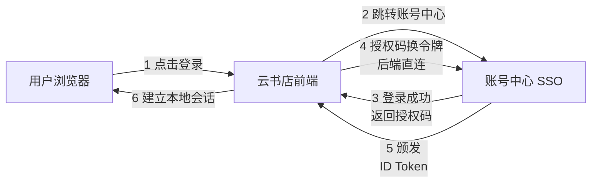

# 第18章：安全架构——构建信任的边界

> [!TIP] Part 3: 系统设计实战（横向专题篇）
> 安全不是一份功能清单，而是一种架构属性。本章讲纵深防御、认证授权、加密与审计——构建让用户敢把数据交给你的信任边界。

被拖库的公司，很少死于"没有防火墙"，大多死于"以为有一层就够了"。安全架构的第一课就是放弃幻想：**假设任何单层防御都会被攻破。**

云书店存着 3000 万用户的手机号、收货地址和支付记录。这些数据不是架构师的眼中钉，而是平台的立身之本——用户把数据交给你，是相信你守得住。本章按纵深防御的顺序，把安全架构的骨架搭起来。

## 18.1 纵深防御：五层防线

纵深防御（Defense in Depth）的思想来自军事：一条防线失守，还有下一条。落到软件上就是五层，每层只信上一层的输出：

```text
外部流量
   │
   ▼
┌──────────────────────────────────────────────┐
│ 第 1 层 边界防御                               │
│   DDoS 清洗 / WAF / 黑白名单 / 防爬虫          │
└──────────────────────┬───────────────────────┘
                       ▼ 放行"看起来合法"的流量
┌──────────────────────────────────────────────┐
│ 第 2 层 网络防御                               │
│   VPC 隔离 / 安全组 / 内网 mTLS                │
└──────────────────────┬───────────────────────┘
                       ▼ 只能访问白名单端口
┌──────────────────────────────────────────────┐
│ 第 3 层 应用防御                               │
│   认证授权 / 输入校验 / 防越权                  │
└──────────────────────┬───────────────────────┘
                       ▼ 合法且已授权的请求
┌──────────────────────────────────────────────┐
│ 第 4 层 数据防御                               │
│   加密存储 / 脱敏 / 字段级加密                  │
└──────────────────────┬───────────────────────┘
                       ▼ 即便数据被拖走也读不懂
┌──────────────────────────────────────────────┐
│ 第 5 层 审计与响应                             │
│   审计日志 / 告警 / 应急复盘                    │
└──────────────────────────────────────────────┘
```

每一层的假设都相同：**上一层已经被攻破了。** WAF 没拦住恶意请求怎么办？靠网络隔离。内网机器失陷了怎么办？靠应用鉴权。应用被拖库了怎么办？靠数据加密。连加密都破解了怎么办？靠审计日志定位损失范围和攻击路径。没有哪一层是万能的，叠加起来才是护城河。

五层落到云书店，每层都有具体清单：

| 层 | 云书店的具体措施 |
| ---- | ---- |
| 边界 | 云厂商 DDoS 高防、WAF 拦截常见攻击特征、爬虫识别与限速 |
| 网络 | 生产环境独立 VPC，数据库只允许应用网段访问，服务间 mTLS |
| 应用 | 网关统一 JWT 验签、接口参数校验、越权检测 |
| 数据 | 密码哈希、手机号 AES 加密、展示脱敏 |
| 审计 | 全量审计日志、异常行为告警、每季度渗透测试 |

五层防线的投入有一个梯度规律：越靠外的层越便宜（WAF 按流量计费，开了就有），越靠内的层越贵（字段级加密要改表结构和所有读写路径）。所以防御设计从外往里做——先把便宜又有效的边界层做满，再按数据的价值决定内层的投入深度。

## 18.2 认证：你是谁

认证（Authentication）回答"你是谁"。四种主流方案放在一起比：

| 方案 | 状态 | 适用场景 | 主要的坑 |
| ---- | ---- | ---- | ---- |
| Session + Cookie | 服务端有状态 | 单体或同域 Web 应用 | 分布式部署要外置存储；跨域麻烦 |
| JWT（JSON Web Token） | 无状态自包含 | 开放 API、App 多端 | 无法主动作废，要配短有效期或黑名单 |
| OAuth 2.0 | 授权框架 | 第三方登录、开放平台 | 只管授权，不管身份 |
| OIDC（OpenID Connect） | OAuth 2.0 + 身份层 | 统一登录、SSO | 实现复杂度最高 |

JWT 的结构是三段用点连接的字符串：`header.payload.signature`——头部声明签名算法，载荷携带用户 ID 和过期时间，签名保证不可篡改。载荷只是 Base64 编码，**不是加密**，任何拿到令牌的人都能读，所以里面绝不能放手机号这类敏感信息。

云书店的组合：Web 端用 Session（外置 Redis，呼应第 17 章的无状态化），App 和小程序用 JWT（15 分钟的 access token + 7 天的 refresh token），第三方商家接入用 OAuth 2.0 客户端凭证模式。

JWT 最纠结的是"作废"问题：令牌签出去就收不回来，用户点"退出登录"或账号被盗，令牌依然有效到过期为止。工程上的折中：access token 压到 15 分钟，refresh token 7 天但存在服务端、可随时吊销；高危操作（改密码、换绑手机）成功后把该用户的令牌全部拉黑（黑名单存 Redis，TTL 等于令牌剩余有效期）。云书店的取舍：日常浏览可以容忍 15 分钟的作废延迟，改密码必须立即全端下线。

选型建议一句话：同构 Web 应用别纠结，Session 最省心；多端（App + Web + 小程序）或跨服务调用，JWT 的无状态优势才真正兑现。很多团队把 JWT 用成了"放在请求头里的 Session"——服务端照样查库查黑名单，无状态的优势没拿到，复杂度倒是全接了。

令牌放哪里也有讲究：放 Authorization 请求头，而不是 URL 参数——URL 会进浏览器历史、网关日志和 CDN 日志，等于把令牌写在公告栏上。Cookie 场景必须配 HttpOnly（JS 读不到）和 Secure（仅 HTTPS 传输），让 XSS 即便注入成功也偷不走令牌。

集团内还有统一登录的需求：云书店、云文具、云咖啡共用一个账号中心，用户登录一次，三个站点都可用——这就是单点登录（SSO，Single Sign-On）。标准做法是 OIDC 授权码流程：



流程里第 4 步"授权码换令牌"由后端直连账号中心完成（携带只有自己知道的 client_secret），授权码就算被截获也无法单独换到令牌——这就是授权码模式比简化模式安全的原因。

## 18.3 授权：你能做什么

认证之后是授权（Authorization），回答"你能做什么"。主流的两把尺子：

- **RBAC（Role-Based Access Control，基于角色的访问控制）**：给用户挂角色，角色挂权限。简单直观，是大多数系统的默认选择。
- **ABAC（Attribute-Based Access Control，基于属性的访问控制）**：根据用户、资源、环境的属性动态判断。灵活，能表达"只能看自己的订单"这类细粒度规则。

ABAC 的"属性"有三个来源：主体属性（用户是谁、什么等级）、资源属性（这份订单属于谁、金额多大）、环境属性（从哪个 IP 来、是不是工作时间）。"客服只能在工作时间查看工单关联的订单，金额超过 10 万的要二次审批"——这句话用 RBAC 表达要造三个角色，用 ABAC 就是一个条件表达式。

权限点的粒度建议细到"动作 + 资源"：order:read、order:refund、product:publish——细粒度先收进角色再组合，永远比粗粒度事后拆分容易。云书店的权限后台有 87 个权限点、5 个默认角色：角色是给人看的入口，权限点才是真正的控制单元。

云书店先定角色的大框：

| 角色 | 权限范围 |
| ---- | ---- |
| 顾客 | 下单、支付、评价自己的订单 |
| 商家 | 管理自己的商品，查看自己店铺的订单 |
| 客服 | 只读用户订单，且必须有对应的工单关联 |
| 运营 | 配置活动、上下架任意商品 |
| 管理员 | 全部权限，敏感操作需二次审批 |

但纯 RBAC 很快会遇到问题：顾客之间怎么区分？商家怎么只看自己的店铺？角色爆炸到最后会变成 200 个没人看得懂的角色。正确的姿势是 **RBAC 定大框，ABAC 判细节**：

```typescript
// 云书店订单查看鉴权：角色定大框，属性判细节
function canViewOrder(user: User, order: Order): boolean {
  if (user.role === 'ADMIN') return requireApproval(user, order);
  if (user.role === 'CUSTOMER') return order.userId === user.id;           // 数据属主
  if (user.role === 'MERCHANT') return order.sellerId === user.merchantId; // 店铺属性匹配
  if (user.role === 'SUPPORT') return hasActiveTicket(user.id, order.id);  // 工单关联才可见
  return false; // 默认拒绝（Deny by Default）
}
```

注意最后一行：**默认拒绝**是一切授权系统的底线——没写明的权限就是没有，而不是"没写就放行"。

角色和权限规则本身也要纳入版本管理：权限模型改了哪一行、谁批准的、影响多少用户，都要能追溯。权限系统是最容易被"临时给个权限"腐蚀的——临时权限必须带过期时间，到期自动回收，否则临时迟早变永久。

## 18.4 传输加密与存储加密

加密分两段：数据在路上，和数据在库里。

**传输加密**靠 TLS（Transport Layer Security）：全站 HTTPS 是底线，内部服务之间用 mTLS 双向认证——第 2 层网络防御的"内网很安全"从来不可信，零信任（Zero Trust）的意思就是"内网外网一视同仁"。

**存储加密**按数据分级处理：

| 数据 | 策略 |
| ---- | ---- |
| 登录密码 | bcrypt 或 argon2 单向哈希加盐，永不存明文，永不可逆 |
| 手机号、身份证 | AES-256 加密存储，密钥独立管理（见 18.7） |
| 展示场景 | 脱敏输出：138****5678，客服后台默认脱敏 |
| 银行卡号 | 不自己存，交给持牌支付网关处理 |

一个容易忽略的点：加密只是让数据读不懂，**脱敏才决定谁能看到什么**。运营同学查订单应该看到 138****5678，而不是完整手机号——把"需要明文"的场景收敛到极少数，泄露面就小一大圈。

两个常见误区顺手澄清。其一，"HTTPS 太慢"是上个时代的经验：TLS 1.3 把握手从 2 个往返压到 1 个，会话复用后边际成本几乎可以忽略。其二，备份也要加密：备份数据库的磁带和对象存储常常流转多年，泄露往往发生在没人记得的备份副本上——云书店的数据库备份全量 AES 加密，且备份密钥与生产密钥分开管理。

字段加密还有一层工程细节：密钥怎么管。用一个主密钥加密所有数据，换一次密钥就要重刷全表。主流做法是信封加密（Envelope Encryption）：每条用户数据用独立的数据密钥（DEK）加密，DEK 再用主密钥（KEK）加密保存——轮换 KEK 时只需重加密少量 DEK，数据本体一动不动。

## 18.5 常见攻击与对策

OWASP（Open Worldwide Application Security Project）每年发布 Web 应用安全清单，电商系统最常遇到的是这几个：

| 攻击 | 原理 | 对策 |
| ---- | ---- | ---- |
| SQL 注入（SQL Injection） | 输入内容被拼接进 SQL 语句执行 | 参数化查询或 ORM；数据库账号最小权限；WAF 兜底 |
| XSS（Cross-Site Scripting） | 恶意脚本注入页面，在其他用户浏览器执行 | 输出转义；CSP 内容安全策略；Cookie 加 HttpOnly |
| CSRF（Cross-Site Request Forgery） | 诱导已登录用户在不知情下发起请求 | CSRF Token；Cookie 设 SameSite；校验 Origin |
| SSRF（Server-Side Request Forgery） | 诱使服务端向内网地址发请求 | 目标 URL 白名单；禁止访问内网段；不回显原始响应 |
| 越权（Broken Access Control） | 改请求里的 ID，直接访问别人的数据 | 每次请求都校验属主（见 18.3）；资源 ID 用不可猜测的值 |
| 暴力破解 | 撞库、爆破密码 | 限流（第 16 章）；验证码；异常登录告警 |

这些攻击的共同套路值得点破：它们都利用了"开发者对输入的信任"。用户的每个输入——URL 参数、请求头、JSON body、甚至文件名——都是不可信的，校验必须发生在服务端（前端校验只是为了用户体验）。把这句话刻进团队意识，一大半漏洞就失去了生存空间。

XSS 的对策再展开一层：输出转义防的是"内容变代码"，CSP（Content Security Policy，内容安全策略）防的是"就算代码进来了也别执行"——响应头声明只允许加载自家域名的脚本，注入的脚本标签浏览器直接拒绝执行。转义是第一道，CSP 是第二道，又一层纵深防御。

CSRF 再展开一句：它的前提是"浏览器会自动带上 Cookie"。所以令牌类认证（JWT 放请求头）天然免疫 CSRF；用 Cookie 的 Web 端才必须上 CSRF Token 或 SameSite。认证方案的选择直接决定了要防哪些攻击——又是一处方案联动。

SQL 注入是最古老的漏洞，一个正反对比就能看清问题出在哪：

```sql
-- 反例：字符串拼接，用户输入 ' OR '1'='1 即可绕过密码校验拖走全表
SELECT * FROM users
WHERE name = '" + userInput + "' AND password_hash = '...'";

-- 正例：参数化查询，用户输入永远只是一个普通的字符串值
SELECT * FROM users
WHERE name = ? AND password_hash = ?;
```

> [!WARNING] 越权是最常被漏测的漏洞
> 功能测试都验证"自己能不能看自己的"，很少验证"能不能看别人的"。把横向越权测试写进用例：用 A 的登录态去请求 B 的订单 ID，期望结果是 403，不是 200。

## 18.6 审计日志与最小权限

前四层都失守时，第五层是最后的底牌。审计日志（Audit Log）回答一个问题：**谁，在什么时间，对什么资源，做了什么，结果如何？**

四条纪律：

1. **只增不改**：审计日志不允许 update 和 delete，写坏了也要留着——它本身就是证据。
2. **独立存储**：和应用库分开，防止攻击者拿到应用权限后顺手删日志。
3. **保留 180 天**：覆盖绝大多数安全事件的追溯窗口。
4. **带 traceId**：和第 14 章的链路追踪打通，一条日志能串出完整攻击路径。

哪些事件必须进审计日志？一张清单：登录成功与失败（失败要记录来源 IP）、权限变更（给谁加了什么角色）、敏感数据查询（谁查了用户手机号明文）、资金操作（退款、调价）、配置变更（限流阈值、降级开关的每次拨动）。特别注意最后一项——第 16 章的降级开关如果是谁都能悄悄拨的，事故排查时你会感谢审计日志。

一条合格的审计日志长这样：时间戳、操作者（用户 ID 或服务账号）、动作（order.refund）、目标资源（order:10086）、来源（IP、设备）、结果（成功/失败）、traceId。七要素缺一不可——少了来源就不知道从哪入侵，少了结果就不知道攻击是否得手。

和审计配套的是最小权限原则（Principle of Least Privilege）：每个账号、每个服务、每个人，只拥有完成任务所必需的最小权限。云书店的实践：应用连接数据库的账号只有增删改查，没有建表权限；DBA 的操作走堡垒机，全命令审计；实习生账号和正式员工的权限边界用系统控制，而不是靠自觉。

服务间的调用同样适用：订单服务调用商品服务，只需要"读商品"权限，就不该拿到"改商品"的接口凭证——服务账号按调用关系逐个声明权限，新服务上线时在网关注册调用白名单。做起来繁琐，但这是把越权风险在架构层封死。

最小权限还有个迭代动作：季度权限审计——列出所有账号的实际权限和最近使用记录，90 天没用过的权限直接回收。权限和衣柜一样只会越塞越多，不定期清理迟早出问题。

## 18.7 密钥管理与凭据轮换

加密的强度最终落在密钥上。密钥管理（Secret Management）的几条铁律：

- **密钥不进代码仓库**：不写在代码里、不写在配置文件里，用 KMS（Key Management Service）或 Vault 管理，运行时注入环境变量。
- **仓库要扫描**：配自动扫描工具，有人把密钥提交到 Git 就告警——历史上无数泄漏事故始于一次不小心的 commit。
- **凭据轮换（Secret Rotation）**：数据库密码 90 天换一次，第三方 API 密钥 180 天换一次，TLS 证书自动续期。轮换用双密钥并行过渡：新密钥生效、旧密钥只验不签、观察期后吊销旧密钥。
- **泄漏应急先于追责**：发现密钥泄漏，第一动作是吊销，不是开会。追责可以慢慢来，攻击者不会等你。

双密钥轮换的完整节奏：第 0 天新密钥上线，签名用新、验签新旧都认；第 3 天确认全部签发方都用新密钥；第 30 天旧密钥停止验签并吊销。整个过程业务无感知。轮换之所以经常被跳过，是因为流程没自动化——所以轮换要写成定时任务，而不是写成制度文件。

工具选型：云上优先用云厂商的 KMS（托管、审计、高可用都是现成的），自建场景用 Vault（动态密钥、租期控制更强）。无论选哪个，都别用"配置文件里放个加密串"凑合——那等于把保险箱的钥匙贴在保险箱门上。

> [!NOTE] 安全没有"完成时"
> 安全不是一次性的验收项，而是持续运营：依赖组件要定期扫漏洞，权限要定期回收，演练要定期做。系统在长大，攻击面也在长大。

## 18.8 安全左移：在写代码时就防住

前面讲的都是运行时的防线，安全还有半个战场在开发流程里：

| 阶段 | 手段 | 拦截的问题 |
| ---- | ---- | ---- |
| 编码 | 静态代码扫描、密钥提交扫描 | 硬编码密钥、危险函数调用 |
| 依赖 | 依赖组件漏洞扫描（SCA） | 带已知漏洞的第三方库 |
| 测试 | 安全用例（越权、注入）进回归 | 改功能时把防护改没了 |
| 上线前 | 渗透测试、架构安全评审 | 设计层面的信任边界缺失 |

安全左移的账很清楚：编码阶段修一个漏洞的成本，是线上事故阶段的百分之一。云书店把依赖扫描挂进了 CI——任何带高危漏洞的依赖，流水线直接变红，合并都过不去。

再往前一步是威胁建模（Threat Modeling）：设计评审时对着架构图问四个问题——要保护什么（数据资产）、谁来攻击（外部用户、内部员工、已失陷的内网机器）、怎么攻击（每个入口过一遍 STRIDE：仿冒、篡改、抵赖、信息泄露、拒绝服务、越权）、防不住怎么办（应急预案）。云书店在每次新服务上线评审里加一页"威胁清单"——半小时的讨论，常常比一周的渗透测试发现得更早。

## 本章小结

- 纵深防御五层：边界、网络、应用、数据、审计，每层都假设上一层已失守
- 认证按场景组合：Web 用 Session，App 用 JWT，开放平台用 OAuth 2.0，统一登录用 OIDC 的 SSO
- 授权用 RBAC 定大框、ABAC 判细节，默认拒绝是底线
- 传输靠 TLS，存储分级加密：密码单向哈希，敏感字段 AES 加密，展示一律脱敏
- SQL 注入的根源是拼接，参数化查询是唯一正解；越权要靠属主校验，且必须写进测试
- 审计日志只增不改、独立存储、带 traceId，配合最小权限原则收口
- 密钥不进仓库、定期轮换、双密钥过渡，泄漏应急的第一动作是吊销

**下一章预告**：Part 3 的六个横切面到此讲完。下一章进入 Part 4，回到云书店的主线故事——从单体到微服务的演进：那场被痛逼出来的、历时三年的架构迁徙。

---
