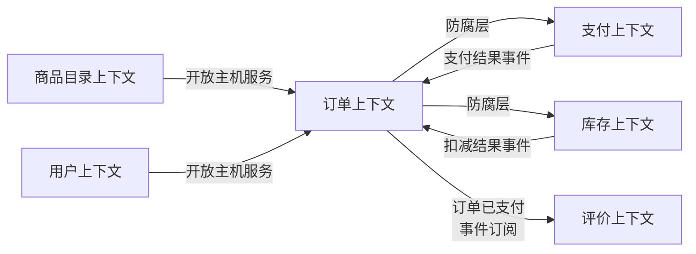

# 第20章：DDD 领域驱动设计

> [!TIP] Part 4: 架构演进与治理（进阶实战篇）
> 拆微服务时最难的判断是"边界在哪"。DDD 给架构师一套从业务语言出发划边界的方法论——战略设计定边界，战术设计落代码。这一章我们用云书店把它走一遍。

上一章我们解决了"什么时候拆"，这一章解决"按什么拆"。如果把服务边界划错了——订单服务里塞着半个库存逻辑，库存服务里躺着别人的用户数据——那么拆得越多、耦合越乱，还不如单体。DDD（Domain-Driven Design，领域驱动设计）就是用来回答这个问题的：**边界不该由技术决定，该由业务决定**。

## 20.1 为什么需要 DDD

先看病灶。云书店的订单模块早期长这样：`OrderService` 一个类 3000 行，里面塞着参数校验、金额计算、优惠券规则、库存调用、物流对接、短信通知。业务方说"下单要支持预售"，你打开代码发现下单逻辑和支付逻辑缠在一起，牵一发而动全身。

问题的根源是：**业务逻辑散落在技术分层里，代码结构和业务人员的语言对不上**。产品经理说"订单"，代码里却有 OrderService、OrderDao、OrderDTO、OrderVO 四个东西；产品经理说"已支付订单不能取消"，这条规则不知道埋在哪个 if 里。

DDD 由 Eric Evans 在 2003 年的同名著作中提出，核心主张一句话：**让代码结构直接反映业务结构，让业务专家和程序员说同一种语言**。

| 没有DDD | 有DDD |
| ---- | ---- |
| 逻辑全堆在 Service 里，越写越厚 | 逻辑归位到领域模型，Service 变薄 |
| 业务规则散落各处，靠口口相传 | 规则内聚在聚合里，一眼可见 |
| 模块按技术分层切（dao/service/controller） | 模块按业务域切（订单/库存/支付） |
| 微服务边界靠拍脑袋 | 服务边界 = 限界上下文 |

> [!NOTE] 什么时候不用 DDD
> 简单 CRUD（比如后台的字典管理）用 DDD 是杀鸡用牛刀，六边形架构的作者自己也这么提醒。DDD 的用武之地是业务规则复杂、变化频繁的核心域——云书店的订单、库存、营销模块值得，地区码表管理不值得。

## 20.2 战略设计：领域、子域与限界上下文

**领域（Domain）**是这家公司在做的事，**子域（Subdomain）**是把领域切开后的每一块。DDD 把子域分三类，这个分类直接决定人力怎么投：

| 子域类型 | 定义 | 判断标准 | 云书店的例子 | 投入策略 |
| ---- | ---- | ---- | ---- | ---- |
| 核心域 | 让你在竞争中赢的那块 | 做差了会死 | 个性化推荐、会员体系 | 自研，放最强的人 |
| 支撑域 | 必须有但不产生差异化 | 外包做不好业务 | 库存、物流对接 | 轻量自研或深度定制 |
| 通用域 | 谁家都一样 | 直接买现成的 | 登录认证、短信、支付通道 | 买 SaaS 或用开源 |

战略设计的第二个关键概念是**限界上下文（Bounded Context）**：一个模型适用的边界范围。同一个词在不同上下文里含义本来就不同——"商品"在商品目录上下文里是书名、封面、简介；在库存上下文里是 SKU、库位、安全库存；在订单上下文里是一份快照：下单那一刻的书名和价格。这不是字典没对齐，而是它们**本来就应该**是三个模型。

云书店的上下文划分长这样：

```text
┌────────────────┐   ┌────────────────┐   ┌────────────────┐
│   用户上下文     │   │  商品目录上下文  │   │    库存上下文    │
│ 注册/登录/会员   │   │  书目/分类/详情  │   │  SKU/库位/扣减   │
└───────┬────────┘   └───────┬────────┘   └───────┬────────┘
        │                    │                    │
        └────────────┬───────┴────────────────────┘
                     ▼
        ┌────────────────────────────┐
        │          订单上下文          │
        │   订单/订单项/金额/状态机     │  ← 核心域，逻辑最重
        └──────┬──────────────┬──────┘
               ▼              ▼
    ┌──────────────┐   ┌──────────────┐
    │   支付上下文   │   │   物流上下文   │
    └──────────────┘   └──────────────┘
```

上下文之间怎么协作，就是**上下文映射（Context Mapping）**。常用的关系类型有七种，记全不容易，先记前五种：

| 关系类型 | 一句话解释 | 云书店实例 |
| ---- | ---- | ---- |
| 合作关系（Partnership） | 两个团队一荣俱荣，协同演进 | 订单与库存（同在交易链上） |
| 共享内核（Shared Kernel） | 共享一小块模型，改动需双方评审 | 订单与支付共用的"金额"类型 |
| 客户-供应商（Customer-Supplier） | 上游照顾下游的需求 | 订单（上游）到推荐（下游） |
| 防腐层（ACL） | 中间加翻译层隔离 | 订单上下文里对接旧单体的适配器 |
| 开放主机服务（Open Host Service） | 上游公开标准协议给所有下游 | 商品目录提供 REST + 事件订阅 |
| 遵奉者（Conformist） | 下游无奈直接接受上游模型 | 对接第三方物流公司的 API |
| 各行其道（Separate Ways） | 不集成，各做各的 | 运营后台自己维护一份书单导入 |

画成图，云书店的上下文关系一目了然：



## 20.3 通用语言：让产品和程序员说同一种话

**通用语言（Ubiquitous Language）**是 DDD 里最"软"却最值钱的部分：在同一个限界上下文内，业务专家、产品、开发、测试、代码、文档必须使用同一套词汇。

反例长这样：产品说"取消订单"，开发代码里叫 `closeOrder()`，客服系统里叫"撤单"，测试用例里叫"关单"。四个词一个意思，沟通中每次都要互相翻译，而翻译就会丢信息。

正例的做法：需求评审会上建术语表，并让它直接落进代码：

| 通用语言术语 | 代码标识符 | 一句话定义 |
| ---- | ---- | ---- |
| 订单 | Order | 一次购买行为的完整记录 |
| 订单项 | OrderItem | 订单中的一种书及其数量 |
| 待支付 | PENDING_PAY | 已创建但未完成支付的状态 |
| 履约 | Fulfillment | 从支付成功到买家收货的全过程 |
| 预售订单 | Preorder | 库存不足时承诺到货后发货的订单 |

判断通用语言是否落地的土办法：随机打开一个类名或方法名让产品经理猜——能猜出八九不离十，说明语言通了；猜不出来，说明代码和业务还是两张皮。

## 20.4 战术设计：从实体到领域事件

战略设计画地图，战术设计盖房子。七个核心构件一张表看全：

| 构件 | 英文 | 本质 | 订单上下文中的例子 |
| ---- | ---- | ---- | ---- |
| 实体 | Entity | 有唯一标识，生命周期内可变 | 订单、订单项 |
| 值对象 | Value Object | 无标识、不可变、整体比较 | 收货地址、金额 |
| 聚合 | Aggregate | 一组必须保持一致的实体与值对象 | 订单 + 订单项 + 地址快照 |
| 聚合根 | Aggregate Root | 聚合的唯一入口，负责守护不变量 | Order |
| 领域服务 | Domain Service | 承载不属于单个聚合的逻辑 | 跨订单项的运费计算器 |
| 仓储 | Repository | 聚合的集合语义，屏蔽持久化 | OrderRepository |
| 领域事件 | Domain Event | 已发生事实的记录，过去式命名 | OrderCreated、OrderPaid |

实体和值对象的区别，用云书店的话说：一本书是**实体**（你关心"是哪一本"，有 ISBN 这个标识）；"作者：刘慈欣"是**值对象**（无所谓"哪一个"，内容一样就相等）。收货地址是值对象——用户"改地址"不是改了某个地址的属性，而是换了一个新地址，所以地址应该整体替换而不是被修改。

## 20.5 聚合设计四原则

聚合是 DDD 里最容易设计错的构件。Vaughn Vernon 总结的四条原则值得贴在工位上：

| 原则 | 解释 | 违反的典型症状 |
| ---- | ---- | ---- |
| 1. 聚合要小 | 一个聚合只保护一条必须强一致的不变量 | Order 里塞了 User、Book、Coupon 的全量对象 |
| 2. 聚合间用 ID 引用 | 跨聚合只存对方 ID，不存对象引用 | Order 里直接 new 了一个 Book 对象 |
| 3. 一次事务只改一个聚合 | 跨聚合的协调交给领域事件 | 在一个事务里同时保存订单和扣减库存 |
| 4. 跨聚合用最终一致 | 事件驱动，接受短暂不一致 | 为了强一致把三个聚合锁在一起 |

为什么第一条最要紧？假设订单聚合包含全部订单项、用户信息、书目信息，那么一次"改收货地址"要加载几 MB 的聚合、锁住一大片数据——在 5000 TPS 的下单峰值下数据库立刻躺平。而一个小的订单聚合（订单 + 订单项 + 地址快照），一次事务只碰自己那几行数据。

## 20.6 DDD 与微服务：一个上下文约等于一个服务候选

DDD 在微服务时代翻红的原因很简单：**限界上下文就是服务边界的最佳候选**。它天然满足微服务对边界的一切幻想：独立的模型、独立的语言、独立的数据。

```text
限界上下文（业务视角）             微服务（部署视角）
┌──────────────────┐          ┌──────────────────────┐
│    订单上下文      │   ≈1:1   │   order-service       │
│  订单聚合+订单事件 │ ───────▶ │   + order_db          │
└──────────────────┘          └──────────────────────┘
┌──────────────────┐          ┌──────────────────────┐
│    库存上下文      │  ──────▶ │   inventory-service   │
│  SKU/扣减规则     │          │   + inventory_db      │
└──────────────────┘          └──────────────────────┘
```

两条实用推论：

1. **先模块化单体，再服务化**。上下文边界可以先在单体里用包结构验证一年，稳了再物理拆分——云书店正是这么干的（第 19 章的阶段 1 到阶段 2）。
2. **一个服务可以包含多个小上下文，但一个上下文绝不能横跨两个服务**。上下文一旦被拆进两个服务，通用语言立刻分裂，"订单"从此有两个含义，再也没人对齐得回来。

## 20.7 实战：云书店的订单聚合

把战术设计落到代码。以下 TypeScript 示例展示聚合根、值对象、领域事件如何配合（节选自云书店 order-service 的领域层）：

```typescript
// ===== 领域事件：过去式命名，描述"已经发生的事" =====
export class OrderCreatedEvent {
  constructor(
    public readonly orderId: string,
    public readonly userId: string,
    public readonly totalAmount: number,
    public readonly items: ReadonlyArray<{ bookId: string; qty: number }>,
  ) {}
}

export class OrderPaidEvent {
  constructor(
    public readonly orderId: string,
    public readonly paymentId: string,
    public readonly paidAt: Date,
  ) {}
}

// ===== 值对象：无标识、不可变、整体比较 =====
export class Address {
  constructor(
    public readonly province: string,
    public readonly city: string,
    public readonly detail: string,
  ) {}
  equals(other: Address): boolean {
    return this.province === other.province
        && this.city === other.city
        && this.detail === other.detail;
  }
}

// ===== 聚合根：外部只能通过它修改聚合内部 =====
export class Order {
  private status: 'PENDING_PAY' | 'PAID' | 'CANCELLED' = 'PENDING_PAY';
  private events: object[] = [];  // 聚合记录自己"发生"的事件

  private constructor(
    public readonly id: string,
    public readonly userId: string,
    private readonly items: OrderItem[],  // 实体，有自己的标识
    private address: Address,             // 值对象，整体替换
  ) {}

  // 工厂方法：创建时就守护不变量（订单非空）
  static create(id: string, userId: string,
                items: OrderItem[], address: Address): Order {
    if (items.length === 0) throw new Error('订单至少要有一本书');
    const order = new Order(id, userId, items, address);
    order.events.push(new OrderCreatedEvent(
      id, userId, order.totalAmount(),
      items.map(i => ({ bookId: i.bookId, qty: i.quantity })),
    ));
    return order;
  }

  totalAmount(): number {
    return this.items.reduce((s, i) => s + i.unitPrice * i.quantity, 0);
  }

  changeAddress(next: Address): void {
    if (this.status !== 'PENDING_PAY') throw new Error('已支付订单不能改地址');
    this.address = next;   // 值对象直接整体替换
  }

  pay(paymentId: string): void {
    if (this.status !== 'PENDING_PAY') throw new Error('当前状态不可支付');
    this.status = 'PAID';
    this.events.push(new OrderPaidEvent(this.id, paymentId, new Date()));
    // 注意：扣库存不在这里做——发事件让库存上下文自己消费
  }

  pullEvents(): object[] {  // 仓储保存后，由应用层拿去发布到消息队列
    const e = this.events;
    this.events = [];
    return e;
  }
}

// ===== 仓储：聚合的集合语义，屏蔽持久化细节 =====
export interface OrderRepository {
  findById(id: string): Promise<Order | null>;
  save(order: Order): Promise<void>;
}
```

三个值得注意的细节：

1. **状态机收口在聚合根里**。"已支付不能改地址"这条业务规则只存在一个地方，想绕过它，代码根本编译不过去。
2. **`pay()` 里没有 HTTP 客户端**。聚合里只有业务语言——跨上下文的协作全部通过领域事件异步表达，这正是第 19 章消息队列在领域层的对应物。
3. **应用层很薄**。应用服务（Application Service）只做三件事：取出聚合、调用方法、存储并发布事件，不含任何业务判断。业务判断全在领域层。

> [!TIP] 检验聚合设计的土办法
> 把聚合的公共方法念给产品经理听：create、pay、cancel、changeAddress——如果他点头说"对，订单就是这些动作"，设计就对了；如果他说"咦，取消订单不是这么回事"，赶紧回去改模型。现在改只要一小时，上线后改要一个季度。

## 本章小结

- DDD 的核心主张：代码结构反映业务结构，业务与开发共用一套语言
- 子域分三类：核心域自研、支撑域轻做、通用域外购，人力投向跟着这个走
- 限界上下文是模型的适用边界，"商品"在目录、库存、订单上下文里就该是三个模型
- 上下文映射定义协作关系，最常用的是合作、共享内核、防腐层、开放主机服务
- 战术七构件：实体、值对象、聚合、聚合根、领域服务、仓储、领域事件
- 聚合四原则：小聚合、ID 引用、一次事务一个聚合、跨聚合最终一致
- 限界上下文是微服务边界的最佳候选；先在单体里验证边界，再物理拆分
- 通用语言的检验法：产品经理能不能看懂你的类名和方法名

**下一章预告**：架构搭起来了，可你怎么知道它正在悄悄变坏？第 21 章讲架构评估与度量——让腐化在酿成事故之前现形。

---
