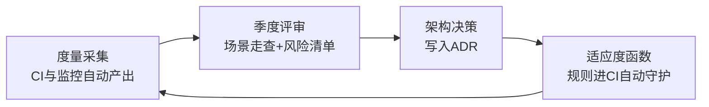

# 第21章：架构评估与度量

> [!TIP] Part 4: 架构演进与治理（进阶实战篇）
> 架构设计完只是开始，它会在无数次"就改一行"的变更中悄悄变形。这一章讲怎么主动发现问题：轻量评估、技术债管理、度量指标与守护工具，让腐化在酿成事故之前现形。

很多团队的架构工作流是这样的：立项时画一张漂亮的架构图，然后这张图再也没有被打开过。两年后系统出了大事故，大家才恍然发现——当初的"三层架构"早已变成了盘根错节的大泥球。这不是谁的错，这是熵增定律：**不加外力，系统只会自发地走向混乱**。架构治理就是那个外力。

## 21.1 架构腐化是常态：为什么要主动评估

先看一条所有系统都逃不掉的曲线：

```text
模块边界清晰度
高 │ ●
   │    ●●
   │       ●●
   │          ●●●              ① 新系统上线，边界清晰人人称赞
   │             ●●●●
   │                 ●●●●●     ② 需求冲刺期，开始有组织地抄近路
   │                      ●●●●●●●●●  ③ 无人守护，彻底糊成大泥球
低 └───────────────────────────────────▶ 时间
      ①          ②                ③
```

三个阶段的推手各不相同：①到②是需求压力——没人有时间为优雅停下来；②到③是纪律真空——规则没有被工具或流程固化，抄近路的成本为零。评估体系要对付的就是这两只手：用场景走查抵抗需求压力下的"集体失明"，用适应度函数消灭抄近路的零成本（21.6 节）。

对照这张曲线，还可以自查一个信号：**最近半年，谁最清楚系统的模块边界？**如果答案是"没有人"或者"只有上个月离职的老张"，评估就更要马上做——记忆流失是腐化的加速器，人一走，连"哪里是雷"都没人知道了。

腐化的典型路径：为了赶 deadline，订单模块直接读了促销模块的一张表（省一次接口调用）；下一个人如法炮制，还反过来让促销读订单的表；三个月后两边互为依赖，谁都不敢动。每一次抄近路在当时看都是"合理的取舍"，叠加起来就是腐化本身。

**腐化不会自己逆转，只能靠主动评估来对抗。**评估不是给架构打分的仪式，而是回答一个具体问题：如果今天重新设计，哪里会和现在不一样？不一样的部分，就是债务或风险。

## 21.2 轻量评估法：场景走查与风险清单

重量级评估（组织十几个专家开一周会）大多数团队玩不起。轻量评估只需要半天，两件武器：

**武器一：质量属性场景走查**。挑出 3-5 个关键场景，沿着架构图人工"走"一遍，追问架构如何支撑：

| 走查场景 | 走查问题 | 云书店的答案 | 结论 |
| ---- | ---- | ---- | ---- |
| 大促峰值下单 | 架构中哪个组件先到瓶颈？ | 订单库写入与库存扣减 | 需要消息队列削峰 |
| 支付服务宕机 | 下单链路会怎样？ | 熔断 + 订单标记"待支付确认" | 有预案，但要演练 |
| 商品改价 | 各处价格多久一致？ | 缓存 3 秒窗口 + 订单用下单快照 | 可接受 |
| 新人改一个功能 | 平均碰几个模块？ | 评审记录显示中位数 2.3 | 变更半径偏大，关注 |

**武器二：风险清单**。把走查发现沉淀成一张持续维护的表，风险不记录就等于不存在：

| 编号 | 风险描述 | 影响范围 | 可能性 | 缓解措施 | 状态 |
| ---- | ---- | ---- | ---- | ---- | ---- |
| R-07 | 库存服务无降级方案，宕机则全站不能下单 | 交易主链路 | 中 | 加库存预扣 + 降级开关 | 处理中 |
| R-12 | 订单与促销模块存在双向数据依赖 | 订单、促销 | 高 | 引入防腐层，Q3 拆除 | 已排期 |
| R-15 | 只有一个人懂积分结算逻辑 | 积分 | 高 | 结对 + 文档 + 单测 | 已完成 |

风险清单的维护节奏比格式更重要：新增风险当场入册，状态每月刷一次，连续两个季度没有缓解动作的条目自动升级、上报到季度架构回顾。清单一旦允许"僵尸条目"存在，它就会退化成装饰品。

走查的执行节奏建议：会前一周各团队提交场景与数据；会上每个场景限时 20 分钟，走完就在图上标注"支撑 / 勉强 / 不支撑"；当场不辩论、只记录，闭会后一周内出风险清单初稿。

> [!NOTE] 走查的关键技巧
> 每个场景都要走到"具体数字"为止。"性能不太好"是废话，"P99 延迟 800ms，目标 300ms"才是走查结论。定性评价无法被跟踪，定量结论才能进下一季度的议程。

## 21.3 ATAM 方法概览：效用树、敏感点与权衡点

如果团队规模够大、系统足够关键，可以了解工业界的标准方法 **ATAM（Architecture Tradeoff Analysis Method，架构权衡分析方法）**，由卡内基梅隆软件工程研究所（SEI）提出。这里点到为止，只取它最有价值的三个概念：

**效用树（Utility Tree）**：把"质量属性"从形容词变成场景的方法。自顶向下展开：质量属性 → 场景 → 可度量的响应：

```text
效用树：质量属性 → 场景 → 响应度量（括号内为 优先级,实现难度）
性能 (P)
├── P1: 大促峰值下单
│   └── P1.1 用户提交订单到收到响应          (高, 高)
│       └── 度量：P99 延迟 < 500ms @ 5000 TPS
可用性 (A)
├── A1: 支付服务宕机
│   └── A1.1 订单创建不受影响、可异步重试     (高, 中)
│       └── 度量：降级期间下单成功率 > 99%
可修改性 (M)
├── M1: 新增一种支付渠道
│   └── M1.1 只改支付上下文内部              (中, 低)
│       └── 度量：改动文件 < 10 个，其他服务零改动
```

效用树的打分习惯来自 ATAM：每个场景标注（重要性，实现难度），（高，高）的场景最优先处理——重要且难，拖得起的是心，拖不起的是架构。

**敏感点（Sensitivity Point）**：某个质量属性高度依赖的架构决策。例如"库存预扣的 Redis 超时时间"直接决定超卖率，它是性能属性的敏感点。

**权衡点（Tradeoff Point）**：影响多个质量属性、且此消彼长的决策。例如"缓存 TTL 设多长"——调长降低数据库压力（性能）但加大价格不一致窗口（正确性）。识别出权衡点，就意味着知道**改这里要找哪些人一起拍板**。

完整流程分六步，一般要走 2-3 天、投入约 40 人时：

1. 评估团队与项目方对齐：介绍 ATAM 流程与架构现状；
2. 识别关键质量属性与业务驱动因素；
3. 协同构建效用树，给每个场景标注（重要性，难度）；
4. 架构走查：针对高优先级场景逐个分析支撑决策；
5. 风险分析：区分风险点与非风险点，标出敏感点与权衡点；
6. 输出评估报告，向管理层汇报结果。

多数团队不必照搬全套流程，但效用树和权衡点的思想值得直接搬进 21.2 的轻量走查——本质上，轻量走查就是"砍掉排场、留下脑子"的 ATAM。

## 21.4 技术债务：显性化、利息与偿还策略

**技术债务（Technical Debt）**由 Ward Cunningham 提出，类比金融债务：为了赶工期走了捷径（借债），之后每次在这块代码上改动都要多花时间（还利息）。

利息是真实可算的：云书店的积分模块因为早期设计缺陷，每个需求要多花 30% 的工时绕坑——假设每季度在这个模块投入 20 人天，利息就是 6 人天/季度。**当利息算出来比重构本金还高时，就该还债了。**

显性化的载体不需要花哨：一张共享表格（列：位置、现象、利息估算、偿还计划、负责人）就够用。关键是每个条目都要有利息估算——没有利息数字，债务在优先级排序里永远排不进去。云书店的做法是把技术债条目直接排进迭代看板，和需求一样参与排序：**债不进看板，就永远排不上号**。

管理技术债的第一步是**显性化**：从"大家都知道很烂"变成一张登记册（21.2 的风险清单可以直接复用）。第二步是选对偿还策略，不同性质的债还法不同：

| 债务类型 | 例子 | 偿还策略 |
| ---- | ---- | ---- |
| 故意欠的、账目清楚的 | 为了大促临时写的硬编码开关 | 大促后立刻安排，趁上下文还在 |
| 无意欠的、账目清楚的 | 早期没料到会做国际化 | 发现时立项还清，越早越便宜 |
| 故意欠的、账目不清 | "先这样吧"式的补丁摞补丁 | 最危险：先花半天把债务定位清楚再还 |
| 无意欠的、账目不清 | 框架升级导致的连锁问题 | 不急着还，遇到哪块修哪块 |

团队层面最有效的机制是**定额还债**：每个迭代预留 20% 的时间偿还技术债，像还房贷一样固定扣款，而不是等"有空了再说"——永远不会有空。

还有一条容易被忽略的偿还技巧：**还债搭车**。反正要在某个模块加需求，就把同区域的小规模重构捎上——单独立项的还债很难批，搭着需求车走的还债几乎不产生额外评审成本。

> [!WARNING] 技术债不是坏的
> 借债是正确的经营手段：业务没验证就建"完美架构"才是最大的浪费。要避免的只有两件事——不知道自己欠了债，以及从不用利息视角算账。

## 21.5 架构度量指标：让腐化可量化

感觉会骗人，数字不会。以下指标构成架构健康度的仪表盘（前四个就是业界熟知的 DORA 四指标之一部分）：

| 指标 | 定义 | 怎么采集 | 云书店的健康线 |
| ---- | ---- | ---- | ---- |
| 变更半径 | 一次典型需求触碰的模块/服务数 | 评审记录抽样统计 | 中位数 < 2 |
| 部署频率 | 单位时间的生产发布次数 | CI/CD 流水线统计 | 核心服务 >= 1 次/天 |
| 变更前置时间 | 代码合并到生产上线的耗时 | 流水线时间戳 | < 1 天 |
| MTTR | 故障平均恢复时长 | 值班与事故记录 | < 30 分钟 |
| 变更失败率 | 引起回滚/故障的发布占比 | 发布记录 | < 15% |
| 圈复杂度 | 单方法分支复杂度 | 静态扫描工具 | 单方法 < 15 |
| 模块耦合度 | 依赖方向违规数 | ArchUnit 等守护规则 | 违规数 = 0 |
| 事件积压量 | 消息队列中未被消费的消息数 | MQ 控制台 | < 1 万条，超过即扩消费者 |

一张云书店本季度的看板示例（节选），感受一下"看趋势"长什么样：

| 指标 | 上季度 | 本季度 | 趋势 | 应对 |
| ---- | ---- | ---- | ---- | ---- |
| 变更半径（中位数） | 2.1 | 2.8 | 恶化 | 升级为风险条目，定位到订单与促销的双向依赖 |
| 部署频率（核心服务） | 每天 1.2 次 | 每天 1.5 次 | 改善 | 保持 |
| MTTR | 25 分钟 | 41 分钟 | 恶化 | 与告警噪音有关，告警治理立项 |
| 变更失败率 | 12% | 11% | 持平 | 观察——"持平"也是信息，它说明之前的动作没起效 |

三个使用要点：

1. **看趋势不看单点**。MTTR 从 20 分钟涨到 45 分钟，比"MTTR 是 45 分钟"这个绝对值信息量大得多。
2. **变更半径是架构师最该盯的**。它直接度量第 19 章说的耦合：如果改一个优惠规则平均要碰 5 个模块，不用怀疑，架构已经在腐化了。
3. **度量不进绩效考核**。一旦指标变成 KPI，工程师会优化指标而不是系统（古德哈特定律）：部署频率考核会让大家学会天天发没有意义的版本。

把指标做成看板落到日常，同样只有三步：**采集自动化**——流水线与监控系统天然有数据，别靠人手填；**看板放显眼处**——挂在内网首页，让趋势可见；**恶化自动升级**——任何指标连续两个季度变差，自动升级为风险清单条目。看板的价值不在好看，而在于让"变坏"这件事无法被悄悄忽略。

## 21.6 适应度函数与架构守护工具

**适应度函数（Fitness Function）**这个概念来自《演进式架构》一书，借自进化计算：用一个可自动执行的函数来检验架构是否仍然满足某些特性。落到工程里，它就是**写在 CI 里的架构测试**——规则违反了，构建直接失败，腐化在进入主干之前就被拦截。

以 Java 生态的 **ArchUnit** 为例，云书店模块化单体阶段的两条守护规则：

```java
// ArchUnit：把架构规则写成测试，违反即构建失败
@AnalyzeClasses(packages = "com.yunbookstore")
class ArchitectureTest {

    // 规则 1：分层依赖方向——controller 不许绕过 service 直连 repository
    @ArchTest
    static final ArchRule layeredAccess =
        layeredArchitecture().consideringAllDependencies()
            .layer("Controller").definedBy("..controller..")
            .layer("Service").definedBy("..service..")
            .layer("Repository").definedBy("..repository..")
            .whereLayer("Controller").mayNotBeAccessedByAnyLayer()
            .whereLayer("Service").mayOnlyBeAccessedByLayers("Controller")
            .whereLayer("Repository").mayOnlyBeAccessedByLayers("Service");

    // 规则 2：订单模块不许依赖促销模块的内部实现包（防腐铁律）
    @ArchTest
    static final ArchRule noInternalLeak =
        noClasses().that().resideInAPackage("..order..")
            .should().dependOnClassesThat()
            .resideInAPackage("..promotion.internal..");
}
```

适应度函数不一定靠工具，任何可执行断言都行：用脚本扫描全仓库是否存在跨服务的数据库直连账号；用依赖图工具检查微服务间是否存在循环调用；用性能测试脚本验证 P99 是否仍在 500ms 内。按守护对象分三类：**结构类**（分层规则、依赖方向，ArchUnit 是代表）、**运行类**（P99、资源占用，压测脚本进 CI）、**流程类**（每次变更带 ADR、数据库迁移必须带回滚脚本，用 CI 检查文件存在性）。三类混着用，守护才完整。关键特征只有一条：**机器自动跑，不需要人记得**。

以云书店 CI 流水线里的一小段 yaml 为例，看适应度函数怎么挂进去（测试失败即流水线失败）：

```yaml
name: architecture-guard
on: [pull_request]
jobs:
  guard:
    runs-on: ubuntu-latest
    steps:
      - uses: actions/checkout@v4
      - uses: actions/setup-java@v4
        with: { distribution: temurin, java-version: 21 }
      - name: 架构规则与复杂度门禁
        run: |
          mvn -q test -Dtest='ArchitectureTest'                # ArchUnit 架构测试
          mvn -q checkstyle:check -DmaxAllowedComplexity=15    # 圈复杂度门禁
```

注意两条门禁的分工：ArchUnit 管"形状"，checkstyle 管"密度"，一个挡结构腐化，一个挡函数膨胀。门禁的报错信息还要写得可执行——直接告诉人"哪个类违反了哪条规则、建议怎么改"，而不是只吐一个失败码。

## 21.7 季度架构回顾会议怎么开

所有评估动作最后要落进一个固定节奏。云书店的季度架构回顾（QA + 各团队 Tech Lead + 架构师，90 分钟）议程如下。谁来组织？架构师牵头，但"对账"环节必须由上一季度定目标的人自己汇报——自己报自己的账，是这会有别于普通汇报会的关键：

| 时间 | 议题 | 产出 |
| ---- | ---- | ---- |
| 0-10 分钟 | 过度量看板：只看趋势和异常，不看单点 | 问题清单 |
| 10-40 分钟 | 场景走查：本季度挑 2 个关键质量属性场景 | 新增风险条目 |
| 40-60 分钟 | 技术债盘点：按利息排序，定偿还优先级 | 还债排期 |
| 60-80 分钟 | ADR 抽检：上季度决策是否被代码遵守 | 需修订/废弃的决策 |
| 80-90 分钟 | 定下季度架构目标（不超过 3 条） | 目标清单 |

开不动的团队可以先从 60 分钟的"半场版"起步：度量趋势 + 一个场景走查 + 三个目标，其余议题下季度轮换。仪式一旦重到没人愿意维护，它自己也会腐化。



这个闭环里最重要的是最后一个箭头：**守护规则要回流到 CI**。评审会上发现的"不许跨模块直连表"，如果只是写在会议纪要里，三个月后一定会再犯；写成 ArchUnit 规则，才会真正长在系统里。顺带的，这个闭环也让"架构师"从瓶颈变成杠杆：度量自动跑，守护自动拦，架构师只需要在评审会上处理机器处理不了的事。

会议纪律比议程更重要：没有数字的观察不上会（"感觉订单模块有点乱"不行）；每个风险条目必须有负责人和日期；一次只定 3 个以内的目标——超过 3 个等于没有目标。

会前准备同样决定质量，提前一周发出三样东西：度量看板的截图与趋势解读、当前风险清单、上季度目标的完成情况。会上第一件事就是对账——上季度承诺的事做没做。对不了账的回顾会，开几年也开不出信任。散会后 24 小时内归档产出：风险清单更新进仓库、新目标写成季度条目、需要修订的决策挂上新的 ADR 编号——超时的纪要等于没有纪要。

## 本章小结

- 架构腐化是熵增的常态，只能靠主动评估对抗，不能指望自觉
- 轻量评估两件武器：质量属性场景走查（要走到具体数字）+ 持续维护的风险清单
- ATAM 取三点精髓：效用树把形容词变成场景，敏感点是单属性命门，权衡点影响多个属性
- 技术债要显性化成登记册，用"利息"算账决定何时偿还，每迭代固定 20% 时间还债
- 核心度量指标：变更半径、部署频率、变更前置时间、MTTR、变更失败率、耦合度
- 度量看趋势不看单点，且不进绩效考核，否则指标会被反向优化
- 适应度函数把架构规则写进 CI（如 ArchUnit），让腐化在进主干前被拦截
- 季度架构回顾形成闭环：度量、评审、决策、守护规则回流 CI

**下一章预告**：评估发现了问题，决策产生了 ADR，这些都记录在哪里、写给谁看？第 22 章讲架构文档与 ADR 实战——让文档活下来而不是进坟墓。

---
