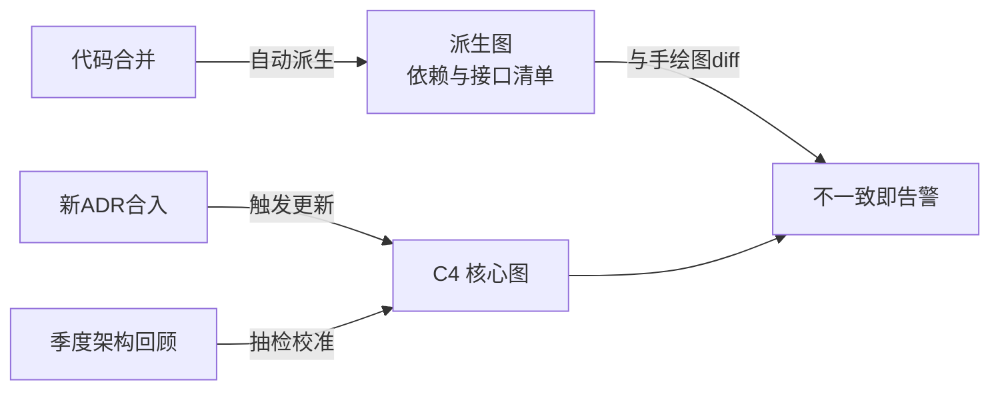

# 第22章：架构文档与 ADR 实战

> [!TIP] Part 4: 架构演进与治理（进阶实战篇）
> 架构决策的生命周期远比项目长：今天拍板的人，半年后多半已经调岗。这一章讲怎么用最少的笔墨写出有人看、活得久的文档——核心武器是 ADR（架构决策记录）。

"文档"这个词在很多团队约等于"过期谎言"。但反过来，完全没有文档的团队，每天都要重新解释一遍"当初为什么这么设计"。解决方案不是写更多文档，而是**写对文档**：面向读者、面向决策、并且有机制保证它不过期。

## 22.1 架构文档的三大反模式

先看三种最常见的失败方式，几乎每个团队都能对号入座：

| 反模式 | 典型症状 | 病根 |
| ---- | ---- | ---- |
| 百页无人读 | 500 页 Word 文档，季度访问量为 0 | 面向"归档"写作，不面向任何真实读者 |
| 图与代码脱节 | 图上还是三层单体，代码已经拆了 15 个服务 | 手工画图，没有更新机制，改了代码忘改图 |
| 只画不解释 | 满页框和箭头，没有一句"为什么这么连" | 把文档等同于图，把决策信息全弄丢了 |

第三种最隐蔽也最致命：一张图能告诉你系统"长什么样"，却永远无法告诉你"为什么长这样"。而**半年后真正值钱的恰恰是"为什么"**——结构看代码就能猜出来，当初否决了哪些方案、踩过哪些坑，代码里一个字都不会留。

图与代码脱节的病根值得多说一句：画图的人默认"大家会维护它"，但没有任何流程强制维护。解药不是号召，而是机制——要么让图能从代码自动生成，要么让某个固定仪式（比如季度回顾）必须校对图。指望自觉的文档机制，等于没有机制。

三种反模式还经常连环出现：文档没人读，所以没人发现图错了；图错了没人发现，又反过来证明"读文档没用"，恶性循环就此成立。打破循环的入口只有一处——先把文档变少、变准，让第一次阅读就产生价值。

## 22.2 轻量化文档策略：谁看、看什么、活多久

治好文档病的药方是三个问题：谁看？看什么？活多久？——想清楚这三问，90% 的文档都可以不写。云书店只保留五种文档：

| 文档 | 谁看 | 看什么 | 活多久 |
| ---- | ---- | ---- | ---- |
| C4 系统上下文图 | 所有人，包括老板和运营 | 系统边界与外部依赖 | 数年，随大版本更新 |
| C4 容器图 | 新入职工程师、合作团队 | 服务划分与通信方式 | 半年到一年 |
| ADR | 当事开发、评审者、半年后的自己 | 每个重要决策的来龙去脉 | 永久，包括被否决的 |
| 关键流程时序图 | 排查问题的人 | 一次下单请求经过谁 | 随架构变更 |
| 服务级 README | 接手该服务的人 | 怎么跑起来、依赖什么、找谁问 | 跟随代码，随提交更新 |

注意列表里**没有**"架构设计说明书"。一份面向所有人的文档等于不面向任何人：老板只关心边界，新人关心怎么跑起来，排查问题的人关心请求路径——把各自需要的那一份写好就够了。

> [!TIP] 判断文档该不该写的捷径
> 写之前问："半年后谁会需要它，需要时会怎么找？"两个问题都答不上来，就别写。云书店的实践：文档总量控制在一屏能列完的程度，超过这个数就说明有文档在为"写了"而存在。

对应地，这五类东西可以放心不写：

- 每个服务的接口全量文档——代码与 OpenAPI 注解就是真相；
- 数据库全量字段说明——ER 图由工具从 schema 自动生成；
- 每个版本的变更记录——Git log 与发布说明承担；
- 培训用 PPT——生命周期两周，投屏讲完即弃；
- "架构设计说明书"式的全景大文档——按上表拆给五类读者。

再补充一个"寿命测试"：写下这份文档时，预估它的第一次失效时间（比如"下次大促架构调整后"），把时间记在文档开头。到期未被推翻，说明它还算准确；到期已失效，说明当初就该写得更概要。

## 22.3 ADR 完整实战

**ADR（Architecture Decision Record，架构决策记录）**是目前业界共识度最高的轻量文档实践：一个决策一个 Markdown 文件，写完不改，改主意就写新的并标注取代旧的。

### 22.3.1 ADR 模板

模板的核心是五段，一段都不能省：

```markdown
# ADR-编号：一句话标题（动词 + 宾语）

- 状态：提议 | 已接受 | 已废弃（被 ADR-xxx 取代）
- 日期：YYYY-MM-DD
- 决策人：xxx；参与者：xxx

## 背景
我们面临什么问题？约束是什么？为什么现在必须决策？

## 决策
我们选择做什么。（一句话能说清，说不清说明还没想清）

## 备选方案
- 方案 B：为什么不选
- 方案 C：为什么不选

## 后果
正面：……
负面：我们接受这些代价，理由是……
```

"备选方案"和"后果（负面）"两段最常被偷懒省略，但它们恰恰是 ADR 的灵魂：没有备选，说明没有权衡；只写正面后果，说明没诚实地面对代价。半年后的读者看到"我们拒绝了 X，代价是 Y，我们接受"——这一行胜过十页设计说明。

落地时的四条使用规则：

1. **编号只增不改**：从 ADR-001 排起，废弃不删除，状态改为"已废弃"并指向新编号；
2. **状态只有三种**：提议、已接受、已废弃——不存在"暂时同意"这种暧昧状态；
3. **存进代码仓库**：和代码一起评审、一起版本化，别放在 wiki 里漂着；
4. **写完即冻结**：新信息出现就写新 ADR，旧 ADR 顶多补一行"被 ADR-xxx 取代"。

云书店三年积累了 40 多篇 ADR，平均每季度 3-4 个。这个量级刚刚好：决策太少说明团队在拖延，太多说明在给琐事立规矩。

### 22.3.2 示例 1：云书店选 Redis 而非 Memcached

```markdown
# ADR-017：商品与购物车缓存选用 Redis 而非 Memcached

- 状态：已接受
- 日期：2026-03-12
- 决策人：架构组；参与者：交易团队、基础设施团队

## 背景
阶段 1 的云书店日订单 5 万，商品详情 P99 延迟 800ms，数据库 CPU 85%，
需要引入缓存层。候选为 Redis 与 Memcached。决策窗口两周：大促前必须上线。

## 决策
采用 Redis 6.x（主从 + 哨兵），承载商品详情、购物车、会话三类数据。

## 备选方案
1. Memcached：多线程吞吐更高，但只有字符串结构——购物车要自己序列化，
   且无持久化，实例重启即全量回源，大促前重启一次等于自残。
2. 本地缓存 Caffeine：延迟最低，但 20 个应用实例间数据不一致，
   改价要自己广播失效，把复杂度转嫁给应用层。

## 后果
正面：
- 购物车用 Hash 结构直接存储，会话用 TTL 自动过期
- 支持持久化与主从，重启不丢数据
- 为阶段 2 的分布式锁、本地消息表预留了能力

负面（我们接受的代价）：
- 单线程模型在大 value 场景吞吐低于 Memcached（我们的 value 均 < 10KB，可接受）
- 多一套主从 + 哨兵要维护（基础设施团队可承接）
- 内存成本高约 20%，月增约 400 元，换取购物车改造少花两周
```

两个示例读下来应该有同一种感觉：每一条负面后果后面都跟着"为什么接受"。这不是文风，而是纪律——**被明确接受的代价会被记住，被隐瞒的代价会在事故里被记起**。

### 22.3.3 示例 2：订单服务拆分的 ADR（含备选方案对比表）

```markdown
# ADR-023：将订单模块从单体拆分为独立订单服务

- 状态：已接受
- 日期：2026-09-02
- 决策人：架构委员会；参与者：六个业务小组

## 背景
团队 50 人六个小组同仓库开发；部署耗时 55 分钟；改促销逻辑回归测试
要覆盖订单；四个拆分信号中三个已亮红灯（见第 19 章 19.1）。

## 决策
采用绞杀者模式，将订单模块连同订单表拆为独立 order-service；
下单链路改为事件驱动：订单落库后发布"订单已创建"事件，
库存与积分服务订阅异步处理，本地消息表保证事件不丢。

## 备选方案对比

| 维度 | A：维持模块化单体 | B：一次拆 8 个服务 | C：绞杀者拆订单/支付/库存（选定） |
| ---- | ---- | ---- | ---- |
| 交付影响 | 零 | 冻结新需求 6-9 个月 | 每两周迁一个模块，不停业务 |
| 大促扩容 | 整体扩容，成本最高 | 最优 | 核心链路独立扩容，够用 |
| 分布式复杂度 | 无 | 全量引入 | 只在核心链路引入 |
| 回滚难度 | 不涉及 | 极难（数据已全拆） | 路由开关，分钟级切回 |
| 一致性改造点 | 0 | 30+ 处跨服务事务 | 8 处，本地消息表解决 |
| 风险 | 团队信号已红灯，维持不现实 | 收益覆盖不了风险 | 风险可控，收益优先兑现 |

## 后果
正面：订单链路独立扩容（20 到 60 副本按需），六小组独立发布互不阻塞，
大促容量成本下降 30%。
负面：新增 8 处最终一致场景需要补偿机制；运维从 1 套变 4 套
（接受，平台化治理跟进为 ADR-025）。
```

对比表是拆分类 ADR 的利器：维度选得越"疼"，说服力越强。上面六个维度里有四个（交付、回滚、一致性、风险）是反对者真正关心的，而不是"谁的技术更时髦"。

写对比表还有个诀窍：维度从反对者的疑问出发，而不是从自己的卖点出发。云书店拆分前收集到的最高频反对意见是"拆了之后一致性怎么办"和"拆错了怎么收场"，所以"一致性改造点"和"回滚难度"两行最有说服力——它们回答的正是反对者最怕的事。

还有个反直觉的发现：对比表里"维持现状"那一列也要认真写它的代价，而不是只挑风险写——认真写 A 列，反对 A 的人才会相信你真的理解过他们的立场，而不是为拆而拆。

## 22.4 arc42 模板速览

当项目需要一份"完整"的架构文档时（投标、审计、大型外包），别自创目录——用 **arc42** 模板。它是欧洲广泛使用的架构文档骨架，重点在于它的章节顺序：先讲约束和上下文，最后才讲决策——**和大多数人的写作顺序正好相反**：

| arc42 章节 | 回答什么问题 | 对应本教程 |
| ---- | ---- | ---- |
| 1. 需求与目标 | 给谁做、要达成什么 | 第 2 章质量属性 |
| 2. 架构约束 | 技术、组织、法规上的硬约束 | 第 2 章 |
| 3. 系统范围与上下文 | 系统边界在哪 | C4 Level 1（第 3 章） |
| 4. 构建块 | 切成几块、各自职责 | C4 Level 2/3 |
| 5. 运行时视图 | 一次请求怎么流动 | 时序图 |
| 6. 部署视图 | 跑在什么环境上 | C4 部署图 |
| 7. 跨切面概念 | 安全、日志、异常如何统一处理 | Part 3 各专题 |
| 8. 架构决策 | 为什么这么设计 | ADR（本章） |
| 9. 质量、风险与技术债 | 风险清单 | 第 21 章 |
| 10. 术语表 | 通用语言词汇 | 第 20 章 |

日常团队不必每章都写满——arc42 的价值在于查漏：哪一章节你填不出来，哪里就是盲区。

用法上，arc42 更像体检表而非写作顺序。云书店的做法是按 arc42 的十个章节建立文档目录，每章允许写"本章不适用，理由是……"——空白和"不适用"是两种完全不同的信息：前者是没写，后者是思考过。

顺带一提：arc42 的第 8 章（架构决策）在本教程里被我们扩成了整节 ADR 实战——因为它是十个章节里唯一"过期最慢"的部分：结构会变，而"当初为什么这么定"几乎不会变，投入产出比最高。

## 22.5 三层组合：C4 + ADR + 代码即真相

第 3 章讲过 C4 是"结构视图"，本章的 ADR 是"决策视图"，两者加上代码本身，构成一套自洽的文档体系：

```text
   ┌─────────────┐
   │     ADR      │  ← 决策层：为什么这么设计
   │  50-100 个   │     单个文件小，永久保留，写完不改
   ├─────────────┤
   │    C4 图     │  ← 结构层：系统长什么样
   │  10 张以内   │     只维护 L1/L2 两级，与代码结构对得上
   ├─────────────┤
   │  代码 + 测试  │  ← 真相层：永远最新
   │              │     图和文档对不上时，以它为准
   └─────────────┘
```

三层的分工一句话说清：**代码告诉你"是什么"，C4 图告诉你"怎么组织"，ADR 告诉你"为什么"**。任何一层的信息如果可以在另一层得到，就删掉——例如 C4 图上不必写每个服务的接口清单（代码即真相），ADR 里不必画大图（那是 C4 的事）。

新信息出现时的更新流向也要约定：代码变更直接改代码；影响结构的大变更先写 ADR，ADR 被接受后同步更新 C4 图；小修小改不惊动任何文档。方向永远是"从代码到文档"，绝不允许文档里出现代码里没有的东西。

## 22.6 文档的衰减与定期校准机制

所有文档都在衰减，区别只在于有没有校准机制。云书店的双保险：



**保险一：自动派生**。凡是机器能生成的图就不手画：依赖关系图、API 文档、数据库 ER 图，全部从代码在 CI 里自动生成。手画的图只保留"机器画不出来"的部分——也就是设计意图。

**保险二：定期校准**。第 21 章的季度架构回顾里有一条固定议程：抽检 C4 核心图与 ADR 是否与代码一致。发现不一致，要么改图要么改代码，当场拍板，不带过夜。

落到人头上，每类文档要有明确的 Owner：C4 核心图归架构师本人，随大版本更新；ADR 由决策提出者撰写，架构组共同维护索引；服务 README 归服务现任负责人，交接时必须更新。没有人负责的文档，等于默认过期。

再进一步，给文档设"退休"机制：服务 README 跟代码走不用管；ADR 永久保存；C4 图每半年强制复审一次，复审不过的图当场改或当场删。删错的老图能从 Git 历史里找回，留错的图会继续误导人——**删除一篇过时文档的成本，永远低于留着它的成本**。

> [!WARNING] 文档腐化和架构腐化一样危险
> 一张错误的架构图比没有图危害更大：新人照着错误理解去改代码，改出的事故还得你收拾。宁可删掉过期的文档，也不要留着一篇"看起来很全"的谎言。

## 本章小结

- 三大反模式：百页无人读、图与代码脱节、只画不解释，病根都是没想清楚"谁看"
- 轻量策略：用"谁看、看什么、活多久"三问过滤，90% 的文档可以不写
- ADR 五段模板：背景、决策、备选方案、后果，备选与负面后果是灵魂
- 一个决策一个 ADR 文件，写完不改，被取代就标状态指向新 ADR
- 拆分类 ADR 用备选对比表表达权衡，维度要选反对者真正关心的
- arc42 是完整文档的查漏清单，章节顺序：先约束与上下文，最后才决策
- 文档三层组合：代码是真相层，C4 图是结构层，ADR 是决策层
- 校准机制双保险：CI 自动派生 + 季度回顾抽检，过期文档宁可删不可留

**下一章预告**：演进、评估、文档都有了落点，最后一站是基础设施的形态变革——第 23 章云原生架构：容器、Kubernetes、服务网格与 GitOps。

---
