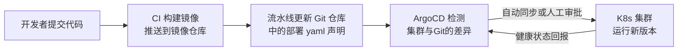

# 第23章：云原生架构

> [!TIP] Part 4: 架构演进与治理（进阶实战篇）
> 最后一站是基础设施形态的变革。云原生不是"把服务器搬到云上"，而是一套让应用天生适配弹性环境的工程方法：容器、Kubernetes、服务网格、Serverless 与 GitOps。

回到第 19 章云书店的阶段 3：服务已经有 15 个了，每上一个新服务都要手工配注册中心、监控、告警，发布靠工单，大促扩容靠提前一个月买机器。这时候你需要的不是"更多的服务器"，而是**一种让基础设施可以像代码一样被描述、被调度的基础设施**——这就是云原生要解决的问题。

## 23.1 云原生是什么：定义与价值主张

按云原生计算基金会（CNCF）的定义，云原生技术有利于各组织在公有云、私有云和混合云等新型动态环境中，构建和运行可弹性扩展的应用。翻译成人话，它的价值主张就三条：

1. **弹性**：容量跟着流量走，大促前不用买一堆平时闲置的机器；
2. **韧性**：任何实例挂了都自动替换，故障是常态而非事故；
3. **效率**：部署单元标准化之后，发布从"工程仪式"变成"日常操作"。

一个常见的误会要先拆掉：云原生不等于"买了云服务器"。把虚拟机从机房搬到云上，弹性还是假的——真正的分水岭在于应用是否按弹性环境的要求被改造过：无状态、可水平扩展、可随时杀掉重来。下面每一节，都在回答"应用要变成什么样，才配得上云的弹性"。

先看三种部署形态的对比，理解容器到底改变了什么：

| 维度 | 物理机部署 | 虚拟机部署 | 容器部署 |
| ---- | ---- | ---- | ---- |
| 启动时间 | 分钟到小时级 | 分钟级 | 秒级 |
| 单机密度 | 1 个应用 | 几个到几十个 | 几百个 |
| 环境一致性 | 装环境靠文档 | 镜像模板，易漂移 | 镜像即环境，完全一致 |
| 扩容方式 | 采购+装机 | 开虚拟机 | 调一个副本数 |
| 资源粒度 | 整台机器 | 1-2 GB 起 | 可以精确到 128MB |

## 23.2 容器与 Docker：三个基础抽象

云书店运维同学第一次接触容器时，用了一个绝妙的类比：**镜像是类，容器是对象，编排是对象池管理器**。三个抽象层层递进：

```text
镜像 (Image)             容器 (Container)            编排 (Orchestration)
"类/模板"                 "对象/实例"                  "对象池管理器"
┌──────────────┐  run    ┌──────────────┐  大量部署   ┌──────────────────┐
│ order:v2.3.1  │ ──────▶ │ 进程+文件系统 │ ─────────▶ │ K8s 调度到几百台机器│
│ 只读、分层构建 │  可起N个 │ 隔离、用完即弃 │            │ 挂了自动重启        │
└──────────────┘         └──────────────┘            └──────────────────┘
```

- **镜像（Image）**：打包了应用代码、运行时、依赖库的只读模板。因为"环境即镜像"，"我本地是好的"这句话从此从借口变成了线索——本地和线上跑的是同一个镜像。
- **容器（Container）**：镜像跑起来的实例，隔着自己的文件系统和进程空间，但共享宿主机内核（这是它比虚拟机轻的原因：虚拟机带整个操作系统，容器只带应用）。
- **编排（Orchestration）**：当容器超过几十个，谁来决定它跑在哪、挂了谁拉起、流量怎么进来？这就需要 Kubernetes。

两个工程细节：镜像用分层构建，依赖层放在代码层之前——代码天天变、依赖月月变，分层缓存能把构建时间从 5 分钟压到 30 秒；镜像推到私有 Registry 并使用不可变 tag（如 Git commit 短哈希），"latest"标签是环境漂移的头号来源。

云书店 order-service 的 Dockerfile（多阶段构建，最终镜像不到 200MB）：

```dockerfile
# 阶段一：构建
FROM node:22-alpine AS build
WORKDIR /app
COPY package*.json ./
RUN npm ci --omit=dev
COPY . .
RUN npm run build

# 阶段二：只带运行所需的最小产物
FROM node:22-alpine
WORKDIR /app
COPY --from=build /app/dist ./dist
COPY --from=build /app/node_modules ./node_modules
EXPOSE 3000
CMD ["node", "dist/main.js"]
```

## 23.3 Kubernetes 核心对象速览

Kubernetes（K8s）的声明式 API 是它的灵魂：你不告诉它"把服务部署到 A 机器"，你只声明"我要 3 个副本"，控制器会持续把现实拉向声明。六个最核心的对象：

| 对象 | 一句话职责 | 类比 |
| ---- | ---- | ---- |
| Pod | 最小调度单元，一个或一组共命运的容器 | 一间办公室 |
| Deployment | 声明副本数与镜像版本，负责滚动更新 | 办公室管理制度 |
| Service | 一组 Pod 的稳定访问地址（Pod 会死，地址不死） | 前台总机号码 |
| Ingress | 把外部 HTTP 流量按域名/路径路由到 Service | 大楼门牌指引 |
| ConfigMap | 配置与代码分离，配置注入环境 | 公告栏 |
| HPA | 按指标自动增减 Pod 数量 | 弹性用工制度 |

一个把五件事串起来的 yaml（云书店的订单服务，节选）：

```yaml
# Deployment：声明"订单服务要 3 个副本"
apiVersion: apps/v1
kind: Deployment
metadata:
  name: order-service
spec:
  replicas: 3
  selector:
    matchLabels:
      app: order-service
  template:
    metadata:
      labels:
        app: order-service
    spec:
      containers:
        - name: order-service
          image: registry.yunbookstore.com/order-service:2.3.1
          ports:
            - containerPort: 3000
          envFrom:
            - configMapRef:
                name: order-config        # ConfigMap 注入配置
          resources:
            requests: { cpu: "500m", memory: "512Mi" }
            limits: { cpu: "1", memory: "1Gi" }
          readinessProbe:                  # 没就绪的实例不接流量
            httpGet: { path: /health, port: 3000 }
---
# Service：给这组 Pod 一个稳定的内部地址
apiVersion: v1
kind: Service
metadata:
  name: order-service
spec:
  selector:
    app: order-service
  ports:
    - port: 80
      targetPort: 3000
---
# HPA：CPU 超过 70% 自动扩容，3 到 30 个副本之间
apiVersion: autoscaling/v2
kind: HorizontalPodAutoscaler
metadata:
  name: order-service
spec:
  scaleTargetRef:
    apiVersion: apps/v1
    kind: Deployment
    name: order-service
  minReplicas: 3
  maxReplicas: 30
  metrics:
    - type: Resource
      resource:
        name: cpu
        target: { type: Utilization, averageUtilization: 70 }
```

注意这对应了第 19 章阶段 3 的承诺：大促前"扩容"从提前一个月买机器，变成了改一个 `maxReplicas` 数字。

同样重要的是 K8s 不做什么：它不管理数据库里的数据迁移，不替你设计服务的拆分边界，也不保证应用自身写得无状态。容器化接管的是"进程的运维"，而第 13 章讲的数据架构问题，一个都不会因为上了 K8s 而消失。

## 23.4 服务网格：Sidecar 模式思想

微服务多了之后你会发现：重试、熔断、超时、灰度、加密……这些治理逻辑在每个服务里都要写一遍，而且每种语言各写一套。**服务网格（Service Mesh）**的思路是：把治理逻辑下沉到基础设施——在每个 Pod 里额外塞一个代理容器，让它替业务容器处理所有网络事务。这就是 **Sidecar（边车）模式**：

```text
        一个 Pod（K8s 最小调度单元）
┌───────────────────────────────────────┐
│  ┌────────────────┐  ┌─────────────┐  │
│  │ order-service   │  │   Sidecar   │  │
│  │  业务容器        │◀▶│ Envoy 代理   │◀─┼──▶ 网络中的其他服务
│  │ （零治理代码）    │  │ 重试/熔断/加密│  │
│  └────────────────┘  └─────────────┘  │
└───────────────────────────────────────┘
```

**Istio** 是最流行的服务网格实现：控制平面统一下发规则，数据平面（每个 Pod 里的 Envoy 代理）执行。它的收益是业务代码与治理逻辑彻底解耦——"订单服务调用支付服务失败重试 3 次"变成一条 yaml 规则，Java 服务和 Go 服务同样生效。

Istio 的能力面板主要三块：**流量管理**（按比例灰度、金丝雀发布、故障注入演练）；**安全**（服务间 mTLS 加密与细粒度授权）；**可观测**（不改代码拿到服务间调用指标与拓扑图）。代价也很直接：每个 Pod 多一个代理，每次请求多两跳代理，延迟增加约 1-3ms，还要养一个能玩转 Istio 的团队。云书店的实践建议：**15 个服务以下别上**，用框架内治理（如 Spring Cloud）就够了；服务超过 30 个、多语言混杂时，网格才开始划算。

## 23.5 Serverless 与 FaaS：适合与不适合

**Serverless（无服务器）**不等于"没有服务器"，而是"你不用管服务器"：上传函数，平台负责伸缩、容错、计费（按调用次数和执行时长，不调用不花钱）。**FaaS（Function as a Service）**是它的主要形态，如阿里云函数计算、AWS Lambda。

关键是分清它适合什么。云书店的真实用法：

| 适合的场景 | 为什么适合 | 云书店的例子 |
| ---- | ---- | ---- |
| 突发、无规律的流量 | 按调用付费，闲时不花钱 | 大促海报生成：平时每天几十次 |
| 轻量数据加工 | 写个函数就上线，零运维 | 每日销售报表汇总、日志清洗 |
| 事件触发的胶水逻辑 | 天然与消息、对象存储集成 | 用户上传封面后自动生成缩略图 |

| 不适合的场景 | 为什么不适合 |
| ---- | ---- |
| 核心交易链路 | 冷启动几十到几百毫秒，P99 抖动不可控 |
| 有状态的长时间任务 | 函数实例随时被回收，状态得外挂 |
| 需要精细控制的性能场景 | 共享运行时，无法调 OS 参数 |

一句话：**Serverless 适合"边缘的、突发的、无状态的"，核心链路留在常驻服务里**。云书店把缩略图生成和日报统计搬上了函数计算，一年省下 3 台常驻服务器的钱；订单服务则在 K8s 上稳稳地跑着。

## 23.6 IaC 与 GitOps：声明式基础设施

**IaC（Infrastructure as Code，基础设施即代码）**主张：服务器、网络、数据库这些基础设施也用代码声明，版本化在 Git 里，由工具（Terraform 等）负责创建和变更——环境不再靠"运维老师傅的手感"。例如云书店用一份 Terraform 声明描述预发环境的 3 台应用服务器、1 个 Redis 主从、1 个 RDS 实例，销毁环境就是一条 `terraform destroy`——演练环境从"申请一周"变成"十分钟建、用完即毁"。

**GitOps** 是 IaC 在应用部署层的延伸，规则只有一条：**Git 仓库是唯一事实源，集群状态由工具自动向 Git 对齐**。以 ArgoCD 为例，它的运行方式：



GitOps 的额外红利是**回滚**：回滚一个发布 = revert 一个 Git 提交，ArgoCD 会把集群拉回旧状态。第 19 章"每步都要有回滚方案"在这里有了工程化的落点。变更审计也顺手解决了：谁在什么时候改了什么配置，Git log 一目了然——不再有运维深夜手改线上配置然后没人知道的事故。

## 23.7 12-Factor App 十二条速览

**12-Factor App**（十二要素应用）诞生于 2011 年的 Heroku，是"云原生应用长什么样"最早的完整回答，今天的容器时代回头看依然句句命中：

| # | 要素 | 一句话 | 云书店的落地 |
| ---- | ---- | ---- | ---- |
| 1 | 基准代码 | 一份代码库，多份部署 | 一个 Git 仓库对应一个服务 |
| 2 | 依赖 | 显式声明并隔离依赖 | package.json + npm ci |
| 3 | 配置 | 配置存于环境，不进代码 | 数据库地址走 ConfigMap 注入 |
| 4 | 后端服务 | 把数据库、队列当附加资源，用 URL 绑定 | 换 Redis 地址不用改代码 |
| 5 | 构建、发布、运行 | 严格分离三阶段 | CI 构建镜像，发布只改版本号 |
| 6 | 进程 | 应用是无状态进程 | 会话放 Redis，进程可随时杀 |
| 7 | 端口绑定 | 应用自带端口对外服务 | 服务监听 3000，K8s 直接探活 |
| 8 | 并发 | 靠进程水平扩展 | HPA 按副本数伸缩 |
| 9 | 易处理 | 快速启动、优雅终止 | 启动 3 秒，SIGTERM 后排空请求 |
| 10 | 开发环境与线上环境等价 | 缩小差异 | 本地用同版本镜像跑 |
| 11 | 日志 | 把日志当事件流，输出到 stdout | 采集器统一收集，不在本地落盘 |
| 12 | 管理进程 | 一次性任务与常驻进程同环境 | 数据迁移用同一个镜像跑 Job |

## 23.8 云书店容器化改造 Checklist

最后给一份可直接抄走的改造清单。云书店从虚拟机搬上 K8s 时，按下表逐项打勾，两个季度完成：

| 事项 | 说明 | 不做的后果 |
| ---- | ---- | ---- |
| 无状态化 | 会话、本地缓存全部外移到 Redis | 扩容后流量打到新实例就丢登录态 |
| 配置外部化 | 配置走 ConfigMap/配置中心，敏感项走 Secret | 换环境要重新打包镜像 |
| 健康检查 | 提供 /health（存活）与 /ready（就绪）两个接口 | 僵尸实例继续接流量 |
| 优雅停机 | 处理 SIGTERM，先摘流量再处理完存量请求 | 每次发布都掉一批在途请求 |
| 日志进 stdout | 日志输出到标准流，由采集器统一收走 | Pod 重建日志即丢失，排障抓瞎 |
| 镜像最小化 | 多阶段构建 + 固定版本 tag，禁用 latest | 镜像 2GB 拖慢发布，latest 引发"漂移" |
| 资源 limits | 每个 Pod 声明 requests 与 limits | 一个失控容器吃光整机资源 |
| 连接池适配 | 数据库连接池大小 = 副本数 x 每实例池大小 | 副本一多打爆数据库连接上限 |
| 优雅上下线 | 就绪前不接流量，下线前先从注册中心摘除 | 大促扩容时新实例接住打死的请求 |

云书店按这份清单改造时，前五项（无状态化、配置、健康检查、优雅停机、日志）花了一个季度，是真正的硬仗；后四项在容器化流水线里顺手完成。估算工作量时按"无状态化最难"来估，它是整张清单的地基。

> [!NOTE] 改造顺序建议
> 别把"上 K8s"当第一步。云书店的真实顺序是：先无状态化（第 8 条的前置），再容器化（Dockerfile + 健康检查），最后才上编排（K8s + HPA）。顺序反了，等于把一堆有状态的麻烦打包搬进了新家。

## 本章小结

- 云原生的价值主张：弹性、韧性、效率，本质是让基础设施可声明、可调度
- 三个基础抽象：镜像是类，容器是对象，编排是对象池管理器
- K8s 是声明式 API：只描述期望状态，控制器持续把现实拉向声明
- 六个核心对象：Pod、Deployment、Service、Ingress、ConfigMap、HPA
- 服务网格用 Sidecar 把治理逻辑下沉到基础设施，服务超过 30 个、多语言混杂才划算
- Serverless 适合边缘、突发、无状态场景，核心交易链路留在常驻服务
- GitOps 让 Git 成为唯一事实源，回滚一个发布等于 revert 一个提交
- 容器化改造从无状态化开始，而不是从装 K8s 开始

**下一章预告**：最后一章，我们把整本教程收束成你随身的工具箱——架构师的三种类型、五年成长路径、一张决策速查大表、评审 checklist 与全书术语表。

---
