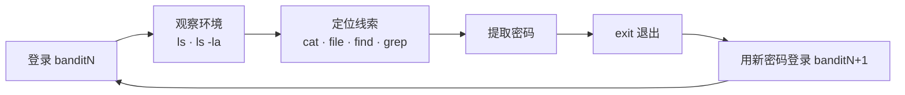

# 第1章：Bandit 通关手册（上）——从 SSH 登录到文本检索

> [!TIP] Part 1: 终端闯关篇
> 本 Part 的目标是把命令行变成你的「手柄」：先用 Bandit 这座靶场练出 Linux 命令的肌肉记忆，再用两款轻量游戏把导航与组合命令打磨成型。本章从第 0 关一路打到第 8 关，覆盖 SSH 登录、文件名陷阱、隐藏文件、find 条件搜索与文本检索五项基本功。

你大概已经背过 `ls`、`cd`、`cat` 这些命令，也可能跟着教程敲过一遍就翻篇了。但「看过」和「条件反射」是两回事——真到排查问题时，手能比脑子先敲出正确命令的人，都是被反复的小关卡磨出来的。Bandit 提供的就是这种磨法：34 个关卡，每关只有一个目标，**找到下一关的密码**，而你手里的武器只有终端。

本章你将从一条 SSH 命令开始，一路用上文件操作、条件搜索和文本检索三组共十余条命令。到第 8 关通关时，你会发现自己已经能在陌生服务器上自信地「翻箱倒柜」了。

## 1.1 Bandit 是什么：一座可以合法闯的靶场

Bandit 是 OverTheWire 社区运营的 Wargame（战争游戏，俗称「靶场」），是公认的最适合编程新手的入门战场。所谓靶场，就是**由他人搭建、明确授权你攻击练习的封闭环境**——在真实服务器上做同样的事是违法的，在靶场里做同样的事是通关的唯一方式。

它的规则简单到可以用一句话说清：

- 你以 `bandit0`、`bandit1`……`bandit33` 这 34 个账号逐级登录；
- 每一级的密码，都藏在**上一级用户能读到、但需要动点脑筋才能找到**的地方；
- 找到 `bandit1` 的密码，就用它登录 `bandit1`，开始找 `bandit2` 的密码，如此循环 33 次。

```text
        【Bandit 闯关循环】

   bandit0 ──cat readme──→ 找到密码 ──登录──→ bandit1
     ↑                                        │
     │                                    cat ./-
     │                                        │
   bandit33 ←── .bashrc 陷阱 ←── ... ←── bandit2
   （毕业）

   每一关 = 一次「线索 → 命令 → 验证」的小循环
   每一关只引入一个新知识点，这就是心流公式里的「渐进关卡」
```



这张循环图值得背下来，因为它是所有终端靶场的通用套路：**观察 → 定位 → 提取 → 换身份重来**。后面第 10 章的 picoCTF 靶场，解题框架仍然是这四步。

| 关卡段位 | 考察能力 | 典型命令 | 本章覆盖 |
| ---- | ---- | ---- | ---- |
| 第 0-2 关 | 登录与文件读取 | ssh、ls、cat | 是 |
| 第 3-4 关 | 隐藏文件与类型识别 | ls -la、file | 是 |
| 第 5-6 关 | 条件搜索 | find | 是 |
| 第 7-8 关 | 文本检索与去重 | grep、sort、uniq | 是 |
| 第 9-24 关 | 编码、解压、网络与定时任务 | strings、base64、nc、cron | 第2章 |
| 第 27-33 关 | Git 实战 | git clone、git branch | 第2章 |

## 1.2 第 0 关：第一条隧道——SSH 登录

打开你的终端（Windows 10 及以上自带 OpenSSH 客户端，也可以用 VSCode 内置终端），敲下全书的第一条命令：

```bash
ssh bandit0@bandit.labs.overthewire.org -p 2220
# bandit0@... 是用户名@主机名，-p 2220 指定端口
# 首次登录会询问是否信任主机指纹，输入 yes
# 提示输入密码时输入 bandit0，屏幕不会显示任何字符——这是正常的
```

几个参数拆开看：

| 片段 | 含义 | 备注 |
| ---- | ---- | ---- |
| `ssh` | 建立 SSH（Secure Shell）加密远程连接 | 本站[《Git 与 SSH 完全教程》](/git-ssh/ch04)第四章专门讲它 |
| `bandit0@` | 用户名，`@` 前是账号 | 每通关一级，账号名 +1 |
| `bandit.labs.overthewire.org` | 靶场主机 | 全世界玩家连的是同一台服务器 |
| `-p 2220` | 端口号 | 靶场故意不用默认的 22 端口 |

登录成功后，你会看到一行 ASCII 字符画的服务器欢迎语，然后是 shell 提示符。按闯关循环走第一步——观察环境：

```bash
bandit0@bandit:~$ ls
readme
bandit0@bandit:~$ cat readme
NH2SXQwcBdpmTEzi3bvHMM7i07G36TyA   # 这就是 bandit1 的密码（示例格式，实际以你读到的为准）
```

恭喜，第一个密码到手。接下来是贯穿全书的标准动作：**记录它**——不是为了抄，而是下一关登录要用。输入 `exit` 断开连接，然后 `ssh bandit1@... -p 2220`，粘贴密码，进入第 1 关。

> [!NOTE] 「密码屏幕上不显示」不是故障
> SSH 输入密码时没有任何回显（连星号都没有），这是 Unix 的传统安全设计。照常输入、按回车即可。第一次登录被 `The authenticity of host` 询问拦住时，输入 `yes`——那是在确认服务器指纹（Host Key），细节见本站 Git 与 SSH 教程第六章。

## 1.3 第 1-2 关：文件名的两个陷阱

第 1 关的家目录里躺着一个名字只有一个字符的文件：`-`。你很自然地会敲 `cat -`——然后终端像是卡住了，光标停在那里不动。

**反例（会发生什么）：**

```bash
bandit1@bandit:~$ cat -
（没有任何输出，命令看起来挂住了——按 Ctrl+C 逃生）
```

原因：`-` 开头的参数会被命令解析成**选项**（option）而不是文件名，`cat -` 的含义是「从标准输入读取」，于是 `cat` 在耐心等你打字。解法是用 `./` 前缀把文件名钉死成「当前目录下的路径」：

```bash
bandit1@bandit:~$ cat ./-
（输出 bandit2 的密码）
```

第 2 关换了一个陷阱：文件名里全是空格，叫 `spaces in this filename`。这时不加处理直接敲，`cat` 会把 `spaces`、`in`、`this`、`filename` 当成四个独立文件名，逐个报「找不到文件」。

```bash
bandit2@bandit:~$ cat "spaces in this filename"
（输出 bandit3 的密码）
```

两个陷阱对应同一条底层规则：**Shell 会先对命令做「分词」，再交给命令本身**。引号告诉 Shell「这一整段是一个词」，`./` 前缀告诉命令「这是路径不是选项」。记住这对组合拳，以后处理 `My Documents` 这类路径时不会再摔跟头。

| 陷阱 | 症状 | 解法 | 原理 |
| ---- | ---- | ---- | ---- |
| 文件名以 `-` 开头 | 命令挂住或报「无效选项」 | `cat ./-` | `./` 让参数变路径，绕开选项解析 |
| 文件名含空格 | 报「No such file or directory」且把空格当分隔 | `cat "spaces in this filename"` | 引号阻止 Shell 分词 |
| 文件名含通配符 `*` | 匹配出意外的文件列表 | 引号或 `\*` 转义 | 同上，Shell 分词在先 |

## 1.4 第 3-4 关：隐藏文件与 file 命令

第 3 关的线索在一个叫 `inhere` 的目录里。`cd inhere` 进去后 `ls` 一敲——空的？不，是**有一个隐藏文件**。Unix 世界里，以 `.` 开头的文件默认不显示，需要 `-a` 参数：

```bash
bandit3@bandit:~/inhere$ ls -la
total 12
drwxr-xr-x 2 root   root   4096 ...  .
drwxr-xr-x 3 root   root   4096 ...  ..
-rw-r----- 1 bandit4 bandit3   33 ...  .hidden
bandit3@bandit:~/inhere$ cat .hidden
（输出 bandit4 的密码）
```

`ls -la` 的输出值得逐列读懂：第一列是权限与类型，第三、四列是属主与属组，倒数第二列是文件名。这套符号在第 5 章的 Linux 权限关卡里还会反复出现，现在先记住 `-a` 能让隐藏文件现形。

第 4 关更进一步：`inhere` 目录里有 `-file00` 到 `-file09` 十个文件，**只有一个**是人类可读的，其余都是乱码二进制。总不能一个个 `cat` 出来辣眼睛——用 `file` 命令识别每个文件的类型：

```bash
bandit4@bandit:~/inhere$ file ./-file0*
./-file00: data
./-file01: data
./-file02: data
./-file03: data
./-file04: data
./-file05: data
./-file06: data
./-file07: ASCII text     ← 只有它是文本
./-file08: data
./-file09: data
bandit4@bandit:~/inhere$ cat ./-file07
（输出 bandit5 的密码）
```

`file` 的原理是读文件头部的「魔数」（Magic Number，文件开头几个字节的特征码）来判断真实类型，**而不是看扩展名**——这也是第 10 章取证类 CTF 题目的基本功。

| file 输出 | 含义 | 什么时候会见到 |
| ---- | ---- | ---- |
| `ASCII text` | 人类可读文本 | 密码、配置文件 |
| `data` | 无法归类的二进制数据 | 加密、压缩或故意伪装的文件 |
| `gzip compressed data` | gzip 压缩包 | 第2章第 12 关解压流水线 |
| `POSIX tar archive` | tar 归档包 | 同上 |
| `Zip archive data` | zip 压缩包 | 同上 |

## 1.5 第 5-6 关：find 的条件搜索

从第 5 关开始，暴力 `cat` 走不通了：`inhere` 下面嵌套着几十个子目录、上千个文件，线索只有三个属性——**人类可读、大小恰好 1033 字节、不可执行**。这时候需要的是搜索，而不是遍历：

```bash
bandit5@bandit:~/inhere$ find . -size 1033c ! -executable
./maybehere07/.file2
bandit5@bandit:~/inhere$ cat ./maybehere07/.file2
（输出 bandit6 的密码）
```

拆解这条命令：`find .` 从当前目录递归搜索；`-size 1033c` 中的 `c` 是字节单位（不加单位默认是 512 字节块，这是 find 最著名的坑之一）；`! -executable` 表示「取反」，排除可执行文件。三个条件是**与**的关系，全部满足才输出。

第 6 关把搜索范围扩大到整台服务器，条件变成属主与属组：找一个**属于用户 bandit7、属于组 bandit6、大小 33 字节**的文件：

```bash
bandit6@bandit:/$ find / -user bandit7 -group bandit6 -size 33c 2>/dev/null
/var/lib/dpkg/info/bandit7.password
bandit6@bandit:/$ cat /var/lib/dpkg/info/bandit7.password
（输出 bandit7 的密码）
```

`2>/dev/null` 是这条命令的关键：全盘搜索必然闯进大量无权限的目录，系统会刷出成百上千行 `Permission denied`，把结果淹没。`2>` 把标准错误（fd 2）重定向到 `/dev/null` 这个「黑洞设备」，报错信息就地蒸发，屏幕上只留下真正的结果。

| find 条件 | 作用 | 本站参考 |
| ---- | ---- | ---- |
| `-name "*.txt"` | 按文件名（支持通配符） | [文件与目录操作](/linux-command/ch03) |
| `-size 1033c` | 按大小，`c` 为字节，`k`/`M` 为千/兆字节 | 本章第 5 关 |
| `! -executable` | `!` 取反：排除可执行文件 | 本章第 5 关 |
| `-user bandit7` | 按属主用户 | 本章第 6 关 |
| `-group bandit6` | 按属组 | 本章第 6 关 |
| `-type f` | 只找普通文件（排除目录等） | 第2章 Git 关卡会用到 |

> [!WARNING] 重定向黑洞别用反了
> `2>/dev/null` 只该吞掉「可以预期的权限报错」。如果你把标准输出也一起丢进黑洞（`>/dev/null 2>&1`），find 的搜索结果也会一起消失——排查问题时先想清楚：我要看的是结果还是错误？多数时候，两者你都想要。

## 1.6 第 7-8 关：grep 精确检索与 uniq 去重

第 7 关回到文本本身：`data.txt` 是一个上万行的文件，密码在含有单词 **millionth** 的那一行。一条命令解决：

```bash
bandit7@bandit:~$ grep millionth data.txt
millionth UsvVyFSfZZWbi6wgCB7VdIXx89Fvey42   # 含目标单词的行整行输出
```

grep 是文本检索的瑞士军刀，本站[《Linux 命令行完全教程》](/linux-command/ch22)第二十二章用整章篇幅讲它。第 8 关则要一点组合技：`data.txt` 有一百行重复内容与**唯一一行只出现一次**的密码，要求你把那一行找出来。

直觉方案「去重」撞上的第一个坑：`uniq -u` 只会**去除相邻的重复行**——而这份文件里相同的行根本不相邻。所以正确姿势是先排序、再去重：

```bash
bandit8@bandit:~$ sort data.txt | uniq -u
（输出 bandit9 的密码）
```

```text
      【为什么必须先 sort 再 uniq】

  原始文件:          直接 uniq -u:          先 sort 再 uniq -u:
  ┌─────────┐       ┌─────────┐           ┌─────────┐
  │ A       │       │ A  ←留下 │           │ A       │
  │ B       │       │ B       │           │ B       │
  │ A       │       │ A  ←留下 │  重复行    │ C  ←唯一 │
  │ C       │       │ C       │  不相邻，   │ (排序后 A、B
  │ A       │       │ A  ←留下 │  全部幸存   │  相邻被合并)  │
  └─────────┘       └─────────┘           └─────────┘

  sort 把相同内容排到相邻位置，uniq 才有去重的机会
```

这条 `sort | uniq -u` 里的竖线是管道（Pipe，`|`）：把左边命令的输出，原封不动地接到右边命令的输入上。管道是 Unix 哲学的灵魂——每个工具只做一件小事，组合起来完成大事。这个话题在本站 Linux 命令教程第六章有完整的展开。

## 1.7 通关习惯：记录、复盘与 30 分钟规则

前 9 关打完，你大概已经体会到 Bandit 的节奏：每关 5-30 分钟。要让这些时间产生复利，建议固定三个动作：

1. **记一笔**。每通关一关，在本地记一行「关卡号 + 关键命令 + 一句话原理」。到第 33 关时，这份笔记就是你亲手写的 Linux 速查表。
2. **复述一遍**。合上笔记，用自己的话说出这关为什么用这条命令。说不出来 = 还没掌握，翻回对应小节再看一眼。
3. **30 分钟规则**。卡关超过 30 分钟就去查提示，查完务必手动复现一次。游戏化学习的目的是建立正反馈，不是自虐。

> [!WARNING] 笔记可以记，密码别乱放
> Bandit 的密码本身是公开练习数据，但请养成职业习惯：你的通关笔记与密码记录，永远不要提交到公开的 Git 仓库。真实世界的运维笔记里混着的可就不是练习密码了——这个习惯从 Bandit 开始养，正好用上本站[《Git 与 SSH 完全教程》](/git-ssh/ch12)第十二章的仓库卫生知识。

## 本章小结

- Bandit 是一座明确授权的闯关靶场，34 个关卡的唯一目标都是找到下一关的密码，规则核心是「观察 → 定位 → 提取 → 换身份重来」的循环。
- 登录是全书的第一课：`ssh 用户名@主机 -p 端口`，密码输入不回显属于正常设计。
- 以 `-` 开头的文件名会被当成选项，用 `./` 前缀化解；含空格的文件名会被 Shell 分词，用引号化解——本质都是「Shell 分词在先，命令解析在后」。
- 以 `.` 开头的文件默认隐藏，`ls -la` 让它现形；`file` 命令靠魔数判断真实类型，不看扩展名。
- `find` 用条件（大小、属主、属组、可执行位）在海量文件里精确定位；`2>/dev/null` 用来吞掉可预期的权限报错。
- `grep` 按关键词整行检索；`uniq` 只去相邻重复，所以「先 sort 再 uniq -u」是找唯一行的固定组合。
- 管道 `|` 把左边的输出接给右边的输入，是 Unix 组合式工具哲学的载体。
- 三个通关习惯：记一笔、复述一遍、卡关 30 分钟再求助。

**下一章预告**：第 9 关之后 Bandit 开始「变形」——密码藏在 base64 里、藏在七层压缩包里、藏在网络端口和定时任务里。第2章带你把 strings、base64、tar、nc、cron 一网打尽，顺手闯完最后那组 Git 关卡。

---
