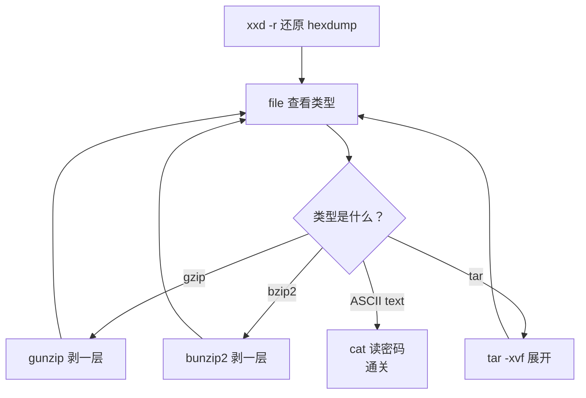

# 第2章：Bandit 通关手册（下）——从编码解压到定时任务

> [!TIP] Part 1: 终端闯关篇
> 本 Part 的目标是把命令行变成你的「手柄」：先用 Bandit 这座靶场练出 Linux 命令的肌肉记忆，再用两款轻量游戏把导航与组合命令打磨成型。本章承接第1章，从第 9 关打到第 33 关毕业，新增五组武器：编码识别、压缩处理、网络通信、定时任务与 Git 实战。

第 8 关之前，密码都「躺」在普通文本文件里。从第 9 关起，Bandit 开始变形：密码被编码、被压缩、被塞进网络端口，甚至被定时任务每分钟搬运一次。这不是刁难——这正是真实服务器上数据的存在方式。打完本章，你就把一座服务器上最常见的十几种「藏匿手法」全见过了。

## 2.1 第 9-11 关：二进制里的线索与两种编码

第 9 关的 `data.txt` 不再是纯文本：前半段是打印不出来的二进制乱码，密码藏在其中几行以 `=` 开头的字符串后面。直接 `cat` 会糊你一脸乱码，用 `strings` 只提取「人类可读的连续字符」，再用 grep 过滤：

```bash
bandit9@bandit:~$ strings data.txt | grep =
========== passwordiVSWH
kiq??M=== password
========== G7w8NEi4evT7Kv0De40PZb0MKFu0EAtM   # 以你实测输出为准
```

第 10 关的密码整行被 Base64 编码过——一种用 64 个可打印字符表示任意二进制数据的编码方案。解码用 `base64 -d`：

```bash
bandit10@bandit:~$ base64 -d data.txt
（输出 bandit11 的密码）
```

第 11 关是凯撒密码的亲戚 ROT13：所有字母在字母表里后移 13 位，A 变 N、N 变 A，移两次回到原点。`tr` 命令（translate）能做字符替换，把两套字母表写出来就完成了「位移 13」：

```bash
bandit11@bandit:~$ tr 'A-Za-z' 'N-ZA-Mn-za-m' < data.txt
（输出 bandit12 的密码）
```

这里要做一个重要辨析——第 10 章的密码学关卡还会重逢：

| 名称 | 类别 | 能否还原 | 本质 |
| ---- | ---- | ---- | ---- |
| Base64 | 编码（Encoding） | 任何人都能解 | 只改格式，不改内容，无密钥 |
| ROT13 | 置换（可视为极弱的加密） | 任何人都能解 | 移位规则公开，形同编码 |
| 真正的加密（Encryption） | 加密 | 只有持密钥者能解 | 安全性来自密钥保密 |

编码的目的是「兼容传输」，加密的目的是「保密」。密码学游戏里见到的多数谜题属于前者——这也是为什么它们适合当游戏，而不适合当保险箱。

## 2.2 第 12-13 关：六层压缩的剥洋葱流水线

第 12 关是 Bandit 前 24 关里流程最长的关卡：`data.txt` 是一份 hexdump（十六进制转储），还原后是一个被**反复压缩**的文件——gzip、bzip2、tar、zip 轮番上阵，共约六七层。解法不是背序列，而是一条「剥洋葱」流水线：

```text
        【剥洋葱流水线】

   data.txt ──xxd -r──→ 还原为二进制文件
        │
        ▼  循环：file 看类型 → 换对应工具剥一层
   ┌──────────────────────────────────────┐
   │  file 输出是什么？                       │
   │   ├─ gzip compressed  → mv 加后缀 .gz  │
   │   │                     gunzip 剥一层   │
   │   ├─ bzip2 compressed → mv 加后缀 .bz2 │
   │   │                     bunzip2 剥一层  │
   │   ├─ POSIX tar archive → tar -xvf 展开  │
   │   └─ ASCII text ──────→ 密码到手，出循环 │
   └──────────────────────────────────────┘
```



动手前有个必要的仪式感——先建一个属于自己的工作目录：

```bash
bandit12@bandit:~$ mkdir /tmp/mystage12
bandit12@bandit:~$ cp data.txt /tmp/mystage12/ && cd /tmp/mystage12
bandit12@bandit:~$ xxd -r data.txt > restored
bandit12@bandit:~$ file restored
restored: gzip compressed data   ← 第一层是 gzip，开始剥
```

> [!NOTE] 为什么要在 /tmp 下工作
> 你的家目录对 bandit12 及以下用户不可写他人文件，而反复解压会产生大量中间文件。`/tmp` 是全员可写的临时目录，惯例是用「关卡号 + 随机后缀」命名自己的目录（如 `/tmp/mystage12x7k`），避免和其他玩家的实验互相覆盖。文件工具为什么对格式挑剔：`gunzip` 不认 `.gz` 后缀就会拒绝工作，所以「先 `mv` 改名、再解压」是固定动作。

| file 的输出 | 对应解压命令 | 备注 |
| ---- | ---- | ---- |
| `gzip compressed data` | `gunzip 文件名` | 文件需以 `.gz` 结尾 |
| `bzip2 compressed data` | `bunzip2 文件名` | 文件需以 `.bz2` 结尾 |
| `POSIX tar archive` | `tar -xvf 文件名` | tar 只打包不压缩 |
| `Zip archive data` | `unzip 文件名` | |
| `ASCII text` | `cat 文件名` | 出循环，通关 |

## 2.3 第 13-15 关：私钥登录与 nc 上的明文协议

第 13 关把登录凭证从「密码」换成了「私钥」：家目录里有一份 `sshkey.private`，用它就能免密登录 bandit14——注意目标主机是 `localhost`，因为你要登录的下一级账号就在这台机器上：

```bash
bandit13@bandit:~$ ssh -i ./sshkey.private bandit14@localhost
# -i 指定私钥文件；成功后无需输入任何密码
bandit14@bandit:~$ cat /etc/bandit_pass/bandit14
（输出 bandit14 的密码，供下一关使用）
```

这套「公钥放服务器、私钥留本地」的认证机制，本站[《Git 与 SSH 完全教程》](/git-ssh/ch05)第五章用整章篇幅拆解过——Bandit 等于让你在通关路上顺手复习了它。

第 14 关引入了网络通信：服务器的 30000 端口上有个小程序，把 bandit14 的密码发过去，它就回你 bandit15 的密码。用 `nc`（netcat，网络界的瑞士军刀）连接：

```bash
bandit14@bandit:~$ nc localhost 30000
（粘贴 bandit14 的密码并回车）
（返回 bandit15 的密码）
```

第 15 关几乎一样，只有一个区别：30001 端口的连接是 **SSL/TLS 加密**的，明文的 nc 发过去只会收到乱码或断连。改用带 TLS 的 `openssl s_client`：

```bash
bandit15@bandit:~$ openssl s_client -connect localhost:30001 -quiet
（粘贴 bandit15 的密码并回车）
（返回 bandit16 的密码）
```

`-quiet` 的作用是压掉证书握手过程的刷屏输出。这两关合起来是一次完整的对比实验：**同一个协议，明文与密文各走一遍**——第 10 章讲安全靶场时会重提这个手感。

## 2.4 第 16-19 关：端口扫描、diff 与被劫持的 shell

第 16 关要你在一万个端口里找目标：31000 到 32000 之间，有几个端口开着服务，其中一个是 SSL 加密的「正确答案」，连上后提交 bandit16 的密码，它返回的不是密码，而是一份**下一关的登录私钥**。扫端口用 nmap：

```bash
bandit16@bandit:~$ nmap -p 31000-32000 localhost
PORT      STATE  SERVICE
31746/tcp open   unknown
31790/tcp open   unknown    ← 逐个试，SSL 加密且返回私钥的那个才是答案
31958/tcp open   unknown
# 拿到私钥后存到 /tmp 下自己的目录，chmod 600 收紧权限，
# 再 ssh -i 私钥 bandit17@localhost -p 2220 登录
```

> [!WARNING] 扫描只许在靶场里做
> nmap 扫描未授权的主机在多数国家和地区属于违法行为。靶场内扫描 `localhost` 完全合法，出了靶场，这个动作的边界就是《网络安全法》与目标方的授权书——第 10 章会把这条伦理线再画一遍。

第 17 关是全 Bandit 最温柔的关卡：两份几千行的密码文件 `passwords.old` 与 `passwords.new`，只有一行不同：

```bash
bandit17@bandit:~$ diff passwords.old passwords.new
42c42
< Cea55GlVNR8e5AqfvfQ0gtJm1LLIcdBI    ← passwords.old 的第 42 行
---
> kSkvUpMQ7lBYy2NVUKqD1yGZmDkypV4B    ← passwords.new 的第 42 行，即答案
```

第 18 关展示了真实攻击者最爱的把戏：你能正常通过 SSH 认证，但登录后瞬间被踢出——因为你的 `.bashrc` 被塞了一条匹配到就强制登出的规则。破解思路是**根本不进交互式 shell**，让 SSH 直接执行一条命令拿走文件：

```bash
$ ssh bandit18@bandit.labs.overthewire.org -p 2220 cat readme
（直接输出 bandit19 的密码，全程不进入 shell）
```

第 19 关引入了 setuid 机制：家目录里有个 `bandit20-do` 可执行文件，它被设置了 SUID 位——**无论谁执行它，进程都以文件属主（bandit20）的身份运行**：

```bash
bandit19@bandit:~$ ls -l bandit20-do
-rwsr-x--- 1 bandit20 bandit19 ... bandit20-do
   ↑ s 就在这一位：执行时以属主身份运行
bandit19@bandit:~$ ./bandit20-do cat /etc/bandit_pass/bandit20
（输出 bandit20 的密码）
```

setuid 是 Linux 权限体系里威力与危险并存的设计（`passwd` 命令改密码就靠它），详细原理见本站[《Linux 命令行完全教程》](/linux-command/ch05)第五章。安全的天平也在这里出现：能力越大，误用越险。

## 2.5 第 20-24 关：进程通信与定时任务

第 20 关是一场「左右手互搏」：`suconnect` 这个 setuid 程序会连到你指定的端口，校验收到的字符串是否等于 bandit20 的密码，对上了就回你 bandit21 的密码。你需要两个终端，一个当服务器，一个当客户端：

```bash
# 终端 A：监听 6969 端口，把密码文件的内容发出去
bandit20@bandit:~$ nc -lvp 6969 < /etc/bandit_pass/bandit20

# 终端 B：让 suconnect 来连
bandit20@bandit:~$ ./suconnect 6969
# 终端 A 会收到校验通过后的回传：bandit21 的密码
```

第 21 关开始，密码的搬运工不再是人，而是 cron（定时任务调度器）。`/etc/cron.d/` 目录下的每个文件描述「什么时间、以谁的身份、执行什么脚本」：

```text
        【一条 cron 规则的解剖】

  *  *  *  *  *  bandit22  /usr/bin/cronjob_bandit22.sh
  │  │  │  │  │  │           │
  │  │  │  │  │  │           └── 要执行的脚本
  │  │  │  │  │  └── 以谁的身份执行
  │  │  │  │  └── 星期几 (0-7)
  │  │  │  └── 月份 (1-12)
  │  │  └── 日 (1-31)
  │  └── 小时 (0-23)
  └── 分钟 (0-59)，五个 * = 每分钟执行一次
```

照着 `/etc/cron.d/cronjob_bandit22` 里的脚本顺藤摸瓜，会发现它每分钟把 bandit22 的密码 `chmod 644` 后写进 `/tmp` 下某个固定文件——直接读那个文件就通关。第 22 关进阶：脚本用 `whoami` 拼出字符串再做 MD5 哈希当作文件名，你需要替 bandit23 模拟这个计算：

```bash
bandit22@bandit:~$ echo "I am user bandit23" | md5sum | cut -d ' ' -f1
（得到哈希值）→ cat /tmp/哈希值
```

第 23 关到了 Bandit 常规关卡的毕业设计：写一个脚本，放进 bandit24 的定时任务会扫描的目录（`/var/spool/bandit24/`），让它以 bandit24 的身份把密码抄到你的 `/tmp` 目录：

```bash
bandit23@bandit:~$ mkdir /tmp/mystage24 && cd /tmp/mystage24
bandit23@bandit:~$ cat > getpass.sh <<'EOF'
#!/bin/bash
cat /etc/bandit_pass/bandit24 > /tmp/mystage24/stolen
EOF
bandit23@bandit:~$ chmod 777 getpass.sh && cp getpass.sh /var/spool/bandit24/
# 等最多 60 秒，cron 触发后：
bandit23@bandit:~$ cat /tmp/mystage24/stolen
```

第 24 关则是自动化思想的第一课：30002 端口的服务要求提交「密码 + 4 位 PIN」，PIN 错了就重试。人肉试一万次不现实，写个循环让机器来：

```bash
bandit24@bandit:~$ for pin in $(seq -w 0000 9999); do
    resp=$(echo "你的bandit24密码 $pin" | nc localhost 30002)
    if echo "$resp" | grep -q Correct; then
        echo "答案：$pin"; break
    fi
done
```

`seq -w` 自动补零对齐（0000 到 9999），整个暴破几分钟内出结果。从「逐关手敲」到「写循环让机器干活」，这个观念转换的价值超过后面所有关卡之和。

## 2.6 第 25-26 关速览与第 27-33 关的 Git 战场

最后两个常规关卡是彩蛋性质的技巧题：

- **第 25→26 关**：bandit26 的 shell 被换成了文本阅读器 `more`。技巧是把终端窗口缩到极小，让文件「翻页」触发 `more` 的交互模式，按 `v` 进入 vi 编辑器，在 vi 里执行 `:set shell=/bin/bash` 再 `:sh`，就拿到了真正的 shell。这是一次「从阅读器逃逸」的微型攻防。
- **第 26→27 关**：拿到 shell 后，用 setuid 程序 `bandit27-do` 读出 bandit27 的密码。

第 27 关起，Bandit 换了个完全不同的考法：密码藏在 **Git 仓库**里。每关都是一个可以通过 SSH 克隆的仓库，考的全是版本控制操作：

| 关卡 | 主题 | 关键命令 | 对应本站教程 |
| ---- | ---- | ---- | ---- |
| 27 | 克隆仓库读 README | git clone（SSH 地址） | [公钥与私钥](/git-ssh/ch05) |
| 28 | 密码被最近一次提交删掉了 | git log -p 看历史 | [时光机三件套](/git-ssh/ch07) |
| 29 | 密码在非默认分支上 | git branch -a、checkout | [分支的本质](/git-ssh/ch09) |
| 30 | 密码藏在一个 tag 里 | git tag、git show | [stash、tag 与 cherry-pick](/git-ssh/ch11) |
| 31 | 要求把答案推回远端 | git add、commit、push | [GitHub 协作](/git-ssh/ch20) |
| 32 | shell 只接受大写字母的绝境 | $0（用被调用的 shell 自身生成新 shell） | 综合应变 |

## 2.7 通关之后：把 34 关的收获迁移出去

通关不是终点。按第0章说的迁移纪律，给自己留三个产出：

1. **一份手写速查表**：把两章的通关笔记整理成 34 行的命令表，贴在自己的代码仓库（记得先学会[仓库卫生](/git-ssh/ch12)再提交）。
2. **一次真实服务器的摸底**：找一台自己的云服务器或树莓派，用 Bandit 里练的 `find`、`grep`、`cron`、`ssh -i` 完成一次真实巡检。
3. **一个定时备份任务**：模仿第 23 关的思路，给自己的重要目录写一个 cron 每日备份——把「攻击手法」转成「运维手法」，只隔一层窗户纸。

## 本章小结

- `strings` 从二进制里提取可读文本，配合 `grep` 过滤；Base64 是编码不是加密，`base64 -d` 一条命令还原；ROT13 用 `tr` 的两张字母表完成。
- 解压的核心不是背序列，而是「file 看类型 → 换对应工具剥一层」的循环；动手前先在 `/tmp` 建好自己的工作目录。
- `ssh -i 私钥` 实现免密登录；`nc` 处理明文 TCP 通信，`openssl s_client` 处理 TLS 加密通信——同一个协议的两种外衣。
- `nmap` 是端口扫描标准工具，但扫描行为只允许发生在授权环境中。
- `diff` 精确定位两文件差异；被劫持的 `.bashrc` 可以用 `ssh 主机 命令` 的方式绕过。
- setuid 让程序以属主身份运行，是权限提升的标准机制，也是第 19-20 关的题眼。
- cron 五字段（分、时、日、月、周）+ 执行身份 + 脚本路径，构成了服务器上「看不见的搬运工」。
- 第 24 关的 PIN 暴破是「用循环代替人力」的启蒙课；第 27-33 关把所学全部搬进 Git 战场。

**下一章预告**：Bandit 毕业了，但终端的乐趣才刚开始——第3章带你钻进一座真正的地牢迷宫，再去挑战「一行命令解一道题」的极限微操。

---
