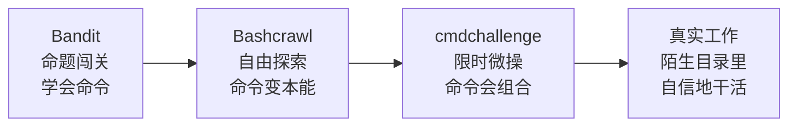

# 第3章：地牢爬行与一行命令——Bashcrawl 与 cmdchallenge

> [!TIP] Part 1: 终端闯关篇
> 本 Part 的目标是把命令行变成你的「手柄」：先用 Bandit 这座靶场练出 Linux 命令的肌肉记忆，再用两款轻量游戏把导航与组合命令打磨成型。本章是 Part 1 的收官：一款游戏练「在陌生目录里活下来」，一款游戏练「把几条命令捏成一行」。

Bandit 是「命题作文」，每关的目标和工具都指好了方向。本章两款游戏补上另两种练习模式：Bashcrawl 是**自由探索**——没有任务栏，只有一座黑暗的地牢；cmdchallenge 是**限时微操**——题目就在那里，看你能不能用一行命令解出来。两种模式合起来，正好覆盖「真实工作」的两大场景：接手一个陌生的项目目录，以及在管道里拼出一段精巧的命令。

好消息是，这两款游戏都是「轻量级」的：不需要注册、不需要付费、不需要先读一章教程。Bashcrawl 甚至不联网也照样能玩——整个地牢就住在你克隆下来的仓库里。

## 3.1 Bashcrawl：把文件系统变成地牢

Bashcrawl 是一个开源的终端游戏（GitHub 仓库 slackermedia/bashcrawl），它的全部世界就是一堆普通的目录和文件——但它们被组织成了一座地牢。你扮演一名冒险者，要用 `ls`、`cd`、`cat` 这些基本命令，从黑暗的地下室一路杀出去。

安装只需要会克隆仓库：

```bash
git clone https://github.com/slackermedia/bashcrawl.git
cd bashcrawl/cellar
# 从此刻起，你脚下就是地牢的第一层
```

先看一眼新手教学层长什么样（输出为示意，实际内容以仓库为准）：

```bash
$ ls -l
total 16
-rwxr--r-- 1 user user   84 ... spellbook   ← 可执行的法术书
drwxr-xr-x 2 user user 4096 ... courtyard  ← 出口在上的方向
-rw-r--r-- 1 user user  220 ... scroll     ← 卷轴：先读它
$ cat scroll
你醒来了，身处地牢的地下室。这里伸手不见五指。
你摸到一个卷轴，上面写着：
  「查看房间里的每一个角落，用 ls -l；
    法术就藏在卷轴里——读它，然后念出它。」
```

玩法规则用一张映射表说清：

| 地牢里的东西 | 真实身份 | 对应命令 |
| ---- | ---- | ---- |
| 房间 | 目录（Directory） | `ls`、`cd` |
| 卷轴（scroll） | 文本文件 | `cat` |
| 法术 | 可执行的脚本或命令 | 直接执行 |
| 金币与装备 | 特殊命名的文件 | `ls -l` 识别 |
| 地牢结构 | 目录树 | `ls -R`、`cd ../..` |

```text
        【地牢结构示意（实际地图以仓库为准）】

            冒险开始
               │
          ┌────▼────┐
          │ cellar  │   地下室：新手教学层，
          └────┬────┘   卷轴会教你第一个法术
          ┌────▼────┐
          │ 中庭大厅 │   两条岔路，先看地图再动身
          └──┬───┬──┘
      ┌──────▼┐ ┌▼──────┐
      │ 军械库 │ │ 议事厅 │   有些房间藏着假出口，
      └──────┬┘ └┬──────┘   走错就原路返回
          ┌────▼────┐
          │ 深层回廊 │   越往下，卷轴越少，
          └────┬────┘   越靠自己的导航本能
          ┌────▼────┐
          │  出口！  │   恭喜，你已经「活在」终端里了
          └─────────┘
```

注意这张图的节奏：越往下，辅助越少。教学层几乎手把手，中庭开始分岔，深层回廊只给零星提示——这个「辅助递减」的曲线和好老师上课一模一样：先扶着走，再撒手，最后只在你求助时出现。你练出来的导航本能，就是撤掉辅助后剩下的东西。

通关的关键只有一条纪律：**进任何房间，先 `ls -l` 看清楚，再 `cat scroll` 读卷轴，最后才施法**。卷轴上的文字是游戏唯一的「攻略书」，写着你不知道的法术名字和下一步的暗示。跳过阅读直接乱试，就是地牢版「不看文档直接调 API」——会在黑暗里浪费大量时间。

值得停下来想一秒：这套游戏到底比敲命令练习「多」了什么？答案是**叙事**。黑暗地牢给了你一个非学不可的理由（想出去），卷轴给了你一个自然的知识投放点（捡到才读），金币给了你即时奖励。这三件事恰好是普通命令练习最缺的——目标感、节奏感、成就感。同样的知识用叙事重新包装一遍，坚持下来就容易得多，这正是第0章心流公式的另一种应用。

> [!NOTE] 玩之前需要什么基础
> 只需要两条命令：`cd` 进目录、`ls` 看内容，其余的卷轴会现教。这正好是本站[《Linux 命令行完全教程》](/linux-command/ch02)第二章的内容——如果 Bashcrawl 玩得吃力，说明挑战已经超出「能力 +10%」，先回去补这一章再回来。

## 3.2 通关思路：前 30 分钟该怎么打

给一条务实的开局路线：

1. **读第一张卷轴**。cellar 里的卷轴是教学关，它会给你第一个法术并解释地图结构。读完这一张，后面的卷轴就都是「递进式提示」了。
2. **养成三连击习惯**。`ls -l` → `cat scroll` → 施法。每进一个新房间重复一次，形成节奏后你根本不会意识到自己在敲命令——这就是肌肉记忆成型的标志。
3. **迷路时回头看**。`cd ..` 永远可用，`pwd` 告诉你自己在哪。地牢里没有「死亡」，走错路的代价只是原路返回——这也是它适合练手的原因：失败成本为零。
4. **金币要捡**。有些金币是后续关卡的钥匙，而且「看清楚目录里每个文件再行动」本身就是真实运维的核心素养。

Bashcrawl 全程约 1-2 小时。它教的所有命令你在 Bandit 里都见过，但**从「知道命令」到「手比脑快」中间隔的就是这种无目的的自由探索**——就像学会了所有棋规之后，还需要下过几十盘棋。

顺手整理一份「地牢生存速查」，每一条都是在这款游戏里反复用到的动作：

| 情境 | 命令 | 为什么重要 |
| ---- | ---- | ---- |
| 这是哪？ | `pwd` | 地牢和服务器一样，迷路第一件事是确认坐标 |
| 房间里有什么？ | `ls -l` | 详情模式能看出谁是卷轴、谁是法术 |
| 上一层有什么？ | `cd ..` 与 `ls` | 回头路是信息源，不是失败 |
| 这文件是什么？ | `cat 文件名` | 卷轴不读就施法，等于不看文档就调 API |
| 附近还有什么？ | `ls -R` | 树状浏览整片区域，规划路线用 |

再预判三个新手最容易迷路的场景，遇到时照方抓药：

- **「敲了法术没反应」**：多半是当前目录不对。法术脚本是相对路径执行的，先 `pwd` 确认位置，再回卷轴描述的房间。
- **「读了一堆文件还是不知道去哪」**：回看已读卷轴的连贯性——每张卷轴都有指向下一层的信息，把读过的线索串起来，地图自然浮现。
- **「文件名带空格或特殊字符，执行失败」**：第1章的陷阱在这里再次出现，用引号包住文件名即可。地牢很贴心地把「面试高频坑」都安排进了必经之路。

## 3.3 cmdchallenge：一行命令的极限微操

如果说 Bashcrawl 是走路，cmdchallenge（cmdchallenge.com）就是百米冲刺。它由一组浏览器出题、终端作答的挑战组成：网页给出任务，你在自己的终端里敲**恰好一条命令**，网页校验结果是否正确。

示例题目（节选，实际题库以站点为准）：

| 任务 | 一句话考点 |
| ---- | ---- |
| 打印当前工作目录 | 最基本的存在感确认 |
| 列出包括隐藏文件在内的所有文件 | `ls -a` |
| 统计 access.log 的行数 | `wc` 与重定向 |
| 找出目录中最大的文件 | 排序与取头 |
| 删除所有文件名带空格的文件 | 引号与 find 的组合 |
| 只打印文件的第一行 | `head` |
| 把文件里每行数字求和 | 管道与计算 |

它和 Bandit 的气质完全不同：**Bandit 考「能不能找到」，cmdchallenge 考「能不能写得短而准」**。界面也极简：题目显示在浏览器里，校验基于你的终端工作目录是否产生了预期效果——所以你可以在任何环境下练，答案正确与否一秒见分晓。

「一行命令」看似刻意，其实训练的是一种真实能力：**把一个复杂意图拆解成一串单一职责的小工具**。这条思路和写函数组合、写数据处理流水线完全同构——命令写得通的人，写代码时也更懂得「一个函数只做一件事」。来看两道经典题的思路：

题目一：**找出当前目录树里最大的文件**。直觉的 `ls -S` 只看一层，要递归就得靠 `find` 加排序：

```bash
find . -type f -exec du -b {} + | sort -n | tail -1
# du -b 逐个算字节 → sort -n 按数值排序 → tail -1 取最大
```

题目二：**删除所有文件名含空格的文件**。第1章的「空格陷阱」在这里从障碍变成了考点：

```bash
find . -type f -name "* *" -delete
# -name "* *" 匹配名字里含空格的文件，-delete 直接执行
# 先把 -delete 换成 -print 预览一遍，确认无误再删——好习惯
```

> [!WARNING] 题目二顺手练了一颗职业习惯的种子
> `find ... -delete` 没有回收站。做题时先用 `-print` 看命中列表，再换 `-delete`，这个「先预演后执行」的两步法，在真实服务器上能帮你挡掉绝大多数「一秒删库」的事故。

再来两道经典题，见识一下「一行命令」可以有多精巧。

题目三：**统计 access.log 的行数**。看似简单，但正确答案里藏着 `wc` 的一个小坑——`wc -l access.log` 会把文件名一起输出，校验通不过；把文件从标准输入喂进去，输出才干净：

```bash
wc -l < access.log
# < 是输入重定向：只送内容，不送文件名
```

题目四：**把文件里每行的数字加起来**。这题是「组合拳」的代表作——`wc`、`head` 都不够用，需要把多行数字压成一行表达式再计算：

```bash
paste -sd+ numbers.txt | bc
# paste -sd+ 把每行数字用 + 拼接成 1+2+3+...
# bc 是命令行计算器，负责把表达式算出结果
# awk 一行也能解：awk '{s+=$1} END {print s}' numbers.txt
```

题目五：**只打印 access.log 的第 42 行**。这道题的乐趣在于解题路径的多样性，同一件事至少有三种「一行」写法：

```bash
head -42 access.log | tail -1       # 思路 A：切出前 42 行，再取最后一行
sed -n '42p' access.log             # 思路 B：sed 定位第 42 行并打印
awk 'NR == 42' access.log           # 思路 C：awk 按行号匹配
```

三种写法结果一致，但可读性和可扩展性不同：思路 A 最直觉，思路 B 最短，思路 C 最容易改成「42 到 84 行」这类变体题。做题时多想一种解法，等于多学一个工具的性格。

同一道题往往有三种以上解法，这正是 cmdchallenge 的额外乐趣：**提交通过后，不妨看看别人怎么写**。你的 `paste|bc` 和别人的 `awk` 是两条思想路线，比一比哪条更清晰、哪条更快——这就是 Code Review 的雏形。

第二部分题库（site 上的 Level 2）难度明显上升，会用到 `awk`、`sed`、进程与权限的组合，适合作为学完本站[文本处理三剑客](/linux-command/ch22)一章后的复习测验。

关于练习节奏，给两条建议：

- **每道题先自己想 10 分钟**。cmdchallenge 的诱惑是直接搜答案，但「一行命令」的精髓在于推理过程（哪个工具负责筛选？哪个负责格式？），跳过推理就只剩抄写。
- **时间盒 60 分钟**。一次做 5-8 题恰到好处，超过 60 分钟的题暂时跳过——和第0章的 30 分钟规则同理，挑战超出 +10% 就先记下、后回来。

选题也有讲究：从 Level 1 的第一题按顺序做，遇到「完全没思路」的题先跳过、做完一圈再回来。题库的排列大致按工具从简单到复合排序，顺序做能保证每道新题只比你已会的多一个知识点——又是那个「能力 +10%」。

## 3.4 从两款游戏看「肌肉记忆」怎么练

把 Bandit、Bashcrawl、cmdchallenge 三款游戏放在一起，会发现它们其实是同一套练习体系的三个阶段：



箭头的方向值得强调：**不是「学完命令就该写代码」，中间还隔着两段**。很多人命令行学不下去，不是因为笨，而是被要求直接从「会 ls」跳到「会干活」，中间缺的那两块木板没人补。游戏恰好是现成的木板。

| 阶段 | 练习模式 | 反馈周期 | 失败成本 | 对应能力 |
| ---- | ---- | ---- | ---- | ---- |
| Bandit | 有目标、有线索 | 每关 5-30 分钟 | 低 | 知识：知道用什么 |
| Bashcrawl | 无目标、自由探索 | 即时（走错就迷路） | 零 | 本能：不用想就敲对 |
| cmdchallenge | 有目标、无提示 | 秒级（网页即判） | 零 | 组合：把命令捏成流水线 |
| 真实工作 | 有目标、有期限、有风险 | 小时到天级 | 高 | 综合：前三者的战场 |

最后一行的对比正是本教程存在的理由：真实工作的失败成本太高，不适合当练习场——所以先用低成本的游戏把前三层练到本能，再上战场。游戏玩得越扎实，真实工作里踩坑的机会越少；反过来，真实工作里踩过的坑，也值得回游戏里找一款针对性练习。两者不是替代关系，而是循环。

用第0章的心流公式复盘：三款游戏的挑战梯度是平滑的——Bandit 给你线索降低挑战，Bashcrawl 用零失败成本保护你的探索欲，cmdchallenge 用秒级反馈把「即时反馈」拉满。**卡在哪一款，就说明哪一段的能力还差 10%，回对应教程补课即可**。

换一个视角看同一件事：三款游戏分别接管了「学命令」路上三个最容易放弃的节点。

- **刚开始背命令最无聊**（无聊区）→ Bandit 用「找密码」的目标感把你拉回心流通道；
- **命令会了但不敢用**（焦虑区，怕删错东西）→ Bashcrawl 的克隆仓库随便折腾，失败成本为零；
- **命令会了但只会单打独斗**（能力停滞）→ cmdchallenge 逼你把工具组合起来，突破单命令的天花板。

每个节点都有对应的游戏接盘，这条路就不会断。

游戏会通关，但肌肉记忆会退化。三条复训策略，把一次通关变成一项长期能力：

1. **间隔重游**。每两三周挑一个晚上，重打 Bandit 中随机抽的 5 关。重打时不看笔记——当初 20 分钟的关卡现在 3 分钟解决，就是记忆留住了的证据。
2. **换环境复用**。Bashcrawl 通关后，把自己的项目目录当新地牢逛一遍：用「三连击」审视每个文件夹。地牢只有一座，但你的工作机上是无数座。
3. **错题本机制**。cmdchallenge 里想不出或做错的题，抄进一个本地文件，标题写上「考的是哪个工具」。一个月后重做，依然卡壳的题说明那个工具需要回教程补课。

这三条策略共享同一个原理：**间隔重复（Spaced Repetition）**——记忆不是一次性写入的，而是在「快忘掉时再提取一遍」的循环里越来越牢。游戏的好处是让这个循环不痛苦：重打关卡比重背笔记有乐趣得多。

## 3.5 通关之后：三个迁移产出

1. **给自己的目录做一次「地牢化」巡检**：挑一个自己的项目仓库，只用 `ls -l`、`cat`、`find` 完成一次结构梳理，写进一份 README。验收标准：三个月后翻看这份 README，不看代码也能回忆起项目结构。
2. **出一套自己的 cmdchallenge**：模仿它的题目，给自己的工作场景出 5 道一行命令题（比如「统计本周的报错日志条数」），这就是最快的自我测验。出题能力是掌握程度的试金石——能出好题，说明你真的懂了考点在哪。
3. **把管道用熟**：回到本站[《Linux 命令行完全教程》](/linux-command/ch06)第六章，系统学一遍管道与重定向——cmdchallenge 里那些「几条命令捏成一行」的写法，根源都在这一章。学完再回去重做 Level 1，你会发现之前绕的弯路有了新走法。

三份产出做完，终端就从「偶尔打开的窗口」变成了「常驻的工作台」——Part 1 的目标到此达成。

毕业前，填一张自己的成绩单。这张表也适合一年后重玩时再填一次，两栏数字的差距就是你的成长曲线：

| 项目 | 本次成绩 | 目标参考 |
| ---- | ---- | ---- |
| Bandit 通关数（共 34 关） | ___ 关 | 首周 12 关 |
| Bashcrawl 进度 | ___ 层 | 2 小时内抵达出口 |
| cmdchallenge 完成题数 | ___ 题 | Level 1 全清 |
| 错题本条数 | ___ 条 | 越少越好，且逐月清零 |

最后一个建议：把这张成绩单存好。一年后回看，你会清楚看到「游戏化学习」不只是好玩，它真的在复利。

## 本章小结

- Bashcrawl 把目录树包装成地牢，玩法是「ls -l 查看房间 → cat scroll 读卷轴 → 施法前进」，全程只用基础命令。
- 它练的是自由探索能力：失败成本为零，反馈即时，最适合把「知道命令」升级成「手比脑快」。
- cmdchallenge 考「一行命令解题」，考的是组合能力：find、sort、head、wc 这些小工具靠管道捏成流水线。
- 危险命令（如 find -delete）永远先预演再执行——「先 print 后 delete」值得成为条件反射。
- 三款终端游戏构成「学会 → 本能 → 组合」的阶梯，卡在哪一级就回对应教程补哪一级。
- 复训靠间隔重复：每两三周重打几关、把工作目录当地牢逛、错题本一个月重做，记忆才留得住。
- 终端游戏的终极收益不是记住命令，而是获得「在陌生目录里不慌」的职业底气。

**下一章预告**：终端闯关篇毕业，欢迎来到浏览器谜题馆。第4章的三款 CSS 游戏——青蛙、菜园与晚餐桌——会让你在 84 个小关卡里不知不觉学会 Flexbox、Grid 与选择器。它们比 Bandit 更轻：一关平均一分钟，通勤路上就能打完一章。

---
