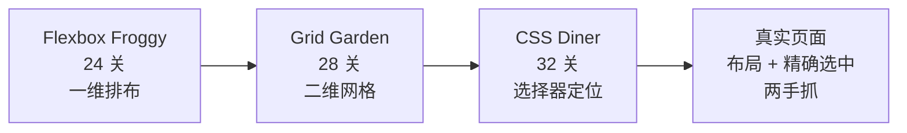

# 第4章：CSS 三部曲——青蛙、菜园与晚餐桌

> [!TIP] Part 2: 浏览器解谜篇
> 本 Part 的战场从终端搬进浏览器：不用装任何环境，打开网页就是关卡，每次提交立刻有画面反馈。本章用三款游戏讲透 CSS 的三大支柱——弹性布局、网格布局与选择器，合计 84 关。

CSS 是最适合用游戏学的编程知识，没有之一。原因很简单：CSS 的学习曲线卡点不在语法，而在**空间想象**——「这条属性会让盒子往哪边动」用文字讲十遍，不如让一只青蛙真的跳一次。三款游戏（Flexbox Froggy、Grid Garden、CSS Diner）正是这个思路的巅峰之作：把抽象属性变成具体动作，让屏幕上的小青蛙、胡萝卜和餐具替你检验每一行代码。

三款游戏出自同一批可视化教学实践者之手，规则也出奇地统一：**左边是场景，右边是代码编辑器**。你在编辑器里写一条 CSS，场景里的青蛙、胡萝卜或餐具立刻移动到位——写对了就自动进入下一关，写错了就看着青蛙跳进池塘，笑一笑再改。这个「写一行 → 看一眼」的循环，一关平均一分钟，反馈密度是普通教程的几十倍。

还有一个容易忽略的好处：**游戏替你安排了知识出场顺序**。自学者啃 CSS 文档最常见的翻车姿势是从 `display` 一路读到 `box-sizing`，属性是学完了，但不知道先组合哪两个。这三款游戏把几十个属性拆成 84 个「一次只考一个」的小关卡，出场顺序就是依赖顺序——这正是第0章心流公式里「渐进关卡」的标准做法。

## 4.1 三款游戏速览

先用一张表认识三位主角——它们都是免费的网页应用，打开即玩、无需注册：

| 游戏 | 关卡数 | 练什么 | 单关耗时 | 建议顺序 |
| ---- | ---- | ---- | ---- | ---- |
| Flexbox Froggy（青蛙） | 24 | Flex 弹性布局 | 约 1 分钟 | 第 1 步 |
| Grid Garden（菜园） | 28 | Grid 网格布局 | 约 1-2 分钟 | 第 2 步 |
| CSS Diner（晚餐桌） | 32 | 选择器 | 约 1-3 分钟 | 第 3 步 |



推荐的顺序有讲究：**先学排布（Froggy → Garden），再学选中（Diner）**。排布回答「元素放在哪」，选择器回答「操作哪个元素」——前者是布局的主旋律，后者是精确制导。84 关全部通关约需 2-3 小时，是全书中性价比最高的一个下午。

从心流公式的角度看，这三款游戏是「即时反馈」的教科书：终端游戏里你敲一条命令，看的是文本输出；而这里你写一条属性，看的是青蛙跳上荷叶——反馈从「读」变成了「看」，认知负荷进一步降低。这也是为什么它们常被推荐给完全没写过代码的人：CSS 三部曲是本书门槛最低、成就感最快的一章。

## 4.2 Flexbox Froggy：24 关学会弹性布局

Flexbox（弹性盒子布局）的核心模型只有一句话：**容器（container）里的一排子项（item），沿一根主轴（main axis）排布，另有一根交叉轴（cross axis）负责垂直方向**。所有 Flex 属性都是围绕这两根轴说话的：

先交代一下游戏本身长什么样：屏幕左边是一方池塘，几只可怜的青蛙站在旱地上，你的任务是写 CSS 把它们全部送上荷叶；右边是一个迷你编辑器，写完不用点任何按钮，结果实时生效。全 24 关没有一次分数结算、没有存档——因为每关都短到不需要。你会在不知不觉间打完，然后惊讶于 Flexbox 已经会了：这正是「把知识切成关卡」的设计魔力。

```text
        【Flex 容器的两根轴】

              交叉轴 cross axis
                  ↑
        ┌─────────────────────────┐
        │  [青蛙1]  [青蛙2]  [青蛙3] │ → 主轴 main axis
        └─────────────────────────┘
     justify-content 管「主轴上怎么分布」
     align-items      管「交叉轴上怎么对齐」
     flex-direction   管「主轴是横是竖」（换轴后
                      justify 和 align 的含义跟着换）
```

开局第一关，把三只青蛙挪到荷叶上，答案只有一行：

```css
#pond {
  display: flex;            /* 第 0 步：声明这是 Flex 容器 */
  justify-content: flex-end; /* 靠主轴末端排布 */
}
```

24 关按属性分组递进，全程覆盖 Flex 的核心词汇：

| 属性组 | 管什么 | 常用取值 | 对应关卡主题 |
| ---- | ---- | ---- | ---- |
| justify-content | 主轴分布 | flex-start / center / space-between / space-around / space-evenly | 开局几关 |
| align-items | 交叉轴对齐 | stretch（默认）/ flex-start / flex-end / center / baseline | 中段 |
| flex-direction | 主轴方向 | row（默认）/ row-reverse / column / column-reverse | 中段，换轴后分布含义随之翻转 |
| order | 手动排序 | 整数，默认 0，可负 | 中段 |
| align-self | 单个子项的越级对齐 | 同 align-items | 中段 |
| flex-wrap | 换行 | nowrap（默认）/ wrap / wrap-reverse | 后段 |
| align-content | 多行整体的分布 | 同 justify-content 的取值 | 尾段，仅换行后生效 |

24 关的最后几关是「大杂烩」：一行 CSS 里同时要写对方向、分布和对齐。这其实模拟了真实布局的常态——Flexbox 的属性从来不单独出现，而 24 关的分组训练恰好帮你把「单个属性」拼装成「组合直觉」。如果通关后想再加练，同一家族还有塔防变体 Flexbox Defense（用 justify-content 排布炮塔）等衍生游戏，机制相同、口味不同，适合当复训甜点。

三个最容易混淆的点，游戏会用「答错一次就懂」的方式教你：

- **`space-between` 与 `space-around` 的区别**：前者两端贴边、中间等距；后者每个子项两侧都有半份间距（视觉上首尾不贴边）。
- **`flex-direction: column` 之后，justify 与 align 互换身份**——主轴变成了竖直方向。这是 Flexbox 最大的人体工学陷阱，青蛙跳错一次就永远记住了。
- **`align-content` 只在容器换行（`flex-wrap: wrap`）后才生效**：单行时它无事可做，调整对象是「多行组成的大整体」。

中段的 `order` 关卡值得单独展开，因为它暴露了 CSS 的一个重要设计观。有一关要求你把三只青蛙按 5、3、1 的位置摆放，答案是用负数抢位：

```css
#pond {
  display: flex;
}

.frog:nth-child(1) { order: 3; }   /* 第 1 只排到第 3 位 */
.frog:nth-child(2) { order: 1; }   /* 第 2 只抢到第 1 位 */
.frog:nth-child(3) { order: 2; }
```

注意 `order` 改变的只是**视觉顺序**：屏幕阅读器、Tab 键焦点和 DOM 结构仍然是原来的顺序。这在真实工程里是个可访问性（Accessibility，无障碍）问题——想让用户看到的顺序和操作顺序一致，就该去改 DOM，而不是用 `order` 硬掰。游戏没时间讲这层，本节替它补上。

## 4.3 Grid Garden：28 关学会网格布局

Grid（网格布局）比 Flexbox 晚出现，解决的也是 Flex 的短板：Flex 擅长**一维**排布（一行或一列），Grid 擅长**二维**排布（行与列同时规划）。游戏中你要给胡萝卜浇水，而水量取决于你把菜地划分成多大的格子——浇水范围的边界就是你写下的网格线。

和青蛙那关一样，菜园的界面也是「场景 + 编辑器」的双栏结构，但多了两个贴心细节：底部的网格线上会标出数字，帮你把「第几根线」的概念可视化；写错时胡萝卜会浇到空地上，错误位置的视觉反差比任何报错信息都直观。

```text
        【Grid 的坐标语言：线比格子多一根】

     列线1   列线2   列线3   列线4
       │       │       │       │
    ┌──▼───────▼───────▼───────▼──┐
    │  格子   │  格子   │  格子   │   ← grid-template-columns
    ├─────────┼─────────┼─────────┤      定义「有几列、每列多宽」
    │  格子   │  胡萝卜 │  格子   │
    ├─────────┼─────────┼─────────┤      grid-column-start: 2
    │  格子   │  格子   │  格子   │      = 从「列线 2」开始画
    └─────────┴─────────┴─────────┘
```

理解「**定位靠线不靠格**」是 Grid 的第一道坎：`grid-column-start: 2` 的意思是「从第 2 根列线开始」，不是「第 2 个格子」。菜园游戏用浇水范围把这个概念演得明明白白——浇错一格，你就再也不会混淆「线」与「格」。典型的关卡答案长这样：

```css
#garden {
  display: grid;
  grid-template-columns: 20% 50% 30%; /* 三列，宽度自定义 */
  grid-gap: 10px;                     /* 格子间距 */
}

#water-carrot {
  grid-column-start: 2;               /* 从列线 2 开始 */
  grid-column-end: span 3;            /* 跨越 3 个格子 */
}
```

28 关覆盖的核心词汇：

| 属性组 | 管什么 | 值得记住的写法 |
| ---- | ---- | ---- |
| grid-template-columns / rows | 定义行与列的骨架 | `20% 50% 30%`、`1fr 3fr`、`repeat(3, 1fr)` |
| grid-gap（gap） | 格子间距 | 行列间距可分别写 `grid-gap: 5px 10px` |
| grid-column-start / end | 元素在列方向的位置 | 负数（`-1` 是最后一根线）、`span 3` 跨格 |
| grid-row-start / end | 元素在行方向的位置 | 与列方向同理 |
| grid-area | 四个值一写定位完毕 | `grid-area: 1 / 2 / 3 / 4`（行起/列起/行止/列止） |
| order | 改变视觉顺序 | 与 Flex 通用 |
| align-items / justify-items | 格子内部对齐 | Grid 版的对齐词汇 |

两个与 Flex 互通的概念也在这里现身：`fr`（fraction，剩余空间的份数）与 `repeat()`。菜园后半段的题目会引导你把 `1fr 1fr 1fr` 改写成 `repeat(3, 1fr)`——这种「从啰嗦到优雅」的重构快感，正是 Grid 布局在真实项目里的日常。

负数线是菜园里最惊艳的一课。有一关胡萝卜贴着网格最右边，你不知道总共有几列，写死一个正数就翻车。答案是用负数从右往左数：

```css
#water-carrot {
  grid-column-start: -3;   /* 从倒数第 3 根列线开始 */
  grid-column-end: -1;     /* 一直到最后一根列线 */
}
```

`-1` 永远指向最后一根线，无论网格有几列——这让「贴右边界」的写法与列数解耦。真实工程里，弹性的两栏布局（左边自适应、右边固定贴边）大量依赖这个技巧。另一个高频写法是只写起点加跨度：

```css
#water-carrot {
  grid-column-start: 2;
  grid-column-end: span 3;  /* 从列线 2 起跨 3 格 */
  /* 等价于一行：grid-column: 2 / span 3; */
}
```

菜园的尾段还有一关「不用行号、只靠对齐」的题：`align-items: center` 配合 `justify-items: center` 让胡萝卜落在格子正中。你会发现 Grid 的对齐词汇几乎照搬了 Flex——学过青蛙再玩菜园，一半的属性自带经验加成，这就是先学 Flex 的红利。

## 4.4 CSS Diner：32 关学会选择器

前两款游戏练「排布」，晚餐桌游戏练「**选中**」：一张摆着盘子、苹果、泡菜和橙子的餐桌，每关要求你用一条选择器（selector）精确选中指定的餐具。它是三款游戏里最像「编程」的一款——因为选择器本质是一门查询语言，而且这门语言你以后在 JavaScript 的 `querySelector`、本站正则章节的匹配思想里都会重逢。

游戏机制同样极简：左边是餐桌（也就是 HTML 结构），右边是编辑器，写一条选择器，桌面上被选中的餐具会亮起来。和前两款不同，Diner 的关卡**不按属性分组，而按「表达能力」递进**——从「选中一个盘子」一路走到「选中所有以字母 S 开头属性的泡菜」，32 关就是一份选择器进化史。

32 关几乎就是选择器全谱系的目录。打完之后回头看这张表，每一行都对应餐桌上的具体画面——这正是它比背文档强的地方：**语法有了画面当锚点**：

| 关卡主题 | 选择器语法 | 选中谁 |
| ---- | ---- | ---- |
| 元素 | `plate` | 所有盘子 |
| 类与 ID | `.small`、`#fancy` | 有该类名 / 该 ID 的元素 |
| 通配 | `*` | 全部元素 |
| 后代 | `plate apple` | 盘子里的苹果（无论隔几层） |
| 直接子元素 | `plate > apple` | 盘子**直接**放的苹果 |
| 相邻与之后 | `apple + plate`、`apple ~ plate` | 紧跟苹果的盘子 / 苹果之后的所有盘子 |
| 位置伪类 | `:first-child`、`:nth-child(3)` | 第一个孩子 / 第三个孩子 |
| 表达式伪类 | `:nth-child(odd)`、`:nth-child(2n+3)` | 奇数位 / 从第 3 个起每隔一个 |
| 类型与唯一 | `:only-of-type`、`:last-of-type` | 同类中唯一的 / 最后一个 |
| 属性 | `[for]`、`[for="Sarah"]` | 带 for 属性的 / for 恰为 Sarah 的 |
| 属性模式 | `[for^="Sa"]`、`[for$="ah"]`、`[for*="ra"]` | 以 Sa 开头 / 以 ah 结尾 / 含 ra |
| 排除 | `:not(plate)` | 选中除盘子以外的一切 |

`nth-child` 系列的表达式是最难也最有用的部分，游戏里会反复逼你心算。以「从第 3 个起每隔一个选中」这关为例，把推导过程写全：

```text
  表达式: nth-child(2n + 3)      n = 0, 1, 2, ...

  n=0 → 第 3 个    n=1 → 第 5 个    n=2 → 第 7 个
  通项：从 3 开始的等差数列，公差 2（即 3、5、7、9……）

  套路：an + b 中 b 是「起点」，a 是「步长」
        odd  = 2n + 1（奇数位）    even = 2n（偶数位）
```

心算诀窍是把表达式读成「公差 an + 起点 b」：先从 n=0 算出起点，再确认步长方向。CSS Diner 会逼你把这个推导练到 5 秒内出答案，而这个速度在真实项目里意味着：改一段列表样式时，你不再需要往页面里塞调试用的红色边框。

选择器还有一个和布局属性截然不同的气质值得点破：布局属性管「渲染」，选择器管「范围」。前者错了一般是丑，后者错了一般是**错对象**——样式加到了不该加的元素上。所以 Diner 每关的亮灯反馈比青蛙跳错更严格：多亮一盏、少亮一盏都不算过。这种「精确匹配」的洁癖，会跟着你走进所有和「定位目标」有关的工作，从 CSS 一路到测试用例的元素选取。

```css
/* 选中从第 3 个开始、每隔一个出现的元素（3、5、7……）*/
plate:nth-child(2n + 3)

/* 选中所有不是盘子的元素（配合上面的位置表达式一起用）*/
bento:not(plate)
```

CSS Diner 玩完，你会获得一种「点菜式」的读 CSS 能力：看到 `.list > li:nth-child(odd)` 不再是乱码，而是「列表的直接子项里、排在奇数位的那些」。这个能力在前端调试和[样式方案选型](/react/ch13)里天天用得上。

选三款游戏之外值得一提的两件小事：

- **相邻选择器 `+` 与 `~` 的区别**只在「跟随几个」：`A + B` 只选中紧跟在 A 后面的那一个 B，`A ~ B` 选中 A 之后**所有**同级的 B。餐桌上这个差异只是一格和一排的差异，真实页面里却决定了「只高亮下一项」还是「高亮余下全部」。
- **属性选择器是隐藏的瑞士军刀**。`[href^="https"]`、`[class*="btn"]` 这类写法在改不了 HTML 的场景（比如给第三方组件打补丁）是唯一抓手，32 关里有整整一段专门练它。
- **组合才是常态**。真实工程里几乎没有单打独斗的选择器，`.card > .title:nth-child(2):not(.hidden)` 这种三层组合才是日常——Diner 的后 10 关已经在用组合题给你打预防针。

## 4.5 通关之后：把 84 关的直觉带回真实页面

游戏里的餐桌和菜地是理想化的，真实页面要混乱得多。真实页面的容器里塞着的是不规则文本、未知高度的内容和永远比设计稿多一行的用户数据——但正因为如此，游戏里练出的「两根轴」「网格线」直觉才值钱：它们是不变的心智模型，变的只是场景。三个过渡练习，把游戏直觉嫁接到真实工程：

1. **打开 DevTools 重打一遍**。在任意网页按 F12，选中一个容器，在样式面板手动添加 `display: flex; justify-content: space-between`，观察真实布局的反应。游戏的即时反馈在 DevTools 里同样成立，而这里是真的「生产环境」。
2. **改一处自己项目的布局**。给自己的博客或练习项目找一个「想对齐但一直没对齐」的地方，用 Flexbox 或 Grid 修好它——84 关里总有一关和你的问题同构。
3. **读一份真实组件的样式**。翻开本站[《React 完全教程》](/react/ch13)第十三章，看看生产级项目怎么在样式方案里组合这些基础属性。游戏教的是单词，工程教的是句子。

做完这三个练习，再给自己布置一个「复诊」任务：两周后重玩 Froggy 的第 7 关和第 11 关（换轴与 order），如果不用思考就能写对，说明直觉已经扎根——这正是间隔重复的验收标准。

到这里，CSS 三部曲的通关包就齐了：24 关青蛙、28 关菜园、32 关晚餐桌。它们可能是全书节奏最轻快的章节——但请记住第0章的辨析：84 关通关是「玩过」，把它用到自己的页面上才算「学会」。下一章我们换个语言继续：正则表达式。

> [!NOTE] 84 关的正确打开方式
> 别追求一次全通。建议第一次只打 Froggy（24 关，约半小时），建立「属性即动作」的手感；Diner 和 Garden 可以拆到一周内分两次完成——间隔重复的效果比一口气通关好，这个理由在第3章 3.4 节论证过。

## 本章小结

- CSS 适合游戏化的根本原因：学习卡点在空间想象，而游戏能提供像素级的即时视觉反馈。
- 三款游戏合计 84 关（24 + 28 + 32），推荐顺序是先排布后选中：Froggy → Garden → Diner。
- Flexbox 的全部问题是「两根轴」：justify-content 管主轴分布，align-items 管交叉轴对齐；flex-direction 换轴后，两者的含义跟着互换。
- order 只改视觉顺序，不改 DOM 顺序——涉及键盘导航与屏幕阅读器时，要改的往往是结构而不是样式。
- Grid 用「线」定位而非「格」：grid-column-start: 2 是从第 2 根列线开始；负数与 span 是它的两个高频技巧。
- fr 与 repeat() 是 Grid 的优雅担当：`repeat(3, 1fr)` 把三等分写进一行。
- 选择器是一门查询语言：位置伪类（nth-child 的 odd、2n+3）、属性模式（^、$、*）与 :not 组合出精确制导。
- `+` 选中紧跟的一个，`~` 选中后面的全部——一格与一排之差，决定了交互效果是「高亮下一项」还是「高亮余下全部」。
- 游戏通关不是终点，用 DevTools 在真实页面上复现一次游戏里的操作，才算完成迁移。

**下一章预告**：布局之外，正则表达式是另一门「以游戏学之效果拔群」的语言。第5章从 RegexOne 的交互课打到 Regex Crossword 的填字谜题，让你在推格子的时候顺便掌握模式匹配的全部元字符。

---
