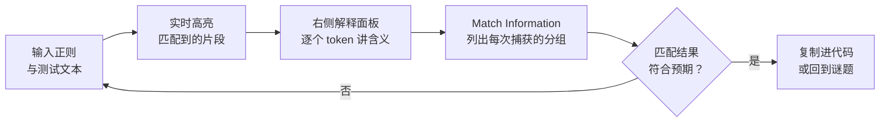

# 第5章：正则解谜——从 RegexOne 到填字游戏

> [!TIP] Part 2: 浏览器解谜篇
> 本 Part 的战场从终端搬进浏览器：不用装任何环境，打开网页就是关卡，每次提交立刻有画面反馈。本章处理一门特殊语言——正则表达式（Regular Expression，简称 regex）：它写的不是程序，而是「文字的形状」。

正则表达式是程序员工具箱里性价比最极端的一项：学会只要一天，用上要过十年，但每次用都后悔「为什么不早点学」。它的难点也不在语法，而在**心智模型**——多数人把它当「搜索框的花式写法」去死记，结果三天就忘。本章用三款工具（RegexOne 教学、Regex Crossword 解谜、Regex101 调试）把这个心智模型焊牢：**正则是用模式描述一整类字符串，而不是匹配某一个字符串**。

「学了就忘」还有一层原因值得提前拆掉：正则不像循环、函数那样天天写，它的出场是**突发**的——日志要解析了、输入要校验了、编辑器里要批量替换了，场景来了才用一次，不用就退步。三款游戏恰好解决的就是「平时没场景」的问题：谜题是随取随用的练习场，让模式匹配的手感在没有真实需求的日子里也不生锈。这个思路和第3章的间隔重复策略一脉相承。

## 5.1 正则是什么：一门「描述形状」的语言

先看一个直觉例子。假设你要从日志里找出所有的时间戳（形如 `14:23:07`）。逐个搜索 `14:23:07` 只能找到一个——但所有时间戳的「形状」是一样的：两位数字、冒号、两位数字、冒号、两位数字。用正则写这个形状：

```text
\d{2}:\d{2}:\d{2}
 └┬┘  └┬┘
  │    └── 冒号，原样匹配
  └─────── \d 表示「任意一个数字」，{2} 表示「重复两次」
```

这一行就选中了日志里**所有**时间戳——不管它们是 14:23:07 还是 03:59:58。这就是「描述形状」：正则表达式是一个模板，字符串是模板的无数个实例。后面的所有元字符（metacharacter），都是在丰富这个模板的词汇量。

再练一个形状：从样式表里找出所有十六进制颜色值（如 `#1E90FF`、`#0a1`）。先拆形状：井号开头，后面跟 6 位或 3 位的十六进制字符（0-9 与 A-F）。翻译成正则：

```text
#[0-9A-Fa-f]{6}\b|#[0-9A-Fa-f]{3}\b
└┬┘ └────┬────┘ └┬┘    └────┬────┘
 │      │       │          └── 3 位短写版
 │      │       └── \b 词边界，防止 #1234567 误伤
 │      └── 十六进制字符集，重复 6 次
 └── 字面井号
```

注意这个模式里的三个细节：字符集 `[0-9A-Fa-f]` 把「十六进制字符」这件事一次性说清；`\b`（词边界）避免匹配到 `#1234567` 的前 6 位；先长后短的顺序保证 6 位优先。**每个符号都在回答一个具体问题**——读正则时逐符号自问「它在防什么」，是建立心智模型最快的路径。

第三个例子换成校验场景：检查用户输入的日期是不是 `2026-11-04` 这种格式。形状拆解：4 位数字、连字符、2 位数字、连字符、2 位数字，而且必须**一整段**都是它：

```text
^\d{4}-\d{2}-\d{2}$
└┬┘ └┬┘ └┬┘ └┬┘
 │   │   │   └── $ 锚定结尾，防止 2026-11-04extra 混进来
 │   │   └── 第二个连字符
 │   └── 两位数字
 └── ^ 锚定开头 + 四位年份 + 第一个连字符
```

对比前两个例子能看出正则的两副面孔：**搜索**时（找时间戳、找颜色）锚点可有可无，因为你要的是「文本里出现过的片段」；**校验**时（验日期、验手机号）锚点从可选项变成生死线，因为没有 `^` `$`，`abc2026-11-04xyz` 也能蒙混过关。同一个 `\d{4}-\d{2}-\d{2}`，加不加锚点是两种完全不同的产品行为——这个区别，比背一百个元字符都重要。

| 词汇 | 含义 | 记忆钩子 |
| ---- | ---- | ---- |
| `\d` `\w` `\s` | 数字、字母数字下划线、空白 | digit、word、space 的首字母 |
| `.` | 任意单个字符 | 万能占位 |
| `[abc]` | 字符集：abc 中任取一个 | 方括号是「点菜」 |
| `[^abc]` | 取反字符集：abc 之外任取 | `^` 在括号内是「不要」 |
| `*` `+` `?` | 重复 0 次以上 / 1 次以上 / 0 或 1 次 | `*` 可有可无、`+` 至少一个、`?` 要不要都行 |
| `{2}` `{2,4}` `{2,}` | 精确 / 范围 / 起码重复 | 花括号是「精确的量词」 |
| `^` `$` | 行首、行尾 | 锚点（anchor），钉住位置 |
| `(...)` | 分组并捕获 | 圆括号是「记住这段」 |
| `a\|b` | 或 | 竖线是岔路口 |
| `\.` | 转义：匹配真正的点 | 元字符想当普通字符就加 `\` |

## 5.2 RegexOne：交互式练习场

RegexOne（regexone.com）是正则学习的标准起点：左侧讲解一个概念，右侧给一段文本和一道题，输入正则实时看匹配结果。全站 20 多节课从「abc 字面匹配」一路讲到分组引用与前后查找，每节都带练习题。

把课程地图先画出来，玩的时候心里有数：

| 课程段位 | 内容 | 学完你能做什么 |
| ---- | ---- | ---- |
| 第 1-5 课 | 字面量、字符类、元字符 | 匹配固定模式与字符集 |
| 第 6-10 课 | 重复与 Kleene 星号（`*` `+` `?`） | 处理变长内容 |
| 第 11-14 课 | 锚点、可选字符、空格问题 | 整行精确匹配 |
| 第 15-20 课 | 分组、嵌套捕获、条件 | 提取并复用子串 |
| 练习题 1-5 | 综合实战 | 独立解真实匹配任务 |

它的课程编排有一个值得学习的设计：**每节课只引入一个新元字符，且新元字符是解题的必要条件**。第 1 课只给 abc，第 2 课就要求匹配 123——没有 `\d` 你就得老老实实写 `123`，而下一课立刻展示 `\d` 能把写法缩短一半。这种「先感受痛点、再给工具」的顺序，比任何速查表都有效。

看一道典型的 RegexOne 练习题（要求匹配 `cat` 文档、`dog` 图片等多种文件名）：

```text
任务文本:  file_record_transcript.pdf
          file_07241999.pdf
          testfile_fake.pdf.tmp

模式:      ^file_\d+\.pdf$
解释:      ^ 行首 → 字面 file_ → \d+ 一串数字 →
           \. 转义的点 → pdf → $ 行尾
结果:      匹配前两行，排除伪装成 pdf 的 .tmp 文件
```

这题浓缩了正则的三种高频操作：**锚点**（`^` `$` 保证整行匹配）、**量词**（`\d+` 处理任意长度数字）、**转义**（`\.` 只匹配真正的点）。RegexOne 的练习题几乎每一道都同时训练两三个元字符，这正是它比文档高效的原因。

课程后半段的「分组捕获」值得再示范一道，因为它通向编辑器批量替换那个最实用的技能。任务：把日志里的用户名和时间拆开提取：

```text
任务文本:  [14:23:07] user=wang logged in
          [15:01:44] user=li failed login

模式:      \[(\d{2}:\d{2}:\d{2})\] user=(\w+)
解释:      \( ... \) 是第 1 组：捕获时间戳
           \( ... \) 是第 2 组：捕获用户名
结果:      组 1 = 14:23:07 与 15:01:44
           组 2 = wang 与 li
```

两个圆括号就是两个「提货单」：匹配成功后，括号里的内容被编号保存，替换时用 `$1`、`$2` 引用。记住这个写法，本章 5.5 节的编辑器重构练习就直接用到。

> [!NOTE] 两条全站通用的练习纪律
> RegexOne 的题目允许你写得很啰嗦也能过（比如把 `123` 全写出来）。建议**每次通过后强迫自己缩短一遍**：能用 `\d` 就不用具体数字，能用量词就不重复抄写——啰嗦的正则能工作，但优雅的正则才能被下次复用。另外，课程到「分组与捕获」后会明显变难，卡住超过 30 分钟就切到 5.4 节的 Regex101 调试器里跑一跑，再回来继续。

## 5.3 Regex Crossword：填字游戏里的正则

RegexOne 教会了「读」，Regex Crossword（regexcrossword.com）练的是「写」与「推理」。它的玩法借鉴了经典填字游戏：一张网格，**每一行、每一列各有一条正则**，你要填出一组字符，让所有行列的正则同时成立。

```text
        【一个 3x3 迷你谜题（自造示例）】

             ┌───┬───┬───┐
   ^[AB]{3}$ │ A │ A │ B │
             ├───┼───┼───┤
   ^[A-Z]{3}$│ X │ M │ Q │
             ├───┼───┼───┤
   ^\d{3}$   │ 2 │ 5 │ 8 │
             └───┴───┴───┘
   列 1: ^A[XY]\d$   列 2: ^[AB][A-Z0-9]\d$   列 3: ^B[A-Z]\d$

  每一行要满足行正则，每一列要满足列正则——同时成立才算解出。
```

推解这类谜题有一套通用策略，比「瞎试」快一个数量级：

1. **锚点与字面量先行**：先填死所有「确定的字符」（如列 1 的 `^A` 决定左上角是 A）。
2. **交集约束收缩**：每个格子的字符必须同时满足行正则与列正则，把两边都允许的候选写出来，往往只剩一两个。
3. **量词定长度**：`{3}`、`+`、`?` 决定每条线的字符数，先排除长度问题再抠内容。
4. **从约束最强的行列开刀**：`^\d{3}$` 这种全数字的行，和 `[A-Z]` 的列一交叉，候选立即坍缩。
5. **矛盾即线索**：走到某格无解时，不要推倒重来——回头看是哪一步把候选耗尽的，那一步往往是错误假设的源头。

拿上面那个 3x3 示例实际走一遍，感受候选坍缩的过程：

```text
  第 1 步：行 3 是 ^\d{3}$ → 底行三个格子全是数字。
  第 2 步：列 1 是 ^A[XY]\d$ → 左列自上而下是「A、X/Y、数字」。
           交叉已知：左下 = 数字，左中 ∈ {X, Y}，左上 = A。
  第 3 步：行 1 是 ^[AB]{3}$ 且左上已定 A → 中上 ∈ {A, B}；
           列 2 的首字符也允许 [AB]，兼容。
  第 4 步：列 3 是 ^B[A-Z]\d$ → 右上必为 B。
           于是行 1 剩下的中上 ∈ {A, B}，若取 B 则与列 3 冲突检查……
  第 5 步：逐格填完，验证每条正则——全部成立，谜题解开。
```

这套「**行列交叉、候选坍缩**」的思维，正是真实世界里调试正则的思维：一行文本不匹配时，逐个字符找出「哪一条约束把它拒之门外」。谜题把这个调试过程变成了游戏乐趣，而且比工作里便宜——填错了不用回滚代码。

Regex Crossword 的谜题分方阵与六边形两种规格，难度从 5x5 入门到 7x7 偏执狂级别。建议的打开方式：先做官网标记为 easy 的两三张，卡住时允许看提示，但解出后要能**逐格复述**「这个字符为什么是它」。

难度选择的参照系：RegexOne 全部通关后，5x5 的 easy 谜题大约 10-20 分钟能解一张——这个速度说明基础词汇已经过关；如果一张 easy 卡了半小时以上，回 RegexOne 的量词与字符集两段补课，比硬磨效率高。六边形版本每格有**三条**约束（行、左斜、右斜），推理密度更高，适合当「二周目」。

还有一个进阶玩法是**反向出题**：自己画一张 3x3 空网格，先随手填一组字符，再反推每一行每一列的正则，交给朋友（或一周后的自己）解。出题比解题难一个档次——你得保证答案唯一，还得让每条正则都「长得像人话」。这个练习直接训练的是正则写作中最被忽视的能力：**可读性**。工作里接手别人代码时，那些没人看得懂的正则，就是出题人没做过这道功课。

## 5.4 Regex101：解谜之外的调试神器

Regex101（regex101.com）严格说是工具不是游戏，但它在解谜和工作里的出场率一样高。它的核心能力有三件：



- **实时高亮**：正则和测试文本并排，匹配到的部分即时着色，改一个字符立刻看到匹配范围变化。
- **逐 token 解释**：右侧面板把你的正则拆成一个个单元（token），每个都用大白话解释——`\d{2,4}` 会被翻译成「2 到 4 位数字」。这个面板是最好的「复读机」，自己写的正则读不懂时丢进来。
- **捕获分组展示**：圆括号捕获的内容会按组列出，调「为什么提取出来的内容不对」时一目了然。

它还支持切换不同语言的正则方言（PCRE、JavaScript、Python 等）——同一个写法在不同语言里行为可能有差异，调试时记得选对目标语言。方言差异不是小事，举个真实例子：`\d` 在 Regex101 的 JavaScript 模式下好用，但在 `grep -E` 里不被支持，要写成 `[0-9]`。**换环境先查方言**，能省掉一半「为什么命令不生效」的困惑。

另一个高频调试场景是**贪婪匹配**（greedy match）。量词默认能吃多少吃多少，看这个对比：

```text
文本:  <a><b>

模式 A: <.+>    → 匹配整个 <a><b>（贪婪：吃到最后一个 >）
模式 B: <.+?>   → 只匹配 <a>（惰性：加 ? 让量词尽量少吃）
```

「贪婪 / 惰性」一对符号（`?` 追加在量词后），处理 HTML 标签、引号内容这类「成对出现」的文本时是分水岭。Regex101 的高亮面板会让两者的差异一眼可见——这比在代码里调试快得多。

> [!WARNING] 量词套量词要留心
> 在 Regex101 里你会遇到「正则跑不动」的情况，多半是**灾难性回溯**（catastrophic backtracking）：嵌套量词（如 `(.+)+$`）让引擎在失败时指数级地回退重试。游戏里顶多是页面卡住，真实代码里这是 CPU 打满的事故。见到嵌套量词先想清楚必要性，再考虑用更精确的字符集替换 `.`。

把 Regex101 纳入日常后，建议固化成一条三步工作流，它对谜题和真实需求同样适用：

1. **先写最笨的版本**：把形状用最直白的字符集和量词写出来，不求优雅。
2. **在 Regex101 里验证**：贴上三五个正例、两三个反例（必须包含你不想匹配的串），看高亮是否符合预期。
3. **再收敛**：确认行为正确后，把啰嗦的部分换成字符类与量词，复查一遍反例仍被排除。

「先正确、再优雅」的顺序不能反——一个又短又错的正则，比又长又对的危害大得多，因为它错得悄无声息。

## 5.5 通关之后：让正则回到命令行与编辑器

三件工具玩完，把能力迁移回每天真正用正则的地方。迁移的顺序有讲究：先回到无界面的命令行——它逼你只靠模式本身思考，不依赖任何可视化反馈；再回到有界面的编辑器；最后进代码。

1. **命令行**。回到本站[《Linux 命令行完全教程》](/linux-command/ch22)第二十二章，用 `grep -E` 重做一遍 Bandit 第 7 关的检索——这次用自己写的模式而不是裸关键词：

   ```bash
   grep -E '^[0-9]{2}:[0-9]{2}:[0-9]{2}' app.log   # 提取所有时间戳行
   grep -E 'ERROR|FATAL' app.log                   # 或关系的实战形态
   ```

2. **编辑器**。VSCode 的全局替换支持正则模式（替换框点亮 `.*` 图标）：试一次「把所有 `console.log('xxx', yyy)` 折叠成 `logger(yyy)`」的批量重构，感受捕获分组与 `$1` 反向引用的威力。

   ```text
   查找:   console\.log\('([^']+)', (.+)\)
   替换:   logger($2)
   效果:   全项目一键迁移日志 API，捕获组 2 原样保留
   ```

3. **Python**。翻到本站[《Python 教程》](/python/ch16)第十六章，把学到的模式写进 `re` 模块的正式代码里——分组捕获、命名分组 `(?P<name>...)`、前后断言这些进阶写法都在那里等着。正则从「工具」升级为「语言能力」就在这一步。

三步走完，你对正则的掌握就从「游戏知识」变成了「肌肉记忆」——下次遇到日志解析需求，手会自己伸向 `grep -E`。

最后留一个持续练习的种子：**给自己攒一本正则错题本**。格式很简单：一行记录「想匹配什么 + 当初写错的模式 + 正确写法 + 差在哪个符号」。下面三行是常见的开山条目：

```text
1. 想匹配小数 3.14 → 误写 3.14（点匹配任意字符）→ 正解 3\.14（转义）
2. 想匹配 3-5 位数字 → 误写 \d{3-5} → 正解 \d{3,5}（逗号不是减号）
3. 想匹配整数或小数 → 误写 \d+\.?\d+ → 正解 \d+(\.\d+)?（点和小数部分整体可选）
4. 想匹配两个词之间的空格 → 误写 \s* → 正解 \s+（* 允许零个空格，两个词会粘在一起）
```

错题本每两周回翻一次，和第3章的复训策略合流。当你发现连续两周没有新增条目时，说明正则已经真正长在了手上——本章的使命也就完成了。

## 本章小结

- 正则的本质是「用模式描述一整类字符串」：模板对形状，字符串是实例——建立这个心智模型比背元字符重要。
- 元字符四大家族：字符类（`\d` `[abc]`）、量词（`*` `+` `?` `{2,4}`）、锚点（`^` `$`）、分组与或（`( )` `|`），再加转义 `\`。
- 搜索场景锚点可选、校验场景锚点必加——同一个模式，加不加 `^` `$` 是两种产品行为。
- RegexOne 用「先痛点后工具」的课程编排把 20 多节课串成阶梯，练习时主动缩短自己的答案。
- Regex Crossword 把调试思维变成游戏：行列交叉、候选坍缩，卡住的字符就是被某条约束拒绝的字符。
- Regex101 的实时高亮与逐 token 解释是读正则的复读机，也是写正则的安全网；警惕嵌套量词引发的灾难性回溯。
- 迁移路径：`grep -E` → 编辑器批量替换（反向引用 `$1`）→ 代码里的 `re` 模块。
- 反向出题（自造谜题）训练可读性：能写出让别人看懂的正则，才算真正掌握。
- 换语言先查方言：`\d` 在 `grep -E` 里要写成 `[0-9]`，贪婪与惰性（`?` 追加）决定成对文本的匹配范围。
- 正则是一门「学一天用十年」的语言，游戏只是把最陡的前三天变得有趣；错题本负责让后十年不退步。

**下一章预告**：解谜玩够了，来点剧情向的——第6章上半场你要用 SQL 在数据库里破一桩真实的凶案，下半场用 JavaScript 调度一部会思考的电梯。两场实战对应的分别是关系型数据库与事件驱动编程。

---
