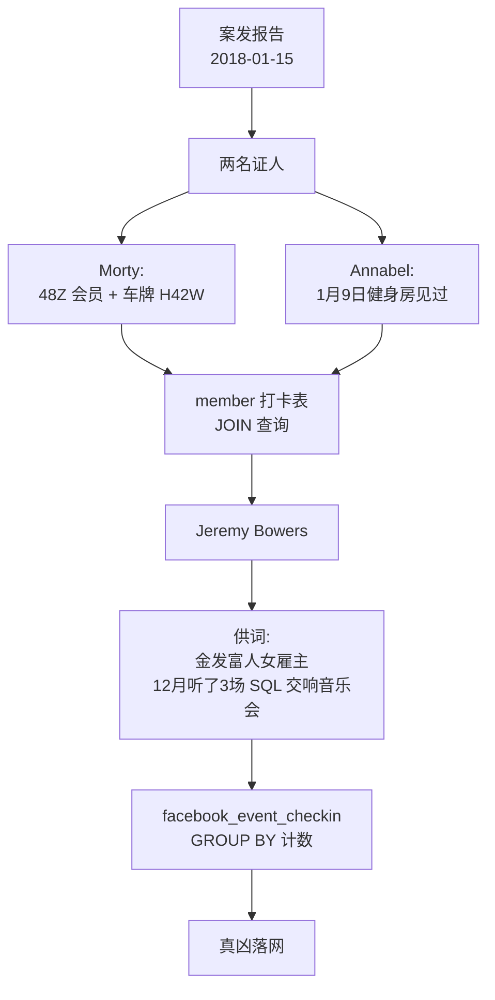
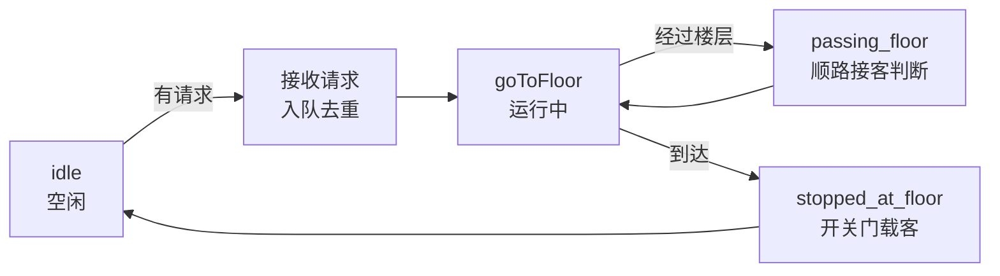

# 第6章：用 SQL 破案与电梯调度——两场最有趣的实战

> [!TIP] Part 2: 浏览器解谜篇
> 本 Part 的战场从终端搬进浏览器：不用装任何环境，打开网页就是关卡，每次提交立刻有画面反馈。本章是 Part 2 的收官实战，一局游戏一个真实技能：上半场用 SQL 查询破一桩凶案，下半场用 JavaScript 调度一部会思考的电梯。

前面四章各练一个专项：终端、命令、CSS、正则。本章换一种节奏——**两款游戏、两个毫不相干的技能，但玩家体验殊途同归**：你完全感觉不到自己在「学 SQL」或「学事件驱动」，你只是在破案、在救电梯里焦躁的乘客。这种「目标与技能错位」的设计，正是心流公式里「即时反馈」的最高形态：反馈不是分数，而是剧情推进和电梯 doors closing。

## 6.1 SQL Murder Mystery：一场在线凶案

SQL Murder Mystery（mystery.knightlab.com）出自美国西北大学 Knight Lab，定位是「SQL 新手的课后甜点」：一座只有 7 张表的小型数据库，一桩 2018 年 1 月 15 日发生在 SQL City 的谋杀案，你手上只有一句开场白——去查案发当天的报告。全程只用浏览器，连注册都不用。

先认识一下这座「案发现场」——7 张表各自的角色：

| 表名 | 存了什么 | 在破案中的角色 |
| ---- | ---- | ---- |
| crime_scene_report | 案件报告 | 开局唯一入口，拿到证人线索 |
| person | 城市居民档案 | 所有线索的「人」都要落到这里 |
| drivers_license | 驾照记录 | 车牌、身高、发色的交叉验证 |
| get_fit_now_member | 健身房会员 | 会员号、身份（gold/silver） |
| get_fit_now_check_in | 健身房打卡 | 把嫌疑人和日期钉在一起 |
| facebook_event_checkin | 活动签到 | 主谋阶段的最后一块拼图 |
| income | 收入记录 | 干扰项，多数时候用不上 |

表与表之间靠外键（Foreign Key）相连，破案的本质就是**沿着外键跳来跳去**：

```text
   crime_scene_report ──证人描述──> person
                                      │
                     ┌────────────────┤
                     v                v
            drivers_license    get_fit_now_member
                                      │
                                      v
                            get_fit_now_check_in
                                      │
                     facebook_event_checkin <── 主谋线索
```

> [!NOTE] 先补 15 分钟再进场
> 游戏要求你至少见过 `SELECT`、`WHERE`、`JOIN` 三样东西。零基础的话，先到本站[《MySQL 完全教程》](/mysql/ch04)第四章把 `SELECT * FROM 表 WHERE 条件` 的读法过一遍——15 分钟足够，剩下的语法在破案现场现学效率最高。

## 6.2 第一条线索：查案发报告

游戏界面给了一个输入框和一句提示：还原案发当天、发生在 SQL City 的谋杀案报告。把人类语言翻译成 SQL：

```sql
SELECT *
FROM crime_scene_report
WHERE date = 20180115
  AND type = 'murder'
  AND city = 'SQL City';
```

查询返回一段报告文本，大意是：**监控拍到了两名目击者。第一位住在 Northwestern Dr 的最后一栋房子；第二位叫 Annabel，住在 Franklin Ave 的某处。**

看这条查询里三个 `AND` 条件各自的贡献：`date` 把报告从成百上千条压到一天，`type` 剩下凶案，`city` 收出唯一一条。**用 WHERE 逐层收窄，是 SQL 思维的第一课**——不是「一条完美查询」，而是「每加一个条件，看结果怎么变」。这种小步试探的查询习惯，会让你后面所有查询都不容易写错。

接着找证人。两位证人对应两个形状略有不同的问题：

```sql
-- 证人一：Northwestern Dr 的最后一栋（门牌号最大）
SELECT name, address_number, address_street_name
FROM person
WHERE address_street_name = 'Northwestern Dr'
ORDER BY address_number DESC
LIMIT 1;

-- 证人二：Franklin Ave 上名字含 Annabel 的人
SELECT name, address_number, address_street_name
FROM person
WHERE address_street_name = 'Franklin Ave'
  AND name LIKE '%Annabel%';
```

第一位证人是 Morty Schapiro，第二位是 Annabel Miller。`ORDER BY ... DESC` 加 `LIMIT 1` 是「取最大值」的标准写法，`LIKE '%Annabel%'` 的 `%` 是通配符——这正是第5章正则的远房亲戚，SQL 里的 `%` 相当于正则的 `.*`。

## 6.3 循线追凶：JOIN 的实战课

Morty 的证词信息量很大：凶手背着 **Get Fit Now Gym** 的包，**会员号以 48Z 开头**，只有 **gold 会员**有这种包，然后上了一辆车牌含 **H42W** 的车。Annabel 的证词补了一个时间：她 1 月 9 日在健身房见过这个人。

两个证词一交叉，查询就自己浮现了——找 1 月 9 日打卡的 48Z 开头的 gold 会员：

```sql
SELECT m.name, m.id, c.check_in_date
FROM get_fit_now_member AS m
JOIN get_fit_now_check_in AS c
  ON m.id = c.membership_id
WHERE m.id LIKE '48Z%'
  AND m.membership_status = 'gold'
  AND c.check_in_date = 20180109;
```

结果指向一个人：Jeremy Bowers。但游戏在提醒你**别急着定罪**——用车牌再交叉验证一次，让证据链闭合：

```sql
-- 换一条独立证据链：直接按车牌找人
SELECT p.name, p.id, dl.plate_number
FROM person AS p
JOIN drivers_license AS dl
  ON p.license_id = dl.id
WHERE dl.plate_number LIKE '%H42W%';
```

两条独立证据链——健身房打卡与车牌记录——同时指向 Jeremy Bowers，把名字填进解谜框——**恭喜，你找到了凶手。但游戏还没完**：Jeremy 的供词里另藏玄机，他背后还有一个雇主。整条调查链可以用一张图收拢：



回头看这一路：你没有背过任何 JOIN 语法，但你已经连续写出了**两条三表连接**的查询。这就是破案驱动的威力——JOIN 不再是「两表相乘再筛选」的抽象定义，而是「把证词钉到人身上」的具体动作。

## 6.4 真凶另有其人：从供词到事件表

回到游戏里重查 Jeremy 的供词（游戏界面对面审讯有个 `interview` 步骤，或者查 `person` 表相邻的供词字段）。供词要点：雇主是**一位很有钱的女人**，身高大约 5 尺 5 到 5 尺 7（约 65-67 英寸），**红发**，开 **Tesla Model S**，2017 年 12 月**听了 3 场 SQL Symphony Concert**。

供词是一堆形状条件的集合，全部翻译成 SQL。先按外形筛出候选人，再用音乐会签到表做决定性验证：

```sql
-- 第一步：外形画像筛选（红发、身高、Tesla Model S）
SELECT p.name, p.id
FROM person AS p
JOIN drivers_license AS dl ON p.license_id = dl.id
WHERE dl.gender = 'female'
  AND dl.hair_color = 'red'
  AND dl.height BETWEEN 65 AND 67
  AND dl.car_make = 'Tesla'
  AND dl.car_model = 'Model S';

-- 第二步：12 月 3 场音乐会的签到计数
SELECT person_id, COUNT(*) AS concert_count
FROM facebook_event_checkin
WHERE event_name = 'SQL Symphony Concert'
  AND date LIKE '201712%'
GROUP BY person_id
HAVING concert_count = 3;
```

两条查询的交集只剩一个人：Miranda Priestly。把她填进解谜框，游戏放全剧终的动画——你刚刚独立完成了一次**分组聚合**（`GROUP BY` + `COUNT` + `HAVING`），很多教程里这三件套要讲到第三四章，而你是在追凶时顺手学会的。

把破案全程用到的 SQL 能力清点一下，你会发现覆盖面相当完整：

| SQL 能力 | 在破案中的用法 | 对应真实场景 |
| ---- | ---- | ---- |
| SELECT + WHERE | 查案发报告、筛证人 | 任何「按条件找记录」 |
| ORDER BY / LIMIT | 找最后一栋房子 | 排行榜、Top-N 统计 |
| LIKE 通配符 | 48Z%、H42W、%Annabel% | 模糊搜索 |
| JOIN 多表 | 证词钉人、车牌验证 | 订单关联用户这类核心操作 |
| GROUP BY + COUNT + HAVING | 3 场音乐会锁定真凶 | 用户行为统计、风控 |

> [!TIP] 二周目玩法
> 通关后 Knight Lab 提供了**自造谜题模式**：你写好答案人物，网站自动生成一桩新案件给别人解。这是第5章「反向出题」思路的 SQL 版——出题逼你从数据库的设计者视角看表结构，比解题更接近真实后端工作。

## 6.5 Elevator Saga：会思考的电梯

下半场换风格：SQL Murder Mystery 是剧情驱动，Elevator Saga（play.elevatorsaga.com）是机制驱动——没有凶手，只有 15 层楼、等电梯的乘客和一组不断加码的运输指标。你的任务：用 JavaScript 给电梯写「大脑」，让它把乘客又快又稳送到目的地。

界面元素三样：楼栋（乘客在楼层间随机出现并按键）、电梯（数量随关卡增加）、控制台（代码编辑器，右侧实时报指标达成情况）。写代码前先认识电梯的「感官」——它通过**事件**（event）感知世界：

```text
   乘客按键            电梯状态
      │                  │
      v                  v
 floor_button_pressed   idle / passing_floor / stopped_at_floor
      │                  │
      └────────┬─────────┘
               v
        你的代码收到通知
               │
               v
        下达指令 goToFloor(n)
               │
               v
        电梯执行，物理画面实时运动
```

这就是**事件驱动**（event-driven）编程的最小模型：程序不写「从上到下执行完就结束」的剧本，而是**注册一堆回调函数，等事件发生时被叫醒**。第1关的初始代码长这样（可直接运行，但只能勉强过指标）：

```js
{
  init: function (elevators, floors) {
    const elevator = elevators[0];

    elevator.on("idle", function () {
      // 空闲时回 0 层待命
      elevator.goToFloor(0);
    });

    elevator.on("floor_button_pressed", function (floorNum) {
      // 车厢内乘客按了楼层按钮 → 送过去
      elevator.goToFloor(floorNum);
    });
  },
  update: function (dt, elevators, floors) {
    // 每帧调用，第1关用不上
  }
}
```

跑一下，电梯会动、会把人送到——但指标（如「30 秒内运 1 人」勉强及格，后面「运 15 人」「平均等待时间达标」）很快就会失败。失败信息不会告诉你答案，只会让乘客在屏幕上焦躁地等待：**问题完全暴露在现象里，改代码立刻看效果**，这个反馈闭环比任何讲解都直接。

## 6.6 从第 1 关到第 15 关：电梯大脑的三次升级

15 关的难度曲线设计得像一道算法课的实验列表：每关都逼你在「能跑」和「跑得好」之间再迈一步。三次大的升级节点如下：

| 阶段 | 关卡大致区间 | 出现的挑战 | 需要的策略升级 |
| ---- | ---- | ---- | ---- |
| 1 | 1-4 关 | 单梯、指标宽松 | 基础响应：按键就去、空闲回巢 |
| 2 | 5-9 关 | 多乘客、上下行方向 | 去重排队 + 顺路接客（方向判断） |
| 3 | 10-15 关 | 多梯并行、等待时间指标 | 任务分派：哪部电梯接哪个请求 |

升级 1：**队列去重**。第 5 关起你会撞上第一个经典 bug——乘客把 7 层的按钮按了三次，电梯就把 7 层排了三次任务，往返空跑。解法是给目的地队列做去重：

```js
elevator.on("floor_button_pressed", function (floorNum) {
  const queue = elevator.destinationQueue;
  if (!queue.includes(floorNum)) {
    queue.push(floorNum);
  }
  elevator.checkDestinationQueue();
});
```

升级 2：**顺路接客**。电梯经过 5 层去 8 层时，5 层的乘客明明顺路，你的电梯却呼啸而过——因为回调只认「车厢内按钮」。把楼层按钮事件也接进来，路过时顺手接人：

```js
floors.forEach((floor) => {
  floor.on("up_button_pressed", () => {
    if (queue.length === 0) elevator.goToFloor(floor.floorNumber());
    else if (!queue.includes(floor.floorNumber())) queue.push(floor.floorNumber());
  });
  floor.on("down_button_pressed", () => {
    // 同上，只是方向语义不同
  });
});
```

升级 3：**任务分派**。两部电梯都冲向同一个请求，会互相踩脚。给每部电梯维护自己的队列，新请求派给「当前队列最短」或「距离最近」的那部。到这一步，你已经在无意识中写出了调度算法课的前两页——**多级任务队列与负载均衡**。画成状态机，一部「有大脑」的电梯长这样：



> [!WARNING] 指标会惩罚「聪明过头」的策略
> 后期关卡的指标同时考察运输量和**平均等待时间**——把所有请求都攒起来「拼车」会拉高等待时间，见请求就冲又浪费运力。没有一步到位的最优解，靠的是改一版跑一遍、看指标怎么动。这个「调参」体验，和真实系统调优（缓存多大、线程开几条）一模一样：**先测量，再改动，每次只动一个变量**。

## 6.7 迁移：破案思维与调度思维各归其位

两款游戏通关，把战利品分别送回对应的真实战场：

1. **SQL 回家**。破案里练的 JOIN 与 GROUP BY，在[《MySQL 完全教程》](/mysql/ch04)第四章与[《SQLite 教程》](/sqlite/ch05)第五章里都有系统的体系化展开——带着「证词钉人」的画面感去读，`ON` 后面的等值条件为什么必须存在，会突然变得显然。
2. **事件驱动回家**。电梯的 `on("idle", ...)` 注册模式，正是[《NodeJS 教程》](/nodejs/ch10)第十章 Events（发布订阅）与[第四章](/nodejs/ch04)事件循环（Event Loop）的原型——你在游戏里给电梯注册回调，Node 在服务器里给 HTTP 请求注册回调，机制完全同构。
3. **把调试习惯留下**。两款游戏共同的隐性训练是「改一版、跑一遍、观察指标」的循环。回到真实项目，把它升级成：改动前先记下当前指标基线，改动后对比——这一条纪律的价值，超过本章所有语法点。

到这里 Part 2 结束。回头看这五章的共同结构：**浏览器即关卡、提交即反馈、失败即信息**——心流公式的三要素在网页上被做到了极致，成本却是零安装。

## 本章小结

- SQL Murder Mystery 用 7 张表、一桩凶案，把 SELECT/WHERE/JOIN/GROUP BY 全部变成破案动作——你学的是查询，体验是侦探剧。
- SQL 思维第一课：用 WHERE 逐层收窄，小步试探而不是追求一条完美查询。
- JOIN 的直觉是「把证词钉到人身上」，三表连接在追凶时写出来毫不费力。
- 分组聚合（GROUP BY + COUNT + HAVING）在「3 场音乐会」这一步顺手完成，不用背语法。
- Elevator Saga 是事件驱动的最小模型：注册回调、等待事件、下达指令，和 Node 的事件循环同构。
- 电梯策略三连升级：队列去重 → 顺路接客 → 多梯分派，本质是多任务调度与负载均衡入门。
- 后期关卡没有最优解，只有「先测量、再改动、一次动一个变量」的调参纪律——这正是真实系统调优的雏形。
- 两款游戏都是零安装零注册，通关成本一个下午；产出却是 SQL 与事件驱动两个硬技能的第一块地基。

**下一章预告**：浏览器之外还有一片更硬核的乐土——桌面解谜游戏。第7章走进 Zachtronics 出品的三件套，在虚拟芯片上写汇编、在炼金坊里优化流程，体验「编程本来就该好玩」的出厂设定。

---
