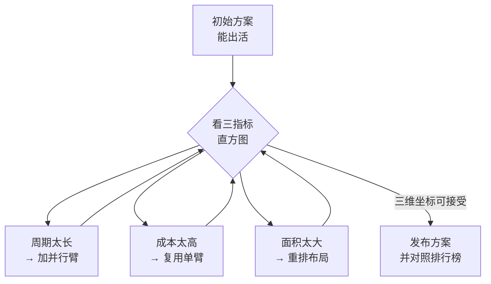

# 第7章：Zachtronics 三件套——在流水线与芯片上写程序

> [!TIP] Part 3: 桌面游戏篇
> 离开浏览器，进入需要花真金白银购买、但回报密度也最高的桌面解谜游戏。本 Part 共两章：本章走进编程游戏的黄金标准 Zachtronics，下一章用两款可视化沙盘修炼 Git 与机器学习内功。

Zachtronics 是一间西雅图的独立工作室，被玩家戏称为「编程游戏界的任天堂」。他们的游戏没有别的品类，全部是「用编程解决问题」：给邮件分拣、给芯片写汇编、给炼金机排产。看起来硬核劝退，实际上它们是**把「编程为什么好玩」这件事还原得最彻底**的一批作品——你在第 1-6 章练出的手感，在这里会遇到最值得挑战的对手。

## 7.1 为什么是 Zachtronics：优化驱动的游戏文化

先看家底。工作室的代表作品按时间排开，每款都对应一种真实的编程能力：

| 游戏 | 年份 | 游戏形式 | 对应的真实能力 |
| ---- | ---- | ---- | ---- |
| Human Resource Machine | 2015 | 邮件分拣办公室 | 汇编思维、循环与跳转 |
| 7 Billion Humans | 2018 | 前作的多线程版 | 并行编程、竞态意识 |
| TIS-100 | 2015 | 故障的老式异构计算机 | 裸汇编、受限资源编程 |
| SHENZHEN I/O | 2016 | 深圳电子厂工程师 | 读手册、嵌入式开发流程 |
| Opus Magnum | 2017 | 炼金机械臂排产 | 算法优化与工程权衡 |
| Turing Complete | 2021 | 从门电路造计算机 | 计算机体系结构 |

这个家族有一个共同的灵魂设计：**优化排行榜**。每道谜题都有不止一个评分维度（执行周期数、指令条数、占用面积），通关后游戏会展示你的成绩在全世界玩家里的**百分位直方图**——你不是「过了」，你是「排在前 37%」。这一下把游戏从「证明能做」升级成「证明做得好」，也正是真实工程与刷题的分界线：工业代码的第一要求是正确，第二要求就是效率与可维护。

另外有两件事提前打预防针：一是 **TIS-100 与 SHENZHEN I/O 刻意不给教程**，开局只发一本游戏内 PDF 手册（可打印），读手册本身就是游戏的一部分——这不是偷懒，是对真实嵌入式开发流程的还原；二是它们没有中文界面，但语言难度约等于初中英语加技术词汇，配合词典完全可玩。

放进第0章的特工晋级主线：第 1-3 章的终端闯关是「新兵营」，第 4-6 章的浏览器解谜是「野外拉练」，本章起进入「特种装备训练」——装备更重、门槛更高，但练出的能力也更能镇场子。心流公式在这里的兑现方式最特别：**即时反馈从「对错提示」变成了「百分位直方图」**，你的每一次优化都立刻看见自己在全球玩家中的位置移动。

和前六章的网页游戏相比，Zachtronics 的第三个区别是**时间颗粒度**：网页游戏一关几分钟，这里一关动辄一小时起步，且官方定位就是「慢慢玩几年」的长期游戏。这不是缺点，而是定位差异——网页游戏负责让你在任何碎片时间不生锈，桌面游戏负责在整块时间里把某项能力凿深。两类搭配使用，正好覆盖第0章心智模型里「渐进关卡」的两种刻度。

## 7.2 Human Resource Machine：汇编思维的第一课

入门推荐从 Human Resource Machine（人_resource 机器，中文常称「人力资源机器」）开始。设定是一个滑稽的办公室：你扮演一名小职员，站在传送带与输出槽之间，把老板要的邮件（数据）搬过去。你的全部指令只有十几条：

| 指令 | 含义 | 记忆钩子 |
| ---- | ---- | ---- |
| inbox | 从传送带取一个值到手 | 输入 |
| outbox | 把手中的值放到输出槽 | 输出 |
| copyfrom/copyto | 从地毯取值/存值到地毯 | 地毯就是内存变量 |
| add/sub | 手上的值加/减地毯上的值 | ALU 运算 |
| bump+/bump- | 地毯上的值自增/自减 | `i++` 的原型 |
| jump/jumpifzero | 无条件/为零时跳转到标签 | goto 与条件分支 |

「地毯」是最妙的设计：办公室地板上贴着几张编号的地毯格，你只能把手里的值放上去、取回来——**这就是内存**。很多初学者对「变量」「内存地址」始终隔着一层纱，在这间办公室里搬两个小时的货，那层纱自己就破了。整间办公室的鸟瞰长这样：

```text
  [传送带 INBOX] ────> ( 你 ) ────> [输出槽 OUTBOX]
                        │  │
                  ┌─────┘  └─────┐
                  v              v
              [地毯 0]        [地毯 1]
                  └──────┬───────┘
                         v
                   指令带（你写的程序）
```

看一道经典关卡：把输入序列里的数**两两相加**输出（比如输入 1, 4, 9, 16 输出 5, 25）。答案是：

```text
a:
    inbox          # 取第一个数到手
    copyto 0       # 暂存到 0 号地毯
    inbox          # 取第二个数到手
    add 0          # 加上地毯上的第一个数
    outbox         # 输出和
    jump a         # 回到开头，处理下一对
```

六个指令，一个死循环，程序写完就不会再改——**「程序是描述流水线的不变规则，数据是流过流水线的变量」**，这个所有编程语言共通的底层心智模型，在办公室里被具象成了你亲眼可见的传送带。全游戏 42 关，后期关卡会出现负数运算、字符串比较、斐波那契数列，但指令集从第二关起就没有增加过——**难度全部来自「用固定指令集组织出更复杂的控制流」**，这正是汇编程序员每天面对的世界。

再拆一道中段关卡感受难度来源：**相等判断**。指令集里没有「比较两数是否相等」的现成指令，但你有减法和为零跳转：

```text
a:
    inbox            # 取第一个数
    copyto 0         # 存进 0 号地毯
    inbox            # 取第二个数
    sub 0            # 手上的数减去地毯里的第一个数
    jumpifzero same  # 差为 0 → 两数相等，跳到 same
    jump a           # 差不为 0 → 不等，回去搬下一对
same:
    outbox           # 输出关卡要求的相等标记
    jump a
```

「**没有的指令，用有的指令组合出来**」——这句话就是汇编编程乃至整个计算机科学的底层品味。全游戏 42 关，指令集从第二关起就没有增加过，难度全部来自「用固定指令集组织出更复杂的控制流」：负数运算、字符串比较、斐波那契数列，全靠十几条基本指令搭出来。卡住时用游戏内置的**单步执行**（step）逐指令观察手上的值与地毯的值——这是最朴素的调试器，先在这里养出「怀疑哪行看哪行」的手感，以后用 GDB、Chrome DevTools 都是同一套反应。

通关后如果意犹未尽，续作 **7 Billion Humans** 把办公室搬进了人口爆炸的未来：你不再指挥一个职员，而是同时指挥**几十个**职员执行同一段程序——每个职员是独立线程，指令不变，但要开始担心「两个职员抢同一块地毯」（竞态条件）和「职员之间互相等」（死锁）。它把并行编程最吓人的两个词，变成了亲眼可见的办公室踩踏事故，是多线程入门最温柔的一课。

> [!NOTE] 手感迁移的对照表
> 玩过前 20 关之后，回头看本站[《Linux 命令行完全教程》](/linux-command/ch20)第二十章的 shell 脚本变量与循环，会有一种「换个语法写办公室」的既视感：`copyto` 是赋值、`jumpifzero` 是 `if`、`jump` 加标签是 `while`。汇编与高级语言不是两个世界，是同一间办公室的两份岗位职责说明书。

再进一步，把办公室指令与真实 CPU 的汇编近似对应起来（以 ARM 为例）：

| HRM 指令 | ARM 汇编近似 | 说明 |
| ---- | ---- | ---- |
| inbox / outbox | LDR / STR（访存读写） | 真实 CPU 没有「手」，只有寄存器 |
| copyto 0 / copyfrom 0 | STR R0, [var] / LDR R0, [var] | 地毯 = 内存地址 |
| add 0 | ADD R0, R0, R1 | 算术逻辑单元干活 |
| jump a | B a | 无条件分支 |
| jumpifzero same | CBZ R0, same | 为零跳转 |

对照表的乐趣在于发现 **HRM 的「手」其实是寄存器**：游戏为了叙事把取数、存数包装成搬运邮件的动作，而真实 CPU 的全部工作就是在寄存器与内存之间搬数据、算数、跳转——三者缺一不可，除此之外再无新意。这个「发现 CPU 很简单」的时刻，是这款游戏最珍贵的礼物。

## 7.3 TIS-100 与 SHENZHEN I/O：裸芯片上的两个段位

这两款是进阶双璧，都是「给故障/待产的电子设备写程序」，但段位不同。

**TIS-100** 的舞台是一台虚拟的 1980 年代异构计算机：一块布满方格节点的电路板，每个节点只有两条寄存器（ACC 累加器和 BAK 备份）与一条双向通道，节点之间靠读写上下左右端口通信。指令集精简到让人心安：

| 指令族 | 代表指令 | 作用 |
| ---- | ---- | ---- |
| 数据移动 | MOV src, dst | 在寄存器/端口间搬数据 |
| 运算 | ADD / SUB / NEG / SWP / SAV | ACC 的算术与备份 |
| 控制流 | JMP / JEZ / JNZ / JGZ / JLZ / JRO | 无条件与条件跳转 |
| 空操作 | NOP | 占位与同步 |

关键难点在于**一块板上十几个节点各跑各的**：你要把一道题（比如「把左边的数流排序后送到右边」）拆成每个节点一段小程序、端口之间互相递值。它就是并发编程的沙盘：第一次亲手体会到**阻塞读、死锁、负载不均**这些词的血肉含义。而每个节点只有 15 行指令的限额，逼你把「能跑」的方案反复折叠成「塞得下」的方案——空间优化的肌肉由此练成。

一个最简的单节点程序长这样——把左边邻居送来的数加倍后转发给右边：

```text
MOV LEFT, ACC    # 阻塞等左邻送数，拿到后存进 ACC
ADD ACC          # ACC 翻倍
MOV ACC, RIGHT   # 发给右邻（右邻没空收就阻塞在这）
```

四行里有三个并发概念：`MOV LEFT, ACC` 是**阻塞读**（左邻不发就永远等），`MOV ACC, RIGHT` 是**阻塞写**（右邻不收就卡住），上下节点各写各的循环就是**生产者与消费者**。TIS-100 的关卡设计会逐步让你不得不处理「左邻产出快、右邻消费慢」的节奏差——缓冲、分摊、化整为零，这些分布式系统的经典动作你会提前十年摸到。

TIS-100 还有一个与所有现代 IDE 相反的设计：**没有断点、没有变量监视、没有自动补全**。你唯一的调试手段是在某个节点里临时插一行 `MOV 999, RIGHT` 这类「探针数据」，看下游行为怎么变。被这种原始手段折磨几天后，再用回任何现代调试器，你都会心存感激——同时也学会了任何时候都能调试：工具可以简陋，方法论不能没有。

**SHENZHEN I/O** 把场景搬到深圳华强北：你是电子厂的外包工程师，接客户订单，选元件、画电路、写固件。它的三个设计决定让它成为「嵌入式开发体验课」：

1. **手册即玩法**。游戏内的 PDF 手册共 30 余页，芯片时序、引脚定义、示例代码全在里面，官方明确鼓励打印出来贴便签。真实嵌入式开发的一半工作就是翻数据手册（datasheet），这里原样复刻。
2. **两种总线的纪律**。XBus 总线一次只能传一个值且会阻塞，Simple I/O 每帧无条件读写——选错总线类型，电路直接跑不正常。这是第一次在「纯软件」之外感受硬件接口的契约。
3. **测试驱动**。每张订单自带工厂验收测试，你的电路要先过测试再谈优化——和真实的 CI 流程一个脾气。

两款的难度梯度建议：先 TIS-100 玩通前 10 段（体会节点协作），再进 SHENZHEN I/O（体会选型与手册）。顺序反过来会被手册劝退。

SHENZHEN I/O 还有一个常被忽略的妙处：**成本是真实的**。每张订单有预算，每个芯片型号明码标价，MC4000 比 MC6000 便宜但寄存器更少——「选型」第一次成为游戏机制。你在第五关就会遇到「用两颗便宜的芯片还是一颗贵的芯片」的决策，而这个决策的判断依据全部来自手册里的时序图。做完这些订单再看真实世界的硬件选型讨论（多少内存、什么型号的云主机），你会有一股莫名的亲切感。

## 7.4 Opus Magnum：从「能跑」到「优雅」的美学课

Opus Magnum（炼金术士的机械臂）是家族里最「好看」的一：你扮演炼金术士，在六角网格上摆放**机械臂**（可抓取、旋转、搬运原子）、**变换台**（把铅变金、拆解盐），让它们像钟表一样循环运转，批量产出目标炼金产物。

它的通关门槛很低（机械臂摆对位置、指令排对时序就能出活），真正的游戏在于**三指标权衡**。举个最小的例子——「把两个原子合成产物」这道入门题，两种摆法对应两种哲学：

```text
  摆法 A：双臂接力             摆法 B：单臂全包

  抓取臂 → 变换台 → 输出       单臂循环：
  每周期产出一个               抓取 → 平移 → 变换 → 平移 → 释放
  成本高、周期短               每五个周期产出一个
                               成本低、周期长
```

双臂方案是**流水线**（pipelining），单臂方案是**批处理**（batching）——计算机体系结构里这对永恒的矛盾，在炼金台上变成肉眼可见的机械臂起舞。优化到后期，你会盯着动画逐周期数拍子，把机械臂的旋转时序错开一格，产量立刻多一成：**吞吐量优化的直觉，是「看」出来的，不是算出来的**。

三指标完整对照如下：

| 指标 | 含义 | 对应真实世界的什么 |
| ---- | ---- | ---- |
| 成本 | 使用的元件总价格 | 硬件成本、服务器开销 |
| 周期 | 单个产物的平均生产时间 | 延迟、吞吐 |
| 面积 | 装置占地大小 | 代码体积、资源占用 |

三者**不可能同时最优**：想快就得堆机械臂（成本爆炸），想省钱就得单臂慢慢转（周期爆炸）。游戏用百分位直方图把全世界玩家的三种偏好可视化，你会看见自己每个方案的三维坐标——**「优化」第一次从口号变成了坐标点**。这个体验对应真实工程里的经典难题：时间换空间还是空间换时间？缓存加几层？Code Review 里那句「这里可以先这样」到底行不行？玩完 Opus Magnum，你对这类问题会有一套带直方图的手感。



这款还有个隐藏福利：它的解谜动画极其优雅，机械臂同步旋转的样子像机械钟表。很多玩家的通关动机一半是指标、一半是「让装置好看」——**美学驱动也是生产力**，别小看它。不少玩家把通关动画录成 GIF 分享，社区里「晒装置」的帖子比「问攻略」的多十倍；当你在真实工作里写出一个设计精巧的模块时，那种想「晒」的冲动，和这里是同一根神经。

## 7.5 Turing Complete：亲手造一台计算机

家族最新也最工程化的一款：Turing Complete 从一个与非门（NAND gate）开始，让你一路把计算机造出来。主线大致是一条这样陡峭但清晰的阶梯：

```text
  逻辑门  →  加法器  →  ALU  →  寄存器与 RAM
     │                                    │
     └──────────> 组成 CPU <──────────────┘
                     │
                     v
          设计你自己的指令集（架构）
                     │
                     v
          写汇编器，用自造语言解最终题
```

每个阶梯对应的真实课程，玩之前心里有个谱：

| 游戏阶段 | 你动手造的东西 | 大学里对应的课程 |
| ---- | ---- | ---- |
| 第一阶段 | 或、与、异或等基础门电路 | 数字逻辑 |
| 第二阶段 | 半加器、全加器、多 位加法器 | 数字电路 |
| 第三阶段 | ALU、寄存器、RAM、计数器 | 计算机组成原理 |
| 第四阶段 | 自定义指令集与 CPU 互联 | 体系结构 |
| 第五阶段 | 汇编器与自造语言编程 | 编译原理（入门体验） |

这张表也是它的选玩指南：只想补体系结构概念的，玩到第三阶段收获就足够；想体验「造语言」快感的，坚持到最终题。

它的核心震撼在于**指令集是你自己设计的**：游戏默认提供一套示例架构（Overture），但最终几关允许你自定义指令编码、寄存器布局，然后用自己发明的汇编语言写程序解题。当一道题用「你上周还不存在的语言」解出来时，「计算机是可建造的而非天赐的」这个认知才算真正落地——多数程序员一辈子没有过这个时刻，而它只需要游戏时间 30 到 50 小时。

对体系结构有兴趣的，把它当作本站[《软件架构完全教程》](/architecture/ch00)之外的一门「硬件架构课」来玩最合适；对底层语言有兴趣的，通关后顺手接本站[《Rust 编程语言教程》](/rust/ch04)第四章「所有权」与[第五章](/rust/ch05)「借用」，从「我造过机器」的视角读它们，阻碍感会小很多。

顺带一个冷知识：游戏开局为什么从与非门（NAND）开始？因为 NAND 是**通用门**——只用它一种门，就能搭出与、或、非、异或乃至整个计算机。真实世界的早期芯片（如阿波罗登月计算机）就是纯 NOR 门搭的。「一种原料造万物」的极简主义贯穿这款游戏，也贯穿整个数字世界。

## 7.6 迁移：Zachtronics 给程序员的四样行李

从这台流水线上下来，值得带走的东西按价值排序：

1. **读手册的耐心**。SHENZHEN I/O 教会你：官方文档 30 页没有一页是装饰，先读再动手是快路径。回到真实工作，把这份耐心用在框架文档与 RFC 上。
2. **对「受限资源」的适应力**。TIS-100 的 15 行限额、HRM 的零内存，都在训练「约束下的创造力」。真实工程处处是约束（预算、工期、内存），这批游戏的本质是约束适应训练器。
3. **优化的坐标系**。三指标直方图给你的最大启示是：优化永远是在坐标平面上移动一个点，而每个维度都有人比你做得好。先想清楚要优化哪个维度，再动手。
4. **比较文化**。通关不是终点，百分位才是。把这个习惯带回 LeetCode 与性能测试——「过了」和「快」之间隔着一整个段位系统。

还有一个无形但重要的影响：Zachtronics 玩家社区（Steam 讨论区与各种排行榜网站）默认交流的是「你的周期数是多少、怎么做到的」，而不是「这关怎么过」。这种以**效率为共同语言**的社区氛围，是算法竞赛圈（OI/ACM）文化的休闲版。泡在里面一段时间，你看代码的眼光会多一把尺子：这段逻辑的「周期数」是多少？有没有冗余的机械臂在空转？

最后提醒一句节奏：这个家族的卡关是常态，一道题磨三个晚上不丢人——它的大门上刻着工作室自己的话，编程不是天赋者的专利，而是能坐得住的人的奖励。哪天发现连续一周毫无进展，就切换到第 1-6 章的网页游戏回回血，两种刻度的练习本来就是互补的。

> [!TIP] 一条省钱攻略
> 这六款游戏常年打折（Steam 冬夏促常到 -50% 以上），且都有试玩退款机制。预算有限时的优先级建议：HRM（必备）→ Opus Magnum（体验权衡）→ TIS-100 或 SHENZHEN I/O 二选一（按对嵌入式兴趣）→ Turing Complete（体系结构爱好者专属）→ 7 Billion Humans（前作粉丝向）。

家族里还有第五位成员 Exapunks（2018）：你扮演一名黑客，给「小恶魔」（exa）写程序去入侵洗衣机、银行与游戏机，本质是 TIS-100 的分布式加强版，多代理协作的玩法比前作更自由。入坑顺序上放在最后——它的自由度对新手反而是一种负担。

最后一个实操建议——**给这个家族定一个训练计划**。它们单位时间的产出密度低于网页游戏（一关可能磨两小时），所以更适合「周更」而不是「日更」：每周固定两个晚上各 45 分钟，一晚推新关、一晚优化旧关（对照直方图），六款游戏大约一个学期可以走完主线。比进度更重要的是**每关通关后写一行通关日志**：这道题的关键约束是什么、我的方案卡在哪、最后是靠什么洞察解开——这就是第3章错题本策略的桌面游戏版。

## 本章小结

- Zachtronics 家族的共同设计是「通关只是及格线，百分位直方图才是成绩单」——把优化意识做成了核心玩法。
- 网页游戏管碎片时间，桌面游戏管整块时间，两种时间颗粒度互补，共同覆盖「渐进关卡」的两种刻度。
- Human Resource Machine 用一间办公室把汇编思维拆到最小：地毯是内存、jump 是控制流，42 关练完再看 shell 脚本全是老朋友；续作 7 Billion Humans 用几十个职员把竞态与死锁变成可见的踩踏事故。
- TIS-100 是并发编程沙盘：多节点通信让你亲历阻塞与死锁，15 行限额逼出空间优化肌肉。
- SHENZHEN I/O 还原嵌入式开发流程：读手册、选总线、过测试，三件事与真实工厂一模一样。
- Opus Magnum 的三指标（成本/周期/面积）不可兼得，把「优化是移动坐标点」从口号变成手感。
- Turing Complete 让你从与非门造到自定义指令集，「计算机是可建造的」这个认知值回全部票价。
- 迁移四行李：读手册的耐心、约束下的创造力、优化的坐标系、比较文化。
- 周更节奏加通关日志，比每天苦刷更可持续；通关日志的关键问题是「这道题的关键约束是什么」。
- 入门顺序建议：HRM → Opus Magnum → TIS-100 或 SHENZHEN I/O → Turing Complete，预算有限按打折季分批购入。

**下一章预告**：桌面篇下半场换轻量装备——两款免费沙盘教你把 Git 的分支图刻进视觉记忆，一款拼图游戏让你在给猫打工的过程中摸到机器学习的门。它们全部免费，今晚就能开玩。

---
