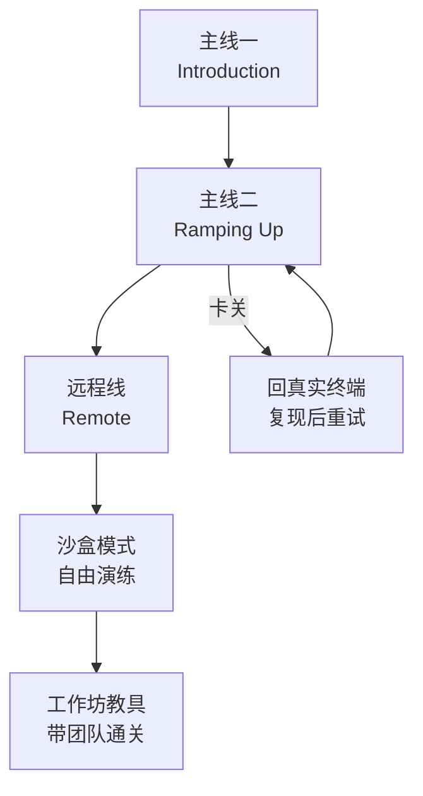

# 第8章：Git 沙盘与 ML 拼图——两台免费练功机

> [!TIP] Part 3: 桌面游戏篇
> 离开浏览器，进入需要花真金白银购买、但回报密度也最高的桌面解谜游戏。本章是 Part 3 的收官：三款游戏两款免费，分别修炼版本控制的视觉记忆与机器学习的流水线思维。

上一章的 Zachtronics 是重型装备，本章换轻量级：**Learn Git Branching** 与 **Oh My Git!** 把 Git 这个「人人都在用、没人真懂」的工具变成可视化沙盘；**while True: learn()** 则让你在给猫打工的剧情里，把机器学习流程拼成一幅幅图。三款共同的卖点：**把不可见的东西画出来**。

这个共同卖点值得多说一句。Git 难学的根源不是命令多，而是**它操作的对象看不见**——提交、指针、历史全是抽象物，背命令等于背盲文的字母表。三款游戏做的事殊途同归：把盲文翻译成大字报。这也是本章的选择逻辑——**当你发现某个技术学得痛苦，先找找有没有它的可视化版本，往往不是你笨，是你没见过它的形状**。

## 8.1 Learn Git Branching：把分支图刻进视觉记忆

Learn Git Branching（learngitbranching.js.org）虽然住在浏览器里，但它的段位配得上本章——它是无数团队新人入职清单上的第一项。界面极简：左边一个终端，右边一棵实时生长的提交树（commit DAG）。你的每一个 Git 命令都会让右边的图**当场变形**：commit 长出新节点、branch 生出新指针、rebase 让一串提交连根拔起再插进新家。

它的核心贡献是一个**心智模型**：分支不是「一条独立的线」，而是一个指向某个提交的**指针**；提交树是真实存在的图，而 HEAD、分支名都只是图上的游标。看两组命令在图上的区别：

```text
  操作前                          merge（分叉合拢）
  main ── C0 ── C1                 main ── C0 ── C1 ── C4 ──┐
              \                            \               merge commit
               bugFix ── C2 ── C3           \── bugFix ── C2 ── C3

  rebase（分叉拉直）                本质差异
  main ── C0 ── C1                 merge 保留分叉历史（图更真实）
              \                    rebase 伪造线性历史（图更整洁）
               bugFix ── C2' ── C3'
```

关卡机制也值得一瞥——它是一个标准的心流设计样本：每关右侧给出**目标树**（长什么样算赢），你的终端支持几十条真实 Git 命令（含 `git log --graph`），通关判定靠比对两棵树的形态。卡住时它提供分步提示但不强制，官方支持中文界面，命令报错与真实 Git 几乎一致——你在沙盘里敲错的每个命令，报错信息都可以直接拿去搜索引擎。

rebase 后的 C2'、C3' 是**全新的提交**（哈希值变了），旧的 C2、C3 在游戏图里直接消失——这个「复制提交」的瞬间用文字讲十遍都不如看一遍动画。本站[《Git 与 SSH 完全教程》](/git-ssh/ch10)第十章讲 merge 与 rebase 的文字结论，在这里全部变成肉眼可见的图形操作。

动画还顺手演示了 rebase 的**黄金法则**：已经推送到共享分支的提交不要 rebase。游戏里的表现很直观——你 rebase 之后，远程与本地各自拿着一套哈希不同、内容相同的提交，图上像两条平行宇宙。真实世界发生这种情况，队友的仓库会进入一种谁也说不清的状态。先在沙盒里犯一次这个错（沙盒专门有关卡让你体会），比在真实仓库里犯便宜得多。

关卡体系分四条线，覆盖从入门到远程协作。官方把它定位成「Git 的交互式教程」，但按本教程的框架，它更像一台**Git 模拟飞行器**——你操纵的每根杆都对应真实驾驶舱里的真实按钮：

| 关卡线 | 内容 | 对应本站 Git 教程 |
| ---- | ---- | ---- |
| 主要（Introduction） | commit、branch、checkout、merge | 第九章分支的本质 |
| 移动提交（Ramping Up） | 相对引用 HEAD~、撤销 reset/revert、交互式变基 | 第八章悔棋三件套、第十一章 |
| 远程（Remote） | clone、fetch、pull、push、tracking | 第十九章 pull 时发生了什么 |
| 沙盒模式 | 无限自由玩，还自带关卡编辑器 | 第二十、二十二章 |

沙盒模式是隐藏福利：它内置了一套**模拟的远程仓库与假队友**（`git fakeTeamwork` 一敲，远处就多一个队友提交），让你零风险演练多人冲突——真实仓库里演练这些，代价是同事的白眼。

首次进入会被四条线的入口晃花眼，推荐路线如下，先建画面感再碰远程：



## 8.2 三道经典关卡拆解

主线里有三道关卡浓缩了 Git 最容易糊的概念，值得单独拆开看。选它们的标准不是「最难」，而是**每道背后站着一个真实工作场景**：挪指针、摘提交、改历史——正好是日常 Git 操作的三大件。

**第一道：相对引用**。关卡要求你用最短命令把 main 指针挪到指定提交。新手会 `git checkout` 一长串哈希，关卡的通关标准逼你学会：

```bash
git checkout HEAD~3      # 回退三代提交
git branch -f main HEAD~2  # 强制把 main 移到 HEAD 的上两代
```

`HEAD~3` 是「沿图向上走三步」，`branch -f` 是「强移指针」。这一关的收获是一个解放性的认知：**分支指针可以被随意移动，只要图还在，历史就没有丢**。很多人对 Git 的恐惧来自以为分支名是神圣不可移动的——这一关治好了这份恐惧。

顺带把两个容易混的记号拆清：`HEAD~2` 沿**第一父提交**往上数两代；`HEAD^2` 是取 HEAD 的**第二个父提交**（只在 merge 提交上有意义）。波浪线数步数、尖括号挑父亲——这两个符号在 rebase 出错救援时天天用到，游戏里有专门的关卡逼你分清。

**第二道：cherry-pick 挑樱桃**。关卡给你一棵分叉树，要求把三个特定提交摘到 main 上，其余的不要：

```bash
git cherry-pick C3 C1 C2   # 按顺序摘三个提交到当前分支
```

通关瞬间你会明白 cherry-pick 的真实用途：**只带走某几个提交**（比如把一个热修复挑到发布分支），而不是整棵分叉。真实工作里的对应场景是：线上出了 bug，你在开发分支修好了，但发布分支不能吞下整个开发分支的半成品——这时候摘一个提交过去，两全其美。本站[《Git 与 SSH 完全教程》](/git-ssh/ch11)第十一章的 stash、tag、cherry-pick 三件套，游戏里能看到最直观的那个。

**第三道：交互式变基**。关卡要求把最近 4 个提交重排并合并，命令只有一句：

```bash
git rebase -i HEAD~4   # 弹出编辑界面：调整顺序、squash 合并
```

真实 Git 里这条命令会打开一个 vim 式的编辑界面，每行一个提交，行首的动词决定它的命运：

```text
pick  a1b2c3  第一条提交     ← 保留
pick  d4e5f6  第二条提交     ← 改成 squash：与上一条合并
pick  9f8e7d  第三条提交     ← 改成 reword：顺便改提交信息
pick  0a1b2c  第四条提交     ← 挪到最上面
```

游戏的图形界面让你**拖拽**提交顺序、勾选要不要 squash，而真实 Git 里这一步发生在 vim 里。先在游戏里建立「我要的是重排 + 合并」的目标感，再去背 vim 操作，方向感完全不同——这正是可视化沙盘对纯文字教程的补充价值：**先看见终点，再学路径**。

**第四道：远程圆舞曲**。远程线的关卡把多人协作搬进沙盒——敲一句 `git fakeTeamwork side 2`，假队友就往远程推了两个提交。接下来你要在「远程比本地新」的局面下完成自己的提交：

```bash
git fetch           # 把远程的新提交拉下来，但不动本地分支
git rebase o/main   # 把自己的提交搬到远程进度之上
git push            # 再推送就不需要强推了
```

这一连串在图上的效果是：你的提交像积木一样被拆下来、装到远程最新进度的顶上。通关后你会真正理解为什么本站[《Git 与 SSH 完全教程》](/git-ssh/ch19)第十九章说「pull 就是 fetch 加一次合流」——游戏把这句话拆成了你亲手敲的三条命令。遇到更较真的关卡还会逼你在 `git pull --rebase` 与普通 pull 之间做选择：**历史要线性还是要真实**，沙盒里试两种，直觉立刻建立。

移动提交线里还藏着一对容易混的撤销命令，顺手在这里辨析清楚：

```bash
git reset HEAD~1   # 本地撤销：提交直接从历史上抹掉（改写历史）
git revert HEAD    # 公开撤销：造一个「反向提交」抵消目标提交（追加历史）
```

规则一句话：**还没 push 的用 reset，已经 push 的用 revert**——前者是「假装没发生过」，后者是「公开认错并修正」。游戏里有两道相邻关卡专门对比这两种撤销在图上的形状差异，看完那个对比，这句话就不用背了。

> [!WARNING] 在真实仓库练 reset 前先买保险
> 沙盒里的 reset 敲错了刷新页面就重来，真实仓库里的 reset 敲错会真的丢工作。练之前先打个保险：`git branch backup-before-reset` 建一个备份分支，让指针在 reset 前先留一份位置记录——事后哪怕全乱了，这个分支还能把你带回去。第3章的「先 -print 再 -delete」纪律，在这里同样适用。

## 8.3 Oh My Git!：卡牌化的 Git 入门

Learn Git Branching 假设你已经在用 Git，Oh My Git!（ohmygit.org）则面向**完全没碰过命令行的人**。它是一款免费开源的卡牌游戏：每张卡牌就是一个 Git 操作（commit、branch、merge、push……），你拖卡牌到时间线上，右侧的仓库视图实时变化——和 Learn Git Branching 一样的可视化哲学，但把「打命令」降级成了「出牌」。

两款对比着看更清楚：

| 维度 | Learn Git Branching | Oh My Git! |
| ---- | ---- | ---- |
| 操作方式 | 真实 Git 命令行 | 卡牌拖拽（背后是真实 Git） |
| 目标人群 | 已入门、要进阶 | 零基础、第一次接触 |
| 关卡设计 | 严格目标判定，像刷题 | 目标宽松，鼓励自由探索 |
| 协作玩法 | 假队友（fakeTeamwork） | 支持真人同屏协作同一关 |
| 最佳用途 | 面试前突击、建立指针心智 | 工作坊教学、带新人第一次 commit |

它最值得借鉴的是**「真人同关」**模式：两个人各自操作自己的工作区，共同完成一关——你 push 我 pull，冲突了当面商量。很多团队把它当 Git 工作坊（workshop）教具用，一小时的新人培训效果胜过一周的文档阅读。如果团队有 Git 新人，这一条直接抄走：**把游戏挂到会议室屏幕上，两人一组通关，比讲 PPT 有效十倍**。

还有一个对进阶者友好到意外的设计：**它背后是真实的 Git**。每张卡牌只是真实命令的皮，游戏允许你随时打开内置终端直接敲原生 Git 命令——想 `git reflog` 就 `git reflog`。这意味着玩家可以「卡牌起步、命令收尾」：前期拖卡牌建立直觉，后期切终端无缝过渡到真实工作流。从零基础到第一线命令之间没有断崖，这是它作为教学工具最优雅的地方。

作为开源项目它还有一层玩法：**关卡是可编辑的**。自带的关卡编辑器能让你搭一棵自定义的提交树、写好目标条件，生成一道「本团队专属关卡」——比如复刻上周真实项目里的那次冲突现场，让新人重新解一遍。把踩过的坑变成关卡，是这款游戏最实用的隐藏能力，成本只有半小时。

上手体验也要交代真实：它的卡牌对「手已经会 Git 的人」会显得拖沓——熟练工用键盘敲命令的速度远快于拖卡牌。所以它的定位清单很明确：**教零基础的人（卡牌降低启动门槛）、组织协作练习（同关模式）、设计团队关卡（编辑器）**。你自己已经过了新手村的话，直接玩上一节的 Learn Git Branching 更对味。

## 8.4 while True: learn()：给猫打工的机器学习入门

第三款画风突变：while True: learn() 是一款机器学习主题的拼图游戏（有付费，也常年打折）。剧情设定荒诞而精准：你的猫是个绝世 AI 天才（毕竟整天盯着数据看），你替它成立了一家公司接单——客户要「把猫照片分类」「预测用户流失」，你就在画布上**连接各种处理节点**来完成订单。猫是 CTO，你是它名义上的员工，这个身份倒置的设定贯穿全部剧情：每个章节以一段猫咪研究项目报告开场，用猫的口吻科普一个 ML 概念，荒诞但记忆点极强。

玩法本质是搭流水线：每个订单给一份「数据格式要求」，你从工具箱里拖出节点——**排序器、分类器、清洗器、AI 模块**——用线连成一条数据流，点运行，数据气泡顺着管道流动，不达标就改。订单有预算与时间约束，节点越高级越贵，所以每关都是一道「用有限预算搭出达标流水线」的优化题。看一个典型布局：

```text
  [原始数据] ──> [清洗节点] ──> [分类器] ──> [格式化] ──> [交付]
                    │
                    └── 不达标 ──> [丢弃/重试]
```

节点工具箱里最常用的几件货：

| 节点 | 功能 | 对应真实概念 |
| ---- | ---- | ---- |
| 清洗器 | 过滤格式不对的数据 | 数据预处理 |
| 分类器 | 按特征把数据分堆 | 监督学习 |
| 排序器 | 按规则重排数据 | 排序算法 |
| AI 模块 | 高级处理，昂贵但万能 | 预训练模型 |
| 条件分支 | 按统计结果走不同管道 | 业务规则引擎 |

它偷偷教了真实的机器学习流程（pipeline）思维：**原始数据从来不能直接喂给模型**，中间必须有预处理、特征整理、输出格式化；分类器的准确率不是玄学，而是上游每个节点的质量叠加。游戏把「监督学习」「聚类」这些术语做成剧情节点科普（以猫咪研究项目的口吻讲，意外地通俗），通关后你对[《Python 教程》](/python/ch29)第二十九章 AI 与机器学习入门导论里出现的术语会有一种「我在游戏里用过」的亲切感——术语不再吓人，是它最大的价值。

拿一道中后期订单看思维深度：客户要「按毛色分拣猫咪照片， 且黑白照片占比高的批次要打上标记」。这道题的解法不是一个节点，而是**两阶段流水线的编排**——先分类、再按分类结果做条件分支，分支条件本身又是一个统计节点。玩到这一步，你接触的其实是真实数据工程里的**有向无环图**（DAG，Directed Acyclic Graph）编排思想：大数据工具 Airflow、CI 系统的 job 依赖图，全都是它的严肃版。游戏没有告诉你这些名字，但思维方式已经种下。

难度曲线方面它走的是「订单升级」路线：前期单管道、后期多管道嵌套，偶尔来一单「限时挑战」逼你删掉冗余节点。心流公式三要素全部在线——挑战梯度平滑（关卡引导）、反馈即时（数据气泡实时流动）、关卡递进（订单越接越大）。如果只挑一款在「完全没有学习压力」的晚上玩，选它。

```text
              ┌──> [毛色分类器] ──┐
  [照片流] ───┤                   ├──> [占比统计] ──> [打标] ──> [交付]
              └──> [黑白检测器] ──┘
```

要管理预期的是：它不教你调参、不教你写模型代码，深度止步于「流程直觉」。它的正确位置是**正式学习 ML 之前的开胃菜**——先用 20 小时游戏建立流程感，再去啃课程，挫败感会小很多。

## 8.5 三款怎么选：按你的缺口对号入座

三款游戏解决的缺口不同，按症状选。这张表请结合第0章的特工晋级主线一起看：Git 是主线里最早发枪的技能（第 1-3 章的终端闯关全程在用它），ML 则是主线末端的进阶方向——本章两款恰好各守一头：

| 你的症状 | 处方 | 用时 |
| ---- | ---- | ---- |
| 会 add/commit 但看不懂别人的分支图 | Learn Git Branching 主线前两条线 | 一个周末 |
| 团队要来了新人/要开 Git 工作坊 | Oh My Git! 同屏协作 | 一小时的会 |
| 听到「模型」「特征」就头大 | while True: learn() 主线 | 20 小时散装 |
| 面试前想过一遍 rebase/reset 场景 | Learn Git Branching 沙盒 + 移动提交线 | 两个晚上 |

> [!TIP] 沙盘与实战的对照纪律
> 游戏里每学一个命令，**立刻在本地建一个一次性仓库复现**。完整流程：
>
> ```bash
> mkdir /tmp/gitlab && cd /tmp/gitlab && git init
> echo "v1" > file.txt && git add . && git commit -m "c0"
> git checkout -b bugFix        # 复现游戏里的建分支
> echo "v2" >> file.txt && git add . && git commit -m "c1"
> git log --oneline --graph --all
> ```
>
> 最后那条 log 命令的输出就是「真实世界的提交树」：
>
> ```text
> * c1 (HEAD -> bugFix) c1 的提交说明
> * c0 (main) c0 的提交说明
> ```
>
> 沙盘建立的画面感 + 真实终端的肌肉记忆，两个都到位才算学会——只玩沙盘不摸真仓库，等于在驾校看了一年视频。

如果想给三款游戏排一个两周的开学计划，可以这样组合——每款都不需要连续大块时间：

| 时间 | 任务 | 产出 |
| ---- | ---- | ---- |
| 第 1 周末 | Learn Git Branching 主线一 + 二 | 分支指针画面感 |
| 第 1 周通勤 | 每天沙盒模式敲 10 分钟 | 命令肌肉记忆 |
| 第 2 周团队会 | Oh My Git! 两人一组同关 | 团队 Git 气氛 |
| 第 2 周晚间 | while True: learn() 前 10 关 | ML 流水线直觉 |
| 第 2 周末 | Learn Git Branching 远程线 + /tmp 复现 | 远程协作闭环 |

两周结账时对照 8.5 开头的症状表自查：分支图看得懂了吗？新人敢带了吗？ML 术语不头大了吗？没达标的条目留在下两周的碎片时间里——这三款都是即取即用型，不欠进度债。

表外还有第四种用法：**把它们当面试弹药**。「你怎么理解 Git 的底层结构」这类问题，用「分支是指针、提交是图」开头，再用 Learn Git Branching 里 rebase 动画的语言描述解决方案，比背概念性回答高出一个段位——面试官自己多半也玩过这款游戏，梗是通用的。

练习节奏上它们都比 Zachtronics 轻得多：Learn Git Branching 的单关普遍 5-10 分钟，适合当**通勤刷题**；while True: learn() 的单关 10-20 分钟，适合当晚间休闲。所以本章不安排周更计划——这三款更像随身工具，按上表的「症状」随时取用。

## 8.6 迁移：把画面感带回真实仓库

通关后的迁移动作，按游戏分别交割：

1. **Learn Git Branching → 日常命令**。把「分支是指针」带回终端：以后写 `git branch` 时，脑子里浮现的是图上一个游标在移动。配合本站[《Git 与 SSH 完全教程》](/git-ssh/ch09)第九章「分支的本质是指针」重读一遍，文字与画面互相锁死，想忘都难。
2. **冲突演练 → 真实协作**。用沙盒模式的假队友模式，把「fetch → rebase → push」的远程循环练到不假思索，再去本站[《Git 与 SSH 完全教程》](/git-ssh/ch19)第十九章对照「git pull 时究竟发生了什么」的内部机制——游戏给你现象，教程给你原理。
3. **while True: learn() → 数据思维**。以后接到任何「处理数据」的需求，先在纸上画节点图（输入 → 预处理 → 处理 → 输出）再动手写代码——这个习惯在写 ETL、构建 CI 流水线、甚至整理个人信息流时全都用得上。
4. **工作坊复用**。把 Oh My Git! 和 Learn Git Branching 收进团队的入职清单，这是本章最实际的一条迁移产出——教是最好的学，何况教具已经现成。
5. **可视化习惯**。以后要做任何复杂的分支操作（跨分支移植、大规模 rebase），先在纸上或白板上画出提交树、标出指针要去的终点，再动手敲命令。沙盘游戏给你的最大能力不是会玩，而是**会画**——会画的人极少在 Git 里迷路。

到这里，Part 3 正式收官。回头看这两章的互补关系：Zachtronics 是「往深处凿」（汇编、并发、体系结构），本章三款是「往广处铺」（版本控制、数据流程、团队协作）——一深一广之后，你手上就有了向 Part 4 进阶挑战发起冲锋的全部装备。

## 本章小结

- Learn Git Branching 的核心馈赠是「分支是指针、提交是图」的画面感——文字教程读十遍不如看一遍 rebase 动画。
- 三道经典关卡各治一个心结：相对引用治「指针不可动」的恐惧，cherry-pick 教「只带走需要的提交」，交互式变基建立「重排历史」的目标感。
- 沙盒模式内置假队友，是零成本演练多人协作与远程循环的唯一场所。
- Oh My Git! 把命令降级成卡牌，面向零基础人群，真人同关模式是团队 Git 工作坊的现成教具。
- while True: learn() 用给猫打工的剧情建立 ML 流水线直觉：数据不能直接喂模型，预处理决定上限。
- 三款按症状取用：补分支图、办工作坊、破 ML 术语恐惧，各有一个明确的处方。
- 沙盘纪律：每学一个命令，在 /tmp 的一次性仓库里复现一遍，`git log --graph` 看真图。
- 游戏负责画面感与现象，本站 Git 与 Python 教程负责原理与体系——两边的链接都给了，别只走一条腿。
- 复杂分支操作前先画提交树：沙盘游戏给你的最大能力不是会玩，而是会画。

**下一章预告**：桌面篇结束，Part 4 进入进阶挑战篇——第9章去 CodinGame 用游戏引擎打算法天梯，再在每年 12 月的 Advent of Code 日历上每天拆一份编程礼物。

---
