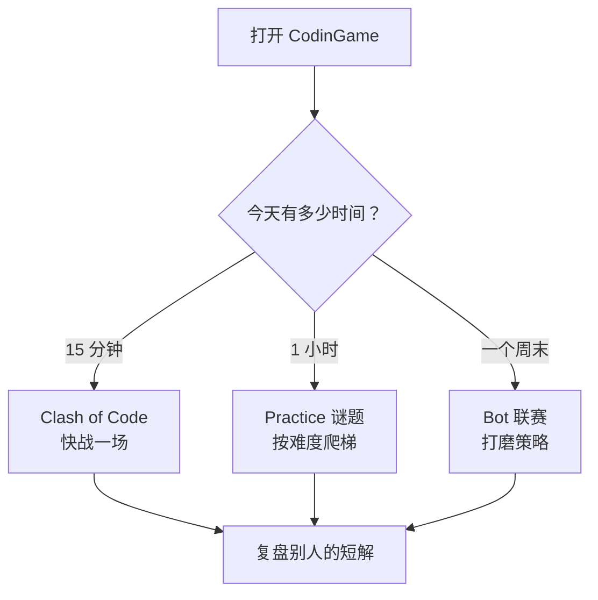

# 第9章：CodinGame 与 Advent of Code——算法天梯与编程日历

> [!TIP] Part 4: 进阶挑战篇
> 终章冲刺：前面九章的游戏都把编程包在剧情与图形里，本章两款直接以「写代码」为核心玩法——它们提供的是普通刷题平台没有的两样东西：一个有对手的天梯，一个有日期的日历。

刷题的最大敌人不是难度，是**没有对手、没有节点**：LeetCode 的题永远在那里，所以永远「明天再刷」。CodinGame 用实时对战把对手装进来，Advent of Code 用降临历把节点装进来。两款都是免费，一个练对抗中的算法手感，一个练节日里的工程耐力——配合食用，就是本教程给你的最后一套训练系统。

它们也正好补齐本教程工具箱的最后两块拼图：前九章练的是「环境与工具」（终端、Git、正则、SQL、汇编），本章练的是「算法与手感」——而这两层合在一起，才是完整的程序员训练闭环。

## 9.1 CodinGame：把刷题机变成游戏引擎

CodinGame（codingame.com）是一个法国出品的免费平台，它对「刷题」做了三重改造：题目有**可视化画面**（你的代码逻辑驱动精灵移动、炮弹飞行）、支持 **25+ 种编程语言**（Python、JavaScript、Go、Rust、甚至 Pascal 与 Brainfuck）、且大量玩法以**对战**呈现。语言自由带来一个隐藏福利：**它是成本最低的「新语言试驾场」**——想试试 Rust 手感？不用配环境，打开浏览器选 Rust 写两道 easy，五分钟知道合不合身。三种模式构成它的骨架：

| 模式 | 玩法 | 适合场景 |
| ---- | ---- | ---- |
| Practice 谜题 | 单人闯关，按 easy 到 very hard 分级 | 系统练算法 |
| Clash of Code | 快速对战：同一道题多人比拼速度或代码长度 | 碎片时间热身 |
| Bot 编程联赛 | 写代码控制单位与别人的 bot 对战 | 深度策略编程 |

Practice 模式的最大差异化是**看得见**：一道「骑士绕过守卫取宝物」的题，你的 BFS（Breadth-First Search，广度优先搜索）写对了，画面上骑士真的会沿最短路径走过去；写错了，骑士会撞墙给你看。抽象算法与具象画面的这条连线，对「背过模板但从来没感觉」的人是解药。

Practice 的难度梯也从「几乎不会编程」一路排到「需要精巧算法」：easy 段的题只考输入输出与循环，medium 段开始出现图与贪心，hard 以上则要组合多种算法并优化常数。每个难度段内题目按知识域打标签，可以像点菜一样专项补强——「这周专攻图论」在 Practice 里是一个可执行的计划，而不是一句口号。三个模式的选用可以画成一条决策路径：



## 9.2 第一场 Clash of Code：对抗式刷题的滋味

Clash of Code 的房间很小（三五人），流程极快：进房 → 同一道题弹出 → 计时开始 → 交卷。赢法分三种模式：**最快**（第一个写对者胜）、**最短**（字符数最少者胜）、**反向**（最长的正确代码胜）。前两种好理解，反向模式值得咂摸——它逼你把一行能干完的事拆成十行冗余代码，荒诞之余恰恰训练了「代码与解题是两件事」的意识。一场三五分钟，连打五场正好是一杯咖啡的时间。

看一道典型的 easy 快战题：**给定一行小写字母，输出出现次数最多的字符（并列取最先出现的）**。第一反应的解法长这样：

```python
line = input()
best_char, best_count = '', 0
for c in line:
    count = line.count(c)
    if count > best_count:
        best_char, best_count = c, count
print(best_char)
```

写得对，但在「最短代码」模式下它太胖了。快战结束后的复盘界面会展示**全场所有人的代码**——你会看到有人一行搞定：

```python
print(max(input(), key=input().count))
```

这行代码同时用了 `max` 的 key 参数与 `str.count`，优雅且正确。Clash of Code 真正的价值就在赛后这五分钟：**同一道题的人类解法画廊**。只刷 LeetCode 你只能看题解（编辑体），在这里你看的是活人现场写的代码（口语体）——短解法里那些「哦还能这样」的时刻，是纯刷题平台给不了的。

快战还有一层隐藏训练：**读题速度**。对战模式下题目描述往往一句话，全靠你秒懂边界条件（空输入？并列怎么办？大小写敏感吗？）——没读懂就交卷，错的不是算法是审题。举个例子，同样是「出现次数最多的字符」，两种理解会给出不同答案：

```text
输入:  abba
理解 A: 并列时取最先出现 → 输出 a
理解 B: 并列时任取     → 可能输出 b

一次快战输掉，八成不是代码慢，是这一步想岔了。
```

这个能力在真实工作里对应「把模糊需求转成明确规格」，它比算法本身更值钱。

## 9.3 Bot 联赛：会下棋的代码

Bot 模式是 CodinGame 的招牌：平台定期举办联赛（League），你写一个 bot（机器人程序），与全球玩家的 bot 在同一张地图上对战，赢了升段——从木 league（Wood）一路打到传奇（Legend）。bot 的代码结构高度固定：

```python
import sys

while True:
    inputs = sys.stdin.readline().split()   # 读当前回合的游戏状态
    my_pos = (int(inputs[0]), int(inputs[1]))
    enemy_pos = read_enemy()

    # 决策：最朴素的贪心——朝最近的资源移动
    target = nearest_resource(my_pos)
    print(f"MOVE {target[0]} {target[1]}")  # 输出行动指令
```

每回合「读状态 → 决策 → 输出指令」的循环，就是一个最小的人工智能决策器。它还有一条真实的约束：**每回合有思考时间上限**（通常几十到一百毫秒量级，超时判负）——这意味着 bot 编程第一次让「算法复杂度」从笔试题变成了生死线：暴力枚举在评测机上一超时，你的 bot 当场瘫痪。很多人正是在 bot 联赛里第一次「真心实意」地关心复杂度，因为代价是看得见的败北。

它的进化路线清晰得像一部游戏史：

```text
  木 league：    贪心——每次挑眼前最近/最优的一步
     ↓
  银 league：    评估函数——给局面打分，挑分高的行动
     ↓
  金 league：    模拟推演——向前看 N 步，避开会输的分支
     ↓
  传奇 league：  搜索剪枝 + 对手建模——你在写一个简化版的 AlphaGo
```

段位与策略的对应关系，放进表里看得更清楚：

| 段位 | 典型策略代码 | 核心思想 |
| ---- | ---- | ---- |
| 木 | 挑最近的资源走过去 | 贪心（greedy） |
| 银 | 距离 × 收益 × 危险度加权打分 | 评估函数 |
| 金 | 把未来 2 回合的局面都推演一遍再选 | 前瞻模拟 |
| 传奇 | 对候选行动做搜索树，剪掉必输分支 | 搜索与剪枝 |

以银 league 的评估函数为例，所谓「打分」落地成代码就是几行算术：

```python
def score(my_pos, resource_pos, enemy_pos):
    gain = value_of(resource_pos)             # 这个资源值多少分
    dist = manhattan(my_pos, resource_pos)    # 要走多远
    risk  = 100 if near(enemy_pos, my_pos) else 0   # 敌人在附近吗
    return gain - dist * 2 - risk             # 综合打分

best = max(resources, key=lambda r: score(my_pos, r, enemy_pos))
```

从「挑最近的」到「算综合分」，代码量的差别只有十几行，但段位差一整级——**策略升级往往不是推倒重来，而是把决策依据从单因素换成多因素加权**。这个领悟放在产品排序、推荐系统、风控打分上同样成立。

你不需要懂得多聪明才能开始：木 league 用贪心就能赢一片，然后每一层段位会自然逼你升级一层策略。等哪天你写出了「向前模拟两回合、给每种局面打分」的 bot，回头看会觉得陌生——**你已经在写博弈树搜索（Minimax）的朴素版了**，而很多人是在大三的人工智能课上第一次见到它，且是背公式。

> [!NOTE] bot 打不过就抄作业，这不是作弊
> CodinGame 每场对局结束后可以看到对手 bot 的源代码（自愿公开的部分），社区里更有大量顶级选手公开的策略博客。「先跑通自己的贪心版，再对照高段位代码理解差距在哪」是公认的进步最快路径——和第7章说的「百分位直方图」一样，看见高手长什么样，才知道往哪里改。

## 9.4 Advent of Code：全球同步的编程降临历

第二款游戏干脆不要对手了——Advent of Code（adventofcode.com，社区简称 AoC）是一个**按日历发题**的免费活动：每年 12 月 1 日到 25 日，每天零点（美国东部时间）准时开放一扇「日历门」，门后一道由故事串起来的编程题。北京时间是**下午 1 点开门**——对国内玩家来说，正好是午休掏出电脑的时间，这个时差堪称友好。

规则设计很讲究：**每天两问，第二问在你答对第一问后才揭晓**——而第二问往往会反转条件（「现在要找的是三个数」「数据规模扩大一万倍」），逼你推翻刚才的暴力解法重新设计。两问连击的结构，把「重构」变成了每天的必修课。去年（2025 年）的 25 扇门 × 每天 2 问 = 50 道题，是这个星球上质量最高的免费算法题集之一。

题目形态也和常见平台不同：**故事包装 + 文本输入 + 数字答案**。每年一条原创故事线（精灵、雪橇、潜水艇……），题目文字动辄半页，答案通常是提交一个数字而非代码——语言完全自选，甚至有人用 Excel 和 APL 解题。这意味着 AoC 考的不是「背模板」，而是两件最朴素的事：**读懂长题面**与**把想法变成能跑的代码**。它和 LeetCode 的定位差异值得一张对照表：

| 维度 | Advent of Code | LeetCode |
| ---- | ---- | ---- |
| 题目形态 | 长故事 + 文本输入 + 数字答案 | 短描述 + 函数签名 + 判题机 |
| 评判标准 | 你的答案对不对（语言不限） | 算法复杂度（常卡时限） |
| 节奏 | 日历驱动，每年 25 天 | 自由刷 |
| 侧重的成长 | 读题、工程组织、需求演进 | 算法与数据结构的应试强度 |
| 最佳用途 | 年度例行训练 + 团队活动 | 求职备战 |
| 社区生态 | 复盘博客与全家桶代码仓库 | 题解站与面试经验帖 |
| 计分方式 | 私有排行榜按分钟排名 | 按题目通过数与竞赛 rating |

参与姿势有三种，各自成立：

| 姿势 | 玩法 | 适合人群 |
| ---- | ---- | ---- |
| 同步派 | 12 月每天 13:00 准时解题，追全球排行榜 | 已有算法底子，找刺激 |
| 补课派 | 次年任意时间刷往年题（2015 至今全部开放） | 想系统涨工程手感 |
| 自选派 | 只挑感兴趣的年份与难度 | 时间紧张 |

> [!TIP] 12 月之前把脚手架搭好
> 同步派每年翻车的头号原因不是题目难，而是**仪式摩擦**：语言没定、项目没建、模板没写，第一天的 13:00 全花在 mkdir 上。建议 11 月底前做完三件事——定一个顺手的语言（想换语言的年份尤其要提前）、建好「读输入 → 跑样例 → 输出答案」的骨架模板、把往年第一天刷一遍当演习。开赛后你要做的只有一件事：13:00 读题。

**2026 年 12 月 1 日，第 12 届 AoC 开赛**——你读到本章时距离开门很可能只剩几周，这本身就是最好的行动理由。放进第0章的特工晋级主线：Bandit 是新兵营、Zachtronics 是特种装备训练，AoC 就是年度大演习——每年 12 月，全体「特工」集中拉练一次，雷打不动。同步派的仪式感值得单独描述：全球几十万人同一时刻读同一道题，私有排行榜（private leaderboard，建一个 25 人的小房间）里同事与网友的完成时间以分钟计刷新，社区里 13:05 就有人贴出解题思路。这种「全球同题」的节日感，是刷题平台永远给不了的。

## 9.5 AoC 实战方法论：拿一天题做完整流程

以补课派刷一道「往年第 1 天」的典型题为例（AoC 的第一天历年都是热身难度），演示每天两问的标准打法。题目大意：从输入文件的一串数字里，找出**相加等于 2020 的两个数**，输出它们的乘积。

第一步永远是**手算小样例**，别急着写代码：

```text
输入:  1721
      979
      366
      299
      675
      1456

手算:  1721 + 299 = 2020  → 找到了
输出:  1721 * 299 = 514579
```

第二步写**暴力但正确**的版本，第一时间把第一问的分拿到手：

```python
nums = [int(x) for x in open("input.txt").read().split()]
for i in range(len(nums)):
    for j in range(i + 1, len(nums)):
        if nums[i] + nums[j] == 2020:
            print(nums[i] * nums[j])
```

顺带一提，AoC 每天的第一道工序其实是**解析输入**——题目给的输入文件格式千奇百怪（一行一个数、逗号分隔、坐标网格、甚至二维字符画），把原始文本变成顺手的数据结构占掉每天前 20 分钟。这门手艺没有捷径，全靠字符处理的积累，本站[《Python 教程》](/python/ch09)第九章的字符串方法在这里全部派上用场：`split`、`strip`、切片、`zip` 配对，都是日历门后的常客。

第三步，第二问揭晓：「找**三个**数」。三重循环还能跑，但你会本能地想重写——这正是 AoC 的设计意图。固定一个数，剩下两个数用集合把查找降到线性：

```python
from itertools import combinations

for a, b, c in combinations(nums, 3):
    if a + b + c == 2020:
        print(a * b * c)
        break
```

也可以写得更聪明：把两数之和缓存进字典，第二问退化成「查表」。**同一个答案的两种写法，性能差出一个数量级**——第二问的设计目的就是逼你完成这次跳跃。

「先暴力拿分、再按第二问重构」这套节奏走顺之后，你会发现它就是**软件开发的微缩模型**：先交付能跑的，再面对变化的需求演进代码。AoC 每天都在给你做一次这样的小规模演练，25 天下来，「需求变了重写核心逻辑但不焦虑」的心理素质就练出来了。

每天的时间账也要算清楚，别被 13:00 的开门声绑架：

```text
  13:00 - 13:20   读题 + 手算样例（输入长什么样？答案要求什么？）
  13:20 - 13:50   写暴力解，提交第一问
  13:50 - 14:00   喝口水，猜第二问会怎么反转
  14:00 - 14:40   第二问揭晓，按新条件重构
  14:40 - 15:00   看排行榜/复盘一条别人的解法
```

工作日能全跟的人是少数——只跟前 50 分钟、把复盘挪到晚上，是完全体面的玩法。AoC 的日历设计从不要求全勤：**它奖励的是连续接触，不是完美主义**。

想玩得更工程化，还有一条进阶纪律：**每天开题前先搭测试**。把题目给的样例输入与答案写成断言，再写正式解法——本站[《Python 教程》](/python/ch20)第二十章的 pytest 正好派上用场：

```python
def test_day1_part1():
    assert part1(SAMPLE_INPUT) == 514579   # 题面给的样例就是免费测试用例
```

AoC 社区里高手们的仓库清一色是「测试先行」结构，跟风一次，受益十年。

## 9.6 迁移：天梯与日历各带一件行李

本章两款游戏，各有一件行李要带走：

1. **从 CodinGame 带走「对抗下的冷静」**。计时、对手、升段，全是压力源；练的是「高压下先审题再动手」。把这个习惯带回 code review 与线上事故处理——慌乱时的第一反应永远是先看清楚再敲键盘。
2. **从 AoC 带走「日历节奏」**。每天 2 小时、连续 25 天的中等强度长跑，是所有学习项目的节奏原型。学任何新框架、读任何大部头，都可以用「AoC 节奏」切成 25 天。这呼应了第3章的间隔重复：**难度中等 + 高频接触 + 有节点感**，比周末突击十小时有效得多。
3. **把私有排行榜变成团队资产**。在公司或朋友群里建一个 AoC leaderboard，12 月每天午休对答案——这是成本最低的团队技术氛围建设，比团建省钱比周会有趣。
4. **给明年的自己留复盘**。12 月 25 日打完收工，写一篇「今年用哪个语言、卡在哪天、学到了什么」——AoC 社区的复盘博客是一个宝藏体裁，写的人涨功力，读的人捡攻略。顺手把当年的解题仓库用 Git 管起来（怎么管理见第8章），明年 12 月对着去年的代码重刷同一天的题，进步肉眼可见。

## 本章小结

- CodinGame 的三重改造：可视化画面驱动算法、25+ 语言随便选、对战模式内置对手——刷题从此不孤独。
- Clash of Code 的真价值在赛后复盘：全场活人代码画廊，比编辑体题解更鲜活；快战还练审题速度。
- Bot 联赛的段位进化路线（贪心 → 评估函数 → 模拟推演 → 搜索剪枝）就是一部简明博弈论人工智能史，木 league 的贪心人人能写。
- Advent of Code 用降临历把刷题装进日历：25 天 × 2 问，第二问必然反转条件，重构是每日必修。
- 2026 年 12 月 1 日第 12 届开赛，北京时间 13:00 开门——读到本章时行动窗口就在眼前。
- 每日两问的标准节奏：手算样例 → 暴力拿分 → 按第二问重构，这是软件开发的微缩模型。
- pytest 测试先行、私有排行榜组队、复盘博客——AoC 的进阶玩法都比刷题本身更值钱。
- 本章的行李：对抗下的冷静（CodinGame）与日历节奏（AoC），一个管战斗，一个管长跑。
- 语言试驾、团队排行榜、复盘博客——两款游戏的衍生玩法，有时比主线题目本身更值钱。

**下一章预告**：全书最后一章是毕业考验，也是一次「守门人测试」——第10章走进 picoCTF 与 OverTheWire Natas，站在攻击者的视角看一遍自己每天写的 Web 代码，然后带着安全意识毕业。

---
