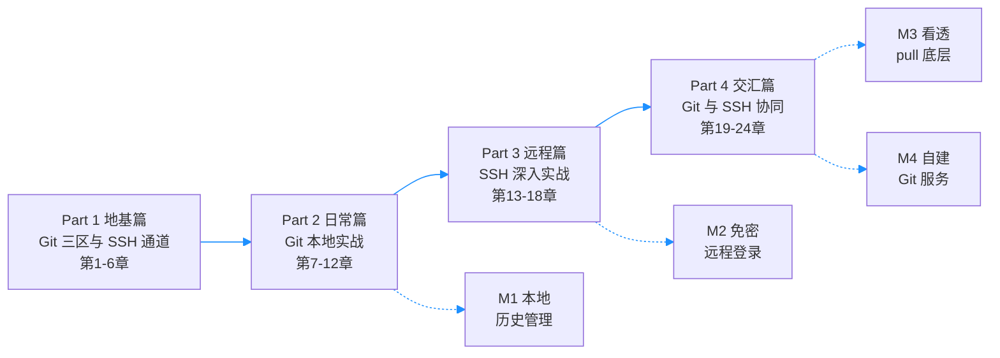

# Git 与 SSH 完全教程

> 一句话副标题：本书解决两个根本问题——「改了什么」与「怎么安全送达」。Git 管内容，SSH 管通道，从第一次 commit 一路讲到自建 Git 服务器。

---

## 目录

### Part 1: 基础概念篇（地基篇）

- [第1章：为什么需要版本控制](./ch01.md)
- [第2章：Git 安装与三层配置](./ch02.md)
- [第3章：三个区域：工作区、暂存区与版本库](./ch03.md)
- [第4章：SSH：一条加密的远程通道](./ch04.md)
- [第5章：公钥与私钥：不传秘密的认证](./ch05.md)
- [第6章：known_hosts 与双向认证](./ch06.md)

### Part 2: Git 本地实战篇（日常篇）

- [第7章：时光机：log、diff 与 reflog](./ch07.md)
- [第8章：悔棋三件套：restore、reset、revert](./ch08.md)
- [第9章：分支的本质是指针](./ch09.md)
- [第10章：merge 与 rebase：分叉的两种结局](./ch10.md)
- [第11章：stash、tag 与 cherry-pick](./ch11.md)
- [第12章：.gitignore 与仓库卫生](./ch12.md)

### Part 3: SSH 深入实战篇（远程篇）

- [第13章：~/.ssh/config：别名与多账户](./ch13.md)
- [第14章：密钥管理：agent 与 passphrase](./ch14.md)
- [第15章：端口转发：-L、-R、-D](./ch15.md)
- [第16章：跳板机：ProxyJump](./ch16.md)
- [第17章：sshd 服务端：开放与加固](./ch17.md)
- [第18章：排错手册：Permission denied 的真相](./ch18.md)

### Part 4: 协同交响篇（交汇篇）

- [第19章：git pull 时究竟发生了什么](./ch19.md)
- [第20章：GitHub：登记公钥到多人协作](./ch20.md)
- [第21章：自建迷你 GitHub：裸仓库](./ch21.md)
- [第22章：团队工作流与服务端钩子](./ch22.md)
- [第23章：部署衔接：从 push 到上线](./ch23.md)
- [第24章：安全复盘与综合排错](./ch24.md)

---

## 心智模型

### 一、核心模型：一个公式

初学者最常见的困惑，是把 Git 和 SSH 搅成一团：以为 push 是 SSH 的功能，以为 GitHub 登录是 git 在加密，分不清「远程仓库」和「远程登录」。本书用一条主线把它们彻底切开：

```text
┌──────────────────────────────────────────────────┐
│  Git  管「内容」：改了什么、谁改的、怎么回退          │
│  SSH  管「通道」：你是谁、链路加密、怎么送达          │
│                                                  │
│  远程协作 = 把 Git 的内容装进 SSH 的通道            │
└──────────────────────────────────────────────────┘
```

这条公式展开就是一张分层图，全书 24 章全部挂在这张图上：

```text
      你的电脑                             远程服务器
┌──────────────────┐               ┌──────────────────┐
│ git 客户端        │    git 协议    │ git 服务端        │
│ 管内容：提交/分支  │ ◄═══════════► │ upload-pack 等    │
├──────────────────┤               ├──────────────────┤
│ ssh 客户端        │  ssh 加密通道  │ sshd             │
│ 管通道：认证/加密  │ ◄═══════════► │ 管认证与加密       │
├──────────────────┤               ├──────────────────┤
│      TCP :22     │ ◄───────────► │     TCP :22      │
└──────────────────┘               └──────────────────┘
```

逐层解释：

- **Git 层**：不理解它，你会怕分支、怕冲突、怕丢代码。Part 2 用六章拆掉这层恐惧。
- **SSH 层**：不理解它，你配不好免密、查不了故障、看不懂指纹告警。Part 3 会把你换到服务端视角，反向理解客户端的一切行为。
- **交界处**：`git pull` 从回车到合并，中间到底执行了什么？这是第 19 章的解剖台——理解了交界处，前两部分的知识才算焊在一起。

每个 Part 在这张图上的位置一目了然：

| Part | 对应图层 | 学完你能做到 |
|------|---------|-------------|
| Part 1 地基篇 | 三区模型 + 通道概念 | 看懂每次提交发生了什么、连接如何建立 |
| Part 2 日常篇 | Git 层 | 不查文档完成分支、合并、撤销全套操作 |
| Part 3 远程篇 | SSH 层 | 配好免密、隧道与跳板，能从两端排错 |
| Part 4 交汇篇 | 交界处 | 看透 pull 底层，自建 push 即部署的 Git 服务 |

### 二、易混概念：一表分清

这八组概念覆盖了初学者提问率的八成。现在先混个脸熟，不必强记，对应章节会逐一拆解；日后忘了也可以随时回来查——这张表就是全书最好的复习索引：

| 概念 A | 概念 B | 一句话区分 | 详见 |
|--------|--------|-----------|------|
| git pull | git fetch | fetch 只取回不合并，pull = fetch + 合并 | 第19章 |
| merge | rebase | merge 保留分叉历史，rebase 把历史拉直 | 第10章 |
| reset | revert | reset 抹掉历史，revert 追加一条反向提交 | 第8章 |
| 公钥 | 私钥 | 公钥是锁（随便给人），私钥是钥匙（绝不出门） | 第5章 |
| SSH | HTTPS | 都是加密通道，但协议自成体系，互不相通 | 第4章 |
| 裸仓库 | 工作仓库 | 裸仓库只有版本库没有工作区，专做中转站 | 第21章 |
| known_hosts | authorized_keys | 前者记「我信过哪些服务器」，后者记「谁能进这台机器」 | 第6、17章 |
| git clone | git pull | clone 首次取回全仓，pull 更新已有仓库 | 第20章 |
| ssh-keygen | ssh-copy-id | 前者造钥匙，后者把公钥送上服务器 | 第5章 |
| ssh-keygen | ssh-agent | 前者造钥匙，后者替你揣着钥匙免输密码 | 第14章 |

### 三、两张命令地图

学完本书，你应该能在脑中画出两张地图。第一张是 Git 的「三区地图」——所有 git 命令都是对象在三区之间的搬运工：

```text
 工作区              暂存区               版本库              远程
(Working Dir)     (Staging Area)     (Repository)      (Remote)
    │                  │                  │                 │
    │ ── git add ────► │ ── git commit ─► │ ── git push ──► │
    │                  │                  │                 │
    │ ◄─ git restore ─ │ ◄─ git reset ─── │ ◄─ git fetch ── │
    │                  │                  │                 │
```

第二张是 SSH 的「能力地图」——ssh 远不止「远程登录」一件事：

| 能力 | 代表命令 | 典型场景 |
|------|---------|---------|
| 远程登录 | `ssh user@host` | 管理云服务器 |
| 免密认证 | `ssh-keygen` + `ssh-copy-id` | 每天登服务器 20 次的人 |
| 传文件 | `scp` / `rsync` | 备份配置、同步日志 |
| 端口隧道 | `ssh -L` / `-R` / `-D` | 访问只听内网的数据库 |
| 跳板穿透 | `ssh -J`（ProxyJump） | 目标机没有公网 IP |
| 服务端 | `sshd` + `sshd_config` | 开放并加固远程入口 |

顺手记下全书反复出现的「门牌号」——路径与端口：

| 路径 / 端口 | 归属 | 作用 |
|------------|------|------|
| `~/.ssh/id_ed25519` | 客户端 | 你的私钥（绝不出门） |
| `~/.ssh/id_ed25519.pub` | 客户端 | 你的公钥（随便发） |
| `~/.ssh/config` | 客户端 | 连接别名与参数 |
| `~/.ssh/known_hosts` | 客户端 | 你信任的服务器指纹 |
| `~/.ssh/authorized_keys` | 服务端 | 谁有权进入这台机器 |
| `/etc/ssh/sshd_config` | 服务端 | sshd 的规矩 |
| `/srv/git/` | 服务端 | 本书自建裸仓库的约定位置 |
| 22 | SSH | 默认端口 |
| 9418 | git:// | 明文 git 协议端口（已淘汰） |

### 四、贯穿全书的主线场景：云笔记

本书所有例子围绕同一个项目展开：**云笔记**——一个从单人玩具长成三人团队产品的笔记应用。它的三次危机，恰好对应 Git 与 SSH 的三类需求，也对应本书的四个 Part：

| 阶段 | 剧情危机 | 规模 | 催生的学习需求 | 对应章节 |
|------|---------|------|---------------|---------|
| 阶段 1 | 单机开发，一次误删差点报废一个月的工作 | 仓库 3MB，50 次提交 | 本地版本管理 | 第1-12章 |
| 阶段 2 | 笔记本 + 台式机双机写码，U 盘拷目录拷出灾难 | 仓库 80MB，2000 次提交 | SSH 免密、自建服务器 | 第13-18、21章 |
| 阶段 3 | 3 人团队协作，push 后自动上线 | 仓库 1.2GB（含图片素材），12000 次提交 | GitHub 工作流、钩子、安全 | 第19-20、22-24章 |

三次危机各有一个名场面，读正文时你会反复遇到：

- **危机一（第 12 周深夜）**：一次 `rm -rf` 手滑，两个月的笔记同步功能只剩回收站里的一声抱歉——这场事故催生了「小步提交」的肌肉记忆。
- **危机二（第 20 周周末）**：U 盘里的旧代码覆盖了笔记本上两天的工作——U 盘从此退休，裸仓库上岗。
- **危机三（第 35 周早晨）**：上线十分钟页面全白，一边回滚一边找原因——从此 push 与部署之间有了自动化和回滚预案。

为什么主角是一个笔记应用，而不是电商或博客？因为笔记项目人人写过：它足够简单——简单到你不必理解业务就能聚焦工具本身；又足够真实——有图片素材、有多端同步、有上线部署，恰好把 Git 与 SSH 的全部能力用一遍。

为保证全书举例自洽，统一采用以下设定（各章不再重复交代）：

- 项目本地路径：`~/cloudnote`
- 你的云服务器：`203.0.113.10`，登录用户名 `wang`
- GitHub 账号：`cloudnote-dev`，仓库名 `cloudnote`
- 自建裸仓库路径：`/srv/git/cloudnote.git`

### 五、建议学习路径：用这个模型去学

**完整路径**（约 5-7 天）：按 Part 顺序通读，每章实验必须动手做。Git 与 SSH 都是肌肉记忆型技能——只读不做等于没学，一个下午的实操胜过三遍通读。

**最小路径**（约 1 天，先能干活，再回头补全）：

1. 第1-3章：装好 Git，理解三区，完成第一次提交
2. 第5章：生成密钥对，建立「私钥绝不出门」的观念
3. 第9章：分支就是指针，从此敢开分支
4. 第13-14章：配好 config 与 agent，实现免密登录
5. 第19-20章：看懂 pull 的底层，用 GitHub 完成协作

最小路径刻意跳过了 merge 与 rebase（第10章）、端口转发（第15章）——它们重要，但不是第一天的必需品。另外，Git 与 SSH 两条线在前三篇基本独立：急用远程服务器的读者，可以从第4章直接读起，回头再补 Git 本地篇。

**四个里程碑自检**——过不了就回炉对应章节：

| 里程碑 | 通过标准 | 位置 |
|--------|---------|------|
| M1 | 不查文档完成：建分支、改代码、合并、撤销一次误操作 | Part 2 末 |
| M2 | 10 分钟内给一台新服务器配好免密登录 | Part 3 末 |
| M3 | 口头完整复述 `git pull` 从回车到合并的全过程 | 第19-20章 |
| M4 | 从零搭出「push 即部署」的私有 Git 服务 | Part 4 末 |

里程碑不是考试，而是自检信号：M1 卡住说明 Part 2 的实验做得太少，M3 卡住说明第 19 章需要重读。每个 Part 读完，回到这张表打一个勾。

**实验环境三选一**，按预算和动手意愿挑一个：

| 方案 | 成本 | 优点 | 缺点 |
|------|------|------|------|
| 云服务器（推荐） | 轻量云约每月十几元 | 全书 100% 实验可做，贴近真实运维 | 需要一点开通耐心 |
| 本地虚拟机（VirtualBox 装 Ubuntu） | 免费 | 随意折腾、快照可回滚 | 与真实公网环境略有差异 |
| WSL2 | 免费 | Windows 内零成本起步 | sshd 与端口转发实验受限 |

实验环境建议：一台 Linux 云服务器（或虚拟机、WSL），加上本地任意系统即可覆盖全书 90% 的实验。纯 Windows 下所有 Git 命令在 Git Bash 中执行。

三选一没有标准答案：想认真学一遍服务端就上云服务器，只想先跑通本地 Git 就选虚拟机或 WSL2。后续章节的实验都会标注所需环境，需要服务器的实验集中在 Part 3 与 Part 4。

如果全书只让你记住一句话，就是心智模型里那条公式：**Git 管内容，SSH 管通道**。遇到任何困惑，先问自己「我卡在内容层还是通道层」，答案往往立刻清晰。

## 六、开始之前的三个约定

**约定一：平台差异只此一处交代。** 全书命令默认在类 Unix 环境（Linux 服务器、macOS 或 Windows 上的 Git Bash）执行。Windows 用户请安装 Git for Windows 并全程使用 Git Bash，而非 CMD 或 PowerShell——可避开九成的换行符与引号问题（详见第2章）。

**约定二：代码块的展示格式。** 示例省略 `$` 提示符；命令输出单独成块；需要 root 权限时显式写 `sudo`。所有需要动手的实验都用「实验」小节标出，建议边读边做。

**约定三：不重复造轮子。** 底层网络原理不在本书展开，需要时直接送你去站内对应章节：

| 想深入的主题 | 站内去处 | 关联章节 |
|-------------|---------|---------|
| TLS、证书体系、协议分层 | 网络协议完全教程 | 第4、5章对比 SSH 时 |
| 基础 shell 与服务器操作 | Linux 命令行完全教程 | 第17章 sshd 服务端 |
| CI/CD 流水线 | GitHub Actions 教程 | 第23章部署衔接 |
| 服务器容器化 | Docker 完全教程 | 第23章部署运行环境 |

以上约定读一遍即可，其余章节默认你已知悉。环境就绪后，翻到下一章——先回答那个最根本的问题：为什么需要版本控制。

---

最后是全书的知识地图。四个 Part 层层递进，每个 Part 末尾对应一个里程碑（虚线表示「读完该 Part 时应通过对应里程碑」）：


