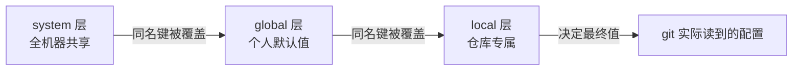

# 第2章：Git 安装与三层配置

> [!TIP] Part 1: 基础概念篇（地基篇）
> 本篇要立起两根地基：Git 的「三区」与 SSH 的「通道」。本章是 Git 地基的第一站——把 Git 装好、配好。上一章末尾你被 `Please tell me who you are` 拦在第一次提交的门外，谜底就在本章。

上一章你跑通了前三步：建仓库、写文件、`git add`，却在第四步 `git commit` 被 Git 一句 Please tell me who you are 拦下——它要知道这次提交署的是谁的名。这个拦截背后，藏着 Git 一个最容易被小看、又几乎决定你日常体验的设计：配置系统（Configuration）。

别急着把「配置」想成流水账。它管的三件事，恰好对应你未来最常见的三类问题：你是谁（署名与邮箱，决定 GitHub 认不认你的提交）、文件怎么进仓库（Windows 换行符，新手第一大坑）、命令打多短（别名，把三连击练成一次回车）。本章掰开三层配置抽屉，最后用一个实验让你亲眼看见「就近覆盖」四个字如何生效。

## 2.1 安装与验证

三个系统三张票，先落座再谈艺：

| 操作系统 | 安装方式 | 备注 |
|---------|---------|------|
| Windows | Git for Windows 安装包（gitforwindows.org） | 自带 Git Bash，本书所有命令默认在这里执行 |
| Ubuntu / Debian | `sudo apt install git` | Ubuntu 24.04 仓库中版本为 2.43.x，够用 |
| macOS | `brew install git`（需先装 Homebrew） | 会覆盖系统自带的旧版 Apple Git |

三句话展开：

- **Windows 只推荐 Git for Windows**。它不是「Git 加个界面」那么简单：安装包同时塞进了完整的 bash 环境、OpenSSH 客户端、scp 等工具——Part 3 的 SSH 大戏全部靠它开场。装完点开开始菜单，找到「Git Bash」，黑底白字（或白底黑字）的终端就是你未来一个月的主战场。
- **Ubuntu 一条命令**：`sudo apt install git`，包管理器自动解决一切。
- **macOS 用 Homebrew 装**。系统其实自带一份 git（随 Xcode 命令行工具而来），但版本常年落后，`brew install git` 装的新版会排在 PATH 前面接管大局。

验证安装只需一条命令：

```bash
git --version
```

三个平台的典型输出：

```text
Windows（Git Bash）：  git version 2.43.0.windows.1
Ubuntu 24.04：        git version 2.43.0
macOS（Homebrew）：    git version 2.45.2
```

只要能看到版本号，安装就算成功。顺手记住这本书的环境底线：

> [!NOTE] 版本焦虑是伪问题
> 本教程用到的所有特性在 git 2.30 之后就已齐备，你今天装到的版本远新于此。真正要警惕的不是「版本不够新」，而是网上陈年教程里已经改动的旧行为——遇到对不上的地方，先用 `git <命令> --help` 查本机官方文档。

## 2.2 三层配置体系

先想一个真实场景：你在公司写代码，邮箱是 wang@company.example；业余维护云笔记，邮箱是 wang@example.com。Git 的提交会把邮箱永久写进历史，两个身份不能混。再想另一个场景：全机器共享的偏好（比如编辑器），不想在每个仓库里重复配一遍。

一层配置显然不够，Git 给了三层：

| 层级 | 写入参数 | 作用范围 | 典型文件路径 |
|------|---------|---------|-------------|
| 系统层（system） | `--system` | 这台机器上的所有用户 | Linux：`/etc/gitconfig`；Windows：Git 安装目录下 `etc/gitconfig` |
| 用户层（global） | `--global` | 当前用户的所有仓库 | `~/.gitconfig`（Windows 为 `C:/Users/wang/.gitconfig`） |
| 仓库层（local） | `--local`（缺省值） | 仅当前仓库 | `~/cloudnote/.git/config` |

三层的关系像三个抽屉，从公共到私有：

```text
        优先级：local > global > system
┌────────────────────────────────────┐
│ system  /etc/gitconfig             │
│         机器级默认，极少手动动它      │
├────────────────────────────────────┤
│ global  ~/.gitconfig               │
│         你的个人习惯，90% 配置写这里  │
├────────────────────────────────────┤
│ local   .git/config                │
│         仓库专属，覆盖上面两层        │
└────────────────────────────────────┘
```

规则一句话说清：**同名键就近覆盖，不同名键合并共存**。仓库层写了 `user.email`，用户层的同名值就被压住；用户层配了 `alias.lg` 而仓库层没提，别名照样生效。这就是「就近覆盖」（nearest wins）原则。

怎么亲眼验证？Git 提供了一个自带「出身证明」的列表命令：

```bash
git config --list --show-origin
```

在云笔记仓库里执行，输出类似（节选）：

```text
file:C:/Program Files/Git/etc/gitconfig   core.autocrlf=true
file:C:/Users/wang/.gitconfig             user.name=wang
file:C:/Users/wang/.gitconfig             user.email=wang@example.com
file:.git/config                          core.repositoryformatversion=0
```

每一行开头的 `file:` 直接告诉你这个值来自哪个文件。再配一个 `--show-scope` 参数（git 2.8 起支持），还能把 system、global、local 的归属直接标在行首，排查时更直观：

```bash
git config --list --show-origin --show-scope
```

> [!TIP] 排配置问题的三板斧
> 记住三个查询姿势：`git config user.name` 看最终生效值；`git config --show-origin --get user.name` 看值从哪来；`git config --list --show-origin --show-scope` 全量列出分层归属。日后遇到「配置改了却不生效」，这三板斧一砍就见底。

最后补一张覆盖方向的示意图，它就是本节全部逻辑：



## 2.3 必配三件套

三件套是：`user.name`、`user.email`、`core.editor`。前两个回答「你是谁」，第三个回答「Git 让你写提交说明时用哪个编辑器」。

```bash
git config --global user.name "wang"
git config --global user.email "wang@example.com"
git config --global core.editor "code --wait"
```

三个注意点：

- **`user.name` 是显示名，不是登录名**。它可以是中文、英文、外号，只负责在历史里展示；同一名字可以出现在无数台机器上，Git 不做任何校验。
- **`user.email` 才是身份的锚点**。每次提交，name 和 email 都会被原样写进快照；GitHub 正是靠邮箱把提交挂到 `cloudnote-dev` 账号名下，贡献统计才认账。想保护隐私可以用 GitHub 提供的 noreply 邮箱（形如 `1234567+cloudnote-dev@users.noreply.github.com`）。
- **不加 `--global` 就写进仓库层**。这个细节现在只留个印象，2.6 的实验会把它变成你手里的开关。

`core.editor` 值得多说两句。不配置时，Git 需要「打开编辑器写说明」的场合（比如 `git commit` 不带 `-m`）会退回系统默认的 vim——无数新手第一次提交就卡死在 vim 里，不知道按 `:wq` 才能脱身，堪称 Git 教程的经典保留节目。`code --wait` 让 VS Code 接管：关掉编辑窗口，Git 才继续。没有 VS Code 就换 `"notepad"`（Windows）或 `"nano"`（Linux/macOS），原则一样：**别让工具在你提交的路上拦路**。

正反一对用法感受差异：

| 做法 | 命令 | 适合 |
|------|------|------|
| 正例：一行说明 | `git commit -m "修复登录超时"` | 日常小步提交 |
| 正例：标题加正文 | 编辑器里标题另起一行写原因 | 复杂改动，讲清为什么 |
| 反例：无 editor 硬闯 | `git commit` 落入 vim，迷失 | 都算不上 |

## 2.4 换行符之战

这是 Windows 用户几乎必踩的坑，值得专门一节。

先补背景。回车换行符的历史比计算机久：打字机时代，「回车」（Carriage Return，CR）指打印头滑回行首，「换行」（Line Feed，LF）指纸卷上滚一行。两个动作被编码成两个字符：CR 是 `\r`（0x0D），LF 是 `\n`（0x0A）。后来：

- Unix 系坚持只用 LF 一个字符；
- Windows（继承 DOS）坚持 CRLF 两个字符连用；
- 2018 年之前的 Windows 记事本甚至只认 CRLF，打开 LF 文件全挤成一行。

Git 本体对字节一视同仁，并不关心文件里是 `\r\n` 还是 `\n`。麻烦出在跨系统协作：Windows 上提交的脚本带到 Linux 上执行，报 `/bin/bash^M: bad interpreter`——那个 `^M` 就是混进去的 CR。

Git 把和解的权力交给一个配置：`core.autocrlf`，三个取值三种性格：

| 取值 | 检出时（checkout） | 提交时（commit） | 适用谁 |
|------|-------------------|------------------|--------|
| `true` | LF 自动换成 CRLF | CRLF 自动换成 LF | Git for Windows 安装器的默认推荐项 |
| `input` | 原样不动 | CRLF 换成 LF | 团队协作首选，本书推荐 |
| `false` | 原样不动 | 原样不动 | 明确知道自己要什么的人 |

一句话总结这张表：**无论你本地怎么换，仓库里只存 LF**。`true` 和 `input` 的差别只在「检出时给不给你换回 CRLF」。

```bash
git config --global core.autocrlf input
```

配好之后，你会遇到两类常见报错，先认脸再处理：

```text
warning: in the working copy of 'notes.md', LF will be replaced
by CRLF the next time Git touches it
```

第一条只是「例行广播」：autocrlf=true 在提醒你下次检出时这个文件会被改写换行符。**它不是错误，不必处理**；如果你选择了 `input`，这条广播根本不会出现。

第二条更阴险：你明明什么都没改，`git status` 里却一串 modified。多半是历史遗留的 CRLF 与当前配置打架。修复三步：

```bash
git config --global core.autocrlf input
git add --renormalize .
git commit -m "统一换行符为 LF"
```

`--renormalize` 让 Git 按当前规则把所有已跟踪文件重新过一遍换行符。个人仓库三步解决；多人团队的正解是把规则写进随仓库分发的 `.gitattributes` 文件，与人无关、与机器无关——这属于仓库卫生，第12章专门交代。

> [!WARNING] 换行符的底线
> 团队项目请全体统一 `core.autocrlf=input`（或用 `.gitattributes` 锁死），并守住一条底线：**CRLF 不进仓库**。放任三种取值各自为战的结果是：每次有人检出，全仓库文件集体「被修改」，diff 里全是看不见的 `\r`，真正想看的改动被淹死。

## 2.5 别名

命令打到手酸是效率杀手。`git status`、`git add`、`git commit` 一天合计敲 50 遍不是夸张——云笔记日均保存 30 次的节奏下，能省一个词都是赚。Git 的解法叫别名（alias）：

```bash
git config --global alias.co checkout
git config --global alias.last "log -1 HEAD"
git config --global alias.lg "log --oneline --graph --all"
```

三条各自的用途：

| 别名 | 等价原命令 | 用途 |
|------|-----------|------|
| `git co` | `git checkout` | 切换分支（第9章正式登场） |
| `git last` | `git log -1 HEAD` | 一眼看到最近一次提交 |
| `git lg` | `git log --oneline --graph --all` | 一屏看清全部历史走向 |

跑一下 `git lg`，在还是单线历史的云笔记仓库里你会看到：

```text
$ git lg
* c48d9e2 (HEAD -> main) 修复笔记列表滚动闪烁
* b7e3a91f 为空笔记添加占位提示
* a1b2c3d 云笔记的第一页
```

别名的原理值得知道：它不是 shell 的 alias，而是 Git 在 `--global` 层登记的「命令缩写映射」。执行 `git last` 时，Git 把 `last` 替换成 `log -1 HEAD`，再把别名后面的参数原样拼接上去——所以 `git lg -3` 完全合法，等价 `git log --oneline --graph --all -3`。

一个反例送你避坑：

```bash
git config --global alias.lg log --oneline --graph --all
```

少了引号，Git 会把 `--oneline` 当成 `git config` 自己的参数，报出一条风马牛不相及的错误。**含空格的别名值必须整体加引号**。

别名就存在 global 层的 `~/.gitconfig` 里，随时 `cat ~/.gitconfig` 可见，也随时可以 `git config --global --unset alias.co` 删除。

## 2.6 实验：三层覆盖与别名实战

本节目标只有一个：把「就近覆盖」从一句话变成亲眼所见。全程在 `~/cloudnote` 里操作。

```bash
git config --global user.email "wang@example.com"
git config user.email "wang@company.example"
git config --show-origin --get-all user.email
```

第三条命令的输出：

```text
file:C:/Users/wang/.gitconfig     wang@example.com
file:.git/config                  wang@company.example
```

两层各存一份，仓库层排在后面（优先级更高）。现在提交一次，看署名到底取谁：

```bash
echo "今天想写点什么" > notes.md && git add notes.md
git commit -m "第一次署名实验"
git log -1 --format="%h %ae"
```

预期输出：

```text
$ git log -1 --format="%h %ae"
a1b2c3d wang@company.example
```

**提交署名取的是就近覆盖后的值**——仓库层的邮箱赢了。还原现场：

```bash
git config --local --unset user.email
git config user.email
```

`--unset` 只删仓库层这一份，第二条命令显示邮箱回落到 global 层的 `wang@example.com`。覆盖与回落，一个来回全部验证。

最后把 2.5 的三条别名配上，用 `git last` 确认生效。顺手做个健脑操：如果把别名配到仓库层（不加 `--global`），换一个仓库它还在吗？——答案是只在当前仓库生效，这正是三层模型推出来的结论，不用背。

## 本章小结

- 三个系统三条安装路径：Windows 用 Git for Windows（自带 Git Bash 与 OpenSSH），Ubuntu 用 apt，macOS 用 Homebrew
- Git 配置分三层：system、global、local，规则是**同名键就近覆盖，不同名键合并共存**
- `git config --list --show-origin` 自带出身证明，是排配置问题的第一板斧
- 必配三件套：`user.name`（显示名）、`user.email`（身份锚点，GitHub 靠它认领提交）、`core.editor`（免受 vim 劫持）
- 换行符之战的底线：**仓库里只存 LF**；Windows 推荐 `core.autocrlf=input`，团队用 `.gitattributes` 一劳永逸（第12章）
- 别名是 Git 自己的命令缩写，含空格的值必须整体加引号；`git lg` 等长命令从此一键直达
- `--global` 与缺省（local）只差一个参数，却决定配置影响一个仓库还是所有仓库

**下一章预告**：环境配好了，第一连击畅通无阻。但你是否想过：为什么存档要 `add` 和 `commit` 分两步，一步不行吗？下一章拆开 Git 的心脏——工作区、暂存区与版本库三区模型，从此你看每条 Git 命令都像看搬运工的路线图。

---
