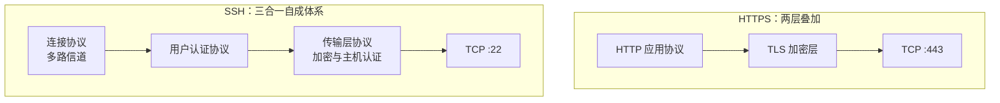

# 第4章：SSH：一条加密的远程通道

> [!TIP] Part 1: 基础概念篇（地基篇）
> 本篇从这一章起转向第二根地基：SSH。Git 管内容，SSH 管通道——通道不立起来，云笔记就永远困在你的本机。本章从一段黑暗的历史讲起，带你完成第一次远程登录，并把 SSH 与 HTTPS 这对易混概念切干净。

上一章结束时，云笔记的三区全部长在你的本机：工作区在硬盘上，暂存区和版本库在 `.git` 里。但项目的下一站是别的机器——笔记本与台式机要同步（阶段 2 的剧情），自建 Git 服务器和 GitHub 也在前方等着（Part 3、Part 4）。内容要跨机器流动，就需要一条安全通道。在讲怎么配通道之前，先看看没有通道的世界有多危险。

## 4.1 明文时代的危险

上世纪九十年代，远程管理服务器的标配是 Telnet（远程登录协议，端口 23）和 rsh（remote shell，端口 514）。它们的工作方式朴素得可怕：**你在键盘上敲的每一个字符，都以明文原样放上网络**——包括用户名，包括密码。

场景还原：你在公司内网用 Telnet 登录服务器。和你连着同一台交换机的任何人，只要把网卡调成混杂模式（Promiscuous Mode）——即让网卡不再只收「发给自己的包」，而是收下线路上流过的每一个包——再用抓包工具听一段流量，你的登录过程就一字不落地摊在他屏幕上。用 `tcpdump` 监听 23 端口，抓到的载荷经得起逐字辨认（示意）：

```text
$ tcpdump -A port 23
14:32:07  192.168.1.23 > 203.0.113.10  login: wang
14:32:12  192.168.1.23 > 203.0.113.10  password: hunter2
14:32:15  192.168.1.23 > 203.0.113.10  cat /etc/shadow
```

用户名、密码、登录后敲的每一条命令，全部裸奔。数字感受一下暴露面：一次 Telnet 登录会话里，用户名一个包、密码逐字符一个包、之后每条命令和命令输出全部明文过网——**抓包者看到的和你屏幕上看到的一模一样**。这不是理论风险：1995 年，赫尔辛基理工大学的 Tatu Ylönen 就是因为校园网里的一次密码嗅探事件（一次嗅探波及数千个账号），愤而写出了 SSH 的第一个版本。

Telnet 至今没有绝迹：老式交换机、路由器、打印机的管理口默认还开着 23 端口，很多新人的第一份运维工作就是「把全公司的 Telnet 换成 SSH」。**Telnet 抓包可见、SSH 抓包是噪声，这一对反差就是本章全部内容的种子**。

```text
 Telnet：你 ─"wang / hunter2"─► 服务器
         ↑ 抓包逐字可见

 SSH：你 ─"8f 3a c2 9b…"─► 服务器
       ↑ 抓到的只有密文噪声
```

## 4.2 SSH 是什么

SSH（Secure Shell，安全外壳协议）是 1995 年诞生的加密远程管理协议；2006 年，IETF 把第二代 SSH-2 发布为正式标准（RFC 4251 至 4254），也就是今天全世界通用的版本。至于默认端口为什么是 22——那只是当年作者在分配给自己的 1 到 1023 区间里随手挑的一个空位，没什么玄机，但它从此成了整个行业的门牌号。

RFC 4251 把 SSH-2 拆成三个子协议，各管一段：

| 组成 | 规范 | 职责 | 一句话类比 |
|------|------|------|-----------|
| 传输层协议（SSH-TRANS） | RFC 4253 | 链路加密、完整性校验、服务器认证 | 修隧道 |
| 用户认证协议（SSH-AUTH） | RFC 4252 | 客户端证明「我是谁」 | 查票 |
| 连接协议（SSH-CONN） | RFC 4254 | 在一条隧道里复用多路逻辑信道 | 分车厢 |

三个子协议跑在一条 TCP 连接上，默认端口 22。记住三个协议的名字，第 5、6 章讲「查票」细节、第 15 章讲「分车厢」（端口转发）时，你会不断回到这张表。

和它的前辈们放在一起，差距一目了然：

| 维度 | Telnet | rsh | SSH |
|------|--------|-----|-----|
| 默认端口 | 23 | 514 | 22 |
| 传输内容 | 明文 | 明文 | 全程加密 |
| 服务器身份验证 | 无 | 弱（主机名等价信任） | 主机密钥指纹（第6章） |
| 用户认证 | 明文密码 | 互信主机列表 | 公钥或密码，不传明文 |
| 今天的地位 | 仅剩内网调试 | 已淘汰 | 远程管理的事实标准 |

把 SSH-2 写成 IETF 标准这件事影响深远：**任何厂商按 RFC 实现的客户端都能连上任何实现的服务端**。今天你能数得出的实现——Linux 与 macOS 上的 OpenSSH、嵌入式设备上的 Dropbear、Windows 内置的 OpenSSH——彼此互操作毫无障碍，靠的不是某家公司的兼容层，而是一纸公共规范。这个特征和 Git 的分布式哲学异曲同工：**标准先行，赢家不止一个**。

> [!NOTE] 你已经在用 SSH 了
> 最流行的实现叫 OpenSSH，1999 年从 SSH 的最后一个开源版本分叉而来，如今 Linux 服务器、macOS、Git Bash 里都预装了它的客户端 `ssh`；Windows 10 之后也内置了可选的 OpenSSH。本章所有命令无需安装，直接可用。

## 4.3 第一次远程登录

理论到此为止，上通道。你的云笔记服务器是 `203.0.113.10`，用户名 `wang`，标准写法是「用户名@主机」：

```bash
ssh wang@203.0.113.10
```

第一次连接，屏幕上会出现一段值得逐字阅读的提示：

```text
The authenticity of host '203.0.113.10 (203.0.113.10)' can't be established.
ED25519 key fingerprint is SHA256:3xKf2mQ7uL9pVdWqR8nTcYbHj4aE5oG1iZ6vX0sD2lM.
This key is not known by any other names.
Are you sure you want to continue connecting (yes/no/[fingerprint])? yes
Warning: Permanently added '203.0.113.10' (ED25519) to the list of known hosts.
wang@203.0.113.10's password:
```

几个细节先记账：

- 「authenticity can't be established」的意思是：**客户端无法确认对面那台机器真的是你的服务器**。这个问题先按下不表——它是第 6 章的全部主角，也是你输入的那个 `yes` 真正的含义。
- 输入 `yes` 后，客户端把服务器的公钥指纹（Fingerprint）记进了本机的 `~/.ssh/known_hosts` 文件，从此这台机器「验明正身」。这个机制叫 TOFU，第 6 章揭底。
- 然后输入密码（输入时屏幕不回显，这是终端的正常行为），看到服务器的欢迎信息，你就站在服务器上了。敲 `exit` 离开。
- 语法拆开看：`ssh` 是客户端程序，`wang@203.0.113.10` 是「用户名@主机」。用户名与当前本机用户不同名时必须写全；如果服务器改了监听端口（第 17 章会这么做），用 `-p 端口号` 指定。

日常使用中，更多时候不需要「站上去」，只想在服务器上跑一条命令就走。SSH 支持直接把命令跟在后面：

```bash
ssh wang@203.0.113.10 "uname -sr && uptime"
```

命令会在服务器上执行，结果送回你本地屏幕，会话随即结束。想在服务器上连跑多件事，就把它们一并装进货柜：`&&` 串联、管道过滤都照常工作，只是执行地点换到了服务器。

```bash
ssh wang@203.0.113.10 "cat /var/log/auth.log | grep -c 'Failed password'"
```

这条组合拳统计服务器上今天的密码爆破次数——第 5 章会看到它的战果。注意一个新手高发的重定向坑：

```bash
ssh wang@203.0.113.10 uname -a > info.txt      # 反例：文件写到本地
ssh wang@203.0.113.10 "uname -a > info.txt"    # 正例：文件写到服务器
```

`>` 由谁解释，文件就落在谁那头——**不带引号时，重定向在本地 shell 完成；整条命令加引号，才是原样交给服务器**。

> [!TIP] 引号是远端命令的「货柜」
> 记不住就记这句：引号里面的所有内容打包发给服务器在服务器执行；引号外的部分留在本地解释。这个规则在第 13 章的别名、第 21 章的裸仓库部署里会反复出现。

## 4.4 辨析：SSH、shell、bash

三个词长得像一家子，其实是三种东西。用铁路类比一次讲清：

- **SSH 是那条加密的铁路**：负责把东西安全地从你的电脑运到服务器；
- **shell 是火车驾驶室里的司机程序**：接收你敲的命令、去执行、返回结果——它只是一个「命令解释器」的统称；
- **bash 是最常见的司机型号**：Bourne Again Shell，Linux 服务器的默认 shell；同岗位还有 zsh、dash 等。

两个延伸事实帮你把概念钉牢。其一，服务器把哪个 shell 当默认司机，写在 `/etc/passwd` 里 wang 用户那一行的末尾，登录后 `echo $SHELL` 可以直接问出来。其二，SSH 是一对程序，两端各司其职，先认个脸：

| 程序 | 运行在哪 | 角色 |
|------|---------|------|
| `ssh` | 你的电脑 | 客户端：发起连接、管理已知主机 |
| `sshd` | 服务器 | 守护进程：值守 22 端口、主持认证 |
| bash 等 shell | 服务器 | 通道里的乘客：解释并执行命令 |

第 17 章你会坐到服务端去配置 sshd，第 18 章排错时这两个名字会一起出现在报错现场。

所以「用 SSH 登录服务器」完整展开是：通过 SSH 这条加密通道，在服务器上启动一个 shell（通常是 bash），然后把你的键盘接过去。验证很简单——登录后敲 `hostname`，显示的是服务器的主机名而不是你本机的：**登录后你敲的每条命令都在服务器上执行**，只是画面通过 SSH 传回来而已。

更要紧的认知是：**shell 只是 SSH 顺路捎上的一名乘客，SSH 这条隧道能运的东西远不止交互式 shell**：

| SSH 通道的载荷 | 代表命令 | 典型场景 |
|---------------|---------|---------|
| 交互式 shell | `ssh wang@203.0.113.10` | 日常运维服务器 |
| 文件传输 | `scp` / `sftp` | 备份配置、同步日志 |
| Git 收发 | `git push`（SSH 地址） | 推代码到自建服务器（第21章） |
| 端口转发 | `ssh -L` / `-R` / `-D` | 访问只听内网的数据库（第15章） |

表格里有两行是全书伏笔：Git 走 SSH 通道是 Part 4 的主题曲，端口转发是第 15 章的专场。**把「SSH = 远程 shell」的心智升级为「SSH = 加密货运铁路」，后面十几章就都通了**。

## 4.5 SSH 与 HTTPS 的异同

SSH 和 HTTPS 是初学者最常混的一对，混的根源是「都是加密的」。先说共同点：都工作在 TCP 之上；都采用「非对称加密解决身份与密钥交换、对称加密承载数据」的混合架构。

差异是结构性的，一张表对齐五个维度：

| 维度 | SSH | HTTPS |
|------|-----|-------|
| 协议构成 | 自成体系的单一协议（传输层、认证、连接三合一） | HTTP 与 TLS 两层叠加 |
| 默认端口 | 22 | 443 |
| 服务器认证 | 主机密钥指纹，首连人工核对（TOFU） | CA 证书链，浏览器凭预装根证书自动校验 |
| 用户认证 | 协议内置：密码或公钥（第5章） | 应用层解决：cookie、token；TLS 客户端证书极少用 |
| 通信模式 | 持久双向会话，一条连接多路复用 | 请求-响应，HTTP 本身无状态 |

必须点破的误区：**SSH 不使用 TLS**。TLS（Transport Layer Security）是 HTTPS 下半身的加密层，是另一套独立协议；SSH 从加密、认证到复用全部自持，两者互不相通。「都是加密的」不等于「用的是同一种加密」。

顺手把流传最广的三个误解清一清：

| 误解 | 事实 |
|------|------|
| 「SSH 就是命令行版的 HTTPS」 | 协议结构完全不同：SSH 三合一自成体系，HTTPS 是 HTTP 叠加 TLS |
| 「SSH 用我的登录密码加密数据」 | 登录密码只参与用户认证；会话加密密钥另行协商，每次连接都换新（第6章） |
| 「用 SSH 前得先装证书」 | 服务器的主机密钥由 sshd 首次启动时自动生成，你唯一要做的是核对指纹（第6章） |

协议结构的差异画成图更直观——HTTPS 是「明文协议 + 加密层」的叠加，SSH 是三合一的整体：



用户认证位置的差异还会影响一个你马上会用到的选择：`git clone` 时 HTTPS 地址允许匿名拉取公开仓库（认证在应用层，不登录也能读），而 SSH 地址没有匿名这回事，连之前必须先把公钥登记好。这个差别在第 20 章选择仓库地址时会再次出现。

图里还有一处值得驻足：SSH 的连接协议支持「一条连接、多路逻辑信道」，所以你可以在同一个 SSH 会话里同时开 shell、传文件、转发端口——它们是同一列火车上的不同车厢。HTTPS 的世界对应物是「一个域名一条 TLS 连接」，浏览器通过并发多条连接来提量，两者在复用哲学上分道扬镳。

## 4.6 实验：登录服务器执行三条命令并初尝 ssh -v

实验目标：跑通「非交互三条命令」的标准动作，并第一次打开 SSH 的调试视野。

```bash
ssh wang@203.0.113.10 "hostname && uname -sr"
ssh wang@203.0.113.10 "uptime"
ssh wang@203.0.113.10 "df -h /"
```

三条分别回答：这是哪台机器、跑的什么系统、磁盘还剩多少。这是日后管理任何一台服务器的「开机三问」，典型输出长这样：

```text
$ ssh wang@203.0.113.10 "hostname && uname -sr"
cloudnote-server
Linux 6.8.0-45-generic

$ ssh wang@203.0.113.10 "uptime"
 21:47:03 up 12 days,  3:22,  1 user,  load average: 0.00, 0.01, 0.05

$ ssh wang@203.0.113.10 "df -h /"
Filesystem      Size  Used Avail Use% Mounted on
/dev/vda1        40G  6.2G   32G  17% /
```

接着给命令加上 `-v`（verbose，详细模式），SSH 会把连接过程中的每一步商量事项都喊出来。输出很长，先抓关键行（调试信息走标准错误流，所以要 `2>&1` 合并后过滤）：

```bash
ssh -v wang@203.0.113.10 "hostname" 2>&1 | grep -E "Connecting|Authenticat"
```

典型的输出片段：

```text
debug1: Connecting to 203.0.113.10 [203.0.113.10] port 22.
debug1: Authenticating to 203.0.113.10:22 as 'wang'
debug1: Authentications that can continue: publickey,password
debug1: Next authentication method: publickey
debug1: Next authentication method: password
wang@203.0.113.10's password:
Authenticated to 203.0.113.10 using "password".
```

逐行读一遍，你会看到本章知识的现场直播：先连 TCP 22 端口（4.2），再宣告「我是 wang」开始认证（4.2 的查票环节）；`publickey,password` 是服务器提供的认证选项——客户端先试公钥（你没有，跳过），退回密码，认证成功。

把过滤器拿掉，完整输出还有两大段值得认脸的内容：前半段是「算法协商」，你会看到成对的 `kex: algorithm: ...`、`kex: host key algorithm: ...` 行——那是客户端与服务器在互相报家门、挑出双方都支持的加密与签名算法，对应 4.2 表里的传输层协议；后半段是认证环节，对应查票。`-v` 到 `-vvv` 还能继续加码，但本章 `-v` 一档足够用。

```text
debug1: SSH2_MSG_KEXINIT sent
debug1: SSH2_MSG_KEXINIT received
debug1: kex: algorithm: curve25519-sha256
debug1: kex: host key algorithm: ssh-ed25519
debug1: kex: server->client cipher: chacha20-poly1305
debug1: kex: client->server cipher: chacha20-poly1305
```

这几行是密钥交换（Key Exchange，kex）的现场：curve25519 是双方选定的交换算法，ssh-ed25519 是服务器出示主机密钥的类型，chacha20-poly1305 是协商出的对称加密方案。看不懂没关系——第 6 章拆密钥交换，第 5 章拆认证，届时再回看这段输出，每一行都有名字。

留意 `Next authentication method: password` 这一行：**现在每连一次服务器，就要交一次密码**。云笔记进入双机阶段后，你每天要登服务器 20 次。怎么做到连密码都不传？这正是下一章的主题。

## 本章小结

- Telnet 时代的远程登录全程明文，同网段抓包即可读到密码原文——SSH 为消灭它而生
- SSH 是自成一体的协议族：传输层协议修隧道、用户认证协议查票、连接协议分车厢，默认 TCP 22
- 首次连接输入 `yes` 的含义是把服务器指纹记入 `~/.ssh/known_hosts`，这套 TOFU 机制的底细在第 6 章揭开
- SSH、shell、bash 三层分明：SSH 是加密铁路，shell 是司机程序，bash 是最常见型号；登录后命令都在服务器执行
- SSH 能承载的远不止 shell：scp/sftp 文件传输、Git 收发、端口转发都跑在同一条隧道上
- **SSH 不使用 TLS**：与 HTTPS 的差异是结构性的（服务器认证 TOFU 对 CA 证书链，用户认证协议内置对应用层）
- 非交互执行记牢「引号是货柜」：引号内整条命令交给服务器，引号外留在本地解释

**下一章预告**：通道已通，但认证还靠密码——每次连接都要把秘密送上链路。下一章制造一对「可以随便发的锁」和「绝不出门的钥匙」，用挑战-签名实现不传秘密的认证。

---
