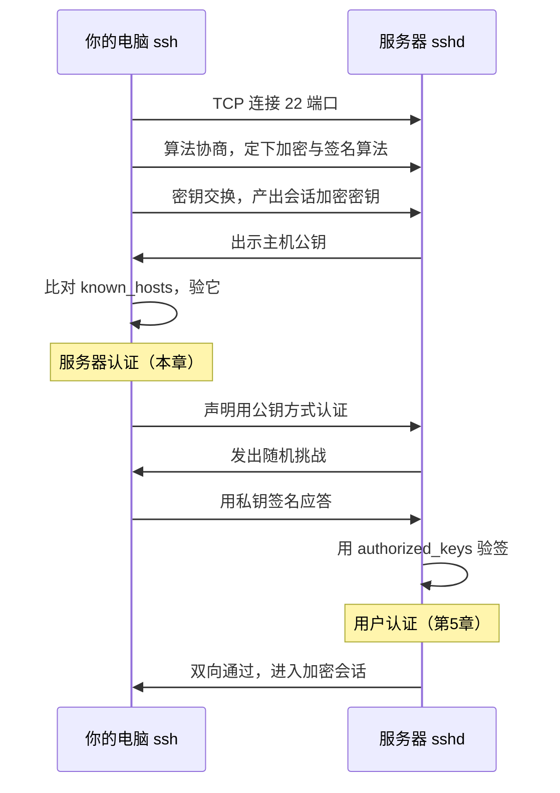

# 第6章：known_hosts 与双向认证

> [!TIP] Part 1: 基础概念篇（地基篇）
> Part 1 的收官章。上一章解决了「服务器怎么信你」，本章解决反方向的问题：**你怎么信服务器**。解开后，第 4 章那个不假思索输入的 `yes` 将获得完整含义，双向认证的全景图也随之合拢。

上一章你把公钥登记到了服务器，认证严丝合缝。但请回忆第 4 章首次连接时输入的那个 `yes`：当时屏幕警告「The authenticity of host can't be established」——客户端承认自己无法确认对面是谁——而你按下了 yes。这一章来算这笔账：你到底信了什么？这笔账不结清，SSH 的安全故事就只讲了一半。

## 6.1 反向的问题：你验证过服务器吗

把第 5 章的认证重放一遍，换一个视角：整个过程中，客户端只顾着证明自己，从头到尾没有问过一句「对面真的是 203.0.113.10 那台服务器吗」。

这不是杞人忧天，攻击路径真实存在：

- **DNS 劫持**：你敲的 `203.0.113.10` 若经过被污染的解析，可能被指向攻击者的机器；
- **ARP 欺骗**：同一内网里，攻击者可以谎称「网关是我」，把你发往服务器的流量先牵到自己手里；
- **公共 Wi-Fi**：咖啡馆网络的控制者天然处在你的流量必经之路上。

这类攻击统称中间人攻击（Man-in-the-Middle, MITM）：攻击者坐在你和服务器中间，两头都以为在跟对方直接通话：

```text
 你以为的连接                    实际发生的连接
 你 ──────► 服务器        你 ──────► 攻击者 ──────► 服务器
 （加密 A）              （加密 B）      （加密 C）
                        攻击者两头解密，全程旁观甚至篡改
```

如果你的 SSH 走密码认证，密码会原样进入假服务器；如果走公钥认证，私钥虽不泄露（这是第 5 章的功劳），但你登上的、传回的数据，全部进了攻击者的口袋。更阴险的是：由于两段都是真加密，你本地的 ssh 不会报任何异常。

把三个场景放在一起看，它们的共同点是：**攻击者没有攻破任何加密算法，只是把自己插进了信任链的起点**。加密保护的是「路上不被偷」，防不了「把货交给假收件人」——所以服务器认证必须由你亲手完成，算法替代不了。

第 5 章回答的是「它怎么信你」，本章回答「你怎么信它」。**没有服务器认证的加密通道，只是安全地把自己交给骗子**。

## 6.2 known_hosts 解剖

SSH 的答案藏在第 4 章就出场过的文件里：`~/.ssh/known_hosts`。它在你的本机上，一行一台主机，记录「我信过谁」：

```text
203.0.113.10 ssh-ed25519 AAAAC3NzaC1lZDI1...
github.com   ssh-ed25519 AAAAC3NzaC1lZDI1...
203.0.113.10 ecdsa-sha2-nistp256 AAAAE2VjZ...
```

（真实记录里 base64 公钥是一长串，此处截断示意。）三行示例顺便暴露了一个细节：**同一台主机可以有多行记录**——服务器通常同时持有 ed25519、RSA、ECDSA 三套主机密钥，你连过几次、客户端用过几种算法，就积累几行。首行是你连自家服务器的记录，次行是连 GitHub 的，第三行说明你还用旧算法连过一次自家服务器。

三个字段：主机标识、密钥类型、公钥本体（base64 编码）。某些发行版默认开启 HashKnownHosts，主机名会被哈希成 `|1|盐|哈希|` 的样子——防止别人翻你的 known_hosts 摸清你常连哪些服务器，行为不受影响。

这套机制的信任模型有个专门的名字：TOFU（Trust On First Use，首次使用即信任）。流程是：

1. 首次连接，客户端拿不到任何凭据，提示指纹并询问（第 4 章那个提示）；
2. 你输入 `yes`——**此刻你无凭无据地信任了一次**，服务器公钥被钉进 known_hosts；
3. 此后每次连接，客户端核对服务器出示的公钥与记录是否一致，不一致立即拉响警报。

TOFU 的软肋在第二步：第一次的「信任」从何而来？答案是从 SSH 体系之外的渠道来，术语叫带外（Out-of-Band）核对。对你自己的云服务器 `203.0.113.10`，最可靠的带外渠道是云厂商控制台里的 VNC 终端——那条链路不经过 SSH，不给你劫持的机会。这也解释了一个稍后（6.4）会遇到的现实：**云主机的公网 IP 常常是「浮动」的**，一台机器销毁后 IP 会被分配给全新机器——IP 没变，门后的「锁」换了，known_hosts 的旧账瞬间变成误报源头。

顺手把容易混的一对文件钉在一起（第 0 章概念表里的那行，现在有了完整的上下文）：

| | known_hosts | authorized_keys |
|--|-------------|-----------------|
| 所在位置 | 客户端 `~/.ssh/known_hosts` | 服务器 `~/.ssh/authorized_keys` |
| 记录内容 | 我信过哪些服务器 | 谁能进这台机器 |
| 谁来写入 | ssh 首次连接自动追加 | ssh-copy-id 或管理员手工 |
| 对应认证环节 | 服务器认证（本章） | 用户认证（第5章） |

## 6.3 指纹的正确核对方式

TOFU 的第一次信任要带外完成，具体怎么核？核对的对象是指纹（Fingerprint）——公钥的哈希摘要，形状短、便于人眼比对。

登上云厂商控制台的 VNC 终端（注意：这条路不经 SSH），在服务器上执行：

```bash
ssh-keygen -lf /etc/ssh/ssh_host_ed25519_key.pub
```

输出：

```text
256 SHA256:3xKf2mQ7uL9pVdWqR8nTcYbHj4aE5oG1iZ6vX0sD2lM root@203.0.113.10 (ED25519)
```

输出的四个字段依次是：密钥位数（Ed25519 恒为 256）、SHA256 指纹、注释、算法类型。如果服务器还留着 RSA 主机密钥，再核一条：

```text
$ ssh-keygen -lf /etc/ssh/ssh_host_rsa_key.pub
3071 SHA256:8mP2nR4tU6vW8xY0zA2bC4dE6fG8hJ1kL3mN5pQ7rS9u root@203.0.113.10 (RSA)
```

把这一串 SHA256 值与你本地首次连接提示中的指纹逐字符比对。一致，才值得输入那个 `yes`。比对时盯紧首尾各 4 个字符加总长度——人眼逐字比对 43 个 base64 字符容易走神，首尾锁定是实用技巧。

命令里两个参数分工明确：`-l` 负责展示指纹，`-f` 负责指定要读的密钥文件；两者合体还能从管道读数据（`ssh-keyscan 203.0.113.10 | ssh-keygen -lf -`），但正如 6.2 所说，从网络取回的指纹只适合网络本身可信的场合，正式核对永远走带外。

顺带解开一个常见疑虑：把指纹印在聊天记录、交接文档里会不会泄密？不会。**指纹是公钥的哈希，不是公钥本体，更不是私钥**——它天生就是设计来公开传播、供人比对的。真正要保密的私钥，从不以任何形式出现在指纹里。

服务器上通常躺着一套主机密钥文件，各家算法一把锁：

| 文件 | 算法 | 说明 |
|------|------|------|
| `/etc/ssh/ssh_host_ed25519_key(.pub)` | Ed25519 | 现代默认，本章的示范对象 |
| `/etc/ssh/ssh_host_rsa_key(.pub)` | RSA | 兼容老客户端的备胎 |
| `/etc/ssh/ssh_host_ecdsa_key(.pub)` | ECDSA | 较少作为首选 |

有件事必须说破：**核对指纹必须走带外渠道，不能在 SSH 通道里自己核自己**。社区里流传 `ssh-keyscan 203.0.113.10` 取回指纹再比对的教程——想一下就知道它防不了中间人：你被劫持时，keyscan 从攻击者机器上取回的正是假指纹。带外的意义就在于绕开这条可能被劫持的链路。

> [!NOTE] 指纹告警之前，先想清楚 yes 给了谁
> 云厂商控制台的 VNC 或救援终端、机房的当班同事、服务器交付单上的指纹记录——这些都算带外。唯独「从这条 SSH 连接本身取指纹」不算，那是循环论证。

## 6.4 指纹告警：REMOTE HOST IDENTIFICATION HAS CHANGED

TOFU 真正的威力在日常。服务器公钥一旦与 known_hosts 的记录对不上，客户端会拒绝连接并刷出全书最长的警告：

```text
@@@@@@@@@@@@@@@@@@@@@@@@@@@@@@@@@@@@@@@@@@@@@@@@@@@@@@@@@@@
@    WARNING: REMOTE HOST IDENTIFICATION HAS CHANGED!     @
@@@@@@@@@@@@@@@@@@@@@@@@@@@@@@@@@@@@@@@@@@@@@@@@@@@@@@@@@@@
IT IS POSSIBLE THAT SOMEONE IS DOING SOMETHING NASTY!
Someone could be eavesdropping on you right now (man-in-the-middle attack)!
It is also possible that a host key has just been changed.
The fingerprint for the ED25519 key sent by the remote host is
SHA256:Lp8sQw2rT9yUvX4zA6bC8dE0fG1hI3jK5lM7nO9pQ1sR3tU5v.
Please contact your system administrator.
Add correct host key in /c/Users/wang/.ssh/known_hosts to get rid of this message.
Offending ED25519 key in /c/Users/wang/.ssh/known_hosts:12
Host key verification failed.
```

倒数第三行给了定位：旧记录在 known_hosts 的第 12 行。**这条警告是防御机制在工作，不是故障**——它说明客户端还记得服务器原来的样子，并且发现它变了。

「变了」有两种可能，处置完全不同：

| | 正常情形 | 危险情形 |
|--|---------|---------|
| 何时发生 | 你或运维刚重装了系统、重装了 sshd；云主机释放后 IP 被别的新机器复用 | 没人动过这台机器，指纹却变了；或突然出现在公共网络里 |
| 本质 | 服务器真的换了「锁」 | 对面可能是中间人 |
| 正确处置 | 带外核对新指纹后清除旧记录 | 停下，按攻击处理，先查清再说 |

正常情形下的处置流程四步走：

1. **先确认原因**：这台机器最近被谁动过？重装过吗？问运维、看云控制台的操作记录；
2. **带外核对新指纹**：控制台 VNC 里跑 `ssh-keygen -lf /etc/ssh/ssh_host_ed25519_key.pub`，与告警中给出的新指纹比对；
3. **清除旧记录**：`ssh-keygen -R 203.0.113.10`，它会打印出命中的旧行再改写文件，不会误伤其他条目；
4. **重新连接**：再次首连，输入 `yes` 之前比对一遍新指纹。

```bash
ssh-keygen -R 203.0.113.10
ssh wang@203.0.113.10
```

处置完成后还有个加分动作：把核对过的新指纹连同日期记进交接文档——下一次有人（可能是三个月后的你自己）撞上告警时，它就是现成的带外凭据。

> [!WARNING] 绝不能无脑清告警继续连
> 网上大量教程教你「遇到告警就 `-R` 删掉重来」，这句话漏掉了最关键的前提：**先确认原因、先带外核对**。告警是这套机制唯一的价值，看见告警不加核实就清除记录，等于报警器一响就拆掉报警器——中间人攻击怕的就是你嫌它烦。

## 6.5 双向认证全景

现在把四章的积累拼成一张完整的图。一条 SSH 连接从按下回车到进入 shell，认证环节其实是「一来一回」双向各验一次：



图中两个验证缺一不可，合起来才是「双向认证」：

- **你验它**（服务器认证）：靠主机密钥与 known_hosts 比对，防中间人——本章主角；
- **它验你**（用户认证）：靠第 5 章的挑战-签名，防冒名顶替。

把图按行读一遍，注意顺序的深意：双向认证发生在**加密会话建立之前**——先验明双方身份，加密通道才正式开始运货；而不是先建加密通道再补验身份。第 1 到第 3 步（连接、协商、密钥交换）把隧道的钢筋骨架搭好，第 4、5 步给服务器验明正身，第 6 到 11 步反过来验你，最后一步才放行真实流量。这也回答了一个老问题：为什么服务器 IP 不变、密码没输错，连接却可能被拒？——**认证链上任何一环对不上，sshd 都会按规矩关门**。

一个诚实的说明：真实报文里，主机公钥是在密钥交换的报文中捎带送达的，并不像图里那样单独走一步；图按教学顺序拆开，语义不差。密钥交换产出的会话密钥随即加密后续所有流量，这就是第 4 章表格里「传输层协议修隧道」的全部内涵。

这张图是后续十几章的挂架，先立三根挂钩：

- 第 15、16 章的端口转发与跳板机，全部建立在「先双向认证、后加密运货」的同一条会话之上；
- 第 17 章配置 sshd 时，`HostKey`、`PasswordAuthentication` 等配置项分别对应图里的哪一环，届时一一归位；
- 第 24 章安全复盘时，这张图就是检查清单的前两行。

至此，Part 1 的两根地基各自立稳：Git 侧有了三区模型，SSH 侧有了双向认证的加密通道。回头看第 0 章那张分层图——上层管内容、下层管通道、交界处贴着 TCP 22——你已经能从上到下把每一层说清楚了。

> [!TIP] 用一次真实验证固化记忆
> 本节最好的复习方式：找一台自己有控制台权限的服务器，把 6.6 的实验从头做一遍。双向认证这种知识，做过一次顶读十遍。

## 6.6 实验：亲手核对指纹并制造一次指纹告警再修复

实验分三幕，在你自己的服务器上完成（先确认上面没有别人的重要业务）。

**第一幕：规范首连。** 清掉历史记录，按本章流程走一遍标准 TOFU：

```bash
ssh-keygen -R 203.0.113.10
ssh wang@203.0.113.10 "hostname"    # 记下提示中的指纹，控制台核对后再输 yes
ssh-keygen -F 203.0.113.10          # 在本地查看 known_hosts 里刚登记的记录
```

第三条命令会先报告 `Host 203.0.113.10 found: line 12`，再打印记录行——6.4 告警里 `known_hosts:12` 的行号就是它报出来的：

```text
203.0.113.10 ssh-ed25519 AAAAC3NzaC1lZDI1NTE5AAAAIJm7pQ9xKf...
```

known_hosts 会随你的连接自然生长：每登一台新服务器、每连一次 GitHub，就多一行。它是你机器上最值得备份的小文件之一——丢了不算灾难（重连重登记即可），但每次重登记都意味着重新走一遍带外核对。

**第二幕：制造指纹变化。** 站在服务器上（此刻你既是运维又是「肇事者」），重新生成主机密钥：

```bash
sudo rm /etc/ssh/ssh_host_ed25519_key*
sudo ssh-keygen -t ed25519 -f /etc/ssh/ssh_host_ed25519_key -N ""
sudo systemctl restart sshd
```

回到本地重连，欢迎观赏全书最长的警告——REMOTE HOST IDENTIFICATION HAS CHANGED。此刻你就是「正常情形」里那个知道原因的人：密钥刚被你自己换了。顺带记一条冷知识：重启 sshd 不会踢掉已经建立的会话，但它生成新密钥这件事，会让下一批新连接全部撞上告警。

**第三幕：按流程修复。** 四步处置走一遍：确认原因（自己干的）；带外核对（在服务器上执行 `ssh-keygen -lf /etc/ssh/ssh_host_ed25519_key.pub`，与告警中的新指纹比对）；清除旧记录（`ssh-keygen -R 203.0.113.10`）；重新连接（输入 `yes` 前再比对一次）。修完你会看到熟悉的：

```text
Warning: Permanently added '203.0.113.10' (ED25519) to the list of known hosts.
cloudnote-server
```

服务器指纹重新钉入 known_hosts，警报解除。收工前对照三条验收标准：

1. 你能在告警出现时说出「这是防御在工作」，而不是当成故障绕开；
2. 你能不查资料写出四步处置的顺序：确认原因 → 带外核对 → 清除记录 → 重连核对；
3. 你知道哪一步（带外核对）绝不能省，也知道省了它等于什么。

这场演习的价值在于：**等你某天在深夜真的撞上这条告警，手指不会先于大脑行动**。

## 本章小结

- 第 5 章解决「它怎么信你」，本章解决「你怎么信它」——双向认证缺一不可
- known_hosts 一行一台主机，信任模型是 TOFU：首连无据信任一次，此后逐次核对
- 首次指纹必须带外核对（云控制台 VNC 等），**不能用 SSH 通道自己核自己**
- `ssh-keygen -lf /etc/ssh/ssh_host_ed25519_key.pub` 在服务器上打印指纹，与客户端提示逐字符比对
- 指纹告警的两种成因：重装系统属正常，来历不明视为劫持；处置永远是先确认原因、再带外核对、后 `ssh-keygen -R` 清记录
- **绝不能无脑清告警继续连**：告警是防御在工作，不是故障
- 至此 Part 1 双地基完工：Git 三区 + SSH 双向认证，下一部分回到 Git 本地实战

**下一章预告**：地基打完——左手 Git 三区，右手 SSH 通道。下一章回到 Git，开着时光机把云笔记的 50 次提交翻个底朝天：log 的四种视角、diff 的三种比较，以及后悔药真正的源头 reflog。

---
