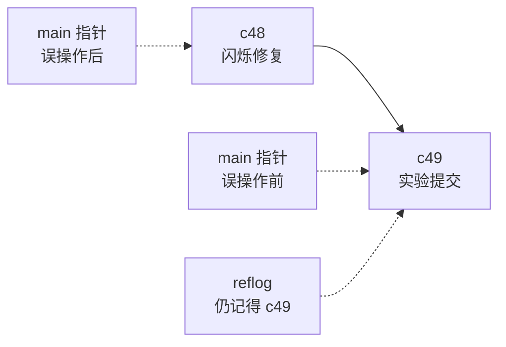

# 第7章：时光机：log、diff 与 reflog

> [!TIP] Part 2: Git 本地实战篇（日常篇）
> 本篇六章全部在本地仓库里操练，目标是把 Git 用成肌肉记忆：翻历史、做撤销、玩分支、整理历史。本章是日常篇的第一站——学会把仓库的历史翻个底朝天，后面的撤销与分支才有施展的舞台。

地基打完：上一章收束了 SSH 的双向认证，前六章立起 Git 三区与 SSH 通道两根柱子。从本章起回到 Git 本体。云笔记进入阶段 1 的尾声：仓库约 3MB，50 次提交，47 个文件。历史一多，新问题跟着来——「上周五那个能演示的版本什么样？」「这个闪烁到底是哪次改出来的？」本章给你三台望远镜：log、diff、reflog。

## 7.1 五十次提交的仓库

先感受一下 50 次提交意味着什么。云笔记第一个月，你日均提交一到两次，从「云笔记的第一页」一路走到滚动优化。裸敲 `git log`，输出是这样的长卷：

```text
$ git log
commit c48d9e2c7f3a1b9e5d8c2f6a4b0e8d1c9f7a3b2c
Author: wang <wang@example.com>
Date:   Tue May 12 14:32:07 2026 +0800

    修复笔记列表滚动闪烁

commit b7e3a91f2c8d4e6a0b9c3f5d7e1a8c2b4d6f0e3a
Author: wang <wang@example.com>
Date:   Mon May 11 20:15:33 2026 +0800

    为空笔记添加占位提示

...（后面还有 48 条）
```

完整版信息最全，但翻 50 次提交的仓库时，「每次提交一小屏」的节奏很快让人失去耐心。真正把需求推到桌面的，是三个具体问题：

- 上线前发现一个诡异 bug，怀疑是两周前某次「顺手优化」引入的——**哪次？**
- 交接的同事说「旧方案被我删了」，可你隐约记得它值得再看一眼——**在哪个提交里？**
- 领导要一页「这个月都干了什么」的清单——**怎么从 50 次提交里快速汇总？**

好消息是 log 的每一段信息（哈希、作者、日期、信息）都可以按需裁剪，过滤器齐全——这正是下一节四种视角的由来。

## 7.2 git log 的四种视角

四种常用视角，从鸟瞰到显微镜：

**视角一：`--oneline`，一行一提交。**

```text
$ git log --oneline
c48d9e2 (HEAD -> main) 修复笔记列表滚动闪烁
b7e3a91 为空笔记添加占位提示
a1b2c3d 云笔记的第一页
```

短哈希加标题，50 次提交一屏收下。`HEAD -> main` 标出你现在站在哪。

**视角二：`--graph --oneline --all`，图形加全分支。** `--graph` 画出提交谱系，`--all` 把所有分支都拉进画面。现在云笔记还是单线历史，`*` 排成一列；等第 9 章开了分支、第 10 章有了合并，这条命令会画出分叉与汇流的路网，是日常最常挂嘴边的一条。

**视角三：`--stat`，文件级统计。** 每次提交动了哪些文件、增删几行：

```text
$ git log --stat -1
commit c48d9e2c7f3a1b9e5d8c2f6a4b0e8d1c9f7a3b2c
Author: wang <wang@example.com>
Date:   Tue May 12 14:32:07 2026 +0800

    修复笔记列表滚动闪烁

 src/scroll.js | 6 ++++--
 1 file changed, 4 insertions(+), 2 deletions(-)
```

**视角四：`-p`，完整补丁。** 在 stat 之上再展开每一行的增删，等于把每次提交的 diff 直接铺进 log。信息量最大，一般配 `-1` 之类条数限制使用。

四种视角按需组合，再送你三个常用过滤器，速查表收拢全部：

| 想看什么 | 用什么 |
|---------|--------|
| 快速浏览全部历史 | `git log --oneline` |
| 分支谱系与走向 | `git log --graph --oneline --all` |
| 每次提交动了哪些文件 | `git log --stat` |
| 某次提交的完整改动 | `git log -p -1` 或 `git show` |
| 只看最近 3 条 | `git log --oneline -3` |
| 只看某人最近的提交 | `git log --author="wang" --oneline` |
| 只看最近两周 | `git log --since="2 weeks ago" --oneline` |
| 只看某个文件的历史 | `git log --oneline -- src/scroll.js` |

输出格式还能整体定制，`--format` 配占位符（`%h` 短哈希、`%ad` 日期、`%an` 作者、`%s` 标题）可以拼出你想要的任何样子：

```bash
git log --format="%h %ad %s" --date=short
```

```text
c48d9e2 2026-05-12 修复笔记列表滚动闪烁
b7e3a91 2026-05-11 为空笔记添加占位提示
a1b2c3d 2026-05-02 云笔记的第一页
```

这张「日期 + 一行摘要」的清单，正是 7.1 那句「领导要一页月度清单」的答案。

> [!TIP] 先定位，再显微镜
> 日常节奏固定为两拍：先用 `--oneline`（可加过滤器）定位目标提交，再用 `show` 或 `-p` 看细节。一上来就 `-p` 看全量，等于用显微镜找门牌号。

## 7.3 定点查看：git show 与 git diff

`git log` 是巡览，定点看某一次提交用 `git show`。不带参数看当前 HEAD，跟哈希或 `HEAD~n` 看任意一次：

```bash
git show                # 当前提交的元信息 + 补丁
git show HEAD~1         # 上一次提交
git show c48d9e2        # 指定提交（短哈希即可）
```

`HEAD~2` 这类写法读作「HEAD 往前数 2 步」，波浪号（~）就是沿提交链向历史方向走。定点查看与巡览的关系：`git log --stat` 看到 c48d9e2 动了 scroll.js，想看细节就 `git show c48d9e2`。

diff 家族在第 3 章见过前两招，这里把完整的三种比较钉成一张表——它们回答的问题完全不同：

| 命令 | 比较对象 | 回答的问题 |
|------|---------|-----------|
| `git diff` | 工作区 vs 暂存区 | 还有哪些改动没报名？ |
| `git diff --staged` | 暂存区 vs HEAD | 已报名的改动长什么样？ |
| `git diff c1 c2` | 提交 c1 vs 提交 c2 | 两个历史快照差在哪？ |

第三种是本章新招，在「哪个版本引入的变化」这类问题上最好用：

```bash
git diff HEAD~2 HEAD     # 最近两次提交合起来改了什么
git diff b7e3a91 c48d9e2 # 任意两个历史快照之间
```

配一个具体问题演练：云笔记的滚动闪烁修复前后的差异——`git diff b7e3a91 c48d9e2` 输出里，你会看到 `requestAnimationFrame` 那几行的 `+` 与旧写法的 `-`。**log 回答「发生过什么」，diff 回答「差在哪」，show 回答「这一次具体是什么」——三台仪器各管一段**。

## 7.4 blame 与 log -S

有些问题的粒度更细：不是「哪次提交」，而是「这一行代码」。云笔记的闪烁问题定位到了 `src/scroll.js`，你想知道第 13 行是哪次提交写的。 blame 登场：

```text
$ git blame -L 12,15 src/scroll.js
c48d9e2c (wang 2026-05-12 14:32:07 +0800 12) function onScroll() {
c48d9e2c (wang 2026-05-12 14:32:07 +0800 13)   requestAnimationFrame(update)
b7e3a91f (wang 2026-05-03 09:15:44 +0800 14) }
b7e3a91f (wang 2026-05-03 09:15:44 +0800 15) window.addEventListener("scroll", onScroll)
```

每行前置四元组：提交哈希、作者、时间、行号。`-L 12,15` 只查 12 到 15 行。结论直读：**第 13 行是 5 月 12 日 14:32 的 c48d9e2 写的**——查案查到人、查到时刻。

但 blame 有盲区：它告诉你「这行最后一次被谁改」，回答不了「这段逻辑最早是哪次引入的」。比如 `requestAnimationFrame` 这个函数调用，你怀疑它就是闪烁修复的方案，想找出它的「出生证明」。pickaxe（镐子）搜索登场：

```text
$ git log -S "requestAnimationFrame" --oneline
c48d9e2 修复笔记列表滚动闪烁
```

`-S "字符串"` 找出「该字符串出现次数发生变化」的所有提交——引入一次、删除一次，各是一条记录。因为只有 c48d9e2 一条，说明它就是引入点；哪天这段逻辑被删掉，还会再出现一条「删除证明」。想用正则匹配就换 `-G`，例如 `git log -G"scroll.*Listener"`。

三连击串起来就是一条完整的破案流水线：**blame 定位行与时刻，log -S 找到引入提交，git show 复盘全貌**。云笔记这种 50 次提交的小仓库用起来如探囊取物；等它长到阶段 3 的 12000 次提交，这套组合拳的价值只会更大。

## 7.5 reflog：后悔药的真正源头

前三节的工具都在「提交链」上工作。现在看 Git 保险柜最深处的机制：reflog（引用日志）。

第 1 章承诺过「提交过的东西几乎不可能真正丢失」，底气来自哪里？来自 reflog 记录的** HEAD 的每一次移动**。你做过 commit、reset、checkout，无论指针怎么动，reflog 都记了一笔，存放在 `.git/logs/HEAD`：

```text
$ git reflog
c48d9e2 (HEAD -> main) HEAD@{0}: reset: moving to HEAD~1
c49a1f3 HEAD@{1}: commit: 实验提交
c48d9e2 HEAD@{2}: commit: 修复笔记列表滚动闪烁
b7e3a91 HEAD@{3}: commit: 为空笔记添加占位提示
```

读法：每行前半段是「移动后 HEAD 指向的提交」，后半段是「刚发生了什么动作」。上面这份记录讲的故事是：你提交了「实验提交」（c49a1f3），随后 reset 回退了一格（HEAD@{0}）。注意 c49a1f3 此刻已经不在 main 分支上了——**但 reflog 还记得它**，`HEAD@{1}` 就是找回它的门牌。

提交链与两类账本的关系，一张图钉住：

```text
提交链：   c47 ───► c48 ───► c49 ───► c50
                     ▲        ▲
                     │        │
                   main      reflog
                 （指针：     （日志：
                 现在在哪）    你去过哪）
```

分支指针（main）只记「现在在哪」，reflog 记「你去过哪」——这就是两者最根本的分工。

那「几乎不可能丢失」的「几乎」呢？**reflog 记录及其可达的对象默认保留 90 天**（配置项 `gc.reflogExpire`，已经不被任何引用和 reflog 指到的「孤岛」对象则是 30 天，`gc.reflogExpireUnreachable`），到期后才可能在 `git gc` 清理时真正删除。也就是说：只要在 90 天内想起后悔，胜利几乎总在你这边。

| 账本 | 记什么 | 什么时候用 |
|------|--------|-----------|
| 分支（refs） | 每条线「现在」指向谁 | 日常提交与切换 |
| HEAD | 你当前站在哪个分支哪个提交 | 确认位置 |
| reflog | HEAD 的全部移动史 | 事后找人的唯一线索 |

两个进阶用法先留个爪印：`git reflog main` 可以看 main 分支自己的移动史（reflog 不止 HEAD 一份，每个引用都有一本）；加 `--date=iso` 能给每条移动标上真实时间，排查「我上周五到底干了什么」时特别好用：

```text
$ git reflog --date=iso | head -3
c48d9e2 (HEAD -> main) HEAD@{0}: reset: moving to HEAD~1
c49a1f3 HEAD@{1}: commit: 实验提交
        (2026-05-12 23:41:02 +0800)
c48d9e2 HEAD@{2}: commit: 修复笔记列表滚动闪烁
        (2026-05-12 14:32:07 +0800)
```

> [!NOTE] 90 天后悔期不是躺平的理由
> 90 天是 reflog 条目的默认寿命，过了期限再叠加一次 `git gc`，孤岛提交才可能物理消失。习惯上把 reflog 当「急救箱」：事故当场处理，从不留过夜。

## 7.6 实验：找回消失的提交

亲手演一遍「丢失与找回」的完整剧本。先制造事故：

```bash
echo "临时实验" > scratch.md && git add scratch.md
git commit -m "实验提交"
git reset --hard HEAD~1          # 一时手快，把实验提交丢弃
git log --oneline -2             # 历史里确实没有它了
```

`reset --hard` 把分支指针搬回上一格，还顺带清空了工作区里对应的内容——此刻 `git log` 里再无「实验提交」的踪影。普通人此刻已经开始重写代码，而你打开急救箱：

```bash
git reflog
```

在输出里找到 `HEAD@{1}: commit: 实验提交` 那一行（格式见 7.5）。它前面那串短哈希就是「失踪人口」的门牌。两种找回写法等价：

```bash
git reset --hard HEAD@{1}        # 按 reflog 序号找回
git reset --hard c49a1f3         # 或按哈希找回
git log --oneline -2             # 实验提交回来了
```

整个过程的指针轨迹：



`reset --hard` 只搬动了 main 指针，c49 这个提交本体从未被删除，reflog 一指，指针归位，世界复原。

把剧本升级一档：如果丢的是连续三个提交呢？做法不变——`git reflog` 往下翻，找到三次移动之前那条 `commit:` 记录（比如 `HEAD@{3}`），一个 `reset --hard HEAD@{3}` 全部找回。**reflog 找回的粒度是「任意历史位置」，不是「单次提交」**，这是它比任何单点撤销工具都强大的地方。

> [!NOTE] reset --hard 是本实验唯一的危险动作
> 它会重置暂存区和工作区。跑实验前确认 `git status` 干净，别把没提交的心血一起冲掉。真正的撤销工具箱（restore、reset、revert 各自的适用场景）是下一章的主题。

## 本章小结

- `git log` 四种视角：`--oneline` 鸟瞰、`--graph --all` 看谱系、`--stat` 看文件统计、`-p` 看完整补丁
- 过滤器三件套：`-n` 条数、`--author` 作者、`--since` 时段，加 `-- 路径` 限定文件
- `git show` 定点看单次提交；diff 三种比较各答一问：工作区对暂存区、暂存区对 HEAD、两提交之间
- blame 查「这一行谁写的」：`git blame -L 12,15 文件` 直读提交、作者、时刻
- `log -S "字符串"`（pickaxe）查「这段逻辑哪次引入或删除」，与 blame 组成破案三连击
- reflog 记录 HEAD 的每一次移动，`HEAD@{n}` 是历史位置的门牌号
- **reflog 可达对象默认保留 90 天**（`gc.reflogExpire`），过期叠加 gc 才可能真正消失——后悔要趁早

**下一章预告**：reflog 是万能急救箱，但每次撤销都翻日志未免太重。下一章把日常撤销武器库配齐——restore 管工作区、reset 管指针、revert 管公开历史，三件套各管一段，从此任何误操作都有精确解法。

---
