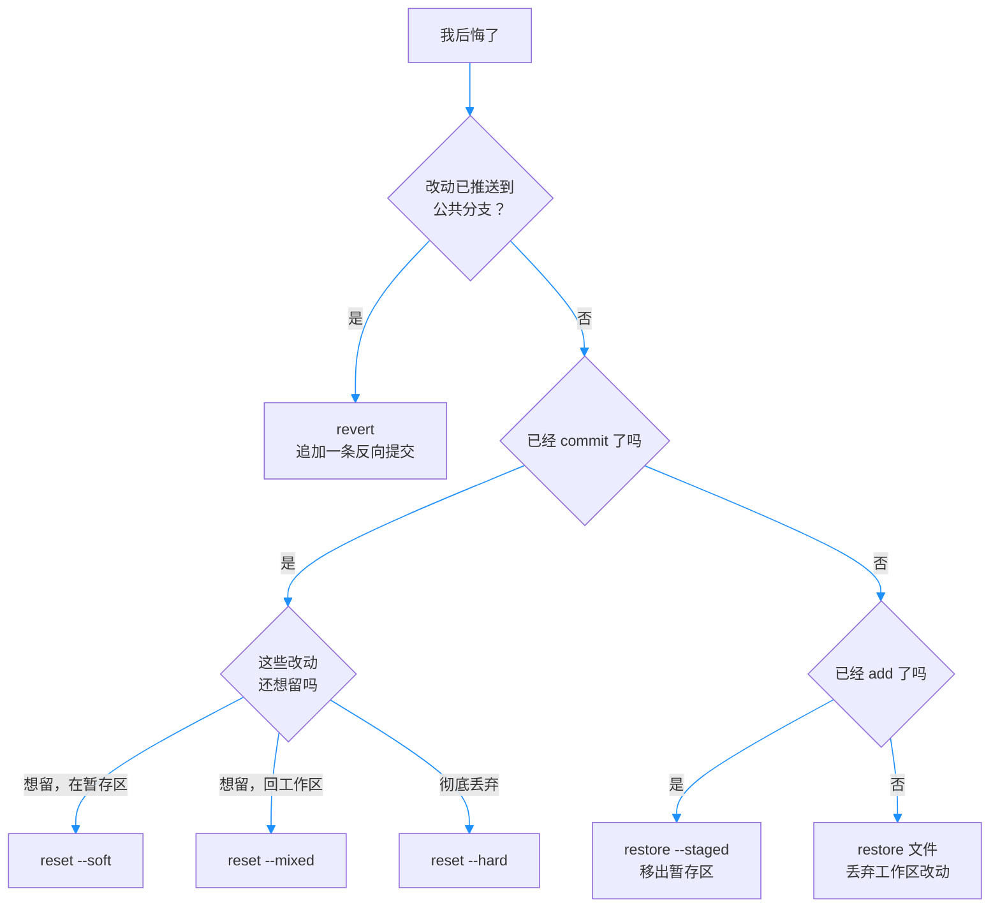

# 第8章：悔棋三件套：restore、reset、revert

> [!TIP] Part 2: Git 本地实战篇（日常篇）
> 本篇进入「改错」环节。上一章你学会了用 log、diff、reflog 把历史看个通透，本章解决紧随其后的问题——看出问题了，怎么改？Git 为不同程度的后悔准备了三件工具，剂量不同，副作用也不同。

晚上十点半，云笔记的第 50 次提交刚刚完成。你伸了个懒腰，然后瞳孔一缩：`notes.html` 里那行调试用的 `console.log` 也跟着进了历史。再往前翻，半小时前你还把一份只写了一半的临时方案 `add` 进了暂存区，现在整个文件都不对了。三件倒霉事，严重程度不一样，处理方式自然也不一样。

「撤销」在文件夹复制时代等于 `Ctrl+Z` 按到底然后听天由命；在 Git 里它是一门手艺。本章的主角是三件工具：restore 管「未提交的后悔」，reset 管「已提交未推送的后悔」，revert 管「已推送的后悔」。**先诊断后悔发生在哪个区域，再选工具**——这是本章唯一的总纲。

## 8.1 后悔分级：先诊断，再开药

第3章讲过三区模型：改动从工作区（Working Tree）出发，经 `git add` 进入暂存区（Staging Area），经 `git commit` 进入版本库，经 `git push` 离开你的电脑。后悔的「等级」，就取决于改动此刻走到了哪一站：

| 后悔现场 | 判断方法 | 对应工具 | 风险等级 |
|---------|---------|---------|---------|
| 改了，没 add | `git status` 显示已修改 | `git restore` | 中：改动直接消失 |
| add 了，没 commit | 文件躺在暂存区 | `git restore --staged` | 低：只是移出暂存区 |
| commit 了，没 push | 最新提交不想要了 | `git reset` | 中：取决于三档选择 |
| push 了，在公共分支 | 远程历史已经共享 | `git revert` | 低：最保守也最安全 |

一句话记忆：**改动离「公共历史」越近，下药就要越保守**。本地怎么折腾都有 reflog（第7章）兜底；一旦推送到别人可能已经拉取的分支，你动的就不再只是自己的历史了。

拿开头那晚的三件倒霉事对号入座：带 `console.log` 的提交已 commit 未 push——`git reset` 可解；半成品方案 add 进了暂存区——`git restore --staged` 摘出即可；假如你顺手改乱了另一个文件还没 add——`git restore` 丢弃。**分级诊断的最大好处，是把「慌」变成「查表」**。

把诊断流程画成一张图，建议直接存进脑子：



## 8.2 restore：丢弃与撤出

restore 是 Git 2.23（2019 年）从臃肿的 checkout 里拆出来的专职命令，只做两件事：把文件移出暂存区，以及丢弃工作区改动。职责单一，所以远比老命令直观（这场「拆分」第9章会详细讲）。

```bash
git restore notes.html            # 丢弃 notes.html 的工作区改动
git restore --staged notes.html   # 把 notes.html 移出暂存区，工作区不动
```

两个动作一个丢内容、一个不丢，方向完全相反，先看清各自的效果：

- `git restore --staged notes.html`：只把文件从暂存区撤回到工作区状态，文件内容一个字节都不少——**这是零风险操作**。
- `git restore notes.html`：用暂存区（没有暂存过则用 HEAD 版本）的内容覆盖工作区，你未提交的修改当场蒸发。

并排一放更清楚：

| 对比项 | `restore --staged` | `restore` |
|-------|--------------------|-----------|
| 动哪个区 | 暂存区退回工作区方向 | HEAD 或暂存区覆盖工作区 |
| 文件内容 | 一个字节不丢 | 未提交改动永久消失 |
| 风险 | 零 | 高，敲前必看 diff |
| 典型台词 | 「这个先不提交」 | 「这些改动不要了」 |

> [!WARNING] restore 丢弃的改动无法找回
> 工作区改动从未进入 Git 对象库，reflog 也帮不上忙——reflog 记录的是「指针移动」，不记录「文件内容」。`Ctrl+Z` 还能翻栈，`git restore` 没有栈。丢弃前先 `git diff` 看清楚要丢的是什么。

先看会踩的坑，再给正确姿势：

```bash
  # 反例：一把梭，清空所有未提交改动
git restore .
  # 你这三天的全部工作区改动，一秒归零

  # 正例：先看清单，再针对单个文件下手
git status          # 确认哪些文件被动过
git diff notes.html # 确认改动内容
git restore notes.html
```

> [!NOTE] restore 的默认来源
> `git restore <file>` 默认从暂存区取内容覆盖工作区；如果这个文件从未 `add` 过，暂存区与 HEAD 一致，效果就等于「回到上次提交的样子」。它还能指定更早的来源：`git restore --source HEAD~2 notes.html` 从两条提交之前捞回这个文件——第1章承诺过的「从任意历史版本捞回一个文件」，restore 就是兑现它的现代写法。

记住分界线：**restore 管的是「未提交」的后悔，一步都不碰提交历史**。要动历史，请往下看 reset。

## 8.3 reset 三档：--soft、--mixed、--hard

reset 的本质是「移动分支指针」（指针的完整原理第9章揭晓）。`git reset HEAD~1` 把当前分支的指针从最新提交挪回上一个提交，而三档参数的区别只有一句话：**指针挪动之后，暂存区和工作区要不要跟着动**。

| 档位 | HEAD（分支指针） | 暂存区 | 工作区 | 典型用途 |
|------|----------------|--------|--------|---------|
| `--soft` | 移动 | 不动 | 不动 | 撤销提交，重新组织后再提交 |
| `--mixed`（默认） | 移动 | 重置 | 不动 | 撤销提交，重新分批 add |
| `--hard` | 移动 | 重置 | 重置 | 彻底放弃最近所有改动 |

设提交链为 A─B─C，HEAD 原本指向 C，执行 `git reset HEAD~1` 退到 B 之后：

```text
             HEAD    暂存区    工作区     改动去向
  --soft     移动    C 不动    C 不动     原地待命
  --mixed    移动    B 重置    C 不动     退回工作区
  --hard     移动    B 重置    B 重置     彻底蒸发
```

三个场景各来一发，感受三档的分工：

```bash
  # 场景一：提交信息写错了一半（--soft）
git reset --soft HEAD~1
git commit -m "修正后的提交信息"

  # 场景二：add 早了，想把三个文件拆成两次提交（--mixed 或省略）
git reset HEAD~1
git add index.html
git commit -m "第一部分：布局"
git add style.css notes.html
git commit -m "第二部分：样式与文案"

  # 场景三：最近一天的工作全不要了（--hard）
git reset --hard HEAD~3
```

三档经常组合使用。比如手滑把 `.env` 连着代码一起提交了，可以先把整次提交退回暂存区，再把 `.env` 单独摘出来：

```bash
git reset --soft HEAD~1      # 整次提交退回暂存区
git restore --staged .env    # 把 .env 摘出，留在工作区
git commit -m "仅代码改动"
```

历史干净如初，`.env` 也回到了未跟踪状态——它后续该如何处置（出库、忽略、换密钥），第12章有完整流程。

`--hard` 是三件套里唯一的核武器，敲下之前必须先 `git status` 确认没有未保存的宝贝——**已提交的部分 reflog 还能捞回来，--hard 销毁的未提交改动则谁也救不回**。

顺带补一个常见变体：`git reset --hard origin/main` 把本地分支硬回退到远程分支的位置，用于「本地改乱了，直接对齐远程重来」。它同样会销毁本地未提交改动，规矩不变：先 `git status`。

> [!TIP] 被 reset 掉的提交没有消失
> reset 只是移动指针，旧提交对象仍躺在 `.git/objects` 里。`git reflog` 找到它的哈希，`git reset --hard <sha>` 就能回去（第7章的后悔药之药）。真正的物理删除要等垃圾回收，默认以周计。

## 8.4 revert：已推送的安全悔棋

场景升级：你把带 `console.log` 的那次提交推到了远程 main，同事已经拉取。此时用 reset 是灾难——它会改写历史，被跳过的提交之后的所有提交哈希全部改变。第1章说过，哈希是提交的身份证号，**reset 等于给整条历史换证，协作者手里的旧证全部作废**。

revert 的思路完全不同：不做减法，做加法。它生成一条「反向提交」（Inverse Commit），内容恰好是目标提交的镜像补丁——你加的那行，它删掉。

```bash
git revert 3f8e2a1        # 生成一条抵消 3f8e2a1 的新提交
```

输出长这样：

```text
[main 9c1d4b7] Revert "加入调试输出"
 1 file changed, 1 deletion(-)
```

两种结局的历史形状对比：

```text
  reset：抹掉历史
  A ── B ── C ── D
            ▲
            └── HEAD 与 main 退回 B，C、D 成了无主提交

  revert：追加历史
  A ── B ── C ── D ── C'   ← C' 抵消 C，旧历史原封不动
```

revert 之后，每个人的历史链条都不用变，大家只是多拉到一条提交——这就是它对多人协作友好的根本原因：**历史只增不减，所有人的身份证号都有效**。

两个实务细节：

- revert 较早的提交可能遇到冲突（后面的提交改过同一段代码），解决方式与 merge 冲突一致，第10章细讲。
- revert 的默认提交信息是 `Revert "原提交信息"`，本身就构成一行审计日志。

revert 也支持批量：`git revert <sha1> <sha2>` 会依次生成两条反向提交；加 `--no-edit` 则跳过信息编辑，直接采用默认信息。实验性改动上错了、需要整批回滚时，这个写法特别顺手。

还有一种特殊对象：合并提交。revert 一条合并提交时必须加 `-m 1`（如 `git revert -m 1 <sha>`），告诉 Git 保留第一父链那一侧、抵消另一侧——因为合并提交有两个父提交，「撤销」必须先说清沿着哪条线撤销。这个细节在第10章认识合并提交后会更亲切。

## 8.5 reset 与 revert 决策表

两个命令都能「撤销一次提交」，选错的代价却天差地别。决策只看两个问题：

| 决策问题 | 如果是 | 如果否 |
|---------|--------|--------|
| 分支已推送到公共远程？ | revert（唯一安全选项） | reset 或 restore 均可 |
| 历史需要留痕（审计、复盘）？ | revert，即使在本地也建议用 | reset 随意 |
| 只是不想带某个文件走 | `restore --staged` 移出暂存区 | 不涉及 |
| 提交内容对但拆分粒度不对 | `reset --soft` 重新提交 | 不涉及 |

行业里通行的规矩值得直接背下来：**公共分支只 revert，私有分支才 reset**。云笔记进入三人团队（第22章）之后，这条规矩会被写进团队约定；现在养成习惯，将来不用改。

最后补一条「历史留痕」的现实理由：三个月后有人问「当时为什么回退那个功能」，revert 的答案是历史里现成的一条提交（含作者、时间、原因）；reset 的答案是「什么都没发生过」。**回退决策本身也是需要被版本管理的知识**。

补一张速查卡，把本章三件工具按「后悔深度」排成一列：

| 工具 | 深度 | 碰历史吗 | 丢数据吗 |
|------|------|---------|---------|
| `restore` | 工作区与暂存区 | 不碰 | 丢弃工作区改动时会 |
| `reset` | 本地提交历史 | 改写（指针回退） | `--hard` 且有未提交改动时会 |
| `revert` | 任意已提交位置 | 不碰（追加） | 不会 |

## 8.6 实验：三个场景各演练一遍

空仓库练手最放心。建一个 `~/reset-lab`，按剧本把三个场景各走一遍：

```bash
mkdir ~/reset-lab && cd ~/reset-lab
git init
echo "v1" > notes.html
git add notes.html && git commit -m "第一次提交"

  # 场景一：工作区反悔（restore）
echo "v2 调试输出" >> notes.html
git status                      # 显示已修改
git restore notes.html
git status                      # 干净了，改动已丢弃

  # 场景二：本地提交反悔（reset 三档各试一次）
echo "v3" >> notes.html && git add . && git commit -m "错误信息 Typo"
git reset --soft HEAD~1         # 改动回到暂存区
git status                      # 确认
git commit -m "正确的提交信息"

  # 场景三：模拟「已推送」的提交（revert）
echo "v4" >> notes.html && git add . && git commit -m "线上提交"
git revert HEAD                 # 编辑器弹出默认信息，保存退出
git log --oneline -3            # 看到 Revert 那一条
```

最后压轴：用 reflog 验证「reset 掉的提交可复活」。接着场景三继续：

```bash
git reset --hard HEAD~1         # 假设手滑删掉了 revert 提交
git reflog                      # 找到 revert 提交的哈希，如 9c1d4b7
git reset --hard 9c1d4b7        # 满血复活
```

三轮下来你会有一个踏实的手感：**在「已提交」的世界里，Git 几乎给了你无限的后悔机会；唯一救不回的，是从未提交过的东西**。这也是全书反复念叨「小步提交」的最后一层原因。

几处关键输出值得逐项核对：场景一结束时 `git status` 应显示 `nothing to commit, working tree clean`；场景二第一次 `git status` 应显示改动处于「to be committed」状态——soft 档把改动原封放回了暂存区；场景三的 `git log --oneline -3` 里应出现一行 `Revert "线上提交"`。对不上就停下来查，实验的价值全在这些细节里。

## 本章小结

- 后悔分级看「改动走到哪一站」：工作区、暂存区、本地历史、公共历史，一站一件工具
- restore 两件事：`--staged` 移出暂存区（零风险）；不带参数丢弃工作区改动（不可找回）
- reset 三档一句话：soft 只动指针，mixed 动指针加暂存区（默认），hard 三区全动
- `--hard` 销毁未提交改动且无法找回；已提交的部分 reflog 可以复活
- revert 生成反向提交，历史只增不减，是公共分支上唯一安全的撤销方式
- 决策口诀：公共分支只 revert，私有分支才 reset
- 撤销前先 `git status` 加 `git diff` 看现场，比事后补救便宜一百倍

**下一章预告**：撤销是修补过去，下一章是 Git 的招牌能力分支——先破除它的神秘感：分支的本质只是一个 41 字节的文件。

---
