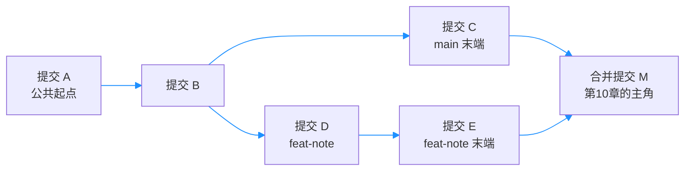

# 第9章：分支的本质是指针

> [!TIP] Part 2: Git 本地实战篇（日常篇）
> 本篇中段的招牌章。上一章你集齐了悔棋三件套，本章进入 Git 最有名也最被误解的能力——分支。先把它的神秘感拆掉，后面的 merge、rebase、协作流程才有落脚点。

「分支」这个词在程序员圈子里自带光环：高手都开分支，教程都讲分支，可轮到自己就手心冒汗——万一开了一条下不来？万一两个分支打架？于是很多初学者的真实状态是：一条 main 用到底，改错了就靠悔棋三件套硬扛。

本章要做的第一件事不是教命令，而是拆神秘感。等你亲眼看到「分支不过是一个 41 字节的文件」，恐惧会当场消散大半。云笔记此刻刚满 50 次提交、3MB，正要进入多线开发——从下一章起，分支就是你的日常。

## 9.1 分支恐惧症的由来

恐惧不是你的错，是历史包袱。集中式时代（第1章提过 SVN），创建分支意味着让服务器把整个项目目录复制一份：30MB 的仓库要复制数十秒，切换分支要与服务器往返，合并更是出了名的慢。于是那个年代的团队养成了一个习惯——**常年只开一条主干，所有人挤在一起改，互相踩脚**。

用具体数字对比两代工具的成本，恐惧就显得毫无必要：

| 操作 | 集中式（SVN） | Git |
|------|--------------|-----|
| 创建分支 | 服务端整目录复制，30MB 仓库需数十秒 | 写一个 41 字节文件，毫秒级 |
| 切换分支 | 与服务端往返，网络慢时以秒计 | 改指针加更新工作区，通常不到 1 秒 |
| 合并分支 | 服务端协调，慢且容易堵塞 | 本地完成，只有冲突才需要人 |
| 团队习惯 | 常年单主干 | 每个功能一条分支是日常 |

**你怕的其实是 SVN 时代的分支；Git 里开分支的成本，约等于一次文件写入**。接下来直接开膛验货。

一个真实的写照：集中式时代的团队常规定「建分支需要审批」，一年下来全公司只有三四条分支；Git 时代的开发者同时挂着三五条分支，一天开十次也不觉得是事。**工具成本决定团队习惯，习惯又反过来塑造你对「分支」这个词的第一反应**——本章做的就是把第一反应纠正过来。

再算一笔反向账：不开分支并不是零成本。三件事挤在一条 main 上，任何一件事没做完都不敢提交，工作区越积越乱；开分支之后每件事都有独立的提交线，乱摊子互不传染。**分支省下的不只是创建成本，更是「半成品互相污染」的隐性成本**。

## 9.2 揭秘：分支就是个文件

第1章说过，全书唯一一次让你看 `.git` 内部就是在本章。到云笔记仓库里，把 main 分支对应的文件原文打印出来：

```bash
cd ~/cloudnote
cat .git/refs/heads/main
```

输出是一行 40 位的十六进制：

```text
a1b2c3d4e5f60718293a4b5c6d7e8f9012345678
```

再量一下它的个头：

```bash
wc -c .git/refs/heads/main
```

输出 41——40 个字符，加 1 个换行符。这 41 字节就是 main 分支的全部实体：**一个分支，是指向某个提交的指针（Pointer），存成一个 41 字节的文本文件**。没有任何隐藏的魔法。

把它画在提交链上就一目了然：

```text
  提交链：A ── B ── C ── D ── E
                     ▲     ▲
                     │     │
                  main   feat-note
```

main 指向 C，feat-note 指向 E，两个指针各是各的 41 字节文件。注意方向：**提交链是「子指父」**——每个提交对象记录着自己的父提交，分支指针只是挂在链条末端的「书签」。这也解释了第7章 `git log --oneline` 输出里 `(HEAD -> main)` 的含义：HEAD 在 main 上，main 在这条链的末端。

顺手看看书签们的家：

```bash
ls .git/refs/heads/
```

```text
main
```

云笔记此刻只有一条分支，所以这里只有一个文件；9.5 节建完 feat-note 后，它会多出一个 `feat-note` 文件——一条分支一个文件，一目了然。再补一个更通用的读法：`git rev-parse main` 直接打印 main 指向的哈希。仓库经历过垃圾回收后，零散引用可能被打包进 `.git/packed-refs`，届时直接 `cat` 未必读得到，而 `rev-parse` 永远可靠。

最后说命名。分支名就是文件名，起名也沿文件习惯：功能用 `feat-` 前缀（如 feat-editor）、修复用 `fix-`、紧急修复用 `hotfix-`。第11章的 hotfix 剧本、第22章的团队工作流，都建立在这套命名习惯上。

> [!NOTE] 为什么新建分支不用复制历史
> 分支只是链条末端的书签，历史本体（提交对象）是共享的。所以「开分支」只需要写一个 41 字节文件指向当前提交——这正是 9.1 节表格里「毫秒级」的全部原因。

## 9.3 HEAD 与检出

还剩一个角色：HEAD。`.git/HEAD` 是个 21 字节的小文件，内容是一行文字：

```text
ref: refs/heads/main
```

意思是「我当前挂在 main 分支上」。这种「指向指针的指针」叫符号引用（Symbolic Ref）。你在 main 上提交时，Git 做两件事：生成新提交，然后把 main 这个书签前移一位——HEAD 本身始终指向 main。

由此引出两个高频概念：

- **检出（Checkout）**：把 HEAD 移到某个分支或提交上，并把工作区同步成目标状态。`git switch main` 就是一次检出。
- **HEAD~1**：HEAD 所指提交的父提交；`HEAD~2` 是祖父提交。第7章的 `git diff HEAD~1`、上一章的 `git reset HEAD~1`，现在你能读出它的准确含义了。

```bash
  # 三种等价或相近的定位写法
git diff HEAD~1        # 与父提交比
git diff HEAD^         # 同上，^ 与 ~1 同义
git diff a1b2c3d       # 与指定提交比（第7章的老朋友）
```

补一个进阶写法备用：遇到合并提交（下一章的主角）时，`HEAD~2` 沿第一父链上溯两代，而 `HEAD^2` 指的是第二个父提交——两者从此分道扬镳。日常用 `~`，读合并历史时才需要 `^`。

如果不经分支、直接把 HEAD 指向某个提交，就进入了游离头指针（Detached HEAD）状态：

```text
  正常态：HEAD ──► main ──► E    新提交 F 挂到 main 上
  游离态：HEAD ──► C             新提交 F 无分支可挂

              A ── B ── C ── D ── E
                         ▲
                  C：游离态直指的中间站
```

游离状态下提交不是不能用，而是**切走之后这些提交会失去书签，变成无主提交**（好在 reflog 仍记录着，第7章的兜底又派上用场）。真进去观光一圈，Git 会当场提醒你：

```text
You are in 'detached HEAD' state. ... If you want to
create a new branch to retain commits you create,
you may do so (now or later) by using -c with the
switch command.
```

提示说得很直白：想留住这里的提交，就 `switch -c` 立个新分支。正确姿势两条：

```bash
  # 只是观光历史：看完从原地回去
git switch --detach a1b2c3d
git switch -                      # 回到之前的分支

  # 想在旧提交上动手干活：当场立一个新分支落袋
git switch -c fix-from-old a1b2c3d
```

## 9.4 新旧命令对照：switch、restore 与 checkout

2022 年前后的老教程里你满眼都是 `git checkout`——因为它一身四用：切分支、建分支、丢弃文件改动、进入历史观光。一词多义是初学者命令记混的重灾区。Git 2.23（2019 年）把它拆成两个专职命令：switch 管切换，restore 管恢复（上一章你已经用过 restore 了）。

| 老写法（checkout 一词多用） | 新写法 | 作用 |
|---------------------------|--------|------|
| `git checkout main` | `git switch main` | 切到已有分支 |
| `git checkout -b feat-note` | `git switch -c feat-note` | 创建并切换到新分支 |
| `git checkout notes.html` | `git restore notes.html` | 丢弃工作区改动（第8章） |
| `git checkout <sha>` | `git switch --detach <sha>` | 历史观光（进入 detached HEAD） |
| `git checkout -` | `git switch -` | 切回上一个分支，两分支间横跳 |
| （branch 家族，无新旧之分） | `git branch -d feat-note` | 删除已合并的分支 |

checkout 并没有被废弃——老脚本、老手册、GUI 工具的输出里全是它，你得看得懂；但自己敲命令时建议用新词，**一词一义，出错的概率直线下降**。`git branch -d` 自带安全带：分支尚未合并时会拒绝删除；`-D` 是跳过检查的强制删除。

拆分后的分工一句话记住：**switch 动「位置」，restore 动「内容」**。位置是你在哪条分支、哪个提交；内容是工作区与暂存区里的文件状态。老命令 checkout 两头都管，新命令各管一头。

## 9.5 用 log --graph 亲眼看分支

概念讲完，动手造一个真实的分叉。目标：两个分支各攒几条提交，然后用图形化日志观察它们的形状。

```bash
git switch -c feat-note          # 从 main 开出新分支
echo "目录页布局初稿" >> toc.html
git add . && git commit -m "目录页布局初稿"
echo "目录页布局第二稿" >> toc.html
git add . && git commit -m "目录页布局第二稿"

git switch main                  # 切回主干，另起一条线
echo "侧边栏定稿" >> style.css
git add . && git commit -m "侧边栏宽度定稿"

git log --graph --oneline --all  # 关键一步：看图
```

输出是这样一张「地图」：

```text
* 9f8d7c6 (HEAD -> main) 侧边栏宽度定稿
| * e5b1a42 (feat-note) 目录页布局第二稿
| * b7e4f01 目录页布局初稿
|/
* a1b2c3d 公共起点：三栏布局重构
```

竖线是两条并行的时间线，`|/` 标出分叉点，括号里是各分支书签所在的位置。逐行读一遍：最左列的 `*` 是提交节点；`| *` 表示 main 之外还有一条线在并行；`a1b2c3d` 是两条线共同的起点。`--all` 让 Git 把所有分支的书签都画出来，不加它只会画当前分支所在的那条线。**这张图不是示意图，是你仓库历史的真实拓扑**——以后判断「我到底在哪儿、谁领先谁」，看它比看文字可靠。

想知道每条分支停在哪个提交，`git branch -v` 一屏看全：

```text
  main       9f8d7c6 侧边栏宽度定稿
* feat-note  e5b1a42 目录页布局第二稿
```

星号标出 HEAD 所在的分支。分支、HEAD、提交三者的位置关系，一张 `git branch -v` 就能核对。

用 mermaid 把这张地图画成节点图（合并提交 M 是下一章的主角，先混个脸熟）：



> [!TIP] 让 log --graph 成为默认习惯
> 可以给它起个别名（第2章的 alias 技巧）：`git config --global alias.lg "log --graph --oneline --all"`，以后一条 `git lg` 就能看地图。

## 9.6 实验：纯命令行演完分支生命周期

最后把「建、切、提交、图示、删除」五步连成一套拳，全程不碰图形界面：

```bash
  # 1. 建：从当前 main 开一条实验分支
git branch exp-note

  # 2. 切：HEAD 移动到 exp-note
git switch exp-note

  # 3. 提交：分支上攒一条提交
echo "实验笔记" > exp.md
git add exp.md && git commit -m "exp-note 上的提交"

  # 4. 图示：main 与 exp-note 各指一处
git log --graph --oneline --all

  # 5. 删：切回 main，再删除实验分支
git switch main
git branch -D exp-note
```

注意第 5 步故意用了 `-D` 而不是 `-d`：exp-note 上有一条 main 没有的提交，`-d` 会以「未合并」为由拦截；这里要演示的正是删除的本质，所以强制删。

删完验证两件事：

```bash
git log --oneline exp-note       # 报错：unknown revision——书签没了
git reflog | head -3             # 但指针移动记录还在
```

你会看到 reflog 里躺着一串哈希，那条「exp-note 上的提交」安然无恙。想复活，把书签重新钉上去即可：`git branch exp-note <哈希>`。

再补两眼证据：

```bash
ls .git/refs/heads/           # 只剩 main——exp-note 的书签文件没了
git branch exp-note b3f9e12   # 从 reflog 抄下哈希，书签重新钉上
git log --oneline -1 exp-note # 那条提交完整回归
```

删书签、钉书签，都是毫秒级操作。到这一步，「分支是个文件」就不再是一句知识，而是你手上的手感。

对照第0章的里程碑 M1 做个自检：不查文档，能不能完成「建分支、改代码、合并、撤销一次误操作」的前两步？本章解决了建与切，合并（merge）正是下一章的主题——拆掉恐惧之后，就轮到把它用熟。

道理在 9.2 节已经埋好：**删除分支删的是书签，不是书**。提交对象本体仍在 `.git/objects` 里，reflog 默认保留 30 天，此后这些无主提交才会被垃圾回收（Garbage Collection，GC）逐步清理。书签可以随手钉随手拔，这才是 Git 分支的正确打开方式。

## 本章小结

- 分支恐惧来自集中式时代「分支很贵」的肌肉记忆；Git 里建分支只是写一个 41 字节文件
- 分支 = 指向某个提交的指针，实体是 `.git/refs/heads/` 下的文本文件
- 提交链「子指父」，分支是链条末端的书签，历史本体全部分支共享
- HEAD 是符号引用，指向当前分支；`HEAD~1` 是父提交，diff、reset 都靠它定位
- detached HEAD 是 HEAD 绕过分支直指提交；要长期停留就 `switch -c` 当场立分支
- checkout 一词多用已拆成 switch（切换）与 restore（恢复，第8章），一词一义更安全
- 删除分支只删书签；提交对象在 GC 前都能凭 reflog 找回

**下一章预告**：分支分开容易，终究要汇合——下一章 merge 与 rebase：分叉的两种结局。

---
