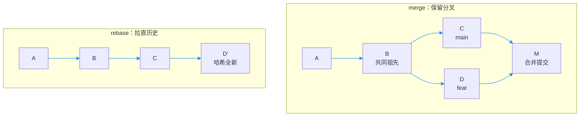

# 第10章：merge 与 rebase：分叉的两种结局

> [!TIP] Part 2: Git 本地实战篇（日常篇）
> 上一章破除了分支恐惧，本章解决分支的必然后续：两条线各自向前，最后怎么汇合？merge 与 rebase 提供了两种截然不同的结局，选对场景是本章的核心目标。

分支敢开了，新问题立刻找上门。云笔记进入阶段 2：仓库涨到 80MB、提交数突破 2000，你也添置了一台台式机，双机写码成为日常。某个晚上，你在笔记本上开了 feat-note 分支改目录页，改到一半关机走人，没合并；第二天在台式机上直接往 main 又提交了两次侧边栏调整。

第三天你想合并目录页时，发现历史已经「岔开」了。本章就讲这个岔开后的抉择：**merge 保留分叉真相，rebase 把历史拉直**——两条路都合法，但适用场景完全不同。

## 10.1 分叉从哪来

把那段历史画出来，就是这个形状：

```text
  A ── B ── C ── D   ← main（台式机：侧边栏两次提交）
       \
        E ── F       ← feat-note（笔记本：目录页两稿）

  B 是两条线的分叉点，也是它们共同的最近祖先
```

先建立一个认知：**分叉不是事故，而是分布式的常态**。第1章讲过，Git 的设计目标就是「强力支持非线性开发」——每人一条线、每机一条线，本来就该各走各的。Git 也绝不擅自替你合并：它把分叉如实记录下来，把选择权留给你。

也许有人会想：「我用 U 盘把两台机器的目录手工同步，不就没有分叉了？」——这正是云笔记阶段 2 之前的做法，也是第0章里「U 盘拷目录拷出灾难」剧本的由来。让一个人类手工合并两个目录，比让 Git 标记一次冲突危险得多：人会覆盖，Git 只会标注。

但分叉放久了代价会涨：两条线改的是同一个 `style.css`，拖得越久，重叠的行数越多，汇合时的冲突越大。云笔记这次只隔了两天、冲突只有一处；到了阶段 3 的三人团队（第22章），惯例是 feature 分支存活不超过三天就汇合一次。**小分叉勤合，大分叉难合**。

## 10.2 merge：三方合并

在 main 上执行 `git merge feat-note`，Git 会根据「main 有没有动过」呈现两种形态：

```text
  形态一：快进 fast-forward——main 分叉后零提交

  合并前  A ── B ── E ── F ← feat-note
               ▲ main
  合并后  A ── B ── E ── F ← main 与 feat-note 重合
               （没有新提交，只是指针前移）

  形态二：三方合并 three-way merge——两边都有新提交

  A ── B ── C ── D ← main
       \           \
        E ── F ──── M ← 合并提交：同时指向 D 与 F 两个父提交
```

两种形态的核心差异：

| 维度 | fast-forward | 三方合并 |
|------|-------------|---------|
| 触发条件 | main 自分叉后零提交 | 两条线都有新提交 |
| 是否产生新提交 | 否，指针前移而已 | 是（有两个父提交的合并提交） |
| 历史形状 | 一条直线 | 菱形分叉 |
| 事后撤销 | 低：指针退回即可 | 中：需 revert 合并提交（第8章） |

重点解释三方合并的三方是谁：**共同祖先 base（此例中的 B）、当前分支的末端（D）、要并入的分支末端（F）**。Git 拿这三份快照逐行比对：base 与 D 的差异是台式机改的，base 与 F 的差异是笔记本改的——只要两边没改同一行，Git 自动把两份差异缝合成新快照，生成合并提交（Merge Commit）。

合并提交是唯一天生有两个父提交的提交——第9章埋的伏笔在此兑现：读它的历史时 `HEAD~1` 沿第一父链（main 侧）上溯，`HEAD^2` 指向第二父链（被并入分支侧）。`git log --graph` 会把两条父链都画出来，这也是日后排查「这个功能从哪条线进来的」时最直观的线索。

两种形态的命令输出也长得完全不同，一眼可辨：

```text
  # 快进：只报指针前移
Updating 1a2b3c4..e5b1a42
Fast-forward
 toc.html | 2 ++

  # 三方合并：报合并策略并生成新提交
Merge made by the 'ort' strategy.
 style.css | 2 +-
```

> [!NOTE] 想永远保留「这里发生过一次汇合」的痕迹
> 默认能快进就快进，不留合并提交。加 `--no-ff` 可以强制生成一条合并提交——不少团队用它标记「一个 feature 从这里进入主干」，配合 revert 也更干净。

## 10.3 冲突：面对它，解决它

两边恰好改了同一行时，Git 拒绝猜心思，当场停下并在文件里标出冲突（Conflict）：

```text
<<<<<<< HEAD
.sidebar { width: 240px; }      ← 台式机版本（当前分支）
=======
.sidebar { width: 20%; }        ← 笔记本版本（feat-note）
>>>>>>> feat-note
```

逐行解剖这段标记：`<<<<<<<` 到 `=======` 是当前分支的内容；`=======` 到 `>>>>>>>` 是要并入分支的内容。**Git 只负责标记现场，绝不替你取舍**——因为合并的不只是文字，是两份意图。

此刻 `git status` 会把现场列得一清二楚：

```text
Unmerged paths:
  (use "git add <file>..." to mark resolution)
        both modified:   style.css
```

`both modified` 是冲突的官方说法。解决后的 `style.css` 应该干干净净，一行标记都不剩：

```text
.sidebar { width: 20%; }        ← 保留 20% 自适应方案
```

解决冲突的标准四步：

```bash
  # 1. 编辑：打开带标记的文件，手工取舍或融合
  #    （本例：20% 自适应是更优方案，保留它，删掉 240px 与全部标记）
  # 2. 标记该文件已解决
git add style.css
  # 3. 其余冲突文件重复前两步
  # 4. 收尾：完成合并
git commit                      # 或 git merge --continue
```

先看反例，再看正例：

```bash
  # 反例一：盲选一边，另一份工作静默蒸发
git checkout --theirs . && git commit

  # 反例二：手抖把冲突标记原样提交进库
git add . && git commit         # 页面上从此挂着 >>>>>>> 

  # 正例：逐个文件读懂标记，融合意图后再收尾
git status                      # 列出所有未合并文件
vim style.css                   # 取舍
git add style.css && git commit
```

如果现场太乱想全身而退，有一条逃生门：`git merge --abort`，仓库瞬间回到合并之前的状态，当作无事发生。**冲突不可怕，可怕的是不看内容就选边**。

比起事后解决，事前预防更便宜：开工前先合并一次 main（或 `git pull`，第19章细讲），让 feature 分支踩在最新历史上；小步提交、勤快汇合，把每次冲突的规模控制在几行之内。**冲突规模与分叉存活时间成正比**，这条规律比任何解决技巧都值钱。

## 10.4 rebase：把提交摘下来重放

rebase（变基）是第二种结局：不制造菱形，而是把 feat-note 上的提交「摘下来」，搬到 main 末端逐个重新播放，让历史拉直成一条线。变基，字面意思就是「换基底」。

```text
  变基前：feat-note 停在旧基底 B 上

  A ── B ── C ── D ← main
       \
        E ── F ← feat-note

  变基后：feat-note 搬到 main 末端，历史成一条线

  A ── B ── C ── D ← main
                     \
                      E'── F' ← feat-note
```

注意搬完之后的一个关键变化：E'、F' 的内容与 E、F 相同，但**哈希全新**——重放生成的新提交，身份证号换了。这个特性既是 rebase 的价值（历史干净），也是它最大的危险来源。

> [!WARNING] 黄金法则：绝不对已推送到公共分支的提交 rebase
> rebase 改写历史，等于给涉及的所有提交换了身份证号。协作者手里还攥着旧哈希的历史，与你的新历史对不上号，拉取、合并、覆盖会连环出事故，而且几乎无法干净收拾。法则的边界也好记：rebase 只动「只有你一个人」的历史——私有分支、还没 push 的提交。

操作本身不复杂，冲突处理与 merge 同构：

```bash
git switch feat-note            # 站在要搬动的一侧
git rebase main                 # 把 E、F 摘下来重放到 D 之后
  # 若某一步冲突：编辑文件 → git add → git rebase --continue
git rebase --abort              # 逃生门：回到 rebase 之前
git switch main
git merge feat-note             # 此刻是纯快进，历史一条直线
```

rebase 顺利收尾时，Git 会报告 `Successfully rebased and updated refs/heads/feat-note`。最后一步的 `git merge feat-note` 则会输出一行 `Fast-forward`——因为重放之后 feat-note 恰好是 main 的直系后代，快进条件自动满足。这正是「rebase 让汇合零成本」的机制：冲突在重放时逐条解决完毕，汇合时已无事可做。

## 10.5 决策表：什么时候用哪个

两个工具没有绝对优劣，只有场景之分：

| 维度 | merge | rebase |
|------|-------|--------|
| 历史形状 | 保留分叉，菱形是真实历史 | 拉直成一条线，整洁 |
| 是否改写已有提交 | 否 | 是，重放者换新哈希 |
| 适合的分支 | 公共分支、主干 | 私有 feature 分支 |
| 撤销方式 | revert 合并提交 | reflog 加 reset（第7、8章） |
| 协作风险 | 无 | 推送到公共分支即灾难 |

行业里多年沉淀出的惯例一句话就能说清：**feature 分支上 rebase，进主干用 merge**。私有历史随便拉直（没 push 之前哈希换了也没人知道），公共汇合点老老实实留痕。第0章概念表里「merge 保留分叉历史，rebase 把历史拉直」那行，本章兑现完毕。

把两种结局画在同一张图里，对比一目了然：



| 你现在的处境 | 推荐 | 理由 |
|-------------|------|------|
| feat-note 还没 push，main 前进了 | rebase | 私有历史，拉直无风险 |
| feat-note 已 push 且同事在用 | merge 或先沟通 | 改写历史必踩人 |
| 团队要求主干历史可审计 | merge --no-ff | 合并提交就是审计记录 |

还有一条只有 rebase 能做对的事：把长分支的一串提交整理干净再进主干。摘下来重放的过程中，可以顺手改写提交信息、合并相邻提交（`git rebase -i` 的交互模式），merge 做不到这一点——它从不改动已有提交。整理的代价是哈希全换，所以依旧只在私有分支上做。

拉直的历史还有两个附带好处：逐条提交排查问题时线性翻找更快；将来做二分定位（`git bisect`）时，直线历史让「哪一条提交引入了 bug」的搜索路径最短。云笔记阶段 3 的三人团队会把本章惯例固化成流程，见第22章。

## 10.6 实验：同一分叉，两种结局

建一个实验仓库，把同一处分叉分别用两种方式收场，亲眼对比 `git log --graph`：

```bash
mkdir ~/merge-lab && cd ~/merge-lab && git init
echo base > style.css && git add . && git commit -m "B: 公共祖先"

git switch -c feat-note
echo "目录页" > toc.html && git add . && git commit -m "E: 目录页初稿"

git switch main
echo "侧边栏" >> style.css && git add . && git commit -m "C: 侧边栏调整"

  # 结局一：三方合并（制造一处冲突并解决）
echo "sidebar { width: 240px; }" > style.css
git add . && git commit -m "D: 台式机侧边栏定稿"
git merge feat-note             # 冲突：CONFLICT (content)
vim style.css                   # 手工取舍，删光标记
git add style.css && git commit # 完成合并
git log --graph --oneline --all # 菱形：M 有两个父提交
```

结局一的图应该是这个形状，中央的 M 就是合并提交：

```text
*   7c4d9e2 (HEAD -> main) Merge branch 'feat-note'
|\
| * e5b1a42 (feat-note) E: 目录页初稿
* | 9f8d7c6 D: 台式机侧边栏定稿
* | 3a2b1c0 C: 侧边栏调整
|/
* 1a2b3c4 B: 公共祖先
```

观察完菱形，用上一章的后悔术回到合并前，改走 rebase 路线：

```bash
git reset --hard ORIG_HEAD      # ORIG_HEAD 记录大动作之前的 HEAD（第8章）

git switch feat-note
git rebase main                 # E 重放为 E'
git switch main
git merge feat-note             # 纯快进
git log --graph --oneline --all # 一条直线，无合并提交
```

结局二则是一条干净的直线——注意 E 的哈希在重放后变了，提交信息不变：

```text
* 6f2e8d1 (HEAD -> main, feat-note) E: 目录页初稿
* 9f8d7c6 D: 台式机侧边栏定稿
* 3a2b1c0 C: 侧边栏调整
* 1a2b3c4 B: 公共祖先
```

两个结局摆在眼前：菱形如实记录「两条线在此汇合」，直线呈现「工作按序推进」。哪个更好没有标准答案——**答案取决于这条分支是私有还是公共**。掌握了选择权，你就从「会用 Git」进入了「会设计历史」。

## 本章小结

- 分叉是分布式开发的常态，分叉点两侧共同的最近祖先叫 base
- merge 两种形态：main 未动则快进（只移指针），两边都动则三方合并（生成合并提交）
- 三方合并比较的是 base、ours、theirs 三份快照，互不重叠的差异自动缝合
- 冲突四步：编辑、add、逐文件处理、commit（或 merge --continue）；merge --abort 是逃生门
- rebase 把提交摘下重放，历史拉直，但重放者哈希全新——这是它的价值也是它的风险
- 黄金法则：绝不对已推送到公共分支的提交 rebase
- 行业惯例：feature 分支上 rebase，进主干用 merge

**下一章预告**：分叉与汇合之外，日常还有三件高频小事——临时切分支、钉里程碑、摘单个提交，下一章 stash、tag 与 cherry-pick 一次讲完。

---
