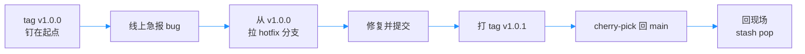

# 第11章：stash、tag 与 cherry-pick

> [!TIP] Part 2: Git 本地实战篇（日常篇）
> 分叉与汇合的大招学完，本章补齐日常三件高频小事：临时切分支、钉版本里程碑、摘取单个提交。stash、tag 与 cherry-pick 各管一件，都是小命令，也都是高频命令。

大招学完，日常登场。阶段 2 的云笔记节奏越来越快：正改着排版，线上 bug 插队；发过版了，得记住「上线的就是这一条提交」；顺手修了个 bug，却修在了不能立刻发布的分支上。这三件事的共同点是：**都很急，都很小，都不值得为大动作铺开流程**。

本章三件兵器各管一件事：stash 管手头活的临时收纳，tag 管给历史钉里程碑，cherry-pick 管摘取单个提交。命令都不长，但每一件背后都有一个值得讲透的结构。

## 11.1 stash：临时抽屉

场景：你在 feat-editor 分支改 `notes.html`，改到 17 行未提交，线上急报 bug，必须马上切分支。`git switch` 会直接拦住你——未提交改动切过去可能冲突甚至丢失。Git 在保护你，但你确实需要「先挪开」。

文件夹时代的反例是复制文件到桌面备份，切过去修完再拷回来——拷错版本的概率极高，三周后桌面上躺着一堆 `.bak`。Git 的正解是贮藏（Stash）：

```bash
git stash push -m "notes.html 排版改到一半"   # 装进抽屉
git stash list                                # 看抽屉里有什么
git switch -c hotfix-login                    # 现在可以干净地切走了
  # ……修完 bug，切回来……
git stash pop                                 # 取出改动，现场恢复
```

多次 stash 也不会乱——它是一个标准的栈（Stack）结构，后进先出：

```text
  git stash push 三次之后：

  栈顶   stash@{0}   「排版第三稿」   ← pop 默认取这个
         stash@{1}   「排版第二稿」
  栈底   stash@{2}   「排版第一稿」
```

继续用开头的场景把流程走完：切到 `hotfix-login` 修完 bug 提交，再切回 feat-editor，`git stash pop` 一敲，那 17 行半成品原封不动回到工作区——像是刚才从未离开。值得一提的还有 stash 的底层：它把你的改动打包成真实的提交对象挂到 stash 引用栈上，所以**抽屉里的东西和提交一样安全，切多少次分支都不会丢**。

取出时有一对容易混淆的命令，区别只在「取完删不删」：

| 命令 | 应用改动 | 从栈上移除 | 适用场景 |
|------|---------|-----------|---------|
| `git stash pop` | 是 | 是（取出即删） | 改动只回一个地方，最常用 |
| `git stash apply` | 是 | 否（栈上保留） | 同一份改动要撒到多个分支 |
| `git stash drop stash@{0}` | 否 | 是 | 这份不要了 |
| `git stash clear` | 否 | 全部 | 慎用：一次清空抽屉 |

`git stash list` 的每行输出都带着分支与说明，找起来不靠猜：

```text
stash@{0}: On feat-editor: notes.html 排版半成品
```

> [!NOTE] stash 的两个边界
> 一、stash 默认只搬已跟踪文件的改动，新建的文件要加 `-u` 才会一起进抽屉。二、pop 时若发生冲突，那条 stash 不会被自动删除——先解决冲突，确认无误再手动 drop，防止改动两头落空。

还有一条使用纪律：抽屉不是仓库。stash 里的东西没有进入任何分支的历史，也没人 review 它，**stash 适合「小时级」的暂存；要过夜的活，还是老老实实开条分支提交**——第9章的书签随用随建，成本可以忽略。

## 11.2 tag：给历史钉里程碑

仓库超过两千次提交后，一个现实问题浮出水面：「v1.0.0 上线那天的那条提交」是哪一条？靠脑子记不住，靠 commit -m 里的字眼也搜不准。标签（Tag）就是钉在历史上的永久书签——和分支一样是指针，但它钉上之后默认不动。

命名采用语义化版本（Semantic Versioning，SemVer）：`v主版本.次版本.修订号`。规则三句话：不兼容的改动主版本加一（v1.0.0 → v2.0.0），新增功能次版本加一（v1.0.0 → v1.1.0），修 bug 修订号加一（v1.0.0 → v1.0.1）。云笔记今天发布第一个正式版：v1.0.0。

标签分两种，差别比想象中大：

| 维度 | 轻量标签（Lightweight） | 附注标签（Annotated） |
|------|------------------------|----------------------|
| 创建命令 | `git tag v1.0.0` | `git tag -a v1.0.0 -m "首个正式版"` |
| 本质 | 只是指向提交的指针 | 指向一个标签对象，含作者、日期、说明 |
| 像什么 | 一张便利贴 | 一块装裱过的纪念牌 |
| 适用 | 私人临时书签 | 对外发布的里程碑 |

```bash
git tag -a v1.0.0 -m "云笔记首个正式版"   # 附注标签，发布用它
git tag -l "v1.*"                         # 按模式列出标签
git show v1.0.0                           # 查看标签详情与对应快照
git push origin v1.0.0                    # 推送指定标签到远程
```

附注标签的内容用 `git show v1.0.0` 就能验货：开头是标签自己的信息，随后才是对应提交：

```text
tag v1.0.0
Tagger: cloudnote-dev <dev@cloudnote.example>
Date:   Sun Nov 1 20:30:00 2026 +0800

云笔记首个正式版

commit a1b2c3d ...
```

SemVer 的三段号放到云笔记的时间线上很好记：v1.0.0 首个正式版；v1.1.0 加入全文搜索（新功能，次版本加一）；v1.0.1 修复导出按钮（修 bug，修订号加一）；将来某天笔记数据格式不兼容升级，才轮到 v2.0.0。**版本号是承诺：用户看到 v1.0.1 就知道只是修 bug，可以放心升级**。

`git tag -l` 还支持通配筛选，发过的版本一目了然：

```text
v1.0.0
v1.0.1
v1.1.0
```

注意最后一条：**标签不会随 `git push` 自动上传**，要单独推。省事的做法是 `git push --tags` 一把全推，但它会把临时便利贴也一起送到远程——发布类标签建议逐个推。

> [!WARNING] 版本号不要移动
> 标签理论上可以 `-f` 强制移到别的提交，但对外发布过的版本号一旦移动，已经下载 v1.0.0 的用户拿到的将是另一种内容——这是发布事故，不是版本管理。

## 11.3 cherry-pick：摘取单个提交

场景：你在 feat-editor 分支上顺手修了一个导出按钮的 bug 并提交，但这个修复明天就要上线，而 feat-editor 整体还没到能合并的程度。把整个分支合过去？掺进太多半成品。放弃？bug 等不了。

第三条路是拣选（Cherry-pick）：把指定的那一个提交复制到当前分支：

```bash
git switch main
git cherry-pick 7e3f9a2          # 把这条提交的改动复制过来
```

成功时它安静地生成一条新提交，和 merge 一样会报告变更统计：

```text
[main 8d3f1c9] 修复导出按钮在旧浏览器失效的问题
 1 file changed, 2 insertions(+)
```

冲突处理与 merge 完全同构：编辑文件 → `git add` → `git cherry-pick --continue`；想全身而退用 `git cherry-pick --abort`。

实战强烈建议加 `-x` 参数，它会在新提交的信息末尾自动补一行来源记录：

```text
修复导出按钮在旧浏览器失效的问题

(cherry picked from commit 7e3f9a2)
```

半年后追溯「这个修复从哪来的」，这行就是线索。一次也可以摘多条：`git cherry-pick <sha1> <sha2>` 按给定顺序依次重放，但摘得越多冲突概率越大，**实战一般一次一条**。

原理层面提醒一句：**cherry-pick 生成的是内容相同、哈希不同的新提交**——它和 rebase 的重放是同一个家族，所以同样遵守第10章的黄金法则：摘取已公开的提交给别人看可以，改写公共历史不行。

## 11.4 组合演练：完整 hotfix 流程

三件兵器单看都简单，价值在于组合。演练一个真实剧本：**v1.0.0 已发布，用户报告导出按钮在部分浏览器失效**。完整 hotfix（紧急修复）流程如下：

```bash
  # 1. 手头的半成品先收好
git stash push -m "notes.html 排版半成品" -u

  # 2. 从 v1.0.0 拉出修复分支（tag 就是个提交坐标，能直接 switch）
git switch -c hotfix-1.0.1 v1.0.0

  # 3. 修复、提交
vim export.js
git add export.js && git commit -m "修复导出按钮在旧浏览器失效"

  # 4. 钉上修订版里程碑
git tag -a v1.0.1 -m "修复导出按钮"
git push origin v1.0.1          # 有远程时执行

  # 5. 让 main 也带上这个修复（main 自己还有新提交，直接合并太重）
git switch main
git cherry-pick -x <修复提交的哈希>

  # 6. 回到半成品现场
git switch feat-editor
git stash pop
```

全程的拓扑长这样——注意 R 和 Y 内容相同但哈希不同：

```text
  v1.0.0 钉在 B，v1.0.1 钉在 Y

  main:    A ── B ── C ── D ── E ── R
                │                  ▲
                │                  │
  hotfix:       X ── Y ────────────┘（R 复制自 Y）
```

三处验收点：第 2 步 `git switch -c hotfix-1.0.1 v1.0.0` 之后，`git log --oneline -1` 应停在 v1.0.0 钉住的那条提交上；第 4 步打完 tag 后 `git tag -l` 应出现 v1.0.1；第 6 步 pop 之后 `git status` 应重新列出 notes.html 的未提交改动。

为什么第 5 步用 cherry-pick 而不是把 feat-editor 整条合并？因为那个分支上还躺着没写完的排版半成品——**合分支是「整批带走」，cherry-pick 是「只拿要紧的那件」**。hotfix 的紧急性决定了它必须走最窄的那条路。

用 mermaid 把流程串起来：



这个流程值得练到肌肉记忆：**从 tag 拉 hotfix 分支、修完钉新 tag、cherry-pick 回主干**——它不依赖任何图形工具，阶段 3 的三人团队里也是同一套动作。

## 11.5 实验：按剧本完整走一遍

找一个练手仓库，把 11.4 的剧本原样跑通，最后用三条命令验收成果：

```bash
mkdir ~/pick-lab && cd ~/pick-lab && git init
echo "v1" > export.js && git add . && git commit -m "初版"
git tag -a v1.0.0 -m "首个正式版"

  # 模拟：在 feature 分支上顺手修了 bug
git switch -c feat-editor
echo "fix compat" >> export.js && git add . && git commit -m "修复导出兼容性"
git log --oneline -1             # 记下这条哈希，如 7e3f9a2

  # 按剧本走 hotfix 流程
git switch main
git cherry-pick -x 7e3f9a2       # 摘到 main
git tag -a v1.0.1 -m "修复导出兼容性"

  # 顺手把 11.1 的抽屉也排进日程：制造半成品再收纳
echo "半成品" >> notes.html
git stash push -m "notes.html 半成品" -u
git switch feat-editor           # 模拟中途切走
git stash pop                    # 回来取出

  # 验收
git log --oneline --decorate -4  # 看到 tag: v1.0.1 与 cherry-pick 来源
git tag -l                       # v1.0.0 与 v1.0.1
git stash list                   # 空的：抽屉已清空
```

验收时重点看 `--decorate` 输出：括号里的 `tag: v1.0.1` 说明书签钉对了位置，`(HEAD -> main)` 说明主干正指向带着修复的最新提交：

```text
* a9b8c7d (HEAD -> main, tag: v1.0.1) 修复导出兼容性
* 1a2b3c4 (tag: v1.0.0) 初版
```

三件兵器各归各位，最后合到一张速查卡上：

| 命令 | 一句话用途 | 最易踩的坑 |
|------|-----------|-----------|
| `git stash push -m` | 手头活临时收纳 | 新文件忘了加 `-u` |
| `git stash pop` / `apply` | 取出改动 | 遇冲突时条目不会自动删 |
| `git tag -a v1.0.1 -m` | 钉发布里程碑 | 忘了标签要单独 push |
| `git cherry-pick -x <sha>` | 摘单个提交 | 摘公开提交去改写公共分支 |

三件兵器各有脾气，但共同点是「小而高频」。至此 Part 2 的工具箱齐整，只差最后一道门：管住什么该进仓库。

## 本章小结

- stash 是「临时抽屉」：push 装入、pop 取出即删、apply 取出保留，栈结构后进先出
- stash 默认不搬新文件，加 `-u`；pop 遇冲突不自动删条目，先确认再 drop
- 语义化版本三段式：不兼容加主版本、新功能加次版本、修 bug 加修订号
- 附注标签含作者与说明，发布用它；轻量标签只是指针，当私人书签
- 标签不随 push 自动上传，发布标签逐个推；已发布的版本号绝不移动
- cherry-pick 摘取单个提交，`-x` 在信息里记录来源；冲突处理与 merge 同构
- 完整 hotfix 剧本：从 tag 拉分支、修复钉新 tag、cherry-pick 回主干

**下一章预告**：工具箱齐了，但仓库里还混着不该有的东西——下一章 .gitignore 与仓库卫生，守住版本库的大门。

---
