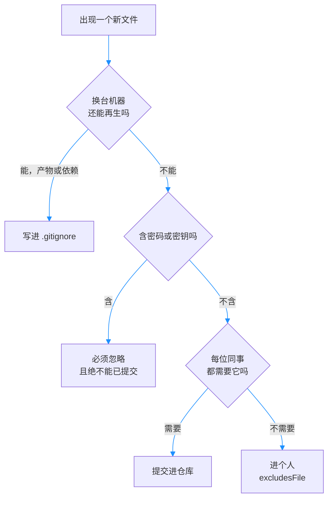

# 第12章：.gitignore 与仓库卫生

> [!TIP] Part 2: Git 本地实战篇（日常篇）
> 本篇收官章。前几章都在「操作历史」，本章反过来管住「什么不该成为历史」：守好版本库的大门，后面 Part 3 的远程协作才有干净的起点。

上一章的工具箱刚收好，一个现实问题就砸了过来。为了阶段 2 的构建流程，你给云笔记引入了依赖管理和打包脚本，第一次 `git status` 刷出 5000 多个待处理文件——全来自 `node_modules/`。仓库也从 5MB 一路涨到 80MB，其中一大块根本不该进库。

更要命的是另一件事：上周调试部署脚本时，你把一个存着数据库密码的 `.env` 提交进了仓库。本章就讲两件事：**怎么让垃圾进不来（.gitignore），以及已经进来的怎么办（抢救流程）**。Part 2 到此收官。

## 12.1 什么不该进版本库

判断标准先立两条：**机器能再生的不进**（源码或包管理器随时能恢复它）；**因人而异的不进**（每台机器上内容不同、或夹带个人偏好与秘密的东西）。按这两条，常见的「仓库垃圾」分成五类：

| 类别 | 典型例子 | 为什么不进库 |
|------|---------|-------------|
| 构建产物（Build Artifact） | node_modules/、dist/ | 可由源码再生，动辄上万文件，仓库暴涨几十 MB |
| 本地配置 | .env、config.local.js | 每台机器不同，常常夹着密码 |
| 编辑器目录 | .vscode/、.idea/ | 个人偏好，同事未必用同款编辑器 |
| 日志与临时文件 | *.log、*.tmp、Thumbs.db | 纯噪音，刷屏 git status |
| 密钥与证书 | *.pem、id_rsa、*.key | 进库即泄露，等于把家门钥匙挂到公网上 |

反例与正例各一句：反例是把 `node_modules/` 提交——你的 80MB 仓库里，别的机器随手一条 `npm install` 就能生成的东西占了大头；正例是忽略它，README 里留一句「克隆后先执行 `npm install`」。**一条口诀：源码进库，产物与秘密止步**。

数字最能说明问题：云笔记阶段 2 共约 2000 次提交，源码本体不过 10MB 上下；一旦把 `node_modules/`（两万多个文件、约 70MB）提交进去，每次克隆都要多传 70MB，第21章搭好自建服务器后每次同步还得反复搬运。构建产物是「可再生」的极限代表——它们像做好的饭，**该进库的是菜谱（源码与依赖清单），不是剩饭**。

顺带澄清一个易混点：`node_modules/` 不进库，但 `package-lock.json` 要进——前者是装好的饭，后者是写着精确配比的菜谱，正是「可再生」的依据。同理，`dist/` 不进库而构建配置文件进库。**分界线画在「能否由仓库内的其他文件推导出来」**。

用 mermaid 把这条口诀变成可执行的判断流程：



## 12.2 .gitignore 语法速查

让垃圾进不了门的门卫，是仓库根目录的 `.gitignore` 文件。语法不多，一张表背完：

| 语法 | 含义 | 示例 |
|------|------|------|
| `#` | 行首为注释 | `  # 构建产物` |
| 结尾 `/` | 只匹配目录 | `node_modules/` |
| `*` | 通配任意字符 | `*.log` |
| `**` | 跨任意层级 | `**/tmp/` 匹配任何深度的 tmp |
| 开头 `/` | 只从仓库根起算 | `/dist` 不管住子目录里的 dist |
| `!` | 否定，重新纳入 | `!keep.txt` |

云笔记现役的 `.gitignore` 长这样，可以直接抄：

```text
  # 构建产物
node_modules/
dist/

  # 日志与临时文件
*.log
*.tmp

  # 本地配置与密钥
.env
*.pem

  # 编辑器与系统文件
.vscode/
.idea/
.DS_Store
```

两个放置细节：`.gitignore` 通常放在仓库根，但任何子目录里也允许放一份——其中规则只作用于所在目录及更深层；规则对路径的匹配以该 `.gitignore` 所在目录为基准。团队项目保持「根目录一份」最简单，找规则时不用翻目录。

规则写多了难免出错，Git 给了一个「规则侦探」：`git check-ignore -v`，它会告诉你某个文件被哪一条规则、在文件的哪一行拦下：

```bash
git check-ignore -v dist/bundle.js
```

```text
.gitignore:3:dist/    dist/bundle.js
```

读法：`.gitignore` 第 3 行的 `dist/` 规则拦住了这个文件。再做个对照实验，看看「文件名在变、规则不变」时的表现：

```bash
git check-ignore -v notes/temp/debug.log
```

```text
.gitignore:6:*.log    notes/temp/debug.log
```

`*.log` 在第 6 行接住了它。若把规则错写成 `*.logs`，同样的命令就会毫无输出——**有输出是「拦了」，没输出是「没拦」，这个侦探只回答是非题**。查「为什么没生效」时先跑它：多数情况是路径写错（`tmp/` 规则拦不住叫 `temp/` 的文件），少数情况是下一条讲的跟踪状态问题。规则不生效通常只有三种原因，按顺序排查：一是路径或通配符写错，用 `check-ignore -v` 验证；二是文件已被跟踪（下一节的主题）；三是别的层在作怪——全局忽略文件里某条旧规则恰好匹配了它。最后再看一个否定规则的经典翻车现场：

> [!NOTE] 否定规则有一个盲区
> 先忽略整个目录 `build/` 之后，`!build/keep.txt` 是无效的——目录被整体排除后 Git 根本不会走进去。改写成先忽略文件 `build/*` 再否定 `!build/keep.txt`，就能生效。

```text
  # 反例：先整体排除目录，再想捞回一个文件
build/
!build/keep.txt        # 无效：Git 不会进入被整体排除的目录

  # 正例：只排除目录下的文件，再留出例外
build/*
!build/keep.txt        # 生效
```

## 12.3 已提交的还能 ignore 吗

先给结论：**不能。.gitignore 只对「未跟踪」的文件生效，管不住已经进库的文件**。那个含密码的 `.env` 就是活例子——你慌忙加了一行 `.env` 到忽略文件，结果 `git status` 照样安静，文件照样被跟踪、被推送，一切照旧。这是新手最常见的假安全感。

正确处置用 `git rm --cached`：它把文件从版本库移除，但**保留本地文件**（不带 `--cached` 的 `git rm` 会连本地文件一起删掉，别用错）：

```bash
git rm --cached .env             # 移出版本库，本地文件还在
echo ".env" >> .gitignore        # 补上忽略规则
git add .gitignore
git commit -m "停止跟踪 .env，并补上忽略规则"
```

从此 `.env` 变回未跟踪状态，被新规则接住，本地照常使用。

一个团队视角的提醒：这次出库提交推到远程后，**每位同事 pull 时都会收到「删除 .env」的变更，他们本地的 .env 文件会随之被删**。提前在群里打声招呼，让大家先备份自己机器上的那份配置，再拉取这次提交。

这条出库提交的暂存区里有一条特殊记录，值得看一眼：

```text
deleted:    .env
```

Git 记录的是「从版本库删除」，而不是「从硬盘删除」——`.env` 出现在 staged 的删除清单里，同时因为补了忽略规则，它也不会再以 untracked 的身份回来。验证两手：

```bash
git ls-files | grep .env     # 无输出：跟踪名单里已没有它
git show HEAD~1:.env         # 但上一条历史提交里仍能翻出全文
```

第二条命令就是隐患的铁证：历史提交里的 `.env` 原样躺着。

> [!WARNING] 移除不等于销毁
> `--cached` 只影响最新版本，**历史提交里的 .env 原样躺着**——任何人拿到仓库，检出旧提交就能翻出密码。只要文件含密钥，就必须按泄露处理：立刻更换密码与密钥，而不是删掉文件了事。从历史里彻底清除的完整流程（filter 类命令与改写远程）在第24章展开。

## 12.4 全局忽略与共享

忽略机制其实有三层，各管一段：

| 层级 | 位置 | 谁能看到 | 放什么 |
|------|------|---------|--------|
| 仓库 `.gitignore` | 仓库根，随库提交 | 全团队 | 团队共识的规则 |
| `.git/info/exclude` | 本仓库私有 | 只有自己 | 本仓库的临时个人规则 |
| `core.excludesFile` | 全局配置 | 自己的所有仓库 | .DS_Store、编辑器缓存等系统文件 |

第三层需要一次性配置，指向你自己的一份忽略文件：

```bash
git config --global core.excludesFile ~/.gitignore_global
echo ".DS_Store" >> ~/.gitignore_global
echo "Thumbs.db" >> ~/.gitignore_global
```

`~/.gitignore_global` 里适合放的是「哪台机器都有的噪音」：macOS 的 `.DS_Store`、Windows 的 `Thumbs.db`、Vim 的 `*.swp`、JetBrains 系的 `.idea/`。这些规则跟着你的用户账户走，到任何仓库都生效，又不会污染任何团队的共享规则。

第二层的 `.git/info/exclude` 用法类似，只是作用域限于单个仓库：

```bash
echo "scratch.md" >> .git/info/exclude    # 本仓库私有，不共享的临时忽略
```

大团队还会维护一份共用的 `.gitignore` 模板（各语言社区都有现成版本），新仓库初始化时直接拷一份，比每次从零手写可靠得多。

分工原则一句话：**团队需要的进 `.gitignore` 提交共享，个人偏好的进全局忽略文件**。把你私有的 `.vscode/` 塞进团队 `.gitignore` 没毛病，但反过来把自己的编辑器配置提交给全组，就是用仓库夹带私货了。

```text
  ~/cloudnote/
  ├── index.html      ← 源码：进库
  ├── style.css       ← 源码：进库
  ├── .gitignore      ← 规则本身：进库，团队共享
  ├── .env            ← 秘密：忽略；进库即泄露
  ├── .vscode/        ← 个人偏好：全局忽略
  ├── dist/           ← 构建产物：忽略，随时可再生
  └── node_modules/   ← 依赖：忽略，两万个文件可再生
```

## 12.5 实验：抢救误提交的 .env

把开头的事故正式收尾。正例流程四步走全：

```bash
  # 1. 移出版本库（本地文件保留）
git rm --cached .env

  # 2. 补上忽略规则，防止再次误提交
echo ".env" >> .gitignore
git add .gitignore

  # 3. 提交这次「出库」动作
git commit -m "停止跟踪 .env 并补上忽略规则"

  # 4. 最关键的一步：当作已泄露，立即更换数据库密码
```

第 1 步执行完，`git status` 应显示 staged 区有一条 `deleted:    .env`；第 3 步提交完成后，`git ls-files` 的输出里不应再有 `.env`；第 4 步没有命令可敲——它是流程里唯一靠纪律完成的一步，也是唯一真正止损的一步。四个环节整理成一张核对表：

| 步骤 | 命令或动作 | 验证方式 |
|------|-----------|---------|
| 移出版本库 | `git rm --cached .env` | `git status` 出现 staged 删除记录 |
| 补忽略规则 | `.gitignore` 加一行 `.env` | `git check-ignore -v .env` 有输出 |
| 提交出库 | `git commit` | `git ls-files` 里无 .env |
| 更换密钥 | 改数据库密码、重发证书 | 用新密钥登录成功 |

反例流程，也就是最开始那次的错误做法，对比着看：

```bash
  # 反例：只加一行 ignore 就以为完事
echo ".env" >> .gitignore
git status                    # 安静得可怕：假象

  # 验证真相
git ls-files | grep .env      # .env 仍在被跟踪列表里
git log --oneline -- .env     # 它的历史提交一条不少
```

`git ls-files` 列出所有被跟踪的文件，是验证「出库是否成功」的标准工具。正例跑完后再查一次，`.env` 应当从这份名单里消失，同时本地文件原封不动。

卫生不是一次性的大扫除，而是定期巡检。两条命令放进每月日程：

```bash
git ls-files | wc -l               # 被跟踪文件总数，环比猛增要查原因
git count-objects -vH              # 仓库体积体检，size-pack 一眼看总量
```

第0章设定里那 80MB 的仓库，巡检时一查就会现形：源码 10MB，剩下的 70MB 全是本不该进门的构建产物——此时按 12.3 的流程出库即可。再叮嘱一遍 12.5 事故的四步记账：移出库、补规则、换密钥、（仓库已共享时）按第24章的流程清洗历史，一步都不能省。**仓库卫生和代码一样需要版本管理思维：门卫（.gitignore）要共享，钥匙（密钥）要轮换，而历史会记住一切**。至此 Part 2 完课，你的本地 Git 功夫已经能撑起单机与双机的日常。

## 本章小结

- 两条入库判据：机器能再生的不进，因人而异的不进；源码进库，产物与秘密止步
- 五类常见垃圾：构建产物、本地配置、编辑器目录、日志临时文件、密钥证书
- .gitignore 核心语法：目录斜杠、`*` 通配、`**` 跨层、`!` 否定；`check-ignore -v` 调试规则
- 否定规则盲区：目录被整体排除后无法再纳入其中文件，要先 `dir/*` 再 `!dir/keep.txt`
- .gitignore 管不住已跟踪文件；`git rm --cached` 出库且保留本地文件
- 出库不等于销毁：历史提交里仍有痕迹，含密钥必须按泄露处理并更换密钥
- 三层忽略：仓库 .gitignore 共享、.git/info/exclude 私有、core.excludesFile 全局个人

**下一章预告**：本地功夫已成，但 Git 的另一半价值在远程——下一章进入 Part 3（SSH 深入实战篇），从 ~/.ssh/config 的别名与多账户开始，从「能登录」进化到「用得爽」。

---
