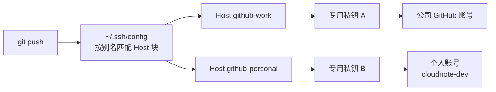

# 第13章：~/.ssh/config：别名与多账户

> [!TIP] Part 3: SSH 深入实战篇（远程篇）
> 本篇把你从「会敲一条 ssh 命令」带到「驾驭整套 SSH 工具箱」：config 别名、密钥管理、端口转发、跳板机、服务端加固与系统排错。本章先解决最耗时间的痛点——把又长又易错的连接命令，缩短成两个字母。

第12章你给仓库做完了大扫除，Part 2 的本地功夫收官。从本章起，镜头从「仓库里有什么」转向「内容怎么安全地到达别的机器」——Part 3 的六章全部围着 SSH 通道转，而通道的第一课不是加密，也不是密钥，是一件更朴素的事：**别再把同一条命令每天敲 20 遍**。

## 13.1 命令越来越长的痛

先看一个熟悉的现场。进入阶段 2 之后，你在笔记本和台式机之间双机写码，每天登云服务器 20 次上下：看日志、重启服务、传文件。偏偏两个变化让命令越来越长：

- 公司的安全基线要求服务器把 SSH 端口从 22 改成 2222（为什么改、值不值，第17章给你完整答案）；
- 按第14章将讲到的习惯，你给工作机配了专用密钥 `~/.ssh/work_ed25519`，而不是人人都用的默认名。

于是「登一下服务器」变成了这条 53 个字符的命令：

```bash
ssh -i ~/.ssh/work_ed25519 -p 2222 wang@203.0.113.10
```

一天 20 遍就是一千多个字符，敲错一个，服务器就礼貌地把你挡在门外。更糟的是，换工具并不换痛苦：

```bash
  # scp 的大坑：端口参数是大写的 -P，与 ssh 的 -p 不同
  scp -i ~/.ssh/work_ed25519 -P 2222 backup.tar.gz wang@203.0.113.10:/tmp/

  # git 走 SSH 通道时，得用环境变量把参数塞给底层的 ssh
  GIT_SSH_COMMAND="ssh -i ~/.ssh/work_ed25519 -p 2222" \
    git push ssh://git@203.0.113.10:2222/srv/git/cloudnote.git main
```

先看两种常见的「自救」，看它们败在哪：

- **反例一：硬背。** 人都靠肌肉记忆，但肌肉记忆救不了你把 `-p` 用在 scp 上。
- **反例二：shell 别名。** `alias connote='ssh -i ... -p 2222 wang@...'` 只救得了 ssh，救不了 scp、rsync 和 git——它们各自是一条独立命令，不会去读你的 shell 别名。

正解早就内置在 SSH 里：**客户端配置文件（client configuration file）**，位置在 `~/.ssh/config`。它由 ssh 命令亲自读取（所以 scp、rsync、git 全都自动受益），作用类似手机通讯录——你存一个昵称，拨号时只喊昵称，完整号码由通讯录代查。

## 13.2 Host 块全解

config 文件由一个个「Host 块」组成，每块回答一个问题：「连接某台主机时，用哪些参数」。先创建文件并收紧权限：

```bash
mkdir -p ~/.ssh
chmod 700 ~/.ssh
touch ~/.ssh/config
chmod 600 ~/.ssh/config
```

然后写入第一个别名块。缩进两个空格是社区习惯，不是语法要求；`#` 开头的注释同样有效：

```text
  # 你的工作服务器，昵称 work
Host work
  HostName 203.0.113.10
  User wang
  Port 2222
  IdentityFile ~/.ssh/work_ed25519
```

之后，53 个字符的命令就变成了 `ssh work`。展开过程长这样：

```text
输入 ssh work
  │
  │  ssh 读 ~/.ssh/config，自上而下找第一个命中的 Host 块
  ▼
┌────────────────────────────────────────────┐
│ Host work                                  │
│   HostName     203.0.113.10                │
│   User         wang                        │
│   Port         2222                        │
│   IdentityFile ~/.ssh/work_ed25519         │
└────────────────────────────────────────────┘
  │
  │  实际发起的连接与手敲这条命令完全等价
  ▼
ssh -i ~/.ssh/work_ed25519 -p 2222 wang@203.0.113.10
```

常用指令先认识这八个，够覆盖全书后续章节：

| 指令 | 作用 | 默认值 |
|------|------|--------|
| HostName | 真正要连的主机名或 IP | 你敲的那个主机名本身 |
| User | 登录用户名 | 本地当前用户名 |
| Port | 端口 | 22 |
| IdentityFile | 指定私钥文件 | 依次尝试 ~/.ssh/ 下的默认名（id_ed25519 等） |
| IdentitiesOnly | 只用本块指定的密钥 | no |
| ServerAliveInterval | 心跳间隔秒数，0 为不发 | 0 |
| AddKeysToAgent | 首次使用时自动把密钥交给 agent | no |
| ProxyJump | 指定跳板机 | 无（第16章） |

> [!WARNING] config 文件也有权限红线
> ssh 会拒绝读取「组或其他人可写」的 config，并报错 `Bad owner or permissions on /home/wang/.ssh/config`。保持属主是你本人、权限 600 即可。这与第17章服务端的 StrictModes 是同一族检查——SSH 全家对「别人能改的文件」一概不信任。

## 13.3 通配与匹配顺序

Host 后面可以写通配符（wildcard）：`*` 匹配任意主机，`?` 匹配单个字符，一行还能放多个模式（`Host work bastion`）。最常见的用法是留一个兜底块，给所有连接统一补上默认参数：

```text
  # 兜底块：凡是前面没被设置的参数，在这里补齐
Host *
  ServerAliveInterval 60
  AddKeysToAgent yes
```

`ServerAliveInterval 60` 表示每 60 秒向服务器发一次心跳，防止长时间挂机后连接被中间设备掐断（第15章细讲）。但兜底块引出了 config 最重要的一条规则，先看反例：

```text
【反例】兜底块放在最前面
Host *
  Port 22            ← Port 在这里被「抢注」

Host work
  Port 2222          ← 已有 Port 值，这条被忽略！
```

结果：`ssh work` 会去连 22 端口，然后卡到超时。原因是 **config 的匹配语义是「自上而下扫描，每个参数先命中先得」，而不是「后来居上」**。越具体的块越要放在前面，`Host *` 永远垫底。正例的完整顺序：

```text
【正例】具体的在前，兜底的垫底
Host work           ← 具体条目 1：工作服务器
Host github-work    ← 具体条目 2：公司 GitHub（13.4 节）
Host github-personal← 具体条目 3：个人 GitHub
Host *              ← 兜底：只补前面没设置的参数
```

顺带一提，`Host` 还支持排除模式（如 `Host *.example.com !critical.example.com`），日常用得少，知道有这回事即可。**记住一句就够：config 读起来像裁判读规则——从上到下，先到先得。** 第17章你会遇到服务端 sshd_config，它的语义一模一样。

## 13.4 多账户隔离

阶段 2 还带来了新麻烦：你同时有两个 GitHub 账号——公司账号（公司项目用）和个人账号 `cloudnote-dev`（云笔记开源项目用）。两个账号意味着两把密钥，而 git 连 GitHub 时用户名永远是 `git`（第19章细说），**服务器区分你是谁，完全靠你递上来的那把钥匙**。

先看反例：把同一把密钥同时登记到两个账号。短期能用，但账号边界已经模糊——哪天你在公司电脑上 push 个人项目，用的就是公司身份；密钥一泄露，两个账号一起沦陷。更隐蔽的坑是 agent（第14章）里攒了一把钥匙后，ssh 默认会先拿 agent 里的钥匙挨个试，试到第 6 次还没轮到对的，服务器直接回一句 `Too many authentication failures` 断开连接。

正解是「两个 Host 块 + 两把钥匙 + `IdentitiesOnly yes`」：

```text
Host github-work
  HostName github.com
  User git
  IdentityFile ~/.ssh/id_ed25519_work
  IdentitiesOnly yes

Host github-personal
  HostName github.com
  User git
  IdentityFile ~/.ssh/id_ed25519_personal
  IdentitiesOnly yes
```

`IdentitiesOnly yes` 是点睛之笔：**让 ssh 只用本块指定的那把钥匙，禁止 agent 里的其他钥匙抢先出手**。两块配置对照如下：

| 配置项 | github-work | github-personal |
|--------|-------------|-----------------|
| HostName | github.com | github.com |
| User | git | git |
| IdentityFile | ~/.ssh/id_ed25519_work | ~/.ssh/id_ed25519_personal |
| 登记在哪个账号 | 公司账号 | cloudnote-dev |
| 验证命令 | ssh -T git@github-work | ssh -T git@github-personal |

验证时 GitHub 会回复 `Hi 公司账号名! You've successfully authenticated...`——注意 GitHub 不提供 shell，命令退出码是 1，但只要看到 `Hi 你的账号名` 就是成功了。整条链路画出来是这样：



> [!NOTE] 公钥要分别登记到两个账号
> 密钥本身没有「属于哪个账号」的属性，是你在 GitHub 的 Settings → SSH and GPG keys 页面把公钥贴给哪个账号，它才属于哪个账号（第20章完整走一遍）。所以「隔离」的最后一环是登记环节别贴错。

## 13.5 config 让 git 直接受益

写完 config，你获得一个立竿见影的调试工具。`ssh -G 别名` 会把「最终生效的全部参数」打印出来，不联网、不登录、纯本地计算（OpenSSH 6.8 起，2015 年加入）：

```bash
ssh -G work | grep -E '^(hostname|user|port|identityfile) '
```

输出类似下面这样（identityfile 会显示为绝对路径）：

```text
hostname 203.0.113.10
user wang
port 2222
identityfile /home/wang/.ssh/work_ed25519
```

这条命令是 config 的「裁判视角」：你以为配置了 A，它告诉你实际生效的是 B，13.3 节的顺序问题一验便知。

更重要的是，**config 里的 Host 名可以直接当主机名用在一切 SSH 地址里**——因为 scp、rsync、git 底层调用的都是同一个 ssh 命令（第19章会解剖这个「外包」机制）：

```bash
  # scp 与 rsync：冒号前写别名即可
  scp backup.tar.gz work:/tmp/

  # git 同理。等第21章把裸仓库建到 /srv/git/cloudnote.git 后：
  git remote add origin work:/srv/git/cloudnote.git

  # 眼下就能玩的：用别名克隆 GitHub 仓库
  git clone github-personal:cloudnote-dev/cloudnote.git
```

对比 13.1 节那条 GIT_SSH_COMMAND 长命令：config 生效后，同一件事就是 `git push` 原地瘦身。**config 里写的 Host 名，在 ssh、scp、rsync、git 眼里就是一台真实的主机**——这个认知会一路用到第16章的跳板机和第21章的自建服务器。

## 13.6 实验：双账户配置并用 ssh -G 验证

目标：10 分钟内配好一个服务器别名加两个 GitHub 别名，并用 `ssh -G` 逐项验证。全程不需要真实的公司账号，第二把钥匙随便生成一个即可。

```bash
  # 1. 建目录与文件，收紧权限
mkdir -p ~/.ssh && chmod 700 ~/.ssh
touch ~/.ssh/config && chmod 600 ~/.ssh/config

  # 2. 为实验生成一把「公司」密钥（已有密钥可跳过）
ssh-keygen -t ed25519 -f ~/.ssh/id_ed25519_work -C "test work key"

  # 3. 写入完整 config（顺序：具体块在前，Host * 垫底）
cat > ~/.ssh/config <<'EOF'
  Host work
    HostName 203.0.113.10
    User wang
    Port 2222
    IdentityFile ~/.ssh/work_ed25519

  Host github-work
    HostName github.com
    User git
    IdentityFile ~/.ssh/id_ed25519_work
    IdentitiesOnly yes

  Host *
    ServerAliveInterval 60
    AddKeysToAgent yes
EOF
```

逐项验证，每一项都有明确的预期输出：

| 检查项 | 命令 | 预期结果 |
|--------|------|----------|
| 别名展开正确 | ssh -G work \| grep -E '^(hostname\|port\|user) ' | 203.0.113.10 / 2222 / wang |
| 服务器连通 | ssh work 'echo ok' | 输出 ok（首次登录按第6章核对指纹） |
| 兜底参数生效 | ssh -G github-work \| grep serveraliveinterval | serveraliveinterval 60 |
| 公私钥归属 | ssh -G github-work \| grep identityfile | id_ed25519_work |

三个常见翻车点，对照自查：

- `Bad owner or permissions`：config 权限过松，`chmod 600 ~/.ssh/config` 解决。
- `ssh work` 连了 22 端口：九成是 `Host *` 块里写了 `Port 22` 且被放在了前面——重读 13.3 节。
- 改了 config 却毫无变化：先 `ssh -G` 看实际生效值，别靠感觉猜。

最后把整个 config 备份进你的 dotfiles（或至少备份一份离线拷贝）。它是纯文本、无秘密（私钥不在这里），阶段 2 你要在笔记本和台式机各放一份，两台机器的命令才能保持一致。

## 本章小结

- 连接参数一多，命令就是事故源；config 是 ssh 亲自读取的通讯录，scp、rsync、git 全部自动受益
- Host 块四件套：HostName、User、Port、IdentityFile；config 文件本身要 600 权限
- 匹配规则是自上而下、先命中先得：具体块在前，`Host *` 兜底垫底
- 多账户隔离 = 两把密钥 + 两个 Host 块 + `IdentitiesOnly yes` 防止 agent 里的钥匙抢先
- `ssh -T git@别名` 验证 GitHub 账号归属，看到 `Hi 账号名` 即成功
- `ssh -G 别名` 打印最终生效参数，是 config 排错的第一工具
- config 里的 Host 名可直接当主机名用于 scp、rsync、git remote 地址

**下一章预告**：别名解决了「敲哪条命令」，但钥匙越攒越多之后，新问题来了——私钥要不要设口令？设了口令难道每次都要输？下一章（第14章 密钥管理：agent 与 passphrase）给每把钥匙上第二把锁，再请一位免打字的管家。

---
