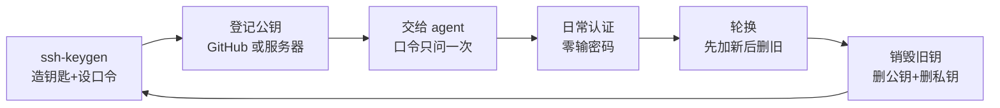

# 第14章：密钥管理：agent 与 passphrase

> [!TIP] Part 3: SSH 深入实战篇（远程篇）
> 上一章的 config 让连接命令变短了，本章处理随之而来的新问题：钥匙一多，怎么放、怎么锁、怎么换、怎么销毁。两个主角：给私钥上锁的 passphrase（口令），以及让你免于反复输口令的 ssh-agent。

第13章你配好了别名与多账户，两把、三把密钥开始在 `~/.ssh` 里安家。钥匙一多，管理问题立刻浮出水面：要不要设口令？口令设了每次都要输，会不会比背长命令还烦？旧钥匙淘汰时怎么优雅退场？这一章回答的全是「钥匙的下半生」——生成只是起点，管好才是功夫。

## 14.1 一机多钥的现实

先盘点阶段 2 你的 `~/.ssh` 目录。笔记本加台式机双机写码，加上公司账号、个人账号、云服务器、内网资产，一个人同时持有 4 把密钥再正常不过：

| 用途 | 建议私钥文件名 | 对应 config 别名 | 为什么单独一把 |
|------|----------------|------------------|----------------|
| 公司 GitHub 账号 | id_ed25519_work | github-work | 离职或设备交接时只作废这一把 |
| 个人 GitHub（cloudnote-dev） | id_ed25519_personal | github-personal | 公私分明，个人项目不沾公司身份 |
| 云服务器 203.0.113.10 | id_ed25519_server | work | 服务器钥不进任何代码托管平台 |
| 内网 git/数据机 | id_ed25519_intranet | db | 内网资产的授权范围单独控制 |

反例是「一把 id_rsa 走天下」：四处登记、处处通用。它的账很好算——泄露一把等于四个阵地同时失守；轮换时要在四个地方重新登记，漏掉一处就留下一个永久的后门。**按用途分钥匙，不是为了仪式感，而是为了把单点风险切成四份，让每一次作废的爆炸半径都可控。**

另外两个命名小习惯：文件名可以自定（`ssh-keygen -f` 指定路径），不必叫 id_ed25519；公钥注释（`-C` 参数）写成「人名+设备+用途」，例如 `wang laptop work github`——将来在 GitHub 后台和 authorized_keys 里排查时，它是唯一的线索。第13章那把 `work_ed25519` 若按本章规范整理，改名 `id_ed25519_server` 更达意——名字本身不重要，全书统一即可。

到阶段 2 中盘，你的 `~/.ssh` 目录应该长这样（权限数字先混个脸熟，本章与第17章会反复用到）：

```text
~/.ssh/
├── config                    ← 第13章：别名与参数（600）
├── id_ed25519_work           ← 公司 GitHub 私钥（600）
├── id_ed25519_work.pub       ← 对应公钥（644，本就公开）
├── id_ed25519_personal       ← 个人 GitHub 私钥（600）
├── id_ed25519_personal.pub
├── id_ed25519_server         ← 云服务器私钥（600）
├── id_ed25519_server.pub
└── known_hosts               ← 第6章：信过的服务器指纹清单
```

一句话记住目录纪律：**.pub 结尾的随便给人，其余的寸步不离。**

## 14.2 passphrase：给私钥上第二把锁

先建立威胁模型。私钥认证的信任链终点是你硬盘上的那个私钥文件，于是问题变成：**谁可能拿到这个文件？** 笔记本在咖啡馆被顺走、电脑借给同事修、误把整个家目录拷进共享网盘——每一种都等于私钥文件直接落入他人之手，不需要任何网络攻击。

此时有没有口令，结局天差地别：

- **无口令的私钥**：文件本身就是钥匙，拷走即用，0 秒攻破。攻击者能立刻以你的身份登录所有登记过这把公钥的地方。
- **有口令的私钥**：文件内容是用口令加密过的（新版 OpenSSH 私钥格式用 bcrypt KDF 从口令派生加密密钥）。攻击者拿到文件还得先离线暴力破解口令，一个 12 位随机口令的破解成本以年计。

所以结论先放在这里：**passphrase 防的不是网络上的黑客，而是「硬盘落入他人之手」这五个字。** 它是私钥的第二把锁，第一把锁（文件权限 600）挡住同机其他用户，它挡住拿到文件的人。

威胁模型落到具体场景，两种结局的差距一表看清：

| 场景 | 无口令私钥的结局 | 有口令私钥的结局 |
|------|------------------|------------------|
| 笔记本在咖啡馆被顺走 | 拷走即用，立刻冒充你登录所有登记处 | 拿到的是密文，先离线破解口令 |
| 家目录被误传到共享网盘 | 同上，且传播范围更大 | 同上 |
| 电脑借人装系统、返厂维修 | .ssh 目录随整盘被复制 | 同上 |

生成时设置口令，就是多答一次提问：

```bash
ssh-keygen -t ed25519 -f ~/.ssh/id_ed25519_personal -C "wang laptop personal"

Enter passphrase (empty for no passphrase):   ← 输入口令，屏幕不回显
Enter same passphrase again:
```

两个实用补充：

- 懒得交互时用 `-N '你的口令'` 一步到位；生成后想换口令用 `ssh-keygen -p -f ~/.ssh/id_ed25519_personal`——注意这只换「锁芯」，不换钥匙本身，公钥与已登记的授权原样有效。
- 反例是「设了口令嫌烦又删掉」。正确姿势是下一节的 agent：口令照设，输入次数降为每台机器每次开机一次。

顺手记一个冷门救命招：私钥还在、公钥却丢了（比如换机时只备份了 .pub 之外的一切），不必重新生成钥匙——`ssh-keygen -y -f ~/.ssh/id_ed25519_personal` 能从私钥反推出公钥全文。**公钥与私钥是同一枚硬币的两面，私钥在手，公钥永远可以重铸**。

## 14.3 ssh-agent：解锁一次全程无忧

ssh-agent（SSH 密钥代理）的定位一句话讲清：**一块保存「已解锁私钥」的内存区域，ssh 认证时自动来取，你不必再输口令。** 上一节的口令只在把钥匙交给它时问一次。

Linux 与 Git Bash 下的标准三连：

```bash
  # 1. 启动 agent，并把环境变量接进当前 shell
eval "$(ssh-agent)"

  # 2. 钥匙交给管家，此刻问一次口令，之后不再问
ssh-add ~/.ssh/id_ed25519_personal

  # 3. ssh 照常连接，认证时 agent 自动供钥
ssh -T git@github-personal
```

agent 靠两个环境变量（SSH_AUTH_SOCK 等）与 ssh 命令牵线，所以新开的终端要能找到同一个 agent。它的日常生命周期很短促：终端里 `eval "$(ssh-agent)"` 启动，随终端关闭而消亡，重启即清空。这带来一类高频小故障：**新开的终端报 `Could not open a connection to your authentication agent`，或 ssh 明明有钥匙却仍然问口令**——原因都是这个终端没接上 agent（环境变量没继承到）。解法不是修系统，是补一句 `eval "$(ssh-agent)"` 再 `ssh-add`。一天的节奏画出来：

```text
开机后的第一件事（一次性成本）：
eval "$(ssh-agent)" ──► ssh-add（各问一次口令）
                                │
                                ▼
              当天所有 ssh / scp / git 零输入

agent 只活在内存里：关终端、注销、重启即清空。
下次再用：重新 eval + ssh-add，口令再答一次。
```

常用命令汇总：

| 命令 | 作用 |
|------|------|
| eval "$(ssh-agent)" | 启动 agent 并接好环境变量 |
| ssh-add 私钥文件 | 加载密钥，问一次口令 |
| ssh-add -l | 列出 agent 持有密钥的指纹 |
| ssh-add -L | 列出对应公钥全文 |
| ssh-add -d 私钥文件 | 移出一把 |
| ssh-add -D | 清空 agent |
| eval "$(ssh-agent -k)" | 关闭 agent |

配合第13章 config 里的 `AddKeysToAgent yes`，第一次使用某把钥匙时它会自动进 agent，连 ssh-add 都可以省。日常体验就变成了：**每天开机后第一次 ssh 问一次口令，之后一整天零输入。**

> [!NOTE] 各平台的 agent 有点不一样
> macOS：用系统自带 ssh 时，`ssh-add --apple-use-keychain`（macOS 12.0 之前叫 `-K`）把口令存进钥匙串，配合 config 里的 `UseKeychain yes` 可以做到重启也不重输。Windows：以管理员 PowerShell 执行 `Set-Service ssh-agent -StartupType Automatic` 再 `Start-Service ssh-agent`，让「OpenSSH Authentication Agent」服务常驻；注意它服务于系统自带 OpenSSH，Git Bash 自带的 ssh 使用自己的 agent 进程，两者不互通。agent 的密钥只活在内存里，重启即清空——这不是缺陷，恰是它的安全属性。

## 14.4 密钥轮换与销毁

钥匙和密码一样有生命周期：换新电脑、怀疑泄露、或者就是定期轮换的习惯，都会走到「换钥匙」这一步。顺序有一条铁律：**先加新、再验证、后删旧，任何时刻手里至少要有一把能用的钥匙**——反例是一上来就删旧钥，新钥又没配好，直接把自己锁在门外。

完整流程五步，以轮换公司钥为例：

```bash
  # 1. 生成新钥（建议文件名带上 new，避免与旧钥混淆）
ssh-keygen -t ed25519 -f ~/.ssh/id_ed25519_work_new -C "wang new laptop work"

  # 2a. 登记新公钥到 GitHub：Settings → SSH and GPG keys → New SSH key
  # 2b. 登记到服务器：追加一行到 authorized_keys
cat ~/.ssh/id_ed25519_work_new.pub >> ~/.ssh/authorized_keys

  # 3. 另开一个终端，用新钥验证通过后再继续
ssh -i ~/.ssh/id_ed25519_work_new work 'echo new key ok'

  # 4. 删旧公钥。先看清单找指纹，再删对应行
ssh-keygen -lf ~/.ssh/authorized_keys
  # 5. 本地收尾：agent 移出、删旧私钥、更新 config 的 IdentityFile
ssh-add -d ~/.ssh/id_ed25519_work
rm ~/.ssh/id_ed25519_work
```

第 4 步删行就是用编辑器打开 authorized_keys 删掉旧钥那一行（保持文件 600 权限，第17章会讲服务端为何在乎）。服务器上的公钥清单像一把登记簿，`ssh-keygen -lf` 会逐行列出指纹与注释——这正是 14.1 节强调写好 `-C` 注释的回报。

轮换的另一半功夫是「盘点登记处」。一把钥匙的公钥登记在几个地方，就要删几个地方，漏一处就留一个活后门：

| 登记处 | 位置 | 操作 |
|--------|------|------|
| GitHub | Settings → SSH and GPG keys | New SSH key 添加新钥，Delete 移除旧钥 |
| 自建服务器 | ~/.ssh/authorized_keys | 追加新公钥一行，编辑器删旧行 |
| 其他用钥的服务 | 各控制台的 SSH keys 设置页 | 同样的「先加后删」节奏 |

建议把「我的公钥登记在哪几处」写成一份三行的个人清单存在密码管理器里——轮换是低频操作，靠记忆必漏。频率上没有强制标准，实用基准是：**个人密钥一到两年一换，或设备进出（卖掉、送修、离职）时必换**；反例是五年不换、换电脑也懒得动的旧钥匙，钥匙串里躺着三把早已说不清用途的 id_rsa——那是清理债，早晚要还。

> [!WARNING] 泄露的私钥只有一条路：作废
> 口令泄露可以改口令，但**私钥文件一旦被拷走（或曾经提交进 git 历史），改口令、删文件都救不回来**——拷贝已经发生。唯一正确的动作是走一遍上面的轮换，把对应公钥从所有登记处删除，让它从此认证失败。删除公钥就是「作废钥匙」这个动作本身。

钥匙的一生画成一张循环图：



## 14.5 私钥安全守则

把前四节浓缩成一张对照表，左列照做，右列一次都别碰：

| 该做 | 不该做 |
|------|--------|
| 私钥 600、~/.ssh 目录 700（ssh-keygen 默认就是） | 把私钥扔进共享网盘、群文件、网盘同步目录 |
| 每把密钥都设 passphrase | 无口令裸奔，图一时省事 |
| 按用途分 4 把钥匙，注明用途注释 | 一把 id_rsa 走天下 |
| 口令存进密码管理器 | 口令写在便签上贴屏幕 |
| 私钥只留在个人电脑 | 提交进 git、发聊天工具、拷上跳板机 |
| 换机/离职/疑似泄露时立刻轮换 | 换了电脑，旧钥继续无感使用多年 |

用一张图记住三把钥匙与管家的日常关系：

```text
   硬盘上的私钥文件（口令加密）       内存里的 ssh-agent
┌─────────────────────────┐       ┌─────────────────────┐
│ id_ed25519_work         │       │ SHA256:9d2f..       │
│ id_ed25519_personal     │ ────► │ SHA256:1a7c..       │
│ id_ed25519_server       │ssh-add│ SHA256:3b8e..       │
└─────────────────────────┘       └─────────────────────┘
  每个文件要各自的口令，口令只在 ssh-add 时问一次
  之后 ssh / scp / git 认证时由 agent 自动供钥，零输入
```

守则里最值得单独强调的是「提交进 git」这一条。阶段 3 的云笔记仓库会到 1.2GB，里面只要混进过一次私钥，历史里就永远有了它——第8章讲过，git 的历史只增不减，事后 `git rm` 删掉文件也删不掉历史记录。**私钥的「私」字是整套体系的地基：公钥可以贴在墙上，私钥连截图都不行。**

「不该做」里还有一条值得专门展开：**多机随意复制私钥**。阶段 2 你要在笔记本和台式机之间双机写码，图省事的做法是把 id_ed25519_work 从这台 scp 到那台——于是同一个私钥文件躺在两块硬盘上，丢哪台都是双重事故，将来轮换还得两台一起改。正确姿势是**每台机器各自生成一把、同一账号登记两把公钥**：GitHub 允许一个账号挂多把钥匙，config（第13章）与公钥一样是纯文本，可以随 dotfiles 安全同步，而私钥永远只在自己那台机器上出生与消亡。

灾备问题也顺带定调：私钥要不要备份？把它传网盘等于把上锁的钥匙挂门口，不行；正确哲学是**私钥不备份，丢了就轮换**——恢复成本只是一次 14.4 的流程，而备份泄露的代价不可控。真正值得随 dotfiles 到处同步的是 config 与公钥。

## 14.6 实验：三把钥匙一个 agent

目标：亲手跑通「多钥匙 + 有口令 + 零反复输入」的完整体验。实验结束后你应该真切感到：口令没有让日常变麻烦。

```bash
  # 1. 生成三把钥匙，各设一个口令（-N 直接指定，免交互）
ssh-keygen -t ed25519 -f ~/.ssh/id_ed25519_work     -N 'test-pass-1' -C "work"
ssh-keygen -t ed25519 -f ~/.ssh/id_ed25519_personal -N 'test-pass-2' -C "personal"
ssh-keygen -t ed25519 -f ~/.ssh/id_ed25519_server   -N 'test-pass-3' -C "server"

  # 2. config 里各自指定——13.4 已写好 github-work 与 github-personal，补上 server 一块
```

```text
Host work
  HostName 203.0.113.10
  User wang
  Port 2222
  IdentityFile ~/.ssh/id_ed25519_server
  IdentitiesOnly yes
```

```bash
  # 3. 启动 agent，统一加载三把，各问一次口令
eval "$(ssh-agent)"
ssh-add ~/.ssh/id_ed25519_work
ssh-add ~/.ssh/id_ed25519_personal
ssh-add ~/.ssh/id_ed25519_server
```

验证清单，逐项打勾：

| 步骤 | 命令 | 预期结果 |
|------|------|----------|
| 清点 agent | ssh-add -l | 3 行 256 SHA256:... 指纹 |
| 连服务器 | ssh work 'echo ok' | 输出 ok，全程未输口令（新钥需先按第5章登记到服务器，未登记则 Permission denied，属预期） |
| 公司账号 | ssh -T git@github-work | Hi 公司账号（未登记公钥则为 Permission denied，属预期） |
| 个人账号 | ssh -T git@github-personal | Hi cloudnote-dev（需先登记公钥） |
| 清空重来 | ssh-add -D 再 ssh work | 第一次又问口令，答一次后恢复免输 |

`ssh-add -l` 的典型输出长这样，指纹后缀正是你当初写的 -C 注释在发光发热：

```text
$ ssh-add -l
256 SHA256:9d2fK3xQ8... wang work (ED25519)
256 SHA256:1a7cQ8mN2... wang personal (ED25519)
256 SHA256:3b8eX1pR7... wang server (ED25519)
```

两个观察点值得停一秒：其一，三把钥匙三个口令，登录体验却毫无区别——这正是 agent 的价值，**口令提高了偷文件者的门槛，agent 抹平了你自己的成本**；其二，`ssh-add -D` 清空后第一次连接会重新问口令，说明口令校验发生在钥匙进 agent 的那一刻，之后 ssh 认证走的全是内存。

实验中可能撞上的小状况，先备好对照表：

| 症状 | 原因 | 解法 |
|------|------|------|
| Could not open a connection to your authentication agent | 当前终端没接上 agent | 重新 eval "$(ssh-agent)" 后再 ssh-add |
| The agent has no identities | agent 空着，一把钥都没加载 | 逐个 ssh-add |
| 每次连接都要输口令 | 钥匙没进 agent（或 agent 没在跑） | ssh-add -l 检查，空则补加载 |
| Too many authentication failures | agent 与 config 双方供钥，试满上限 | config 加 IdentitiesOnly yes（第13章） |

收尾：实验用的密钥如果不再使用，按 14.4 的流程作废；要留用的话，把口令记进你的密码管理器，然后删除 config 之外的多余实验项，保持 ~/.ssh 干净。

## 本章小结

- 阶段 2 的一台机器通常持有 4 把钥匙：公司、个人、服务器、内网各一把，按用途隔离控制爆炸半径
- passphrase 是私钥的第二把锁，防的是「硬盘落入他人之手」；12 位随机口令让离线破解以年计
- ssh-agent 把已解锁的私钥保存在内存里，口令每次开机只问一次，日常认证零输入
- macOS 用 --apple-use-keychain 与 UseKeychain，Windows 启动 OpenSSH Authentication Agent 服务
- 轮换铁律：先加新、再验证、后删旧，任何时刻手里都有一把可用钥匙
- 私钥一经拷贝或入库即视为泄露，唯一处置是删公钥作废，改口令无效
- 私钥权限 600、目录 700、绝不进 git、绝不外传；公钥可以随意公开

**下一章预告**：钥匙管好了，登服务器也丝滑了，但 ssh 的本领远不止「登录进去敲命令」。下一章（第15章 端口转发：-L、-R、-D）把 SSH 通道当成水管，在上面接三通——让本地的数据库图形客户端，穿过 22 端口摸到服务器上只听本机的 PostgreSQL。

---
