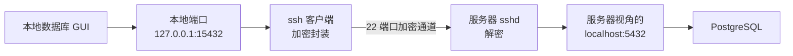

# 第15章：端口转发：-L、-R、-D

> [!TIP] Part 3: SSH 深入实战篇（远程篇）
> config 与密钥管理就位后，本章展示 SSH 通道的第二种用法：不只是「人登进去」，还能让网络流量穿过这条加密水管。三个参数 -L、-R、-D，对应三种接管流量的姿势。

第14章把钥匙管好之后，登录云服务器已经是一条丝滑的加密通道。但真正干活时你会撞上新的墙：服务器上有个服务明明在跑，你本地却连不上。本章就拆这堵墙——**SSH 不只是登录工具，它还是一条可以随意接三通的加密水管**，这就是端口转发（Port Forwarding），俗称隧道（tunnel）。

## 15.1 为什么需要隧道

场景来自云笔记阶段 2 的真实需求：PostgreSQL 数据库装在云服务器 203.0.113.10 上，配置里 `listen_addresses` 保持默认值 `'localhost'`——**它只监听 127.0.0.1:5432，只接受服务器本机的连接**。你在本地电脑上打开数据库图形客户端（DBeaver 之类），填上 `203.0.113.10:5432`，转圈，超时。

为什么数据库要躲起来？因为它知道自己脸大：防火墙和安全组只放行了 22 端口，5432 对公网是关死的。这是标准且正确的姿势。面对这道墙，有三种错误做法：

- **反例一：把 5432 对公网开放。** 公网扫描器对数据库端口的扫描以分钟计，数据库一旦暴露，弱口令爆破随即上门，属于给自己开天窗。
- **反例二：干脆关掉防火墙。** 一台公网机器裸奔，第17章会给你看一台新服务器的 auth.log 里每天数千条爆破记录。
- **反例三：把数据库搬回本地。** 双机写码的服务器端服务就失去了意义。

正解用不着新开任何端口：22 端口的加密通道你已经有了，**在这条通道里再套一根「转接线」，让本地流量借道 22 去够 5432**。这就是端口转发。三根转接线，三个方向：

| 选项 | 监听在哪端 | 目标地址从谁的视角解析 | 典型用途 |
|------|-----------|------------------------|----------|
| -L（本地转发） | 你的电脑 | 服务器 | 本地连服务器的内部服务 |
| -R（远程转发） | 服务器 | 你的电脑 | 让服务器回头访问你的开发机 |
| -D（动态转发） | 你的电脑 | 每个请求临时定 | 本地起一个 SOCKS5 代理 |

一条通用规则先放在最前面：三个选项的完整语法都是「监听端口:目标主机:目标端口」。**最容易理解错的是中间那段「目标主机」从谁的视角解析**——-L 是从服务器视角，-R 是从你本地视角。15.2 节用 -L 把这一点拆透，剩下两个就都通了。

选型不迷路，把日常需求对号入座：

| 需求 | 选型 |
|------|------|
| 本地 GUI 连服务器上只听本机的数据库 | -L |
| 服务器侧的脚本要回调你本地的开发服务 | -R |
| 让某应用的流量临时经服务器出口 | -D |
| 目标机在内网，连 22 都够不着 | 先解决到达问题：第16章 ProxyJump |

动手之前先立三条纪律，它们贯穿本章所有命令：**用完即拆**（隧道是临时通道，不是常驻架构）；**监听只绑回环**（默认即是，别改成 0.0.0.0）；**转发目标按最小权限给**（需要 5432 就只转 5432，不要顺手转个 22）。

## 15.2 本地转发 -L

本地转发（Local Forwarding）一句话：**在本地开一个监听端口，连进它的流量都被塞进 SSH 通道，送到服务器那头，再由服务器转给指定目标。**

```bash
ssh -L 15432:localhost:5432 wang@203.0.113.10
```

这条命令的三段拆开看：

```text
-L 15432 : localhost : 5432
   │          │          │
   │          │          └─ 目标端口
   │          └─ 目标主机（注意：从服务器视角解析！）
   └─ 本地监听端口
```

连上之后，在本地数据库客户端里填 `127.0.0.1:15432`，流量实际走了这样一条路：

```text
数据库 GUI（在本地电脑）
   │ 连接 127.0.0.1:15432（本机回环，不出网卡）
   ▼
ssh 客户端（本地监听 15432）
   │ 加密封装，经 22 端口发往服务器
   ▼
服务器 sshd（解密）
   │ 改发给「服务器视角」的 localhost:5432
   ▼
PostgreSQL（只监听 127.0.0.1:5432，毫不知情地照常应答）
```

两个关键认知：

- **第二段的 localhost 是服务器的 localhost，不是你的。** 反例：想当然以为写的是本地地址，于是填了本机电脑名——服务器上根本没有那台机器，转发静默失败。这条隧道全程加密，数据库看到的来源是 127.0.0.1，就像有人坐在服务器本机上操作。
- **目标也可以是第三台机器。** 写成 `-L 15432:10.0.0.5:5432`，含义变成「服务器替你去连内网机 10.0.0.5 的 5432」——这一下就埋好了第16章跳板机的伏笔。

画成 mermaid 更直观：



另外，本地监听默认绑在回环地址 127.0.0.1 上，别的机器连不进你的 15432——这是安全的默认，别改成 0.0.0.0 除非你清楚后果。

三个实用细节，把 -L 用顺手：

- **本地端口随便挑。** 监听的是你自己的机器，15432 还是 25432 都行，避开已占用的端口即可；1024 以下需要 root，日常用 1 开头的四五位高位端口最省心。
- **一条命令挂多条隧道。** 服务器上往往不止一个服务，参数可以叠着写：`ssh -L 15432:localhost:5432 -L 16379:localhost:6379 work`，一条连接同时通数据库和 Redis，比开两个 ssh 省心。
- **显式写明绑定地址更安心。** `ssh -L 127.0.0.1:15432:localhost:5432 work` 与默认行为一致，但把「只绑回环」写成了明文——团队共享命令时不容易被误改成 0.0.0.0。

## 15.3 远程转发 -R

远程转发（Remote Forwarding）把方向掉了个头：**监听端口开在服务器那头，连进它的流量被送回你本地。** 场景：云笔记的前端开发版跑在你本地 `localhost:3000`，服务器上的联调脚本需要回调这个页面。

```bash
ssh -R 8080:localhost:3000 wang@203.0.113.10
```

之后在服务器上执行 `curl http://127.0.0.1:8080`，请求会穿过隧道回到你本地的 3000 端口。对照 15.1 节的表：这次「目标主机 localhost」是从**你本地**视角解析的——你本地的 3000。

```bash
  # 在服务器的终端里执行：响应应来自你本地的开发服务器
curl -s http://127.0.0.1:8080
```

一个高频坑提前打个预防针：**-R 的转发失败不会打断登录**。如果服务器上 8080 已被别的进程占用，ssh 会照常登录成功，只在输出里捎一句小字警告，隧道实际没建立——这正是 15.5 节坚持加 `ExitOnForwardFailure yes` 的原因：让失败失败得响亮一点，而不是安静地假装成功。

> [!NOTE] 默认只对服务器本机开放
> sshd 出于安全考虑，默认（GatewayPorts no）把远程转发来的端口绑在服务器的 127.0.0.1 上——也就是说外网访问 `203.0.113.10:8080` 是不通的，只有登录服务器本机能用。想让公网访问，需要在服务端把 GatewayPorts 改成 yes 并想清楚代价：那等于把你本地开发机暴露给了整个互联网，多数情况下你真正需要的是反代加鉴权，而不是裸转发。

服务器侧想确认隧道活着，一查便知：

```bash
  # 服务器上执行：应看到监听地址是 127.0.0.1:8080
ss -tln | grep 8080
  # LISTEN 0 10 127.0.0.1:8080  ...
```

一个容易忽略的心法：-R 的监听端口 8080 是「服务器视角的端口」，别和服务器上已有服务冲突；冲突时转发建立失败，配合 15.5 节的 `ExitOnForwardFailure yes` 能让 ssh 立刻报错而不是假装成功。

## 15.4 动态转发 -D

-L 一次只通一个目的地，目标写死在命令里。动态转发（Dynamic Forwarding）把目的地决定权交给流量本身：

```bash
ssh -D 1080 wang@203.0.113.10
```

这条命令在你本地开了一个 SOCKS5 代理，监听 127.0.0.1:1080。此后凡是把这个代理设为出口的应用，每个请求「想去哪」由应用临时声明，ssh 负责把流量原样塞进隧道，从服务器的网络出口出去。

验证它最直观的方式是用 curl 对比两次请求的出口 IP：

```bash
  # 不走代理：出口是你的本地网络
curl -s https://api.ipify.org

  # 走代理：出口变成 203.0.113.10 所在的网络
  # 注意用 --socks5-hostname 而不是 --socks5：前者把域名解析也交给远端
curl -s --socks5-hostname 127.0.0.1:1080 https://api.ipify.org
```

典型用途：验证「从服务器视角」访问某个第三方 API 的表现（服务器在境外机房时尤其有用）、临时借服务器的网络环境调试。想让浏览器也走这条通道，以 Firefox 为例：设置 → 网络设置 → 手动代理配置，SOCKS 主机填 `127.0.0.1`、端口 `1080`，并勾选「使用 SOCKS v5 代理 DNS」（对应 curl 的 --socks5-hostname 语义，把域名解析也交给远端）。

> [!WARNING] 隧道不是 VPN，也不是隐身衣
> 其一，-D 只代理「主动指向它」的应用，浏览器要在代理设置里手动配置 SOCKS5 127.0.0.1:1080，其余流量照走原路，所以它替代不了 VPN。其二，所有流量都从服务器出，服务器管理员对每个请求看得一清二楚——它是运维调试工具，拿它做绕过公司合规的事，后果自负。

三根转接线讲完，把方向收进一张速记图，这是本章最值得带走的一张：

```text
-L  本地监听 15432 ──22 通道──► 服务器去连 localhost:5432
-R  服务器监听 8080 ──22 通道──► 回到你本地的 3000
-D  本地监听 1080 ──22 通道──► 目标由每个请求临时声明
```

## 15.5 写进 config 与保活

隧道命令不短，而且常用，按第13章的老规矩写进 config：

```text
Host tunnel-db
  HostName 203.0.113.10
  User wang
  Port 2222
  LocalForward 15432 localhost:5432
  ServerAliveInterval 60
  ServerAliveCountMax 3
  ExitOnForwardFailure yes
```

之后一条 `ssh -N tunnel-db` 就把隧道立起来。逐项解释这组「长命隧道」的配方：

| 参数 | 默认值 | 建议值 | 一句话解释 |
|------|--------|--------|------------|
| ServerAliveInterval | 0（不发心跳） | 60 | 每 60 秒向服务器发一次心跳包 |
| ServerAliveCountMax | 3 | 3 | 连续 3 次心跳无回应才判定断线（约 180 秒） |
| ExitOnForwardFailure | no | yes | 端口被占等转发失败时直接退出，不假装成功 |
| -N | —— | 必加 | 不执行远程命令，只做转发 |
| -f | —— | 可选 | 认证后转入后台（Linux/macOS 可靠；Windows 建议保持前台窗口） |

心跳为什么必不可少：家用的 NAT 路由器和运营商防火墙通常会掐掉空闲连接，常见的无流量超时从 60 秒到 300 秒不等——不心跳的隧道挂半小时回来看，多半已经凉了。**断线不是网不稳，而是没心跳；保活的三件套是心跳、容忍计数、失败即退。**

还有一个小诊断动作值得养成习惯：立隧道前先看本地端口是否空闲，避免「隧道立了却连不上」的糊涂账：

```bash
  # 本地执行：没输出 = 15432 空闲，可用
ss -tln | grep 15432
```

日常用法则固定成两个动作：

```bash
  # 立隧道（前台，Ctrl+C 即拆）
ssh -N tunnel-db

  # 熟练后转后台
ssh -f -N tunnel-db
```

隧道总会断（网络抖动、笔记本合盖、运营商掐空闲连接），断了不可怕，重跑一遍命令就是。要「断了自动重连」也有成熟方案：autossh 或写个 systemd 服务把 ssh -N 管起来，崩溃自动拉起——思路与 sshd 由 systemd 管理如出一辙，第17章聊完服务端你会更熟悉这套玩法。后台隧道的关闭也别忘了交代：前台 Ctrl+C，后台用 `pkill -f 'ssh -f -N tunnel-db'` 或先 `ps aux | grep ssh` 找到 PID 再 kill。

## 15.6 实验：隧道访问内网 Web

用最轻量的材料做一次完整的 -L 实验：在服务器上起一个只听本机的 Web 服务，从本地浏览器穿过隧道访问它。

```bash
  # 服务器侧：造一个页面，起一个只绑回环的服务
mkdir /tmp/share && echo '<h1>hello from tunnel</h1>' > /tmp/share/index.html
cd /tmp/share && python3 -m http.server 8000 --bind 127.0.0.1

  # 另开一个终端确认它只听 127.0.0.1
ss -tln | grep 8000
```

`ss -tln` 的输出里应看到 `127.0.0.1:8000` 而不是 `0.0.0.0:8000`——这正是 15.1 节「本地 GUI 连不上」的同款处境。然后本地侧：

```bash
  # 本地侧：立一条隧道，本地端口用 18000 避免撞车
ssh -N -L 18000:localhost:8000 wang@203.0.113.10

  # 另开一个本地终端确认监听已建立
ss -tln | grep 18000
  # LISTEN 0 ... 127.0.0.1:18000
```

浏览器打开 `http://localhost:18000`，应看到 hello from tunnel。为了让因果链完整，再补两个反例验证：

| 步骤 | 操作 | 预期结果 | 验证了什么 |
|------|------|----------|------------|
| 1 | 开隧道访问 localhost:18000 | 看到页面 | 隧道通了 |
| 2 | Ctrl+C 拆掉隧道再访问 | 连接拒绝 | 页面不是本地起的，流量真的穿了隧道 |
| 3 | 隧道开着但服务器上 Ctrl+C 停掉 http.server | 浏览器报错 | 目标段解析发生在服务器那头 |
| 4 | 换成 http://203.0.113.10:8000 直连 | 超时 | 防火墙只放行 22，隧道是唯一通路 |

第 4 步值得多看一眼：直连 8000 端口超时、走隧道秒开，两者的对比就是本章全部意义——**没有新开端口，没有降低任何安全水位，只是借了 22 这条现成的加密通道**。顺手把服务器侧的视角也补全：隧道工作期间，在服务器上能看到 sshd 替你建立了到 127.0.0.1:8000 的新连接，而 PostgreSQL 场景里数据库日志看到的来源永远是 127.0.0.1——它到死都不知道真正的客户端在一墙之外。

收尾时把服务器上的 /tmp/share 删掉即可：

```bash
  # 服务器侧清理
rm -rf /tmp/share
```

## 本章小结

- 数据库只听本机、防火墙只放 22 是标准姿势；正解是端口转发，而不是给公网开天窗
- 语法三段式「本地端口:目标主机:目标端口」；-L 的目标从服务器视角解析，-R 从本地视角解析
- -L 本地监听、-R 服务器监听、-D 本地起 SOCKS5 代理按请求动态转发
- 远程转发默认只绑服务器回环（GatewayPorts no），想公开须服务端显式开启并评估风险
- 长命隧道三件套：ServerAliveInterval 60 心跳、ServerAliveCountMax 3 容忍、ExitOnForwardFailure 失败即退
- -N 只转发不执行命令，-f 转后台；隧道命令写进 config 化繁为简
- 目标段也可以是第三台机器（-L 15432:10.0.0.5:5432），服务器替你出内网——跳板机的伏笔

**下一章预告**：-L 转发能「够到」内网服务的端口，但不能「走进去」执行命令。下一章（第16章 跳板机：ProxyJump）把这件事升级：目标机 10.0.0.5 没有公网 IP，你将从跳板机上一跃而过，ssh、scp、git 一步直达。

---
