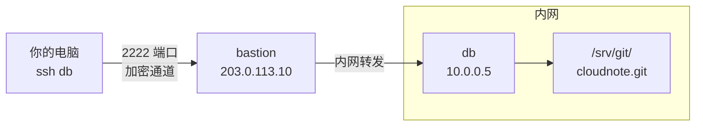

# 第16章：跳板机：ProxyJump

> [!TIP] Part 3: SSH 深入实战篇（远程篇）
> 端口转发让你「够到」内网服务的端口，本章让你「穿过」内网边界直达目标机。一个参数 ProxyJump，把两跳登录压成一条命令，并且 ssh、scp、git 全部通用。

第15章结尾埋了伏笔：-L 转发的目标段可以写成第三台机器，让服务器替你出马。本章把这层关系挑明——当目标机根本不在公网上时，你就需要跳板机（bastion host，也叫堡垒机或 jump host）。这是内网架构里最常见的一道门，也是 ProxyJump 这个参数的整个舞台。

## 16.1 内网隔离的常态

继续云笔记阶段 2 的剧情：数据分析用的数据库被挪到了机房内网的一台机器上，IP 是 10.0.0.5。它没有公网 IP，安全组只允许同内网的机器访问——而你的云服务器 203.0.113.10 恰好在同一个内网里。拓扑长这样：

```text
你的电脑            公网                 内网（外部不可达）
┌──────────┐ ssh  ┌───────────────┐ 内网  ┌─────────────┐
│ ssh db   │ ═══► │ bastion       │ ────► │ 10.0.0.5    │
│ 一条命令 │ 加密  │ 203.0.113.10  │ 转发  │ (db 目标机) │
└──────────┘       └───────────────┘       └─────────────┘
  └──────── 私钥全程留在本地，只传认证协议 ────────┘
```

先把这个小家庭的资产台账立起来，后文的命令都对着它：

| 资产 | 地址 | 公网可达性 | 到达方式 |
|------|------|-----------|----------|
| 你的云服务器（兼任跳板） | 203.0.113.10 | 仅 2222 端口对外开放 | ssh bastion |
| 内网数据库机 db | 10.0.0.5 | 完全不可达 | 只能经跳板转接 |
| 跳板与 db 之间 | 内网互通 | —— | 服务器之间直连 |

为什么内网机要这么藏？反例想一想就明白：给 10.0.0.5 也绑一个公网 IP、开放 22 端口——第17章你会看到，公网 22 端口的爆破尝试以每天数千次计，任何一台暴露的机器都在被持续敲门。**内网机的安全边界不在它自己身上，而在那扇唯一的门上**：门外的人（你）只能先过跳板，跳板本身按第17章的标准加固，内网机则保持对公网完全隐身。

理解了这个架构，问题就只剩一个：你怎么「借道」跳板，又不把安全打折扣？这个模式还有个运维上的红利：**所有外部访问都汇聚到一扇门，审计与管控就有了唯一抓手**——看住跳板的日志，就看住了整个内网的入口。

顺带统一一下称呼：跳板机（bastion host）在云厂商文档里常叫「堡垒机」，企业环境里还可能是带审计功能的商业堡垒机产品（记录每个人的每一次击键）。产品形态千差万别，但网络角色是一样的——**唯一的桥**。本章讲的是自建跳板的通用原理，配好之后无论对面是裸 Linux 还是带审计的堡垒机，接入方式都是同一套。

## 16.2 老办法与新语法

第一种是教科书里的手动两跳：

```bash
  # 第一跳：登上跳板
ssh work
  # 第二跳：在跳板上再跳
ssh wang@10.0.0.5
```

能用，但有两个结构性的毛病。**毛病一：钥匙怎么办？** 第二跳的认证发生在跳板上，私钥只有两种摆法——要么把私钥拷上跳板（直接违反第14章守则：跳板上的 root 能拿走它），要么开 agent 转发（config 里 `ForwardAgent yes`，风险同样实在：跳板上的 root 进程可以借用你的 agent 套接字，冒用你已解锁的钥匙）。**毛病二：体验割裂。** scp 传文件要分两段走，端口转发也要两根隧道叠罗汉。反例现场长这样：

```bash
  # 反例：图省事把私钥拷上跳板
scp ~/.ssh/id_ed25519_server work:~/.ssh/
  # 从此跳板被攻破 = 私钥被攻破 = 内网机跟着沦陷
  # 且这把钥在跳板硬盘上，日志里查不出谁用过它
```

正解是让本地 ssh 自己安排转发，把两跳折叠成一条命令。OpenSSH 5.4 起（2010 年）可以用 ProxyCommand：

```bash
ssh -o ProxyCommand="ssh -W %h:%p work" wang@10.0.0.5
```

`%h` 和 `%p` 是占位符，分别替换成目标主机和目标端口；`ssh -W` 的作用是把标准输入输出直接接到目标的 TCP 连接上，相当于由跳板代为搭桥。OpenSSH 7.3（2016 年）又给它做了个官方语法糖：

```bash
ssh -J work wang@10.0.0.5
```

一个混用细节：`-J` 里写的名字同样会按 config 解析——写 `-J bastion` 时，bastion 块里的 HostName、Port、User 照样生效。因为 -J 的本质就是内部再调一个 `ssh -W` 子进程，config 对它当然也管用。所以「先在 config 里立别名，命令行才好写」的顺序在跳板场景同样成立。

一条命令内部发生了什么，值得画出来看：

```text
ssh -J work 10.0.0.5 的内部接力：
你的 ssh ──TCP:2222──► 跳板 sshd ──ssh -W──► 10.0.0.5:22
    │                     │                     │
    └──── 认证报文由你的 ssh 端到端构造，经跳板中转 ────┘
             跳板只搬运加密字节，看不懂内容
```

注意图中左右两端：第一跳用你的钥匙登跳板，第二跳的认证报文虽然穿过跳板，但构造与签名都发生在你本地——跳板拿到的只是密文管道。

三种方法摆在一起看差距：

| 方法 | 命令样子 | 私钥在哪 | 版本要求 |
|------|----------|----------|----------|
| 手动两跳 | 先 ssh work，再在跳板上 ssh 10.0.0.5 | 跳板上，或靠 agent 转发 | 任意 |
| ProxyCommand | ssh -o ProxyCommand="ssh -W %h:%p work" wang@10.0.0.5 | 始终在你本地 | OpenSSH 5.4+ |
| ProxyJump | ssh -J work wang@10.0.0.5 | 始终在你本地 | OpenSSH 7.3+（2016） |

> [!WARNING] 老教程的两个危险习惯
> 网上大量教程让你「把私钥拷到跳板」或「开 ForwardAgent yes」，两者都等于把钥匙交给了跳板机——跳板被攻破的那一刻，你所有内网资产陪着沦陷。ProxyJump 的认证报文由你本地的 ssh 端到端构造，只借跳板的 TCP 通路，**私钥从生成到销毁都不离开你的硬盘**。这也和第15章的隧道一脉相承：跳板只搬运字节，看不懂内容。

## 16.3 多级跳板

安全要求更严的环境会把边界分成两层：办公网、生产网各一道门。ProxyJump 支持逗号链，按从左到右的顺序逐跳接力：

```bash
  # 先跳 work，再跳 10.0.0.9，最后到 10.0.0.5
ssh -J work,wang@10.0.0.9 10.0.0.5
```

每一跳都可以单独带用户名和端口（`wang@host:port` 的写法），所以多级、异端口、异账号的链条都能描述。用一张小图看链路的形状：

```text
你的电脑 ──► work(203.0.113.10) ──► 10.0.0.9 ──► 10.0.0.5
            第1跳：公网入口      第2跳：生产边界   目标
```

多级跳板平时用得不多，但知道「逗号就是接力棒」这一条，遇到两层隔离的环境就不会懵。链路不通时还有一个笨但有效的办法——逐跳验证，把长链拆成短链分别测：

```bash
ssh work 'echo hop1 ok'
ssh -J work wang@10.0.0.9 'echo hop2 ok'
ssh -J work,wang@10.0.0.9 10.0.0.5 'echo target ok'
```

哪一条先失败，问题就圈定在哪一段。还有一个容易想当然的点：**链上每一跳各自用各的钥匙认证**——第一跳按 bastion 块的 IdentityFile 登跳板，第二跳按 db 块的 IdentityFile 登内网机，并非一把钥匙贯穿始终。所以第14章「按用途分钥匙」的习惯在跳板架构里直接沿用，两跳两钥，各管各的认证。

日常单跳场景，直接进下一节写进 config。

## 16.4 写进 config

老规矩，一次性配置，终身受益。给跳板和内网机各一个 Host 块（bastion 的 HostName 与第13章的 work 是同一台服务器——203.0.113.10，这里按角色重新起名，语义更清楚）：

```text
Host bastion
  HostName 203.0.113.10
  User wang
  Port 2222

Host db
  HostName 10.0.0.5
  User wang
  ProxyJump bastion
```

注意两点：其一，`ProxyJump bastion` 引用的是另一个别名——config 里的别名可以互相引用，ssh 会先把 bastion 展开成 203.0.113.10:2222 再接线；其二，db 块里没写端口，走目标机的默认 22。

两个高频坑提前排掉。**坑一：bastion 块里漏写 User。** db 块的 ProxyJump 只借 bastion 这个名字，ssh 照样要按 bastion 块的配置登跳板——漏了 User 就会拿你本地用户名去连，跳板礼貌拒绝，而报错看起来像「跳板坏了」。**坑二：临时想绕开跳板时别去改文件**，命令行覆盖即可：`ssh -o ProxyJump none db`（团队共享 config、而某些时刻你恰好在内网里时特别好用，用完即走，不留痕迹）。配置生效后，第13章的结论原样复用——**别名写在哪，哪就当真主机用**：

| 想做的事 | 命令 |
|----------|------|
| 登录内网机 | ssh db |
| 远程执行命令 | ssh db 'hostname' |
| 传文件进去 | scp notes.sql db:/tmp/ |
| 同步目录 | rsync -av ./docs db:/tmp/docs |
| 连内网数据库 | ssh -L 15432:localhost:5432 db（第15章配方原样可用） |

首次 `ssh db` 时会弹指纹确认——注意这是**目标机 10.0.0.5 的指纹**，而不是跳板的（跳板早已在第13章登记过）。核对后输入 yes，known_hosts 里从此多一条内网机的记录。若这行确认一直不出现、直接超时，按 16.6 节的断点口诀往第一跳查。

规模感也顺便建立一下：阶段 3 的云笔记仓库将达 1.2GB（含图片素材），哪怕经跳板 rsync 全量同步，多出来的也只是「跳板与内网机之间那一跳」的内网传输——同一机房/VPC 内网通常 1Gbps 起步，1.2GB 实传十几秒量级，跳板带来的延迟感知几乎为零。**性能从来不是拒绝跳板架构的理由，安全才是使用它的理由。**

最后一行值得品一下：第15章的 -L 端口转发和本章的 ProxyJump 是两个独立开关，可以叠加——先经跳板连上 db，再从 db 上把它的 5432 拉回本地。基础设施一层层搭起来之后，上层命令完全不用改。

## 16.5 git 走跳板

假设未来（第21章）云笔记的自建裸仓库建在内网机上，路径 /srv/git/cloudnote.git。有 db 别名之后，git 的接入只有一行：

```bash
git remote add origin db:/srv/git/cloudnote.git
git fetch
git push
```

登记完成后 `git remote -v` 里看到的就是那个带别名的地址，与第13章的写法一脉相承：

```text
$ git remote -v
origin  db:/srv/git/cloudnote.git (fetch)
origin  db:/srv/git/cloudnote.git (push)
```

fetch 和 push 照常工作，仿佛跳板不存在。为什么？回忆第13章末尾的伏笔：**git 自己不懂网络细节，它只是拉起一个 ssh 子进程，把连接整段外包**——ssh 能到达的主机，git 就能到达。ProxyJump 是 ssh 的能力，git 免费继承。

想亲眼验证这条链路，让子进程的 ssh 开唠叨模式：

```bash
GIT_SSH_COMMAND="ssh -v" git ls-remote db:/srv/git/cloudnote.git
```

顺带对比一下两条路线的分工：`GIT_SSH_COMMAND` 适合一次性调试（不动 config，用完即弃），写进 config 的 ProxyJump 适合长期服役（所有命令无感直达）。日常用 config，临时诊断才请出环境变量——和第13章「config 是正解、别靠背长命令」是同一个价值观。想不联网确认跳板已挂上，第13章的 ssh -G 依旧好用：

```bash
ssh -G db | grep -i proxyjump
  # proxyjump bastion —— git 调起的 ssh 会原样继承这个设置
```

输出里能找到两段关键行：先是 `executing proxy command: exec ssh -W 10.0.0.5:22 bastion`（跳板接线），然后才是对 10.0.0.5 的正常认证与握手。若你嫌 -v 太啰嗦，也可以不加任何参数直接 `git fetch`——体验层面完全无感，调试层面才需要打开唠叨模式。一张图收束全章：



对照 15.4 节末尾的三兄弟方向图再看这张图：跳板链路其实可以理解为「一条永远在线的 -L 转发，只不过转发的不只是端口，而是整条 SSH 会话」。机制不同、使命相通——都是在不可直达的两点之间，借一个可信的中间人接线。

**ssh 的能力边界，就是 git 的能力边界**——这句话是 Part 4 的地基。第19章解剖 git pull 时你会看到，所谓「git 走 SSH 通道」，本质就是 git 把 ssh 子进程的输入输出当成自己的传送带。

## 16.6 实验：经跳板登录并执行命令

实验环境说明：内网机可以用云厂商同 VPC 里最便宜的一台按量机器（与 203.0.113.10 内网互通），也可以用本地虚拟机模拟——只要它对公网不可达、而跳板能连到它，实验就成立。

```bash
  # 1. 按 16.4 写入 config（bastion 与 db 两个块）

  # 2. 动手前先确认内网互通（在跳板上做一次性诊断）
ssh bastion 'ping -c 2 10.0.0.5'

  # 3. 无 config 的一次性写法，先证明链路通
ssh -J work 10.0.0.5 'hostname'

  # 4. config 别名版，之后的一切命令都用它
ssh db 'hostname && ip -4 addr show | grep inet'
```

第 3 步应输出内网机的主机名和它的内网地址（10.0.0.5），全程你没有在跳板上停留过一秒。然后做一次故障注入，练习定位跳板问题的手法：

| 步骤 | 操作 | 预期现象 |
|------|------|----------|
| 注入 | 把 bastion 块的 Port 从 2222 改成 2223 | ssh db 卡住直至超时 |
| 定位 | 先跑 ssh bastion 'echo ok' | 跳板自身都不通，问题在第一跳 |
| 收窄 | ssh -G bastion \| grep port | 看到 2223，与服务器实际端口不符 |
| 修复 | 改回 2222 | ssh db 恢复秒连 |

> [!NOTE] 报错出现的位置就是诊断书
> 跳板链路的排错口诀：看断点在哪一段。卡在 proxy command 阶段（ssh -v 里能看到 `executing proxy command` 这行之后没了下文）是第一跳的问题；跳板连通后超时或被拒，才是目标机的问题。和第18章的分层排查一脉相承——**先分清「哪一跳断了」，再谈怎么修**。

链路症状速查，配合上面的口诀使用：

| 症状 | 断点判断 | 首查动作 |
|------|----------|----------|
| 卡在 proxy command 附近超时 | 第一跳 | ssh bastion 'echo ok'；ssh -G bastion \| grep port |
| 跳板能通，之后超时或被拒 | 第二跳 | 确认 db 机 sshd 在跑、内网互通（一次性诊断可登跳板连它） |
| Connection refused | 端口 | ssh -G db \| grep port 与目标机实际端口对表 |
| Permission denied | 认证 | 第14章与第18章的认证层三查 |

收尾：确认 `ssh db 'echo ok'`、`scp`、`git ls-remote db:/srv/git/cloudnote.git`（裸仓库尚不存在时会报仓库不存在，属正常）都能按预期表现后，这套跳板配置就可以长期服役了。

## 本章小结

- 内网机不暴露公网是标准架构；它的安全边界在唯一的入口——跳板机上
- 手动两跳的钥匙困局：私钥上跳板或开 agent 转发都等于把钥匙交给跳板
- ProxyCommand（ssh -W %h:%p，OpenSSH 5.4+）是原理层；ProxyJump（-J，OpenSSH 7.3+）是语法糖
- ProxyJump 的认证由本地端到端完成，私钥全程不离开你的硬盘
- 多级跳板用逗号链：-J work,wang@10.0.0.9，每跳可带独立的用户名与端口
- config 别名可以互相引用：db 块的 ProxyJump bastion 直接写别名即可
- git 只调 ssh 子进程，ssh 能到达的主机 git 就能到达——这是第19章的地基

**下一章预告**：前五章你都是 SSH 的客人，敲的门、配的钥匙、借的道都指向别人的服务器。下一章（第17章 sshd 服务端：开放与加固）换你坐进门卫室：sshd 怎么配置、哪些参数一改就锁门、权限红线的判定规则——把「开放」与「加固」一次讲透。

---
