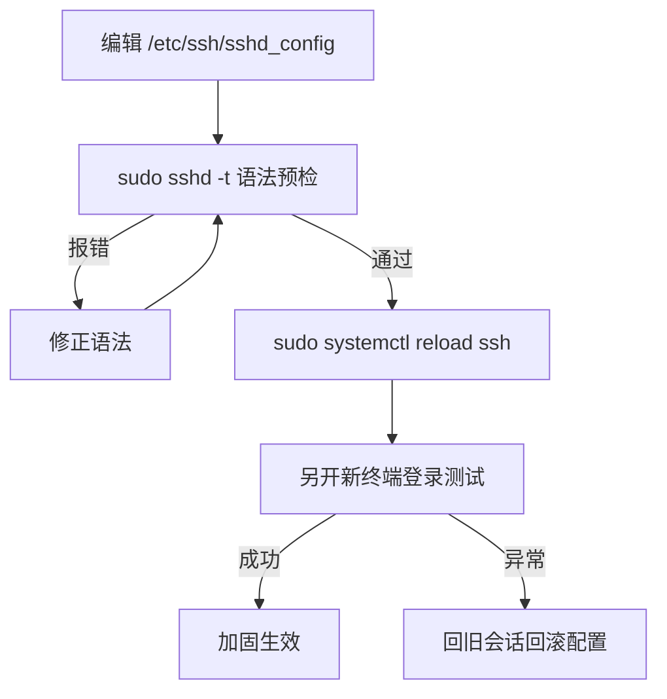

# 第17章：sshd 服务端：开放与加固

> [!TIP] Part 3: SSH 深入实战篇（远程篇）
> 前五章你都是 SSH 的客人：敲别人的门、递自己的钥匙。本章换位到主人视角，把服务端 sshd 的配置、权限红线与加固清单一次讲透——你买的每台云服务器，都是你当主人的第一台机器。

第16章你把跳板机当成了基础设施在用，但有没有想过：跳板机自己是怎么「开门营业」的？谁决定 22 端口开不开、密码能不能用、哪些用户进得来？答案是 sshd（SSH daemon，SSH 守护进程）——一直在服务器上替你守门、却从没露过面的那个进程。理解了它，前五章客户端的很多行为会突然有了对照答案。

## 17.1 换位思考：当你扮演服务器

sshd 由 systemd 管理（守护进程开机自启、崩溃自动拉起）。先认识它的两个身份信息：Ubuntu/Debian 上服务名叫 `ssh`，RHEL/CentOS/Fedora 上叫 `sshd`，命令跟着发行版换名字即可：

```bash
systemctl status ssh
  # Active: active (running) since ... ；main PID 后面就是 sshd 进程
```

sshd 的进程模型决定了后面很多行为，先花 30 秒看清它的组织方式：

```text
systemd ──► sshd 主进程（监听 :22，只负责接客）
                │ 每来一个新连接，fork 一个子进程单独伺候
                ├─► 子进程 A：wang 的会话（跳板登录）
                ├─► 子进程 B：同事的会话
                └─► 子进程 C：爆破连接（认证不过关即拒收）
reload / restart 只重启主进程，已建立的 A、B 照常干活
```

记住这张图就明白了两件事：为什么第16章跳板上的你不受服务器改配置影响；为什么 17.3 节敢让你放心 reload——**主进程重启不牵连已建立的会话，每个会话都是独立子进程**。

sshd 读的配置文件是 `/etc/ssh/sshd_config`（注意是 sshd 不是 ssh，多一个 d 的地方都是服务端）。新版发行版还会在文件顶部写一行 `Include /etc/ssh/sshd_config.d/*.conf`，云厂商镜像常把预置配置放进去。把服务端的四件套先对上号：

| 组件 | 路径 / 命令 | 职责 |
|------|-------------|------|
| sshd 进程 | systemctl status ssh | 监听端口、按连接 fork 会话 |
| 主配置 | /etc/ssh/sshd_config | 开放与限制的策略中枢 |
| 日志 | journalctl -u ssh | 谁来过、谁被拒（第18章主场） |
| authorized_keys | 每个用户的 ~/.ssh/authorized_keys | 该用户认可的公钥白名单 |客户端与服务端的分工一图看懂：

```text
   客户端（你的电脑）                 服务端（云服务器）
 ~/.ssh/config                    /etc/ssh/sshd_config
 「怎么连出去」                    「允许谁进来」
 用哪个端口/用户/密钥              监听哪个端口
                                  允许哪种认证方式
                                  允许哪些用户
        │                              │
        └────────►  TCP :22  ◄─────────┘
              同一条通道，两套规则
```

| 对照项 | 客户端 ~/.ssh/config | 服务端 /etc/ssh/sshd_config |
|--------|----------------------|------------------------------|
| 谁来读 | 每次执行 ssh 命令时 | sshd 启动或 reload 时 |
| 回答的问题 | 怎么连出去（用哪个钥、哪个别名） | 允许谁进来（哪种认证、哪些用户） |
| 作用范围 | 当前这个用户 | 整台机器的所有登录 |
| 改坏了的后果 | 这条命令连不上 | 全机器没人登得进（包括你自己） |

还有一条承上启下的对应关系：第13章讲过 config 「自上而下、先命中先得」——**sshd_config 的语义一模一样**，所以 Include 放在文件最顶部，意味着 sshd_config.d 里的预置配置会优先于你写在正文的同名参数。这个细节 17.3 节马上用到。

## 17.2 核心参数逐项过

sshd_config 一百多个指令，日常真正要拿主意的就这几个。表格里的「默认值」指 OpenSSH 上游默认（发行版或云镜像可能另作预置，以 `sshd -T` 实测为准）：

| 参数 | 默认值 | 建议值 | 理由 |
|------|--------|--------|------|
| Port | 22 | 22 或改 2222 | 改端口是减噪手段，利弊见 17.5 |
| PermitRootLogin | prohibit-password | no | 默认已禁 root 用密码，但允许密钥登 root；root 是爆破头号用户名，干脆禁掉 |
| PasswordAuthentication | yes | no | 公网密码爆破以每天数千次计，改用密钥认证（第5章） |
| PubkeyAuthentication | yes | yes | 密钥认证总开关，保持开启 |
| AllowUsers | 未设置（所有用户可登录） | AllowUsers wang | 最小授权：白名单之外一律拒收 |
| MaxAuthTries | 6 | 6 | 单连接最多尝试 6 次认证，超过即断开（第14章 Too many authentication failures 的出处） |
| StrictModes | yes | yes | 公钥登录前检查权限红线，17.4 的主角 |

> [!NOTE] 先看生效值，再谈改配置
> 想知道一台机器此刻的真实策略，别翻配置文件猜——直接问 sshd 要「最终生效配置」：`sudo sshd -T | grep -Ei 'port|permitrootlogin|passwordauthentication|allowusers'`（sshd -T 需 root，输出全部生效参数）。云镜像的常见 surprises 都藏在这里：比如 Ubuntu 的 cloud-init 可能在 `/etc/ssh/sshd_config.d/50-cloud-init.conf` 里预写了 `PasswordAuthentication no`，你改正文却不生效，原因就是 17.1 节说的「先命中先得」。

改参数的写法与客户端 config 一致：一行一个指令，`#` 注释。多数发行版出厂把这些行注释着——**注释着就等于用默认值**，想改就去掉注释或另起一行（同名参数第一个生效，重复行以靠前的为准）。改动前后的文件长这样：

```text
  # 改动前：发行版出厂常见的注释状态（= 用上游默认值）
#PermitRootLogin prohibit-password
#PasswordAuthentication yes
#AllowUsers ...

  # 改动后：去掉注释、改成目标值，一行一个指令
PermitRootLogin no
PasswordAuthentication no
AllowUsers wang
```

## 17.3 改配置的正确姿势

sshd 配置最大的风险不是「改了不生效」，而是**改错之后把自己锁在门外**。所以服务端改配置有一套固定流程，一步都别省：

```bash
  # 1. 备份，回滚的底气
sudo cp /etc/ssh/sshd_config /etc/ssh/sshd_config.bak

  # 2. 编辑（示例：关掉 root 登录）
sudo vi /etc/ssh/sshd_config
  # PermitRootLogin no

  # 3. 语法预检：没有任何输出即通过，有输出就照着修
sudo sshd -t

  # 4. 平滑重载配置
sudo systemctl reload ssh
  # 5. 关键一步：保留当前会话，另开一个新终端实测登录
```

reload 与 restart 都不会断开已建立的连接（每个会话是独立的子进程，服务单元以 KillMode=process 只回收主进程），但 reload 只重读配置、动作更轻，是改配置的标准动作。三个动作的差别一览：

| 动作 | 重读配置 | 已有会话 | 适用场景 |
|------|----------|----------|----------|
| systemctl reload ssh | 是 | 不受影响 | 改完配置的标准动作 |
| systemctl restart ssh | 是 | 通常也不受影响 | reload 不可用时的替代 |
| killall -HUP sshd | 是 | 不受影响 | 老派写法，知道即可 |

整条流程画出来：



sshd -t 报的错会带上行号，常见几类对照速修：

| 错误写法 | sshd -t 的反应 |
|----------|----------------|
| PermitRootLogin 拒绝 | 值只能是 yes/no/prohibit-password 等关键字，写成自然语言直接报错 |
| AllowUsers=wang（带等号） | Bad configuration option——sshd_config 不支持键值等号写法 |
| 指令拼错（PasswordAuthetication） | Bad configuration option，报具体行号 |
| 多删了引号、粘进杂字符 | 报行号，照着改回即可 |

> [!WARNING] 铁律：改配置时绝不退出当前会话
> sshd -t 通过不代表业务符合预期，只有「另开新终端能登进来」才算数。**当前这个会话就是你的安全绳**：新连接失败时，你还能从旧会话里回滚。若哪天真的把自己锁死了，云厂商控制台的 VNC/串口登录（不依赖 SSH）是最后一道保险——这也是第 14 章说「云服务器别只配 SSH 一条路」的原因。sshd -t 花 10 秒，锁门外一次至少半小时起步。

## 17.4 权限红线与 StrictModes

第5章讲 ssh-copy-id 时留过一个悬念：公钥明明拷成功了，登录却还是要密码，而客户端 `-vvv` 只会冷冷地回一句 denied。谜底在服务端：sshd 默认开启 StrictModes，**公钥认证之前先检查 authorized_keys 及其目录链的属主与权限，不合规矩直接拒绝，连密钥比对都不做**。

红线只有两条：属主必须是你本人（或 root）；文件与路径上任何一级目录不能被「组」或「其他人」可写。对照表：

| 路径 | 建议权限 | 触发拒绝的起点 | 说明 |
|------|----------|----------------|------|
| /home/wang（家目录） | 755 | 775（组可写） | 家目录组可写时直接拒 |
| ~/.ssh | 700 | 775（组可写） | 同上 |
| ~/.ssh/authorized_keys | 600 | 664（组可写） | 644 不触发（公钥本可公开），但统一 600 最省心 |

注意 644 与 664 的分界：StrictModes 只盯「可写位」，不盯「可读位」——公钥本来就是公开的，别人可读无害；但别人可写等于「外人能给你塞公钥」，必须拒。这个分界正好可以解释一类玄学：有人 chmod 600 修好了问题，有人 chmod 644 却毫无效果，其实两人踩的是同一条红线两侧。

这些松权限从哪来？几乎全是人为手滑：修别的文件时顺手 `chmod -R 777`、为了局域网共享把家目录改成组可写、用 root 拷文件把属主改成了 root。出厂默认反而不踩线——Ubuntu 较新版本新建用户的家目录默认 750，老版本 755，都合格。**所以红线不是玄学，是「事后有没有人动过权限」的探测器。**

修复三连，把第5章的悬念正式结案：

```bash
chmod 700 ~/.ssh
chmod 600 ~/.ssh/authorized_keys
chmod go-w ~
```

动手修之前，先学会「一眼看穿」整条路径的现状——namei 把路径上每一级的属主与权限一次列全：

```text
$ namei -l ~/.ssh/authorized_keys
f: /home/wang/.ssh/authorized_keys
drwxr-xr-x root root     /
drwxr-xr-x root root     home
drwxr-xr-x wang wang     wang      ← 家目录：组/他人不可写
drwx------ wang wang     .ssh      ← 700
-rw------- wang wang     authorized_keys  ← 600
```

凡是有属主不对（比如 authorized_keys 属主成了 root 而你用 wang 登录，或反过来）或 w 位多余的一级，就是拒绝公钥登录的元凶。**属主与可写位，两个检查点缺一不可**。修复后无需重启任何服务（sshd 每次认证都现查现判），下一把密钥登录立刻正常。**公钥登录被拒时，第一嫌疑人不是密钥，而是权限**——这个结论第18章还会从日志侧再验证一遍。

## 17.5 加固清单

一台暴露公网的机器，第 1 天的 /var/log/auth.log 里就能收到数千条 Failed password。把加固动作按性价比排序：

1. **关密码认证**：`PasswordAuthentication no`。前提是密钥登录已验证可用（17.6 的顺序就是为此设计）。这一条挡掉绝大多数爆破——爆破者试的全是密码。
2. **禁 root 登录**：`PermitRootLogin no`，日常用普通用户加 sudo。root 是爆破字典的第一个词，禁掉后攻击面少一半。
3. **白名单**：`AllowUsers wang`。机器上的每个账号都是一道可被尝试的门，最小授权从服务端做起。
4. **fail2ban 防爆破**：`sudo apt install fail2ban`，Ubuntu 装完即自动启用 sshd 规则，默认策略是 10 分钟内失败 5 次就封禁来源 IP 10 分钟。`sudo fail2ban-client status sshd` 能看到实时封禁名单——第一次看到 Total banned 的数字，你会对「每天数千次」有体感。想调整策略（比如封 1 小时），写一个覆盖文件即可，不用动发行版自带的 jail.conf：

```text
  # /etc/fail2ban/jail.local：最小覆盖示例
[sshd]
bantime  = 1h
findtime = 10m
maxretry = 5
```

5. **改端口的争议**：22 改成 2222 能挡住无差别扫描器（日志噪音降九成），但挡不住定向攻击（全端口扫描照样找到你），属于减噪不减险，不能当核心防线；改了就要同步更新云安全组、系统防火墙（Ubuntu 的 ufw 记得 `sudo ufw allow 2222/tcp`）、客户端 config（第13章的 2222 就是这么来的），CentOS 上还得 `semanage port -a -t ssh_port_t -p tcp 2222` 放行 SELinux。
6. **算法底线**：新钥一律 ed25519；用 RSA 则至少 3072 位；OpenSSH 8.8（2021 年）起默认禁用基于 SHA-1 的 ssh-rsa 签名，遇到「老设备连不上」应升级对端，而不是把不安全算法开回来。

这份清单的哲学一句话：**加固不是让服务器攻不破，而是让爆破你的成本远高于收益**——密钥认证让密码字典作废，白名单让账号枚举作废，fail2ban让自动化爆破坐牢。

## 17.6 实验：从零开通并加固一台新 SSH 服务

目标：在一台全新机器（或重置系统后的云服务器）上，走完「摸底 → 加钥 → 加固 → 对比验证」全流程。全程遵守 17.3 铁律：旧会话不离手。

```bash
  # 1. 摸底：看清出厂默认
sudo sshd -T | grep -Ei 'port|permitrootlogin|passwordauthentication'

  # 2. 建普通用户并登记公钥（密钥验证通过是关密码的前提）
sudo adduser wang
sudo su - wang
mkdir -p ~/.ssh && chmod 700 ~/.ssh
echo 'ssh-ed25519 AAAA... wang laptop' >> ~/.ssh/authorized_keys
chmod 600 ~/.ssh/authorized_keys

  # 3. 另开终端验证密钥登录成功后，回到旧会话加固
sudo vi /etc/ssh/sshd_config
  # PermitRootLogin no
  # PasswordAuthentication no
  # AllowUsers wang
sudo sshd -t && sudo systemctl reload ssh
```

然后在新终端里把三种登录方式各试一遍，填出这张对比表：

| 操作 | 加固前 | 加固后 |
|------|--------|--------|
| ssh root@203.0.113.10（用密钥） | 可登录（默认 prohibit-password 允许密钥登 root） | Permission denied |
| ssh wang@203.0.113.10（输密码） | 登录成功 | Permission denied (publickey) |
| ssh wang@203.0.113.10（用密钥） | 登录成功 | 登录成功 |

第二行是本实验的灵魂：密码登录被拒时，客户端报 `Permission denied (publickey)`——括号里那个词就是服务器在宣布「我只收公钥」。此时如果输入的密码再正确也没用，这不是你的错，是 17.2 节那张表在工作。想直接看服务器的「收货清单」，用 -v 抓那一行：

```bash
ssh -v wang@203.0.113.10 2>&1 | grep 'Authentications that can continue'
  # 加固后应输出：debug1: Authentications that can continue: publickey.
```

实验异常时，回旧会话对照 17.3 的 mermaid 图回滚即可。回滚模板抄在这里，免得临场翻找：

```bash
  # 从旧会话执行：用备份覆盖回原状，再预检重载
sudo cp /etc/ssh/sshd_config.bak /etc/ssh/sshd_config
sudo sshd -t && sudo systemctl reload ssh
```最后留一份自检清单，全打勾才算收工：

- [ ] sshd -t 无输出、reload 成功
- [ ] 新终端：wang 密钥登录成功
- [ ] 新终端：root 密钥登录被拒
- [ ] 新终端：密码登录被拒（提示只剩 publickey）
- [ ] fail2ban 已安装，fail2ban-client status sshd 正常返回

## 本章小结

- 客户端 config 管「怎么连出去」，服务端 sshd_config 管「允许谁进来」；后者改坏会把所有人锁在门外
- Ubuntu 服务名是 ssh，RHEL/CentOS 是 sshd；配置在 /etc/ssh/sshd_config，注意 sshd_config.d 的预置覆盖
- sshd_config 同样「先命中先得」；sudo sshd -T 看生效值，sudo sshd -t 做语法预检
- 核心五参数：Port、PermitRootLogin（默认 prohibit-password）、PasswordAuthentication（默认 yes）、PubkeyAuthentication（默认 yes）、AllowUsers（默认全放行）
- 改配置流程：备份 → sshd -t → reload → 另开新终端实测；当前会话是唯一安全绳，VNC 是最后保险
- StrictModes 红线：属主正确 + 文件与目录链组/他人不可写；644 合规、664 拒绝；第一嫌疑人永远是权限
- 加固按性价比排序：关密码、禁 root、白名单、fail2ban、改端口减噪、ed25519 优先

**下一章预告**：钥匙、隧道、跳板、加固都练完了，最后一章把散落各章的报错串成一张网。下一章（第18章 排错手册：Permission denied 的真相）给你一套五层排查法：ssh 连不上时，一步一层，每层换一件工具，十分钟内锁定真凶。

---
