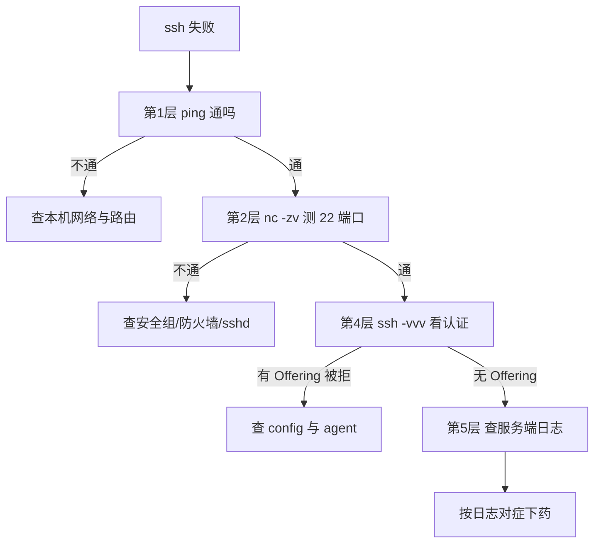

# 第18章：排错手册：Permission denied 的真相

> [!TIP] Part 3: SSH 深入实战篇（远程篇）
> 收官章把 Part 3 串成一张网：密钥、config、agent、跳板、加固的每一个环节都可能出故障。本章交付一套五层排查法——ssh 连不上时不再靠玄学重试，而是逐层收窄，十分钟锁定真凶。

第17章你在服务端装好了门锁，也埋下了不少「会出事的点」：端口可能改过、密码认证可能关了、AllowUsers 可能拦了人、权限可能不合规矩。这些故障在客户端几乎都顶着同一张脸——`Permission denied`。它不告诉你死在哪一层，本章的任务就是给你一张分层地图，让每一次 denied 都有处可查。

## 18.1 分层排查法

先立心法：**排错不是试运气，是控制变量——一次只怀疑一层。** 反例是很多人的真实操作：改一通 config、删一遍 known_hosts、重启机器，碰运气看哪次好了；好了也不知道为什么好，坏了更不知道为什么坏。

一条 SSH 连接从发起到登录成功，要过五道关。每道关一个明确的问题、一件趁手的工具，沿梯子自上而下查，**哪层不通才下探，通了就跳到下一层**：

```text
ssh 连不上？沿梯子自上而下，每层换一件工具，不通才下探
第1层 网络     ping 203.0.113.10
   │ 通
   ▼
第2层 端口     nc -zv 203.0.113.10 22
   │ 开
   ▼
第3层 握手     ssh -vvv 看软件版本横幅
   │ 成功
   ▼
第4层 认证     ssh -vvv 看 Offering public key
   │ 通过
   ▼
第5层 授权     journalctl -u ssh -n 50
```

五层的分工与常客：

| 层 | 要回答的问题 | 工具 | 不通时最常见原因 |
|----|--------------|------|------------------|
| 网络 | 对方机器可达吗 | ping 203.0.113.10 | 本地断网、路由异常 |
| 端口 | 22 端口开着吗 | nc -zv 203.0.113.10 22 | 云安全组、ufw/firewalld、sshd 没起 |
| 握手 | SSH 协议谈拢了吗 | ssh -vvv 看版本横幅 | fail2ban 封禁、中间设备拦截 |
| 认证 | 服务器认这把钥匙吗 | ssh -vvv 看 Offering | 公钥未登记、agent 抢钥 |
| 授权 | 允许这个用户进来吗 | 服务端日志 | AllowUsers 拦截、StrictModes 权限 |

前两层管「路通不通」，中间两层管「身份对不对」，最后一层管「进门之后让不让坐」。把这张表印在脑子里，下面的小节逐层展开。动手前先排除两个「假故障」，免得空跑一趟：首次连接时问 `Are you sure you want to continue connecting` 不是故障，那是第6章的首次指纹登记；连 GitHub 返回 `Hi 账号名` 后退出码为 1 也不是故障，那是 GitHub 不提供 shell 的正常表现（第13章）。每一层在本书都有主场章，排错时按图索骥：

| 层 | 深入章节 | 本章给你的武器 |
|----|----------|----------------|
| 网络 | ——（网络课的领地） | ping 与分层意识 |
| 端口 | 第17章（sshd 与防火墙） | nc -zv、ss -tlnp、安全组与 ufw/firewalld |
| 握手 | 第6章（known_hosts 与指纹） | ssh -vvv 的版本横幅 |
| 认证 | 第5、13、14章（密钥、config、agent） | ssh -vvv 三处关键行、ssh -G、ssh-add -l |
| 授权 | 第17章（AllowUsers 与 StrictModes） | journalctl 与 sshd_config |

五层排查法画成决策树，实操时照着走：



## 18.2 网络层与端口层

第 1 层最常见的误判：**ping 通不等于 22 通。** ping 走 ICMP 协议，SSH 走 TCP 22 端口，云安全组和防火墙按端口放行——ICMP 放行而 22 被拦、或反过来，都完全正常。所以 ping 只是网络层工具，跨到端口层必须换 TCP 探测：

```bash
  # 首选 nc（netcat）：-z 只扫不发数据，-v 显示过程
nc -zv 203.0.113.10 22
  # 没装的话 telnet 也行，看到横幅就 Ctrl+] 再 quit 退出
telnet 203.0.113.10 22
```

端口层的三种结果，含义完全不同，值得背下来：

- **succeeded**：端口开着，甚至 telnet 能看到 `SSH-2.0-OpenSSH_9.6p1` 这样的版本横幅——问题不在网络与端口，直接跳第 4 层。
- **Connection refused**：网络可达，但 22 上没人监听——sshd 没启动，或者第17章改过端口你还在连旧端口。
- **timed out**：包被丢了——云安全组没放行，或系统防火墙（`ufw status` / `firewall-cmd --list-all`）在拦截。

那个版本横幅还有额外价值：它同时确认了第 3 层握手——横幅里的 `OpenSSH_9.6p1` 就是服务器自报的 OpenSSH 版本，能看到它，说明 TCP 通、协议版本协商也通了。排查时若横幅能看见、认证却过不去，**问题必然在第 4 层以后**，别回头折腾网络。

把日常遇到的现象按层归位，就是一张速查表：

| 现象 | 卡在哪层 | 首查工具 |
|------|----------|----------|
| Connection timed out | 端口/网络 | nc -zv 203.0.113.10 22；查云安全组与 ufw/firewalld |
| Connection refused | 端口 | systemctl status ssh：sshd 没起或端口不对 |
| kex_exchange_identification: Connection reset | 握手 | fail2ban 是否封了你（fail2ban-client status sshd） |
| Permission denied (publickey) | 认证 | ssh -vvv 看三处关键行（18.3） |
| Too many authentication failures | 认证 | ssh-add -l 数钥匙；config 加 IdentitiesOnly yes |
| WARNING: REMOTE HOST IDENTIFICATION HAS CHANGED! | 双向认证 | 按第6章流程核实后再 ssh-keygen -R |

「端口层不通」时的排查动作按从外到内的顺序做，先查最外面那道墙：

```bash
  # 1. 云安全组：厂商控制台里确认 22（或 2222）TCP 已放行——这层没有命令行
  # 2. 系统防火墙
sudo ufw status                        # Ubuntu
sudo ufw allow 2222/tcp                # 缺就补
sudo firewall-cmd --list-all           # RHEL/CentOS
sudo firewall-cmd --permanent --add-port=2222/tcp && sudo firewall-cmd --reload

  # 3. sshd 到底听没听、听在哪个端口（0.0.0.0 = 全网卡，127.0.0.1 = 仅本机）
sudo ss -tlnp | grep sshd

  # 4. 服务状态兜底
systemctl status ssh
```

## 18.3 认证层：读懂 ssh -vvv

`ssh -vvv` 的输出动辄几百行，别通篇硬读，只看三处。先记住开关的剂量：`-v` 少量、`-vv` 更多、`-vvv` 全量，认证问题直接上 -vvv。一段真实的认证尾巴长这样（`ssh -vvv work 2>&1 | tail -7` 的典型输出，真实输出里密钥路径为绝对路径，此处截短示意），按顺序正好覆盖三处关键行：

```text
$ ssh -vvv work 2>&1 | tail -7
debug1: Authentications that can continue: publickey
debug1: Offering public key: work_ed25519 SHA256:9d2f...
debug1: Authentications that can continue: publickey
debug1: Trying private key: ~/.ssh/id_rsa
debug1: No more authentication methods to try.
wang@203.0.113.10: Permission denied (publickey).
```

顺带把第 3 层在这里也交代掉：-vvv 输出的开头就是握手过程，`Connecting to 203.0.113.10 ... port 2222`、`Connection established`、`Remote protocol version 2.0, remote software version OpenSSH_9.6p1` 三行齐了，说明握手无恙——可以直接跳到认证段看。

**第一处：服务器宣布收什么。** 握手完成后，服务器会先发一张「认证方式清单」：

```text
debug1: Authentications that can continue: publickey
```

冒号后面就是服务器接受的方式。**最常见的死因已经写在脸上：服务器只收 publickey，而你手里备的是密码**——第17章加固后的服务器全是这个姿势，云镜像也普遍默认只收公钥。看到这行就该去登记公钥，而不是反复试密码。

**第二处：你递了哪把钥匙。**

```text
debug1: Offering public key: work_ed25519 SHA256:9d2f...
```

这行证明客户端找到了钥匙并递了出去；它后面紧跟服务器接受与否。**整段输出里如果没有 Offering 行，说明客户端根本没找到钥匙**——config 没命中（18.5 的 ssh -G 一查便知）或私钥文件不在了。

**第三处：终局。**

```text
debug1: No more authentication methods to try.
wang@203.0.113.10: Permission denied (publickey).
```

若是 `Too many authentication failures`，对应的是 agent 里塞了超过 6 把钥匙（MaxAuthTries，第17章的表），对的钥匙还没轮到就被断开——第13章的 `IdentitiesOnly yes` 就是特效药。三处关键行汇成小抄：

| -vvv 关键行 | 含义 | 下一步 |
|-------------|------|--------|
| Authentications that can continue: publickey | 服务器只收公钥 | 只备了密码就去登记公钥 |
| Offering public key: ... SHA256:... | 你递了这把钥匙 | 核对指纹是否是你想用的那把 |
| Offering 后又是 Authentications that can continue | 服务器拒了这把钥 | 公钥没登记，或权限红线（18.4） |
| No more authentication methods to try | 手里的牌打完了 | 回上一行的处置 |
| Too many authentication failures | 试满 6 次被踢 | ssh-add -D 清场，或 IdentitiesOnly yes |

> [!TIP] 一半以上的「Permission denied」死在同一处
> 服务器只收公钥（continue: publickey）而你只备了密码——这一条覆盖了初学者排错案例的半壁江山。以后看到 denied，第一眼就找 `Authentications that can continue` 这行，答案常常已经写在那里。

## 18.4 服务器端日志

客户端报错永远只有一句话，**真话在服务端日志里**——这也是第17章让你换位的原因：不进过门卫室，就读不懂门卫的记录。

```bash
  # Ubuntu/Debian：服务名是 ssh
sudo journalctl -u ssh -n 50
  # 装有 rsyslog 的系统另有文件版；RHEL/CentOS 服务名是 sshd
sudo tail -50 /var/log/auth.log
sudo tail -50 /var/log/secure
```

两条检索技巧让日志更省眼：一是过滤失败相关行，二是开跟踪模式——一个终端跑 `journalctl -u ssh -f` 盯着滚动，另一个终端发起连接，**报错出现的那一刻你就在场**：

```bash
  # 只看失败、拒绝、报错相关行
sudo journalctl -u ssh -n 200 | grep -Ei 'failed|refused|not allowed|error'

  # 跟踪模式：边连边看，排错最快的姿势
sudo journalctl -u ssh -f
```

日志里高频出现的几行，每行都是一个确诊单：

| 服务端日志（节选） | 病因 | 处方 |
|--------------------|------|------|
| Accepted publickey for wang from ... | 成功记录 | 先找它：也许其实连上了，别白忙 |
| Failed publickey for wang from ... ED25519 SHA256:xxx | 服务器不认这把钥 | 核对该指纹是否已登记（ssh-keygen -lf） |
| Authentication refused: bad ownership or modes for file /home/wang/.ssh/authorized_keys | 17.4 的权限红线 | chmod 700 ~/.ssh；chmod 600 authorized_keys；chmod go-w ~ |
| User wang from ... not allowed because not listed in AllowUsers | 白名单拦截 | sshd_config 补上用户名后 reload |
| error: maximum authentication attempts exceeded | 客户端钥匙太多 | ssh-add -D 清场或 IdentitiesOnly yes |
| Connection closed by ... [preauth] | 扫描器试探/网络层 | 多半与你无关，看频率即可 |

第二行的 SHA256 指纹是黄金线索：把日志里的指纹与本地 `ssh-keygen -lf ~/.ssh/id_ed25519_server` 的输出对一下，**两把钥匙是不是同一把，一秒定案**。第三行则是 17.4 节权限红线的现场实录——客户端 -vvv 只会说 denied，真话只有日志肯讲。

为什么客户端永远这么惜字如金？因为认证的具体规则在服务端手里：密钥为什么被拒（没登记？权限红线？白名单？），客户端既无权限也无义务知道。这不是设计缺陷，而是**安全边界的体现——诊断信息留在墙内，需要你持合法身份登进去看**。这也解释了为什么本章把服务端日志放在客户端三查之后讲。

## 18.5 客户端三查

轮到客户端自证清白时，固定做三件事，顺序别乱：

**一查 config 实际生效值。** 你以为配置了 A，实际命中的可能是 B（拼写、大小写、13.3 节的顺序问题）：

```bash
ssh -G work | grep -E '^(hostname|user|port|identityfile) '
```

**二查 agent 里有什么。** 钥匙是不是你想象的那几把、指纹对不对：

```bash
ssh-add -l
  # 紊乱时清空重来：ssh-add -D 之后按需 ssh-add
```

若 -vvv 里完全没有 Offering 行而 config 又看着没问题，补一个最朴素的动作——确认私钥文件本体还在：

```bash
ls -l ~/.ssh/work_ed25519
  # No such file：私钥不在了，找备份或按第14章轮换
  # 文件在：回查 config 的 IdentityFile 是否指向它（注意 13.3 的顺序规则）
```

**三查 known_hosts 告警。** 看到 `WARNING: REMOTE HOST IDENTIFICATION HAS CHANGED!` 先别慌也别乱删——这是第6章讲的双向认证在工作：服务器出示的指纹和本机记录的不一样了。告警原文长这样：

```text
@@@@@@@@@@@@@@@@@@@@@@@@@@@@@@@@@@@@@@@@@@@@@@@@@@@@@@@@@@@
@    WARNING: REMOTE HOST IDENTIFICATION HAS CHANGED!     @
@@@@@@@@@@@@@@@@@@@@@@@@@@@@@@@@@@@@@@@@@@@@@@@@@@@@@@@@@@@
IT IS POSSIBLE THAT SOMEONE IS DOING SOMETHING NASTY!
...
Host key verification failed.
```

按第6章的流程走：先核实（服务器是不是重装了系统？换机器了？同 IP 复用给了新机器？），**确认无诈后才执行 ssh-keygen -R 203.0.113.10 删掉旧指纹再连**。三个问题都答「没有」，就要按最坏情况对待：先别清记录，换一条网络路径或找服务器管理员当面核对指纹。

> [!WARNING] 别把告警当故障一键清除
> known_hosts 告警挡的正是「服务器被调包」这种最坏情况。反例是写个脚本在告警出现时自动清记录——那等于把 SSH 亲手拆成「只信客户端、不验服务器」的单向认证。告警是流程的一环：核实、确认、再清除，顺序不可倒。

## 18.6 实验：故障注入三连

看会了不算会，亲手坏过才算会。设计三个典型故障，按「注入 → 现象 → 定位 → 修复」各走一遍，全程只用本章的方法定位，不许靠猜：

| 注入的故障 | 现象 | 定位手段 | 修复 |
|------------|------|----------|------|
| config 里 work 的 Port 改成 2223 | ssh work 卡住直至超时 | nc -zv 203.0.113.10 2223 失败而 22 正常；ssh -G work \| grep port 看到 2223 | 改回 2222 |
| 把 work 的私钥改名移走（mv ~/.ssh/work_ed25519{,.bak}，若 config 指向 id_ed25519_server 则同理） | Permission denied (publickey) | ssh -vvv 里没有 Offering public key 行 | mv 回原名 |
| 服务器上 chmod 664 ~/.ssh/authorized_keys | 密钥登录失败，转而索要密码 | 客户端 -vvv 有 Offering 且被拒；上服务器看日志 bad ownership or modes | chmod 600 authorized_keys |

三个故障的深意各不相同：故障 1 训练「先分清层，再动手」——它在端口层，改 config 里任何认证参数都救不了它；故障 2 训练读 -vvv 的第二处——没有 Offering 行就别在服务端浪费时间；故障 3 复习 17.4 的红线，并且打破一个迷信：**644 不会触发拒绝，664（组可写）才会**——权限数字越小越灵是错觉，红线只看可写位。把故障 3 修复前后各跑一次 `sudo journalctl -u ssh -n 20`，亲眼看着那行 bad ownership or modes 出现又消失，这章就算真学完了。

收尾做一次全链路自测，三条命令各守一层：

```bash
ssh -G work | grep -E '^(hostname|port) '   # 配置层：别名展开正确
ssh-add -l                                   # 钥匙层：agent 里有货
ssh work 'echo ok'                           # 全链路：一次打通
```

至此，Part 3 的工具箱清点完毕：config 管别名、agent 管钥匙、隧道管通路、跳板管到达、sshd 管门禁、分层法管故障。它们还只是各自为战的零件——接下来该让 git 来驱动它们了。

## 本章小结

- 排错靠分层不靠玄学：网络、端口、握手、认证、授权五层，一次只怀疑一层
- ping 通不等于 22 通；nc -zv 的 succeeded、refused、timed out 三种结果对应三种病因
- ssh -vvv 只看三处：Authentications that can continue、Offering public key、终局报错
- 最常见死因：服务器只收 publickey 而你只备了密码——答案就写在 continue 清单里
- 真话在服务端日志：journalctl -u ssh（Ubuntu）/ /var/log/secure（CentOS），六行确诊单对症下药
- 客户端三查：ssh -G 看生效配置、ssh-add -l 看钥匙、known_hosts 告警核实后再清
- 权限红线的判定只看可写位：644 合规、664 拒绝；第一嫌疑人永远是权限而不是密钥

**下一章预告**：客户端与服务端两大地基都打通了，合并的时刻到了。下一章（第19章 git pull 时究竟发生了什么）是 Part 4 的开场——把 Git 装进 SSH 的通道，解剖你每天敲十几次的那次回车，看 git 如何把 ssh 子进程当成自己的传送带。

---
