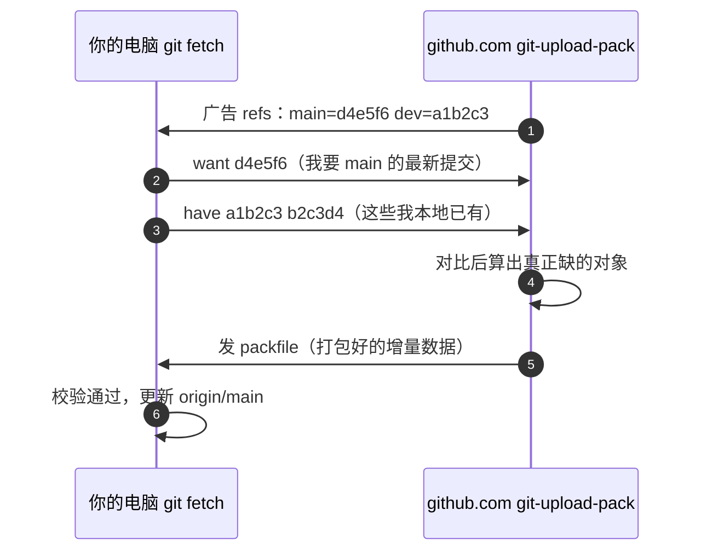

# 第19章：git pull 时究竟发生了什么

> [!TIP] Part 4: 协同交响篇（交汇篇）
> 前三个 Part 分别修好了 Git 的「内容」与 SSH 的「通道」，本篇让它们咬合运转。本章是解剖台：把每天敲十几次的 `git pull` 拆开，看清里面每一层到底跑了什么。

第18章你学会了顺着 Permission denied 一层层往下挖，挖到最后你会发现，所有线索都汇进同一个时刻：敲下 `git pull` 回车之后的那几秒钟。这条你每天都在用的命令，对多数人来说是个黑盒——知道它「会把远程的最新代码弄下来」，却说不清它是怎么弄下来的。

黑盒的代价很实际：fetch 卡住时不知道卡在哪一层；push 被拒时不知道是谁拒绝的；看到 `remote rejected` 更是一头雾水。本章把黑盒拆成六步接力，拆完之后你会发现，第 4-6 章的 SSH 知识和第 7-12 章的 Git 知识，原来是同一台机器上咬合的两个部件。而且这六步是后面三章的地基：第 21-23 章的自建服务器、钩子与自动部署，全都站在本章的流水线上。

## 19.1 一个熟悉的黑盒

先用 30 秒诚实地盘点一下。大多数人对 `git pull` 的全部认知是一句话：「把 GitHub 上最新的代码拉到本地」。日常够用，但出了问题就抓瞎——因为你不知道这条命令背后是一条流水线，而不是一个动作。顺手自测：fetch 和 pull 的区别，你现在能一句话说清吗？答不上来，正是本章的价值所在。

真实的过程是六步接力，每一步都可能出岔子，每一步也都有对应的排查手段：

```text
$ git pull
   │
   ├─ 1. 读 config：origin 的 URL 是什么   ← 19.2
   ├─ 2. URL 是 SSH 形式？拉起 ssh 子进程  ← 19.3
   ├─ 3. ssh 完成双向认证，建立加密通道    ← 第4-6章
   ├─ 4. 服务端 git-upload-pack 与你对话   ← 19.4-19.5
   ├─ 5. 收到数据包，更新远程跟踪分支
   └─ 6. 把 origin/main 合并进当前分支     ← 19.6
```

这条流水线是双向复用的：push 走的也是同一条路，只是方向反过来——第 4 步换成了 git-receive-pack，第 6 步换成了「让服务端的 refs 前移」。所以本章看似在讲 pull，其实把 push 也一起讲透了——看懂了拉，推不过是同一盘磁带的 B 面。

排错时这张表能立刻定位方向：

| 卡住的症状 | 大概率在哪一站 | 第一件该做的事 |
|-----------|---------------|---------------|
| 连接阶段就失败 | 2-3 站（通道） | `ssh -v` 手动连一次服务器 |
| 传输极慢但仍在走 | 6 站（对象确实多） | 看输出里的对象计数，正常等 |
| ! [remote rejected] | 7 站（门禁） | 读回传的 remote: 文字 |
| 冲突与报错在本地 | 第 6 步合并 | 走第10章的冲突流程 |

本章的小节编号就挂在这条流水线上。先从第一步开始：那条神秘的远程地址，到底是什么。

## 19.2 解剖 remote URL

第2章配置过 `user.name`，第13章给服务器起过别名，但 origin 的地址你可能从来没细看过。这一节也让你第一次用服务端的眼光打量地址——从这起，远程不再是一个笼统的「网上」。在 `~/cloudnote` 里敲一条命令：

```bash
git remote -v
  # origin  git@github.com:cloudnote/cloudnote.git (fetch)
  # origin  git@github.com:cloudnote/cloudnote.git (push)
```

`git@github.com:cloudnote/cloudnote.git` 这串字符信息密度很高，拆开看是四段：

```text
git@github.com:cloudnote/cloudnote.git
 │       │          │
 │       │          └─ 路径：仓库在服务器上的位置
 │       └─ 主机名：连谁
 └─ 用户名：以「git」这个账号的身份登录
```

这种 `user@host:path` 的写法叫 **SCP 风格语法（SCP-style syntax）**，因为它长得像 scp 拷文件用的地址。三个细节值得圈出来：

- 它没有写协议名，但 **SCP 风格写法本身就约定为 SSH**——这是 git 的默认解释。
- 用户名是 `git` 而不是你的 GitHub 账号。GitHub 服务器上真的有一个叫 `git` 的系统账号，全球开发者都用它登录，身份区分完全靠密钥（第20章会看到 GitHub 怎么把密钥映射回你的账号）。
- 这串地址原样存放在 `.git/config` 的 `[remote "origin"]` 段里。用 `git remote get-url origin` 可以单独取出它；origin 只是约定俗成的名字，叫别的也行——它本质上只是 config 里的一个键。别名与 URL 是两个概念：前者只在本机 config 生效，改别名不动仓库，换仓库不改别名。

对比 HTTPS 形式的同一个仓库：`https://github.com/cloudnote/cloudnote.git`——写明了协议、没有用户名段（认证在 HTTP 层完成，第20章细说）、路径直接跟在主机名后面。还有一种等价的完整写法 `ssh://git@github.com/cloudnote/cloudnote.git`，与 SCP 风格殊途同归。它比 SCP 风格多做一件事：能显式带端口号，例如 `ssh://wang@203.0.113.10:2222/srv/git/cloudnote.git`——第17章改过 sshd 端口时只有这条路能走，SCP 风格里塞不进端口，这个限制第21章会再次遇到。

git 能走的所有传输方式一共四类：

| 传输方式 | 地址形式 | 端口 | 加密 | 现状 |
|---------|---------|------|------|------|
| SSH | git@github.com:org/repo.git | 22 | 有 | 日常开发首选 |
| HTTPS | https://github.com/org/repo.git | 443 | 有 | CI 与受限网络常用 |
| 本地路径 | /srv/git/cloudnote.git | 不联网 | 无 | 同机备份、挂载盘 |
| git:// | git://host/org/repo.git | 9418 | 无 | 明文无认证，已淘汰 |

git:// 是 git 自带的「原生协议」：历史上速度最快，但完全不加密、不认证，同网段的任何人都能窃听篡改。GitHub 已于 2022 年 3 月彻底关停它。反例摆在这里就是为了加深印象：**今天可选的远程传输只剩 SSH 与 HTTPS 两个活口**，恰好对应第4章讲过的关系——同一件事，两套互不相通的加密体系。

初学者最常见的错位是把两种地址混着记：用 SSH 地址却没登记钥（Permission denied），用 HTTPS 地址却等着免密（弹窗要密码）——先看地址形式，再谈排查，顺序别反。

## 19.3 外包机制：git 拉起 ssh 子进程

接下来是个反直觉的事实：**git 自己完全不懂加密**。面对 SSH 形式的 URL，git 的做法不是内置一套 SSH 实现，而是把传输整段外包——拉起一个 ssh 子进程，把认证、加密、建通道全部委托给系统里的 ssh 命令，自己只负责在通道上讲 git 协议。

这个设计有两层好处。第一，SSH 体系日新月异，git 不必跟着重造轮子；第二，也是对你最实惠的一层：第 13-14 章学的一切——config 别名、指定密钥、agent 免输密码——git 一概直接受益，因为真正干活的 ssh 根本不关心这次调用是不是 git 发起的。Git Bash、Linux、macOS 都自带 ssh 命令（`ssh -V` 可查版本），所以这个外包在三大平台上无缝成立。Windows 下 Git Bash 自带的 ssh 与 Linux 版行为一致，本章所有实验在两种环境下输出可复现。这个机制也解释了一个日常现象：为什么 git 的报错里偶尔混着 ssh 的报错样式——因为报错的本来就是 ssh，git 只是替它传话。

想亲眼确认这个「外包」，用环境变量让子进程的 ssh 开唠叨模式：

```bash
GIT_SSH_COMMAND="ssh -v" git fetch
```

输出会被大量 debug1 行刷屏，挑三行关键的（已截断）：

```text
debug1: Connecting to github.com [140.82.121.4] port 22.
debug1: Offering public key: ~/.ssh/id_ed25519 ED25519 SHA256:AbCd...
debug1: Sending command: git-upload-pack 'cloudnote/cloudnote.git'
```

逐行看：第一行证明连的是 sshd（第17章）；第二行证明认证用的是第5章生成的公钥私钥；第三行最有意思——git 通过 ssh 的 exec 请求，请服务器执行 `git-upload-pack` 这个程序。**「git 把传输外包给 ssh」不是比喻，是一条抓得到现场的子进程**。

> [!TIP] 给某个仓库换专用密钥
> 除了写 ~/.ssh/config（第13章），git 还有自己的入口：`git config core.sshCommand "ssh -i ~/.ssh/cloudnote_key"`。它同样只是换个地方给 ssh 传参数，没有任何魔法——但配置写在仓库的 .git/config 里，只对这个仓库生效，适合「公司仓库与个人仓库用不同钥」的场景。历史上还有个只能放命令不能带参数的老变量 GIT_SSH，如今统一用 GIT_SSH_COMMAND 即可。

## 19.4 服务端的两兄弟

刚才的 debug 输出里出现了 `git-upload-pack`。服务器上的 sshd 验完你的身份后执行这个程序，git 的服务端就开工了。服务端只有两个主角，按读写分家：

| 场景 | 服务端进程 | 干什么 |
|------|-----------|--------|
| clone / fetch / pull | git-upload-pack | 应答「我想要哪些提交」的请求，打包发货 |
| push | git-receive-pack | 接收客户端推来的新对象，验收入库 |

命名容易拧巴，记住视角就好：**这两个名字都是站在服务器说的**。upload-pack 是「往客户端上传」的打包员，所以服务 fetch；receive-pack 是「从客户端接收」的收货员，所以服务 push。

这两个程序不是 GitHub 的私有黑盒——它们随你本机安装的 git 一起就装好了，第21章你会在自己的服务器上亲手调用它们，届时可以发现 GitHub 的服务端毫无神秘之处。顺手记一个事实：fetch 与 push 共用同一个 22 端口、同一个 sshd——服务端只有逻辑上的分家，没有端口上的分家。现在绕过一切客户端封装，直接对 GitHub 的服务端喊话：

```bash
ssh git@github.com "git-upload-pack 'octocat/Hello-World.git'"
```

（如果你的公钥还没登记到 GitHub，这条命令会得到 Permission denied——第20章补上这一步；也可以先跳过，等第21章在自己服务器上做同样的实验。）

正常情况下，你会看到一份原始的「refs 广告」，形如：

```text
00e8e1674596e5d823e5b28c8d825c6c8a2e1a9c HEAD\0multi_ack thin-pack side-band ...
003ce1674596e5d823e5b28c8d825c6c8a2e1a9c refs/heads/master
003de1674596e5d823e5b28c8d825c6c8a2e1a9c refs/pull/352/head
0000
```

（哈希做了截断示意，真实的值每次连接都不同，且无泄密风险——这只是公开引用的名单。）

顺便回答一个安全问题：refs 广告公开的是「有哪些引用」的名录，不含任何对象内容——真正的数据要等你报出 want 才打包。所以这个实验把仓库的门牌号摊开给你看，却不会泄露任何提交内容。

逐行解读这份「菜单」：

- 每行开头的 4 个十六进制字符是这一行的总长度（按字节算，含这 4 个字符本身），例如 `003c` 就是 60 字节。这种自带长度的行格式叫 pkt-line，是 git 传输协议的最小积木。
- 第一行把 HEAD 指向的默认分支与服务器支持的能力列表（multi_ack、thin-pack、side-band……）一并广告出来。其中 side-band 指「数据与进度提示走不同子通道」，所以你在 fetch 时能同时看到进度条和对象计数。
- 中间各行是服务器上全部引用（ref）：分支、标签、PR 的临时分支，清一色摆出来供你挑选。服务器支持的能力清单则决定了客户端能请求哪些高级特性，比如 thin-pack 的增量打包。
- 最后一行 `0000` 长度为零，是结束哨兵，行话叫 flush-pkt——「菜单报完了，请点菜」。

**协议还有个 2.0 版。**细究的话，新版 git 与 GitHub 之间默认走协议 v2：客户端先声明「我要哪个操作的 v2 服务」，refs 广告变成按需询问。骨架没变，只是菜单从「一次全报」变成了「点哪道报哪道」。本节实验里你看到的是最经典的 v0 广告，最适合看清原始样貌。

顺手把话筒反过来看一眼——你报回去的 want/have 长这样（同样截断示意）：

```text
0032want e1674596e5d823e5b28c8d825c6c8a2e1a9c
0032have a1b2c3d4e5f6a7b8c9d0e1f2a3b4c5d6e7f8
0000
```

还是 pkt-line 积木，还是 flush-pkt 收尾——客户端和服务端说的是同一套语言。

实验时看完菜单按 Ctrl+C 退出即可。服务端报完菜单后会一直等你报 want 清单——这正是下一节的话题。

## 19.5 git 协议对话

拿到菜单后，客户端与服务端开始谈判。整段对话可以画成一张时序图：



图里的序号就是对话轮次——六次往返，一次 fetch 完毕。三个词值得点名：

- **refs 广告（advertisement）**：服务器先报家底，你才知道有什么可要。
- **want / have 协商**：客户端声明「我要什么、我已有什么」，双方只在差集上做文章。
- **packfile（打包文件）**：协商出的对象被压缩打包成一整股流传回，而不是一个文件一个文件地要。

差集有多大，图比话直观：

```text
服务端家底：a1 ── a2 ── a3 ── a4 ── a5（main 顶端）
客户端已有：a1 ── a2 ── a3
                 ▲
     have a1 a2 a3 │ want a4 a5
     实际传输只有 a4、a5 两个对象
```

这套「先报家底、再按差集传输」的设计，行话叫**智能协议（Smart Protocol）**。它的反面是早期的哑协议（Dumb Protocol）：服务端不参与对话，客户端只能像下载网页一样把对象文件逐个 GET 回来，一个字节都省不下来。哑协议没有完全消失——把裸仓库目录往 HTTP 服务器后面一放就是它，但你不会想用它；知道它的存在，才明白「对话」二字的分量。正反对比摆在一起，才能看出协商的价值——而协商能成立的前提，是第9章讲过的对象模型：每个对象都有唯一哈希，双方才能精确对账「你有我没有」。

智能协议能省多少？做两个对照。其一：云笔记阶段 3 的仓库已达 1.2GB（含图片素材），首次 clone 要实打实传 1.2GB，但同事推了 3 个提交、改了 5 个文件之后你 fetch 一次，实际传输通常只有几十 KB——**传输量与仓库总量无关，只与你缺的东西有关**。其二：fetch 只传差集，push 同理，receive-pack 侧的反向协商只收服务端没有的对象。这就是 want/have 协商的全部意义。对话的收尾同样严谨：客户端收到的 packfile 里，每个对象都带着第9章讲过的内容哈希，逐个校验通过才更新 refs——传输层再可靠，Git 也不放弃内容层的自查。

## 19.6 fetch 与 pull 的关系

传输拆完了，回到流水线的第六步：数据都到本地了，怎么进你的分支？这就是 pull 与 fetch 的分野：

> **pull = fetch + merge**（或者按配置换成 rebase，见第10章）

fetch 只做 19.2-19.5 的事：把远端新对象取回来，更新一个叫 `origin/main` 的**远程跟踪分支（Remote-Tracking Branch）**——它是本地记录「上次看到远端 main 在哪」的只读书签，存在 `.git/refs/remotes/` 下（第9章说过，refs 就是文件）。fetch 会把所有跟踪分支一次性刷新，`git branch -r` 能看到这份名单。fetch 之后，你的工作区一个字节都不会变。想验证「只读书签」的分量？fetch 前后各看一次这个文件：

```bash
cat .git/refs/remotes/origin/main
  # 输出一个 40 位哈希——所谓远程跟踪分支，就是一个普通文件
```

| 命令 | 做到哪一步 | 工作区会变吗 |
|------|-----------|-------------|
| git fetch origin | 取回对象，更新全部远程跟踪分支 | 不会 |
| git pull origin main | fetch + 把 origin/main 合并进当前分支 | 会 |
| git clone | 首次 fetch + 建立跟踪关系 | 会（初始化） |

所以「pull 出了问题」永远可以拆成两个独立问题：fetch 出了问题（沿 19.2-19.5 的链路查），或 merge 出了问题（走第10章的冲突流程查）。分层之后，每个问题都有了明确的排查路径。

资深用户的日常工作法是把 pull 拆开用：

```bash
git fetch origin                     # 只取回，不动工作区
git log HEAD..origin/main --oneline  # 远端领先了哪些提交
git diff HEAD...origin/main --stat   # 那些提交会碰哪些文件
git merge --ff-only origin/main     # 能快进就快进，分叉就停下来人工处理
```

三段式可以画成一条最短的工作流：

```text
git fetch ──► git log / git diff ──► git merge --ff-only
  只取回        看远端改了什么           看清了才合并
```

`HEAD..origin/main` 表示「origin/main 能到、而 HEAD 到不了的提交」；`--ff-only` 表示只允许快进合并，历史一旦分叉立即报错退出，绝不偷偷造出 merge 提交。反例是闭眼敲 `git pull`：合并悄悄发生，冲突淹没在噪音里，事后连「远端到底改了什么」都说不清。**先看清楚，再动手合并——两段式把知情权和决定权都留在你手里**，这在阶段 2 的双机同步里就是保住午饭时间的关键习惯。两段式还有个隐藏福利：fetch 是幂等的，多敲几次毫无成本，拿不准的时候先 fetch，永远不会错。

> [!WARNING] 别闭着眼 pull
> 裸敲 `git pull` 在双方都有新提交时会自动造 merge 提交；配上 `pull.rebase` 配置还会自动 rebase。默认行为不算错，但「不看内容先合并」会在阶段 3 的三人协作里埋雷。先 fetch、后合并的两段式，是把意外挡在合并之前的最低成本手段。

两个收尾的实用点：其一，从 Git 2.34 起，本地与远端各有新提交时，裸敲 `git pull` 会被直接拦下，提示你显式选择 merge 还是 rebase——官方也认为「默认替你做主」不妥；想一步到位可以让 `git config --global pull.ff only` 成为默认纪律，分叉时自动停手。其二，与「只传差集」同源的还有浅克隆（Shallow Clone）：`git clone --depth 1` 只取最近一层历史，CI 环境用它省下 1.2GB 仓库的全量下载，日后需要完整历史时 `git fetch --unshallow` 补齐即可。其三，pull 的两段式习惯与第21章的自建服务器是天作之合：那时你会发现 fetch、merge 的每一段日志都看得清清楚楚，因为这条流水线的每一站，你已经全认识了一遍。

## 本章小结

- `git pull` 是六步接力：解析 URL → 拉起传输子进程 → ssh 认证加密 → 服务端应答协商 → 更新远程跟踪分支 → 本地合并；push 走同一条路，方向相反
- SCP 风格 URL（git@host:path）默认就是 SSH；git:// 协议明文无认证已被淘汰，现役传输只剩 SSH 与 HTTPS
- git 不懂加密，SSH 传输整段外包给 ssh 子进程；`GIT_SSH_COMMAND` 与 `core.sshCommand` 是控制它的两个入口
- 服务端只有两个进程：fetch 找 git-upload-pack，push 找 git-receive-pack，名字都站在服务器视角
- pkt-line 是 git 传输协议的最小积木，refs 广告以 flush-pkt（0000）收尾
- refs 广告 → want/have 协商 → packfile 传输，这套对话叫智能协议，传输量只取决于你缺什么
- fetch 只更新 origin/main 这类远程跟踪分支，不碰工作区；pull = fetch + merge（或 rebase）
- 先 fetch 再 `--ff-only` 合并的两段式工作法，把知情权和决定权留在自己手里

**下一章预告**：你已经看清 GitHub 在协议层的样子——它跑的正是 upload-pack 与 receive-pack。下一章正式搬进 GitHub：登记公钥、看穿 `ssh -T` 不给 shell 的原因，并跑通三人协作的 Pull Request 全流程。

---
