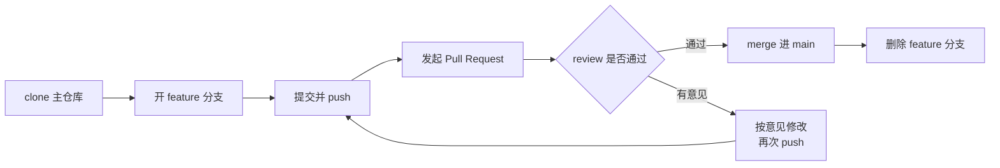

# 第20章：GitHub：登记公钥到多人协作

> [!TIP] Part 4: 协同交响篇（交汇篇）
> 上一章解剖了 pull 的管道，本章把管道接进全球最大的协作平台：登记公钥、看懂服务端如何锁死你的权限范围，最后让云笔记进入阶段 3，跑通三人 Pull Request 协作。

第19章结尾你本想亲手对 GitHub 的服务端喊话，但如果你还没登记过公钥，得到的只有一句 Permission denied——这道门，本章来开。开完门你会发现一件轻松的事：前面十几章的知识几乎原封不动地全部适用，因为 GitHub 在传输层就是一台标准的 git 服务器。

本章回答三个递进的问题：GitHub 到底是什么？`ssh -T git@github.com` 为什么认证成功却不给你 shell？以及最重要的——三个人怎么在同一个仓库里干活而不互相踩脚。本章没有新知识，只有新连接：把已经认识的每一站，接进一个真实的协作平台。

## 20.1 GitHub 是什么，不是什么

先把最容易混的一层窗户纸捅破：**GitHub 不是 git**。git 是版本控制工具，第 1-12 章的所有操作全程没联过网；GitHub 是一家公司运营的托管平台。两者关系像「编辑器」与「代码托管网站」一样分明。

同样要分清的是「托管」与「备份」：GitHub 确实替你保管着仓库，但它保管的是**版本库本体**（第1章说的 .git 内容），工作区、未提交的修改、没 push 的提交都不在它那里。云笔记阶段 3 的仓库 1.2GB（含图片素材），GitHub 上是这 1.2GB 的完整历史；而你本地工作区里那份还没 commit 的草稿，GitHub 一无所知。**push 不是备份的全部，commit 才是备份的最小单位**——这是第1章「小步提交」习惯在远端世界的回声。

记住这点，你会少犯「本地改完没 commit 就重装系统」的经典悲剧。

那 GitHub 服务器上跑的是什么？第19章已经揭晓了一半：你 fetch 时它跑 git-upload-pack，你 push 时它跑 git-receive-pack——**就是随 git 一起发布的那两个标准程序**。剩下的部分才是 GitHub 的增值层。从下往上看这台服务器：

```text
┌────────────────────────────────────────────┐
│ 协作层：Pull Request、Issue、Review、通知    │
├────────────────────────────────────────────┤
│ 平台层：网页、API、权限管理、Actions         │
├────────────────────────────────────────────┤
│ git 服务：upload-pack / receive-pack        │
├────────────────────────────────────────────┤
│ 通道层：sshd(22 端口) 与 HTTPS(443 端口)     │
└────────────────────────────────────────────┘
```

拿掉上面两层，GitHub 就退化成「一台你没法 ssh 登录的裸仓库集群」——第21章你会亲手造一台这样的机器，到时候再回头看这张图，每一层都对得上号。

记住这个定位还有个实际好处：**排查 GitHub 问题永远先分层**。同一个「push 失败」，三种病因分属三层：22 端口连不上或密钥被拒，是通道层，用第18章的分层法；`non-fast-forward` 被拒，是 git 层，远端历史比你新，fetch 看看再并（第19章）；`protected branch hook declined`，是平台层，分支保护在拦你（第22章）。多数人卡壳，是因为把三层问题搅在一起猜。通道不通走 SSH 的手册，历史分叉走第19章的流程，规则拦截走第22章的设置——本章先解决第一层的门票问题：把你的公钥交给 GitHub。

## 20.2 登记：把公钥写进 GitHub

登记路径（2026 年的界面）：GitHub 页面右上角头像 → Settings → 左栏 Access 区的 SSH and GPG keys → New SSH key。三步填完：

1. Title 随便起，但建议写清设备与用途，如 `macbook-air-dev`——将来丢设备时好定位该吊销哪把。
2. Key type 选 Authentication Key（用于 git 传输认证；Signing Key 是给提交签名的，另一码事）。
3. 把 `cat ~/.ssh/id_ed25519.pub` 的**完整输出**粘进 Key 框，保存。

等一下，把公钥传上去，安全吗？安全，而且这正是第5章定下的分工在发挥作用：**公钥本来就是拿来公开的锁，私钥才是绝不出门的钥匙**。你翻遍 GitHub 的设置页也找不到一个「上传私钥」的输入框——凡是让你粘私钥的地方都是钓鱼。上传公钥这个动作的泄露风险是零。

两个实践细节：其一，保存后 GitHub 会显示这把钥的 SHA256 指纹，和本地 `ssh-keygen -lf ~/.ssh/id_ed25519.pub` 的输出对一下，确认粘的是对的钥（这个「双方核对指纹」的动作，和第6章核对服务器指纹是同一件事的两个方向）：

```bash
ssh-keygen -lf ~/.ssh/id_ed25519.pub
  # 输出形如 256 SHA256:AbCd... 注释 (ED25519)，与 GitHub 页面显示值比对
```

其二，每台常用设备各生成各的钥、各登记一条，别把一把私钥拷来拷去——设备一多，私钥的行踪就失控了。算法沿用第5章的推荐：Ed25519，短、快、安全。

登记完立刻验证：

```bash
ssh -T git@github.com
```

看到的输出应该长这样：

```text
Hi cloudnote-dev! You've successfully authenticated, but GitHub does not provide shell access.
```

两个观察点：第一，GitHub 认出了你是 cloudnote-dev——它把密钥指纹映射回了你的账号；第二，它明确说**不提供 shell**。这不是故障，是精心设计，下一节拆解。另外这条命令的退出码是 1，别被 `echo $?` 吓到，GitHub 故意的。把这条命令记进工具箱：`ssh -T` 是 GitHub 官方的连通性测试，今后任何「是不是 GitHub 挂了」的疑问，先用它测通道，再怀疑人生。换新电脑、重装系统之后的第一件事，也是跑这一条——三秒钟知道钥匙对不对。

> [!NOTE] 验证不通先分层
> 如果得到 Permission denied (publickey)，别急着换钥：在命令前加 `-v` 变成 `ssh -vT git@github.com`，看它实际掏了哪把钥（第19章的外包机制让你能直接观察 ssh），再对照第18章的分层排查法走一遍。九成的锅在客户端没掏出登记过的那把钥，比如 config 里指定了别的 IdentityFile。

## 20.3 为什么 -T 没给你 shell

第17章讲 sshd 时埋过一个伏笔：authorized_keys 的每一行前面可以挂选项。其中最有力的一个叫 **command= 前缀（forced command，强制命令）**。在你自己的服务器上，它长这样：

```text
command="git-upload-pack '/srv/git/cloudnote.git'",no-pty,no-port-forwarding ssh-ed25519 AAAAC3Nza... wang-laptop
```

机制是：带 command= 的公钥认证成功后，sshd 无视客户端想执行的任何命令，强制执行 command= 里指定的那一条。客户端喊「给我 shell」没用，喊「跑 ls」也没用——**这把钥进这道门，只能干这一件事**。末尾的 no-pty、no-port-forwarding 再把终端分配和端口转发（第15章）一并封死。把常用选项列成速查：

| 选项 | 作用 |
|------|------|
| command="..." | 认证成功后无视请求，强制执行这一条命令 |
| no-pty | 不分配伪终端，交互式登录无从谈起 |
| no-port-forwarding | 禁用 -L/-R 隧道（第15章） |
| no-agent-forwarding | 禁用 agent 转发（第14章） |

可以做个小实验加深体感：`ssh git@github.com` 后面什么命令都不带、就想要一个交互 shell，得到的仍然是那条 Hi 问候——你请求的东西在服务端被改写了，请求什么不重要，key 的配置说了算。顺手掐个表：一次 `ssh -T` 从发起到问候返回约 100-300 毫秒，背后是第4章讲过的完整握手——这笔开销每次 push 都要重付一次，是免密（第14章的 agent）如此重要的原因之一。

GitHub 干的就是这件事的等价版（用自家服务端实现）：你的公钥被映射到 cloudnote-dev 账号，服务端只放行 git-upload-pack 与 git-receive-pack 两类调用，并且每次都校验「这个账号对这个仓库有没有对应权限」。所以：

- 认证（authentication，你是谁）：靠私钥，第5章。
- 授权（authorization，你能干什么）：服务端配置说了算，与钥无关。

这就是「Hi cloudnote-dev!」和「does not provide shell access」能同时成立的原因。**公钥认证的是身份，权限边界永远由服务端画**——这句话在你第17章加固自家服务器时实践过一次，现在你看到了它在工业级平台的形态。

这个设计的深远之处在于规模：GitHub 全球的机器上都只有一个 git 系统账号，数十万把公钥排在 authorized_keys 的等价物里，每人一把、各锁各的门。一台机器、一个账号、千万种权限——靠的全是每行密钥前面的那点配置。

## 20.4 SSH 与 HTTPS 选型

第19章说过，现役传输只剩 SSH 和 HTTPS 两条路。选型不是信仰问题，是场景问题——先把两个事实摆上桌，选择自然浮现。事实一：HTTPS 走 git 时怎么认证？2021 年 8 月起，GitHub 彻底禁用了「账号密码推 HTTPS」——密码只能登录网页，git 传输必须用 **Personal Access Token（个人访问令牌，简称 PAT）**：在 Settings → Developer settings → Personal access tokens 里生成，使用时当作密码输入，配合凭据管理器缓存后就免输。事实二：token 是文本，而私钥是文件——这个差别决定了后面整张选型表。

两条路怎么选，一表看全：

| 维度 | SSH | HTTPS + token |
|------|-----|---------------|
| 认证物 | 私钥（待在你本机） | PAT（一串可随时吊销的文本） |
| 免密体验 | 配好即永久免密（第13-14章） | 凭据管理器缓存后免输 |
| 端口 | 22（可改） | 443，几乎不会被防火墙挡 |
| CI / 容器场景 | 要塞私钥文件，重 | 塞个 token 环境变量，轻 |
| 权限粒度 | 账号级，可多钥分仓 | token 可设有效期与细粒度范围 |
| 典型人群 | 日常开发的主力机 | CI 机器人、受限内网、临时脚本 |

**结论朴素：日常开发用 SSH，自动化与受限网络用 HTTPS + token**。端口是隐形分水岭——很多公司内网只放行 443，SSH 的 22 出不去，这时 HTTPS 是唯一选择；反过来，能配好 agent 的开发机，SSH 的体验最顺。

再补一个救命冷知识：GitHub 在 ssh.github.com 的 443 端口上同时提供 SSH 服务。22 端口被防火墙挡住时，在 ~/.ssh/config 里给 github.com 单独配 `Hostname ssh.github.com` 与 `Port 443`，SSH 照常可用——第13章的 config 技巧在这里直接救场。顺手自查两条路：`ssh -T git@github.com` 与 `git ls-remote https://github.com/cloudnote/cloudnote.git` 各测一遍，两条都通，你就不会被任何网络环境困住。

token 的使用也有两条纪律。一是有效期：把 90 天过期的 PAT 当成提醒而不是麻烦——令牌散落在各种环境变量与配置文件里，会过期的钥才有机会自动失效。二是最小范围：细粒度 token 可以限定到单个仓库、只放开 contents 只读权限——只读仓库的活就别签 full control 的票，生成时看清权限清单再落笔。第23章的 Deploy Key 会把这套思想推到极致。凭据缓存三大平台各有内置：macOS 钥匙串、Windows 凭据管理器、Linux 下的 libsecret，`git config credential.helper` 一查便知。

> [!TIP] 同一仓库可以同时留两条路
> GitHub 给每个仓库同时提供两种地址，用 `git remote set-url` 随时切换。常见组合是：主力机配 SSH，CI 机器人用只有只读权限的 token——后者就是第23章 Deploy Key 思想的雏形。

两条路在本章实验里都会各露一面：20.6 全程走 SSH，第23章的部署身份则把 token 思想推到仓库级。先把主力路修熟，备胎知道停在哪就行。

## 20.5 三人协作落地

工具就位，回到剧情：云笔记进入阶段 3——仓库 1.2GB（含图片素材）、累计 12000 次提交，作者 cloudnote-dev 之外多了两位笔记贡献者：阿林（lin-note）与小周（zhou-note）。两个人直接改同一分支的时代结束了，需要一套流程。

流程的全名叫 **Pull Request（拉取请求，简称 PR）**：本质是一句话——「请把我的分支合进 main」，外加挂在它上面的评审与讨论记录。完整闭环如下：



注意 G 到 C 的回环：**改完直接 push 到同一条 feature 分支，PR 会自动带上新提交**，不用重开 PR。这是评审迭代的标准节奏。评审者有三种表态可选：Comment（只留言不表态）、Approve（批准）、Request changes（要求修改）——最后一种会让 PR 处于「不可合并」状态，直到修改完成。评审的默契是对事不对人：意见落在代码上，鼓励落在 PR 里——这条与 git 无关，但决定这套流程能活多久。

三个让流程顺滑的小约定：分支命名带类型前缀，feature/export-pdf、fix/export-crash 一眼可辨；PR 描述回答三问——改了什么、为什么改、怎么验证，三问答全，评审时间减半；PR 编号全局递增（Issue 与 PR 共用同一个编号空间），所以团队里说「看下 #87」不会歧义。

把三个人拉进来的方式有两种，各有适用场景：

| 维度 | 直接协作者模式 | fork 模式 |
|------|---------------|----------|
| 加人方式 | 仓库 Settings → Collaborators 邀请 | 任何人自己 fork 一份 |
| push 权限 | 主仓库全分支 | 只能推自己 fork 里的分支 |
| PR 方向 | feature 分支 → 本仓库 main | fork 的分支 → 上游 main |
| 适合 | 团队内部、身份可信的成员 | 开源项目、贡献者不可预知 |

云笔记是三人内部团队，选直接协作者模式：cloudnote-dev 在 Collaborators 里邀请 lin-note 与 zhou-note，私有仓库邀请协作者在免费方案内即可。fork 模式留个概念就行——它把「写权限」收得更紧，代价是同步上游多一步，等你的项目开源那天再学不迟。两者还能共存：核心成员走 Collaborators，外部贡献走 fork——GitHub 上的大型开源项目就是这么混编的。

评审制度还附赠一个容易忽略的收益：知识流动。每份 PR 至少有第二双眼睛读过 diff——阿林因此知道导出模块改了什么，下次他改导出时不用从零读代码。三个人一年下来，交叉阅读就是最便宜的内部培训。

## 20.6 实验：完整走一遍 PR

空谈无益，以小周的身份把流程踩一遍（阿林当评审）。每一步都给出可核对的输出。

第一步，拿到仓库并开出功能分支：

```bash
git clone git@github.com:cloudnote/cloudnote.git ~/cloudnote
cd ~/cloudnote
git switch -c feature/export-pdf
```

clone 过程中你会看到远端在「枚举对象、计数、压缩」，那是第19章的 upload-pack 在打包发货——1.2GB 的仓库首次要实打实全量拉取：

```text
Cloning into 'cloudnote'...
remote: Enumerating objects: 24183, done.
remote: Counting objects: 100% (24183/24183), done.
Receiving objects:  62% (14994/24183), 742.10 MiB | 9.35 MiB/s
```

第二步，写代码、提交、推送：

```bash
  # 假设你改了 notes/export.js
git add notes/export.js
git commit -m "feat: 笔记导出 PDF"
git push -u origin feature/export-pdf
```

push 完 GitHub 会在网页顶端递上一张现成的 PR 创建链接，点进去填写说明、指定阿林为 Reviewer，PR 编号假设是 #87。描述就按 20.5 的三问写——评审者的第一印象定在这三行上。

第三步，评审与修改的回环。阿林在 PR 页面留了意见：「导出接口没处理空笔记，会抛异常」，点了 Request changes。小周的反应不是重开 PR，而是原地修复：

```bash
  # 修复空笔记判断
git add notes/export.js
git commit -m "fix: 空笔记导出时返回提示而非报错"
git push
```

push 一完成，PR #87 自动多出这个新提交，原来的 Request changes 状态等阿林重新看过、换成 Approve 才解除。这正是 20.5 说的回环：**分支不变，PR 自动生长**。Request changes 挂着的时候，合并按钮是灰的——谁也绕不过去，这正是下一章分支保护的思想雏形。

第四步，合并与收尾。阿林点 Merge，GitHub 给三种选项：

| 合并选项 | 历史效果 | 何时选它 |
|---------|---------|---------|
| Create a merge commit | 保留分支形状，多一个合并提交 | 想留下完整的功能脉络 |
| Squash and merge | 整个分支压成一个提交进 main | 分支里全是碎提交 |
| Rebase and merge | 提交逐个重放到 main 顶端 | 想要线性历史（第10章） |

三人小团队日常选 Squash 即可——feature 分支上的碎提交不污染 main。合并后 main 的历史是这样一段干净直线：

```text
main:     ──A──B──C( 笔记导出 PDF )──►
feature:     \__a__b__c__/   分支形状不留痕
```

合并后删掉远端 feature 分支，小周本地同步：

```bash
git switch main
git pull
git branch -d feature/export-pdf
```

最后一步 `git pull` 用第19章的眼光看：fetch 更新 origin/main，再快进合并——你的本地 main 与远端重新对齐。此时阿林想看到这个新版本，同样要 fetch 才行：**merge 只改了远端，没有人本地的 main 会自动跟着动**，这是新手常见的第二个误会。

给这次实验定四条验收标准：

- PR #87 上能看到两个提交，以及 Request changes 换 Approve 的完整记录
- main 的历史里出现 squash 后的干净提交，而不是一串碎提交
- 阿林本地 fetch 之后才能看到新代码——merge 只动了远端
- feature 分支在远端已删，本地 `git branch -a` 里不再出现

四条全过，你的协作肌肉记忆就完成了第一次完整收缩。回头看整个流程，git 层面只用了第9、10章的分支与合并知识，通道层面就是第19章的 push 对话——**新东西只有一样：围绕 PR 的协作约定**。而「约定靠自觉」终归不牢，下一章我们看怎么把它变成机器强制。

## 本章小结

- GitHub = 标准 git 本体（upload-pack / receive-pack）+ 托管与协作平台；它保管的是版本库本体，commit 才是备份的最小单位
- 排查 push 失败先分三层：通道层连不上、git 层历史分叉、平台层分支保护
- 登记公钥在 Settings → SSH and GPG keys → New SSH key；公钥本就公开，上传零风险，私钥永远不该出现在任何输入框
- `ssh -T git@github.com` 返回 Hi 账号名且不给 shell：command= 强制命令思路把每把钥限定为只能跑 git 服务程序
- 认证回答「你是谁」（私钥），授权回答「你能干什么」（服务端配置），两者永远分离
- HTTPS 走 PAT 不走密码（2021 年 8 月起）；日常开发选 SSH，CI 与受限网络选 HTTPS
- 直接协作者模式适合内部团队，fork 模式适合开源；PR 的修改迭代就是往同一条 feature 分支继续 push
- 合并三选项按需选：merge commit 留脉络、squash 收碎提交、rebase 保线性

**下一章预告**：GitHub 的协作能力很全，但数据在别人家，协作规则也未必随你定。下一章回到你自己加固过的服务器，用一条 `git init --bare` 造出属于自己的迷你 GitHub——裸仓库。

---
