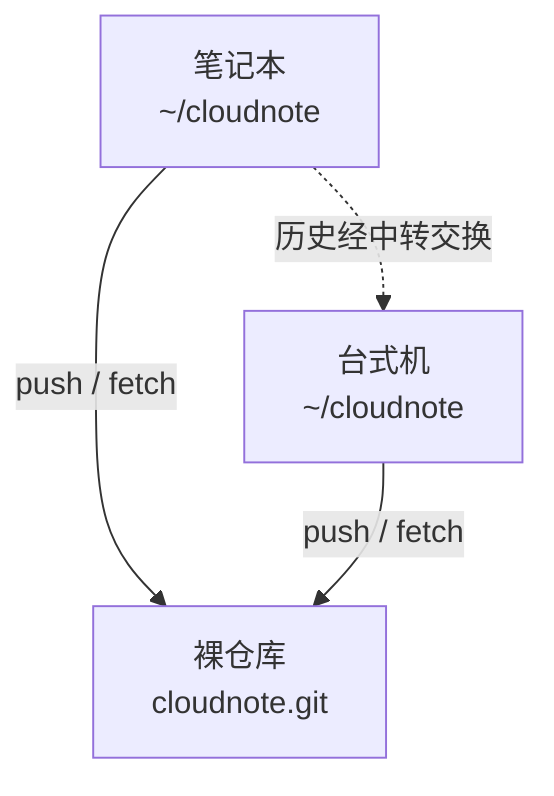

# 第21章：自建迷你 GitHub：裸仓库

> [!TIP] Part 4: 协同交响篇（交汇篇）
> GitHub 顺手，但数据在别人家、规则也未必随你定。本章回到你自己加固过的服务器，用一条 `git init --bare` 造出属于自己的迷你 GitHub——裸仓库。这也是全书里程碑 M4 的第一块砖。

第20章跑通了 GitHub 上的三人协作，但它有个绕不开的前提：仓库、账号、权限规则都长在别人的服务器上。有些东西你未必愿意交出去——云笔记阶段 2 时期的内部笔记、还没定型的实验代码、或者干脆是「我家服务器也能干这活」的不服气。

本章就来证明一件让很多人惊讶的事：**远程仓库不是 GitHub 的专利**。Git 生来是分布式的（第1章讲过，每份克隆都是完整仓库），任何一台装了 git、能被 SSH 到的机器，都是一台合格的远程。而你那台 203.0.113.10，早在第17章就加固完毕：密钥登录、最小权限、端口收紧——万事俱备，只差一个「收货员」。

## 21.1 没有 GitHub 也能有远程

回到第1章 Linus 给 Git 定的四个设计目标，其中一条是完全分布式：没有「中央服务器」这个概念上的必需品。这句话的另一面常被忽略：**任何一份仓库都可以充当别人的远程**。你的笔记本、同事的台式机、云上那台服务器，在 Git 眼里地位平等——只要有办法把对象从一台机器搬到另一台。

把标准说具体，一台机器要当远程只需满足三个条件：装了 git、对你可达（最常见的形式是 sshd 在监听，第17章）、磁盘装得下仓库。云笔记阶段 2 时仓库 80MB、阶段 3 涨到 1.2GB，一台最便宜的入门云主机都绰绰有余。反过来，U 盘当不了远程——它没有服务进程等着你连，你只能把目录拷来拷去，那正是阶段 2 灾难的源头。远程的本质是「有人应答」，不是「有块存储」。

先做思想实验：服务器上已经有一个普通仓库（第1章那种 `git init` 出来的），能不能直接把它当远程 push？动手试试，在服务器上：

```bash
mkdir ~/cloudnote-test && cd ~/cloudnote-test
git init
```

然后从本地把它加为远程并推送：

```bash
git remote add test wang@203.0.113.10:cloudnote-test
git push test main
```

你会收获一行经典报错：

```text
remote: error: refusing to update checked out branch: refs/heads/main
```

这不是 bug，是 git 在保护你。那个仓库里有工作区——`~/cloudnote-test` 目录下摊着一份「正在使用」的文件。如果你 push，它内部的 main 指针会前移，但工作区文件纹丝不动，两边的「文件」和「历史」从此对不上账，谁在那个目录里敲个 `git status` 都会看到满屏的诡异差异。git 的默认配置 `receive.denyCurrentBranch=refuse` 直接掐死了这条路。

> [!WARNING] 普通仓库不是不能当远程，是不能「裸当」远程
> 真要在有工作区的仓库上收推送，需要自己承担工作区与历史脱节的后果。正解不是调配置绕过限制，而是换一个天生为收推送而生的仓库形态——它连工作区都没有，自然无从脱节。这就是下一节的裸仓库。

## 21.2 裸仓库解剖

**裸仓库（Bare Repository）**就是「只有 .git 内容、没有工作区」的仓库。在服务器上创建它：

```bash
ssh wang@203.0.113.10
git init --bare /srv/git/cloudnote.git
```

服务器上的输出与第1章那次 `git init` 几乎一样：

```text
Initialized empty Git repository in /srv/git/cloudnote.git/
```

路径直接指向目录本体而不是目录下的 .git——区别就在这里。看它长什么样：

```text
/srv/git/cloudnote.git/
├── HEAD          → 默认分支指向（如 refs/heads/main）
├── config        → 有一行 bare = true
├── objects/      → 全部历史对象，与普通仓库完全一样
├── refs/         → 分支与标签书签，与普通仓库完全一样
└── hooks/        → 钩子脚本，第22章的主角
```

是不是眼熟？它就是把第1章那个 `.git` 目录整个端出来当了仓库本体，习惯上用 `.git` 后缀标记。两种形态放一张表里对比：

| 维度 | 普通仓库（~/cloudnote） | 裸仓库（cloudnote.git） |
|------|------------------------|------------------------|
| 工作区 | 有，能直接编辑文件 | 没有 |
| objects/ 与 refs/ | 有 | 有，内容结构完全一样 |
| git status / checkout | 正常使用 | 报错：this operation must be run in a work tree |
| git log / git show | 正常使用 | 可用，只读命令照常工作 |
| 直接 push 进去 | 被 receive.denyCurrentBranch 拒绝 | 天生就是收这个的 |
| 在协作中的角色 | 干活的机器 | 中转站与备份库 |

为什么远程不需要工作区？一句话：**没人在那台机器上编辑文件**。工作区的意义是「给人看、给人改」，而服务器上的仓库只有一个职责——可靠地收对象、存对象、发对象。砍掉工作区，脱节问题从根上消失，磁盘上也省下 1.2GB 重复文件（云笔记阶段 3 的图片素材可不是小数目）。

两个落地细节：裸仓库归推送用的账号所有（本章场景就是 wang），否则 receive-pack 写不进 objects；裸仓库里 `git log`、`git show` 这类只读命令照常可用，偶尔想核对「服务器上到底收没收到某次提交」，不用 clone，直接在服务器上查：`git -C /srv/git/cloudnote.git log --oneline -3`。

还有一个新手必踩的小坑提前拆掉。裸仓库的 HEAD 指向默认分支，若本地分支叫 main、而裸仓库的 HEAD 停在 master（取决于 git 版本与 init.defaultBranch 配置），首次 push 后最好在服务器上拨正一次：

```bash
git -C /srv/git/cloudnote.git symbolic-ref HEAD refs/heads/main
  # 把裸仓库的默认分支指向 main，此后 clone 方不会再看到空仓库警告
```

一行命令，省一小时困惑。

## 21.3 两条 push 路径

裸仓库就位，回到本地把它登记为远程：

```bash
cd ~/cloudnote
git remote add origin wang@203.0.113.10:/srv/git/cloudnote.git
git remote -v
  # origin  wang@203.0.113.10:/srv/git/cloudnote.git (fetch)
  # origin  wang@203.0.113.10:/srv/git/cloudnote.git (push)
```

这个地址又是第19章解剖过的 SCP 风格：用户 `wang`、主机 `203.0.113.10`、路径 `/srv/git/cloudnote.git`。它走的是 ssh 子进程，你的 config 别名、agent 免密照单全收。git 认识三种远程写法：

| 写法 | 形式 | 走的通道 | 适用 |
|------|------|---------|------|
| 本地路径 | /srv/git/cloudnote.git | 文件系统直读 | 同一台机器上的备份仓库 |
| SCP 风格 | wang@203.0.113.10:/srv/git/cloudnote.git | SSH | 最常用，配合 config 别名更顺 |
| 完整 URL | ssh://wang@203.0.113.10:2222/srv/git/cloudnote.git | SSH | 需要显式指定非 22 端口时 |

第17章改过 sshd 端口的话看第三行：SCP 风格写法没法带端口，此时要么换成 ssh:// 完整形式，要么用第13章的老办法——在 ~/.ssh/config 里给这台服务器起个别名并配好 Port，远程地址写 `wang@cloudnote-server:/srv/git/cloudnote.git`，别名一劳永逸。

顺带一个快捷方式：仓库已存在时不必从零 init——本地 `git clone --bare ~/cloudnote cloudnote.git` 造出带全部历史的裸仓库，再 `scp -r cloudnote.git wang@203.0.113.10:/srv/git/` 整体上传；或者反过来，直接从本地仓库 `git push --mirror` 推平所有引用与标签。两条路都能把「空仓库等首推」变成「满血仓库上岗」。

`git remote` 还有一些日常会用的管理动作：`git remote rename origin hub` 改名（本地引用一并迁移），`git remote remove hub` 删除，`git remote get-url origin` 查地址。改完这些别忘了它们只是改 `.git/config` 里的键——仓库本身毫发无损。顺便把 21.1 实验里的 test 远程清理掉：`git remote remove test`。

然后是第一次推送：

```bash
git push -u origin main
```

这个 `-u`（长写 `--set-upstream`）值得停下来讲。它做的不是传输，而是登记：把「本地的 main 跟踪 origin 的 main」写进 `.git/config` 的 `branch.main` 段。登记之后三件事自动发生——裸敲 `git push`、裸敲 `git pull` 就知道去哪；`git status` 会告诉你本地比远程领先还是落后几个提交；`git branch -vv` 能看到每条分支的跟踪对象。**首次推送加 `-u`，此后一路裸奔**，这是阶段 2 双机时代就该养成的习惯。

## 21.4 双机同步落地

裸仓库真正的用武之地是云笔记阶段 2 的剧情：笔记本 + 台式机双机写码，U 盘拷目录拷出过灾难。现在的拓扑是三点结构：

```text
   笔记本 ~/cloudnote            台式机 ~/cloudnote
     （工作区 + 版本库）            （工作区 + 版本库）
          │                              │
          │  push / fetch                │  push / fetch
          └────────────┬─────────────────┘
                       ▼
        裸仓库 wang@203.0.113.10:/srv/git/cloudnote.git
              （无工作区：中转站 + 常开的备份）
```

两台工作机互相之间**不直接对话**，都只跟中间的裸仓库同步：



日常仪式只有两条：下班前在笔记本 `git push`，到家在台式机 `git pull`；反之亦然。新手的第一次波折多半发生在这里：到家忘 push 就关机，第二天在另一台机器上 pull 发现什么都没有——排查口诀是先看 `git status` 里那句 ahead/behind（-u 登记过的成果），再决定 push 还是 pull。

更进一层的波折是 push 被拒：另一台机器推过新提交，你的 push 会得到 `non-fast-forward`。处理路径在第19章已经铺好——先 `git fetch`，再 `git log --oneline HEAD..origin/main` 看远端有什么，然后按第10章的流程 merge 或 rebase，重新 push。**冲突不在 push 那一刻解决，而在 fetch 之后、push 之前解决**，这是双机同步最重要的一条心法。

顺带回答一个自然的疑问：两台工作机能不能不经过裸仓库、直接互为远程？技术上完全可以——每台机器都装着 git 与 sshd，互加 remote 即可。但 N 台机器两两直连要维护 N×(N-1) 条路，谁重装系统谁就是断点；星型拓扑只有 N 条路，中转站还顺手当了备份。**三点拓扑不是偷懒，是结构优势**。

这套结构同时送你两份保险：**裸仓库既是中转站，也是异地备份**。笔记本硬盘坏了，台式机加服务器上有两份完整历史（阶段 2 时仓库 80MB，成本可以忽略）；哪天台式机重装系统，一条 `git clone wang@203.0.113.10:/srv/git/cloudnote.git` 就满血复活。对比 U 盘时代的三宗罪——覆盖即永别、差异靠脑补、单盘易损坏——一一对消。

想随时抽查同步状态，不必登进任何仓库目录：

```bash
ssh wang@203.0.113.10 "git -C /srv/git/cloudnote.git log --oneline -1"
  # 一条命令看清服务器收到的最新提交
```

> [!NOTE] 别忘了给裸仓库本身做备份
> 服务器是中转站，不是保险箱。最简单的做法：在服务器上加一条 cron，每天 `git clone --mirror /srv/git/cloudnote.git /backup/cloudnote.git` 或用 tar 打包到另一块盘。仓库只有 80MB 时一分钟就能配好，别等它长到 1.2GB 才想起来。

## 21.5 再看 GitHub

亲手造过裸仓库，回头再看第20章那张分层图，GitHub 的神秘感应该消散大半了：它约等于**裸仓库集群 + 认证调度 + Web 界面 + 钩子平台**。你在 GitHub 上点 New repository，本质是平台替你跑了一次 `git init --bare`；Collaborators 本质是平台帮你维护 authorized_keys 与权限表；PR 是平台在裸仓库之上加的评审工作流。

还有一个此前看不见的事实现在浮出水面：**一个本地仓库可以同时挂多个远程**。云笔记的真实形态就是如此——内部笔记推自建裸仓库，开源组件推 GitHub：

```bash
git remote add origin wang@203.0.113.10:/srv/git/cloudnote.git
git remote add github git@github.com:cloudnote/cloudnote.git
git push origin main      # 推给自建服务器
git push github main      # 推给 GitHub
```

两个远程互不知晓、互不干扰，Git 的分布式设计在这里显出全部弹性：**远程是可插拔的，不是唯一真神的座位**。

多远程带来的自由还有一个用途——搬家。换服务器时旧远程删掉、新远程加上，1.2GB 历史一次推平，业务无感。日常同步则别用 `git push --mirror`：它会把本地全部引用原样镜像过去，包括你未必想发布的实验分支，威力大，射程也大。

那么自建与托管怎么选？把账摊开：

| 维度 | 自建裸仓库 | GitHub 等托管平台 |
|------|-----------|------------------|
| 数据主权 | 全在自己服务器 | 在平台，可随时完整导出 |
| 成本 | 一台已有服务器的闲置算力 | 私有仓库免费，企业功能收费 |
| 协作功能 | 无，PR 得靠约定或第三方 | PR、Issue、Review 开箱即用 |
| 自动化自由度 | 钩子随便写（第22-23章） | 部分开放（GitHub Actions） |
| 运维负担 | sshd、备份、升级全自己扛 | 平台代劳 |

**结论按需求走**：私人项目、内网代码、对数据有完全控制诉求——自建，成本低到只有电费；需要跨团队协作、公开开源、全球化访问——托管，平台替你省下的是运维与协作功能两座山头。云笔记的路线是两者都用：内部笔记走自建裸仓库，开源组件走 GitHub，第22章的钩子与第23章的自动部署都架在自建这一侧。

## 21.6 实验：10 分钟自建私有远程

把全章动作串成一遍，每步配核对点。假设从零开始：

```bash
  # 第 1 步：服务器上创建裸仓库（约 10 秒）
ssh wang@203.0.113.10
git init --bare /srv/git/cloudnote.git
ls /srv/git/cloudnote.git     # 核对：HEAD config objects refs hooks 齐全

  # 第 2 步：本地登记远程并首次推送
exit
cd ~/cloudnote
git remote add origin wang@203.0.113.10:/srv/git/cloudnote.git
git push -u origin main       # 核对：出现 Branch 'main' set up to track

  # 第 3 步：换一个目录当「另一台机器」克隆下来
git clone wang@203.0.113.10:/srv/git/cloudnote.git /tmp/cloudnote-lab

  # 第 4 步：两端交替提交，模拟双机同步
cd /tmp/cloudnote-lab
echo "台式机的修改" >> sync-test.md
git add . && git commit -m "chore: 台式机同步测试"
git push

cd ~/cloudnote
git pull                      # 核对：sync-test.md 出现
echo "笔记本的回应" >> sync-test.md
git add . && git commit -m "chore: 笔记本同步测试"
git push                      # 核对：一次通过
```

第 2 步推送时留意输出里的对象计数与压缩行——那是 receive-pack 在收货，与第19章 fetch 时看到的 upload-pack 发货互为镜像：

```text
Enumerating objects: 24183, done.
To wang@203.0.113.10:/srv/git/cloudnote.git
 * [new branch]      main -> main
branch 'main' set up to track 'origin/main'.
```

第 4 步如果你故意不 push 就切到另一端，会复现 21.4 说的「pull 了个寂寞」，正好把排查口诀练一遍。

四个核对点全过，你就拥有了一条与 GitHub 同构、完全自有的远程链路。实验目录用完可删（`rm -rf /tmp/cloudnote-lab`），它只是台式机的替身；哪一步卡住了，就回到对应小节重走一遍——这本身就是一次微缩的排错演练。此时里程碑 M4 已经过半：push 能进了，下一章让 push 开始「守规矩」。

## 本章小结

- 远程仓库不是 GitHub 的专利：装了 git、可被 SSH 到、磁盘够用，一台机器就具备当远程的资格
- 向普通仓库 push 会被 receive.denyCurrentBranch 拒绝——它有工作区，收推送必然脱节
- 裸仓库 = 只有 .git 内容、没有工作区：objects 与 refs 齐全，只读命令照常可用，`git init --bare` 创建
- SCP 风格远程地址走 ssh 子进程；改过端口用 ssh:// 完整形式或第13章的 config 别名
- 首次推送 `git push -u origin main` 的 -u 登记上游跟踪，此后裸 push/pull 直接可用，status 能报 ahead/behind
- 双机同步的拓扑是「两台工作机 + 一台中转裸仓库」；冲突在 fetch 之后、push 之前解决
- 一个本地仓库可同时挂多个远程，自建与托管可以并存，按需求各取所长
- 裸仓库同时充当异地备份，但服务器本身也要有备份预案

**下一章预告**：裸仓库照单全收任何人推来的任何东西——阶段 3 的三人团队里这行不通。下一章给 push 立规矩：两种团队工作流、GitHub 的分支保护，以及裸仓库上的服务端钩子。

---
